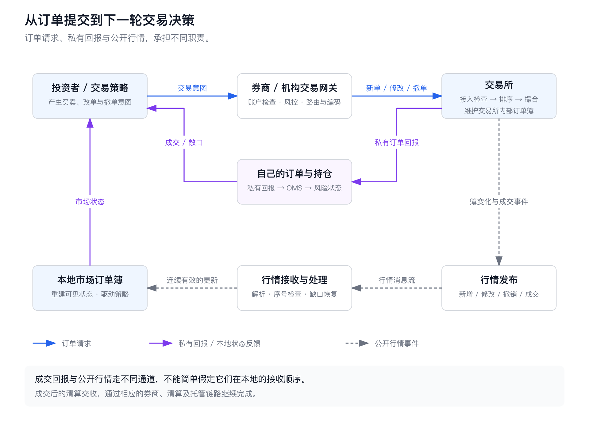
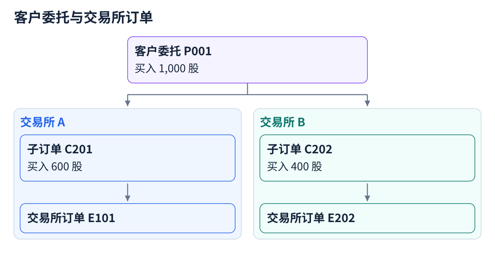
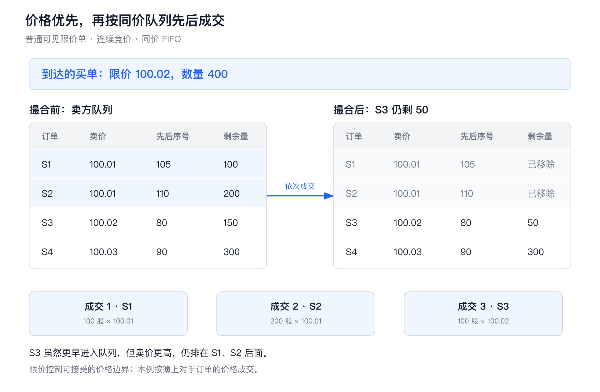
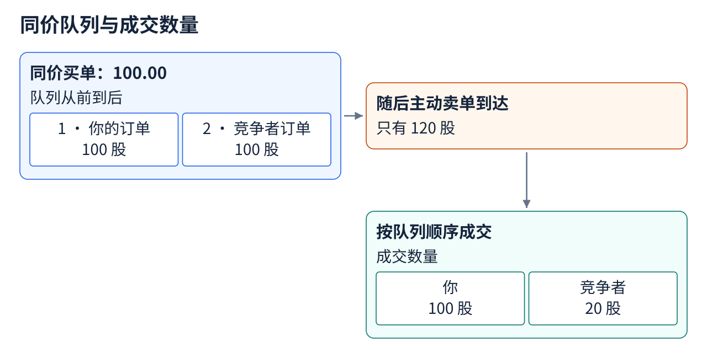
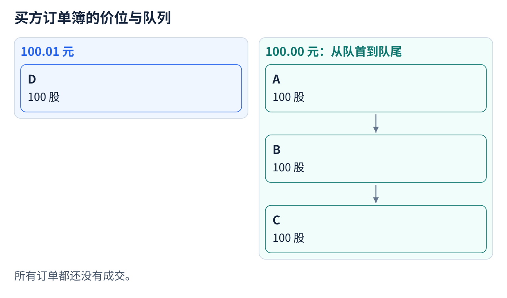
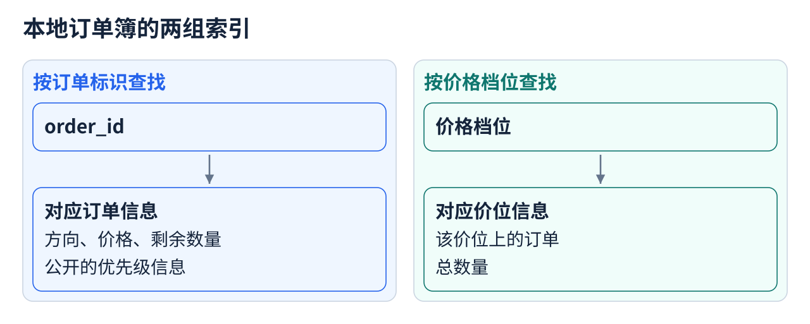
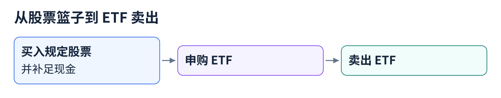
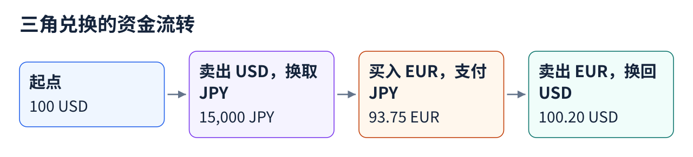
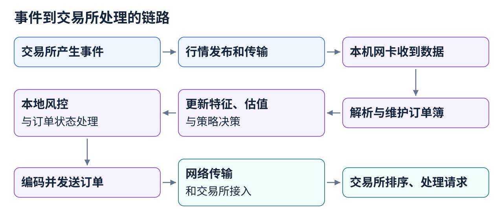
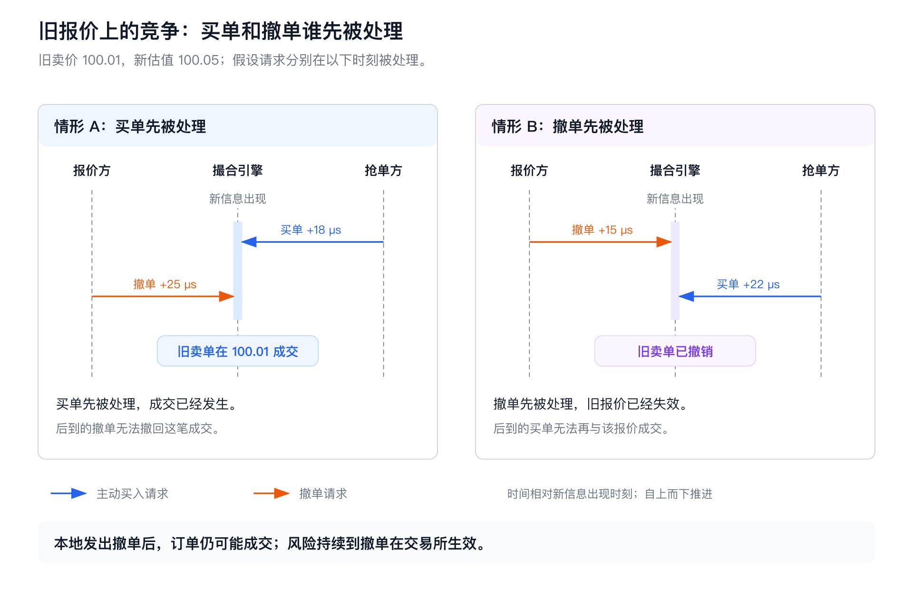

# HFT Engineering从入门到入土（1）—— 建立对于HFT的基础认识

笔者最近在学习 HFT，想用《HFT Engineering从入门到入土》这个系列记录学习过程。我会从基础知识写起，依次讨论低延迟系统设计、时钟、网络、交易所协议和 FPGA，最后搭建一套实际的交易系统。

谈到高频交易，最容易想到的是微秒级延迟、FPGA、内核旁路，以及低延迟 C++ 设计模式。理解这些技术，需要先弄清它们服务的交易过程：一笔订单怎样成交？为什么同一个价格，有的人能成交，有的人只能排队？行情里的订单簿和交易所内部的订单簿是什么关系？高频交易又在这条链路的什么位置赚钱？

这些问题会直接影响工程取舍。例如，少做一次内存分配，省下的时间就可能让订单更早进入队列、赶在价格改变前成交，或者让一笔已经不合适的报价及时撤掉。

这篇文章以**用订单簿逐笔撮合的股票与期货市场**为范围，先讲订单怎样进入市场、撮合和更新，再用交易策略解释收益从哪里来，以及执行速度为什么重要。

## 目录

- [1. 先理解一笔订单怎样进入市场](#hft01-1)
  - [1.1 一条交易链路，其实包含几条不同的消息流](#hft01-1-1)
  - [1.2 一笔订单表达了什么](#hft01-1-2)
  - [1.3 为什么订单需要本地编号和交易所编号](#hft01-1-3)
- [2. 撮合引擎如何决定谁先成交](#hft01-2)
  - [2.1 订单簿不是一张“最新价格表”](#hft01-2-1)
  - [2.2 基础模型：价格优先，同价时间优先](#hft01-2-2)
  - [2.3 “时间优先”使用谁的时间](#hft01-2-3)
  - [2.4 修改订单后的优先级](#hft01-2-4)
  - [2.5 其他常见的成交分配规则](#hft01-2-5)
- [3. 成交以后：自己的订单与整个市场，分别怎样更新](#hft01-3)
  - [3.1 发出请求、获得确认和成交，是不同的事实](#hft01-3-1)
  - [3.2 私有回报回答“我成交了什么”，公开行情回答“市场变成了什么”](#hft01-3-2)
  - [3.3 快照、增量与行情粒度](#hft01-3-3)
  - [3.4 机构怎样重建自己的订单簿](#hft01-3-4)
  - [3.5 用序号检查缺口并恢复订单簿](#hft01-3-5)
  - [3.6 有了市场行情，为什么还需要自己的订单回报](#hft01-3-6)
  - [3.7 成交与结算分别解决什么问题](#hft01-3-7)
- [4. HFT 到底在交易什么](#hft01-4)
  - [4.1 高频做市：为即时成交提供对手方](#hft01-4-1)
  - [4.2 套利：把资产之间的价差兑现](#hft01-4-2)
  - [4.3 统计相对价值：赚价格关系恢复的钱](#hft01-4-3)
  - [4.4 短期方向交易：预测接下来往哪边走](#hft01-4-4)
  - [4.5 延迟套利：利用尚未更新的可成交报价](#hft01-4-5)
  - [4.6 订单簿在这些策略中处于什么位置](#hft01-4-6)
- [5. 为什么这些交易需要极低延迟](#hft01-5)
  - [5.1 一次有效决策，需要赶在机会失效之前到达](#hft01-5-1)
  - [5.2 第一种速度价值：抢到有价值的队列位置](#hft01-5-2)
  - [5.3 第二种速度价值：让撤单先于不利成交生效](#hft01-5-3)
  - [5.4 第三种速度价值：缩短只成交一边时承担风险的时间](#hft01-5-4)
  - [5.5 第四种速度价值：减少信号在执行之前的衰减](#hft01-5-5)
  - [5.6 为什么平均快还不够](#hft01-5-6)
  - [5.7 交易机制怎样转化为工程要求](#hft01-5-7)
- [6. 从基础认识走向 HFT Engineering](#hft01-6)
- [参考资料](#hft01-references)

<a id="hft01-1"></a>
## 1. 先理解一笔订单怎样进入市场

<a id="hft01-1-1"></a>
### 1.1 一条交易链路，其实包含几条不同的消息流



*图 1：订单进入交易所后，私有回报和公开行情沿不同通道返回。*

个人投资者一般通过券商提交订单。机构可以使用券商的交易接口或直接市场接入服务；具备相应资格和连接的机构，也可以通过自己的交易网关直接接入交易所。

这条链路可以拆成四件事：

1. **订单提交**：投资者或策略给出买卖方向、数量等要求，经账户与风险检查后送往交易所。
2. **撮合与订单状态变化**：交易所接受、拒绝、挂单、成交，或者撤销订单。
3. **消息返回**：交易参与方接收自己的订单回报；行情订阅者接收市场公开的信息。
4. **本地状态更新**：机构根据回报更新自己的订单和持仓，根据行情更新本地订单簿，再决定下一步交易。

<a id="hft01-1-2"></a>
### 1.2 一笔订单表达了什么

假设我们提交：

```text
买入 XYZ，数量 400，限价 100.02，当日有效。
```

把这条指令展开，主要字段如下：

| 字段 | 本例 | 含义 |
|---|---|---|
| 标的 | XYZ | 买卖哪个证券或合约 |
| 方向 | Buy | 买入还是卖出 |
| 数量 | 400 | 希望成交多少单位 |
| 订单类型 | Limit | 限价订单 |
| 限价 | 100.02 | 买入价格不能高于 100.02 |
| 有效方式 | Day | 未成交部分可以按规则保留到当日规定的截止时间 |
| 客户订单标识 | 例如 C123 | 下单系统分配的编号，用来识别这笔订单，关联接受、成交、修改和撤销结果 |

**限价规定了可以接受的价格边界。** 如果能以 100.01 买到，限价 100.02 的买单就可以在 100.01 成交。

- **市价单与限价单**：市价单通常不指定成交限价，但仍受交易所的价格保护机制约束；限价单明确买入的最高价或卖出的最低价。
- **主动单与被动单**：主动单立即与已有挂单成交，也叫“消耗流动性”；被动单先挂在订单簿上，等待别人来成交，也叫“提供流动性”。

限价单同样可以是主动单。例如卖一价为 100.01 时，限价 100.02 的买单就具有立即成交的条件。若限价范围内的对手方数量不足，且订单允许挂单，它也可以先主动成交一部分，再把剩余部分挂到簿上。[[2]][ref2]

<a id="hft01-1-3"></a>
### 1.3 为什么订单需要本地编号和交易所编号

假设策略连续提交了两笔订单，都是“以 10 元买入 100 股”。后来收到一条“成交 20 股”的回报，成交的是第一笔，还是第二笔？价格、方向和数量都相同，订单编号才能把这条回报关联到具体委托。

“客户订单标识”中的“客户”，指的是接口的调用方。策略调用券商接口时，编号可以由策略生成；券商向交易所发单时，也可以使用券商系统生成的编号。普通投资者在交易软件里点击买入，这些编号通常由软件自动处理。

先看只有一笔订单、不涉及拆单的情况。券商为一笔待发送的订单分配本地编号 `C123`，交易所随后为它分配编号 `E987`：

| 阶段 | 券商本地记录 | 已知的交易所编号 |
|---|---|---|
| 收到买入 100 股的委托，检查账户和风险 | C123，待发送 | 尚未取得 |
| 向交易所发送订单，等待交易所回报 | C123，已发送、待确认 | 尚未取得 |
| 收到交易所接受订单的回报 | C123，已接受；保存 C123 与 E987 的对应关系 | E987 |
| 收到这笔订单成交 20 股的回报 | 找到 C123，更新为已成交 20 股、剩余 80 股 | E987 |

系统之间按双方约定的协议交换消息。协议规定用什么消息表示下单、回报里包含哪些字段，以及每个字段的含义。例如，**OUCH 是 Nasdaq 提供的订单协议**，交易参与方通过它提交、修改和撤销订单，并接收自己订单的接受、成交等回报。[[5]][ref5]

OUCH 的订单接受消息同时包含发送方提供的 `UserRefNum` 和交易所分配的 `Order Reference Number`，发送方据此建立对应关系；后续成交消息通过 `UserRefNum` 关联订单。[[5]][ref5]

通过券商下单时，通常由券商的订单管理系统或交易网关保存两种编号的对应关系。机构直连交易所时，这项工作由机构自己的系统完成。如果策略、券商和交易所各自使用一套编号，中间就会有多层对应关系。

**拿到交易所编号之前，系统就用本地编号跟踪订单。** 检查资金、记录所属账户和策略、等待交易所回复，都通过本地编号关联到具体订单。如果因资金不足被券商拒绝，系统仍可用本地编号记录这笔委托及拒绝原因。

一笔客户委托还可以拆成多笔交易所订单。例如券商把“买入 1,000 股”拆开，分别发往两个交易所：

[](assets/hft-01/text-parent-child-orders.png)

券商既要分别跟踪两个子订单，也要把它们的成交汇总到 P001。单独一个交易所编号，无法代表整笔客户委托。

Nasdaq 的 `Order Reference Number` 在当日唯一。跨市场、跨日期保存订单时，同时记录交易所和交易日，才能避免混淆。[[5]][ref5]

另一种常见协议是 **FIX（Financial Information eXchange）**，它是机构、券商和交易所之间通用的金融交易消息标准，约定了下单、撤单、订单回报等消息及字段的含义。[[22]][ref22]

FIX 的撤单请求还可以携带接收方分配的 `OrderID`，用来指定要撤销的订单。[[21]][ref21]

<a id="hft01-2"></a>
## 2. 撮合引擎如何决定谁先成交

<a id="hft01-2-1"></a>
### 2.1 订单簿不是一张“最新价格表”

订单簿，即 Limit Order Book，简称 LOB，记录的是尚未成交、仍然有效的买卖订单。

买方希望价格越低越好，但为了优先成交，可以报出更高的买价；卖方正好相反。当前最高的买价称为 **Best Bid**，最低的卖价称为 **Best Ask / Offer**。

例如：

| 买方数量 | 买价 Bid | 卖价 Ask | 卖方数量 |
|---:|---:|---:|---:|
| 300 | 100.00 | 100.01 | 300 |
| 500 | 99.99 | 100.02 | 150 |
| 800 | 99.98 | 100.03 | 300 |

这里的买卖价差是：

```text
spread = best_ask - best_bid = 100.01 - 100.00 = 0.01
```

想立即买入，就要与卖方的挂单成交；想立即卖出，就要与买方的挂单成交。最新成交价记录上一笔交易的价格，当前可成交价格则由订单簿上的买卖报价决定。

表中 100.01 上的 300 股可以来自多个订单。撮合时，交易所还要决定同一个价格上的订单谁先成交。

<a id="hft01-2-2"></a>
### 2.2 基础模型：价格优先，同价时间优先

先只考虑普通、可见的限价订单，并假设采用价格—时间优先规则：

1. **价格更优的订单先成交**：买单价格越高越优先；卖单价格越低越优先。
2. **价格相同时，先取得队列位置的订单先成交**：这就是 FIFO，先入先出。[[2]][ref2]

把刚才各个卖价下的订单展开来看：

| 订单 | 卖价 | 剩余数量 | 取得队列位置的先后序号 |
|---|---:|---:|---:|
| S1 | 100.01 | 100 | 105 |
| S2 | 100.01 | 200 | 110 |
| S3 | 100.02 | 150 | 80 |
| S4 | 100.03 | 300 | 90 |

虽然 S3 比 S1 更早进入订单簿，但它的卖价更高，所以仍排在 S1、S2 后面。

现在，限价 100.02、数量 400 的买单到达：



*图 2：先比较价格，再比较同一价格内的队列顺序；一笔主动订单可以产生多笔成交。*

成交过程如下：

| 步骤 | 与谁成交 | 成交数量 | 成交价格 | 买单剩余 |
|---|---|---:|---:|---:|
| 1 | S1 | 100 | 100.01 | 300 |
| 2 | S2 | 200 | 100.01 | 100 |
| 3 | S3 | 100 | 100.02 | 0 |

最终 S1、S2 全部成交，S3 剩余 50，S4 不变。买单分三次成交，平均成交价为 100.0125。

在这个普通限价单模型里，成交使用簿上已有订单的价格。因此，限价 100.02 的买单可以先以 100.01 买入。[[3]][ref3]

再把买单数量改成 500，**从同一初始订单簿重新计算**：100.02 及以下总共只有 450 股可买。买单不能继续与 100.03 的卖单成交，因为那会超过限价。

剩余 50 股如何处理，取决于有效方式：

- **允许挂单的订单**：剩余部分可以在 100.02 排进买方队列。
- **IOC，立即成交否则取消**：先成交可成交的部分，剩余部分取消。
- **FOK，全部立即成交否则取消**：整个数量必须立即成交，否则整笔取消。

<a id="hft01-2-3"></a>
### 2.3 “时间优先”使用谁的时间

时间优先使用**交易所赋予订单的排序时间**。从客户端发单到进入交易所队列，中间还有网络和接入处理的耗时：

```text
甲：本地 10:00:00.000000 发单，链路耗时 80 微秒
乙：本地 10:00:00.000010 发单，链路耗时 20 微秒
```

即使两台机器的时钟完全同步，后发单的乙也可能先进入交易所的订单队列。

例如，CME 撮合引擎按接收顺序处理下单、改单和撤单请求。[[19]][ref19]

在 FIFO 队列里，排队位置会直接影响成交量：

[](assets/hft-01/text-fifo-fill-quantity.png)

如果队列位置反过来，你就只能成交 20 股。报价相同的订单，排队先后会直接影响能成交多少。

<a id="hft01-2-4"></a>
### 2.4 修改订单后的优先级

修改已挂订单的价格或数量后，是否重新排队取决于修改内容和所用的改单指令。

以 Nasdaq OUCH 5.0 下的普通可见限价单为例，当前买方队列如下，所有订单都还没有成交：

[](assets/hft-01/text-price-level-queue.png)

最优卖价为 100.02 元。下面三种情况分别从这个订单簿开始：

| 对 A 做什么修改 | 修改后的排队位置 |
|---|---|
| 价格不变，用 Modify 把数量从 100 股减到 60 股 | 保留原位置。100.00 元这一档变成：`A（60）-> B（100）-> C（100）` |
| 价格不变，用 Replace 把数量从 100 股增到 150 股 | 整笔订单重新排队。100.00 元这一档变成：`B（100）-> C（100）-> A（150）` |
| 数量不变，用 Replace 把买价从 100.00 元改成 100.01 元 | 在新价位重新排队。100.01 元这一档变成：`D（100）-> A（100）`；原来 100.00 元这一档只剩 B、C |

第三种情况里，A 虽然重新取得了排队时间，但因为买价更高，仍然优先于 100.00 元的 B、C。在 100.01 元这一档，它则排在先到的 D 后面：**改价后，依然是先比较价格，再比较同价队列中的先后。**

Modify 和 Replace 是两种不同的请求。在 OUCH 5.0 中，使用 Modify 可以减少数量并保留原位置，但不能增加数量。Replace 会替换原订单，并重新分配排队时间；即使只是减少数量，使用 Replace 也要重新排队。[[5]][ref5]

<a id="hft01-2-5"></a>
### 2.5 其他常见的成交分配规则

除价格—时间优先外，还有以下常见规则：

| 情况 | 优先级可能如何变化 |
|---|---|
| 可见单与隐藏单：订单是否在行情中显示 | Nasdaq 的普通订单簿依次比较价格、是否显示和时间；同价时，可见订单先于非显示订单成交。[[3]][ref3] |
| 冰山单补量：补充公开显示的数量 | 显示的数量全部成交后，新补出的数量按补量规则确定排队位置。CME 用 OrderID 标识订单，用 PriorityID 表示排序优先级。[[7]][ref7] |
| 按比例分配 | 部分期货产品在同价位按数量比例分配成交，还可能叠加时间、最小分配量、做市商优先权等步骤。[[4]][ref4] |
| 集合竞价 | 将一段时间内收到的订单集中处理，先确定统一成交价格，再分配成交量。 |

例如，同价有 A 的 100 手和 B 的 300 手，来了 80 手可成交数量。仅按数量比例分配时，A 得到 20 手，B 得到 60 手：挂单数量越大，分到的成交量越多。

估计排队位置、预测成交概率、回放历史交易，都以目标市场和产品的分配规则为依据。

<a id="hft01-3"></a>
## 3. 成交以后：自己的订单与整个市场，分别怎样更新

<a id="hft01-3-1"></a>
### 3.1 发出请求、获得确认和成交，是不同的事实

机构用订单管理系统（Order Management System，OMS）跟踪自己的订单状态。下列事件对应不同的完成阶段：

| 观察到的事件 | 可以得出的结论 |
|---|---|
| 本地通过检查 | 本系统允许继续发送 |
| 网络发送完成 | 数据完成了相应发送步骤；不代表交易所已经接受 |
| 交易所接受订单 | 交易所已按协议确认接受；不代表全部成交 |
| 部分成交 | 已成交数量增加，剩余部分可能还在等待成交 |
| 全部成交 | 该订单剩余可成交数量为零 |
| 发出撤单 | 已提出撤销请求，订单仍可能在撤单生效前成交 |
| 确认撤销剩余数量 | 确认撤销的未成交部分不再挂单 |

OMS 根据协议规定的订单接受、成交、撤销和修改等回报更新订单状态。[[5]][ref5]

例如，自己挂了 100 股卖单，看到价格上涨后立刻发出撤单。如果撮合引擎先处理别人的买单，再处理你的撤单请求，这 100 股仍然会成交。撤单请求在路上，不会让已经有效的订单提前失效。

连接中断或回报超时后，订单可能已经成交，只是本地还不知道结果。系统通过恢复、查询或对账确认状态；在确认前直接重发，可能造成重复交易。

<a id="hft01-3-2"></a>
### 3.2 私有回报回答“我成交了什么”，公开行情回答“市场变成了什么”

成交后的信息主要沿两条通道传播：

| 信息 | 主要接收者 | 主要用途 |
|---|---|---|
| 私有订单、成交回报 | 提交订单的一方 | 更新订单状态、成交数量、持仓和已占用的风险额度 |
| 公开或订阅制市场行情 | 行情订阅者 | 更新市场价格、各档报价的可见数量和成交统计，供策略使用 |

成交回报只是私有订单回报的一部分。订单是否被接受、拒绝，修改或撤销是否成功，也通过私有回报通知交易参与方。[[5]][ref5]

两条通道经过不同的网络和处理链路，成交回报与对应行情更新的到达顺序并不固定。

新增、撤销和修改可见订单也会更新行情。Nasdaq 用 **TotalView-ITCH 发布市场行情**，ITCH 协议规定了新增、执行、取消、删除、替换等消息的格式。订阅者根据这些消息重建可见订单簿。[[6]][ref6]

<a id="hft01-3-3"></a>
### 3.3 快照、增量与行情粒度

行情可以给出某一时点的状态，也可以逐条报告变化：

- **快照 Snapshot**：给出某一时点的状态，例如各价格档位的数量。
- **增量更新 Incremental Update**：描述状态变化，例如新增某订单，或减少某订单 50 股。

行情展示的详细程度也有区别：[[7]][ref7]

| 粒度 | 可以看到什么 | 主要限制 |
|---|---|---|
| 最优报价 | 最优买卖价及相应数量 | 看不到其他价格档位的订单 |
| 按价位汇总，MBP | 每个发布价位的总数量，有些还包括订单数 | 一般看不出同一价位上每笔订单的排队位置 |
| 按订单发布，MBO | 不透露账户身份的订单标识、价格、数量，以及协议提供的优先级信息 | 受行情公开范围、未显示的订单数量和具体规则限制 |

快照和增量描述更新方式；MBP 和 MBO 描述数据粒度，分别按价位和按订单提供数据。MBO 可以提供逐笔列出订单的快照，MBP 也可以持续报告各价位的变化。

<a id="hft01-3-4"></a>
### 3.4 机构怎样重建自己的订单簿

如果行情逐笔报告订单变化，本地可以保存两组对应关系，分别按订单标识和价格档位查找数据：

[](assets/hft-01/text-order-book-indexes.png)

例如：

| 事件 | 本地操作 | 操作后的卖一数量 |
|---|---|---:|
| Add：S1，卖 100.01，100 股 | 加入 S1 | 100 |
| Add：S2，卖 100.01，200 股 | 加入 S2 | 300 |
| Execute：S1，100 股 | S1 归零并移除 | 200 |
| Execute：S2，150 股 | S2 剩余 50 | 50 |
| Cancel：S2，20 股 | S2 剩余 30 | 30 |
| Delete：S2 | 删除剩余订单 | 该价位为空 |

数量字段按协议定义处理：表示“本次减少量”时，从原数量中减去该值；表示“更新后的总量”时，直接把原数量改成该值。若替换消息给出了新订单标识，本地也要相应更新。

ITCH 的 Order Executed 消息用于更新对应订单的数量；Trade 消息则报告某些未公开显示的订单发生的成交，不用于更新显示订单簿。[[6]][ref6]

本地订单簿（LOB）记录的是行情公开的订单状态，其中不包含隐藏数量和账户信息。

<a id="hft01-3-5"></a>
### 3.5 用序号检查缺口并恢复订单簿

假设行情源按顺序发布了四条消息：

```text
1001: Add S1
1002: Add S2
1003: Delete S1
1004: Add S3
```

如果只收到 1001、1002、1004，本地就会保留已经被撤掉的 S1，高估该价位的可成交数量。

接收方用序号和会话信息识别消息丢失、重复、乱序及会话切换。**MoldUDP64 是 Nasdaq 用于传送 ITCH 行情的消息传输协议。** ITCH 定义消息内容；MoldUDP64 负责打包传输，通过会话标识、序号和消息数量，让接收方发现缺失并请求重传。序号的范围由协议中的消息流和会话确定。[[6]][ref6] [[8]][ref8]

一种常见恢复思路是：

1. 发现缺口，将受影响的订单簿标为不可信，暂停依赖它的新交易决策，同时根据策略的风险要求处理已有挂单。
2. 尝试补回缺失消息；若无法补齐，则获取能反映同一时点订单簿状态的快照。
3. 使用快照恢复时，先加载快照，再按协议规定的序号处理快照之后的实时更新。
4. 确认消息连续、订单簿状态有效后，恢复正常使用。

Nasdaq 的 **GLIMPSE 是配合 TotalView-ITCH 使用的快照服务**。系统在盘中启动或重建订单簿时，可以通过它取得可见订单簿的快照和接续实时行情的序号。[[9]][ref9]

GLIMPSE 返回的是下一条应读取的 ITCH 消息序号。若返回 S，加载快照后就从 S 开始处理实时行情更新。[[9]][ref9]

<a id="hft01-3-6"></a>
### 3.6 有了市场行情，为什么还需要自己的订单回报

假设你原来没有持仓，以 10 元挂了一笔 100 股的买单。此时，10 元这一档共有 500 股买单，其中 100 股是你的，另外 400 股属于其他人。

随后，有 80 股主动卖单与这个买档成交。按价位汇总的行情告诉你：10 元成交了 80 股，买档剩余 420 股。只看这条行情，还不知道其中有多少成交属于你。

如果自己的成交回报确认买到了 20 股，那么另外 60 股就成交在其他人的买单上。两条消息更新的是不同内容：

| 收到的信息 | 本地更新什么 |
|---|---|
| 市场行情：10 元这一买档剩余 420 股 | 把市场订单簿中该价位的总数量改为 420 |
| 私有成交回报：自己的订单以 10 元成交了 20 股 | 自己的持仓从 0 变成 20 股，这笔买单还剩 80 股 |

这几类状态会影响不同的交易决定：

| 状态 | 策略用它判断什么 |
|---|---|
| 市场状态：当前买卖报价、数量和成交情况 | 10 元还值得买入吗？卖方压力是否变大？是否需要调整报价？ |
| 自己的订单状态：哪些订单还有效、剩余多少 | 那 80 股买单是否还可能成交？是否需要修改或撤销？ |
| 自己的持仓状态：已经买卖了多少、成本是多少 | 已买到的 20 股是否需要对冲？如果挂单继续成交，会不会超过仓位上限？ |

若仓位上限是 100 股，20 股持仓加上 80 股有效买单已经占满额度。再挂 80 股买单，会让全部成交后的持仓达到 180 股。

本地已发出、尚未确认的请求也要跟踪。即使已经发出撤单请求，原有的 80 股买单在确认撤单成功前仍占用额度。

盈亏计算同时使用成交回报与行情。成交回报确认你买了 20 股、每股成本为 10 元；行情提供当前的估值价格。如果按 9.98 元估值，持仓价值与买入成本之间的差额（浮动盈亏）为：

```text
(9.98 - 10.00) * 20 = -0.40 元
```

通过逐订单行情，有时也能找到自己的挂单。例如 CME 会通过私有接口返回订单标识，机构可据此在 MBO 行情中找到自己的订单、判断队列位置。[[7]][ref7] 订单被接受或拒绝等结果，仍由自己的订单回报确认。

<a id="hft01-3-7"></a>
### 3.7 成交与结算分别解决什么问题

撮合决定“谁与谁，以什么价格、成交多少”；清算与结算则计算各方应交付的证券和资金，将可以抵销的买卖相抵，再完成交付。

例如，符合条件的美国股票交易可以进入 NSCC 的 CNS 系统。该系统按清算会员和证券分别计算买卖相抵后的净额，实际证券和资金交付通过 DTC 等基础设施完成。策略可以在最终交收前继续处理行情和管理订单。[[10]][ref10]

交易系统在下单和控制风险时，跟踪可用资金、可卖出的证券数量、卖空和借券条件、保证金、费用，以及不同账户之间的买卖抵销规则。**成交后的持仓、当前可用于交易的持仓、已经完成交收的持仓，分别反映不同的状态。**

<a id="hft01-4"></a>
## 4. HFT 到底在交易什么

HFT，High-Frequency Trading，指高度自动化、频繁响应市场变化、重视快速执行的交易活动，包含做市、套利和方向交易等策略。[[1]][ref1]

按利润来源，可以分为以下四个方向：

| 主要方向 | 钱主要从哪里来 | 常见类型 |
|---|---|---|
| 高频做市 | 围绕估计的合理价格报价，赚取买卖差价，同时管理持仓风险 | 单个品种做市、用相关资产对冲的做市、期权做市 |
| 具有兑换或复制关系的套利 | 同一资产在不同市场，或能够相互兑换、产生相同现金流的资产之间，出现可成交的价差 | 跨交易所、ETF 与申赎股票组合、三角汇率、衍生品复制 |
| 统计相对价值 | 买入相对便宜的资产、卖出相对贵的资产，等待价格关系恢复 | 两只或多只资产的配对交易、不同到期合约的价差交易、对冲后的领先滞后、波动率相对价值 |
| 短期方向交易 | 预测价格涨跌，并买入或卖出相应资产 | 订单流、动量、反转、未对冲的领先滞后、事件驱动 |

实际策略可以组合使用这些方法，例如做市商用短期价格预测调整报价，用相关资产对冲库存。

以下衍生品示例的合约乘数取 1。

<a id="hft01-4-1"></a>
### 4.1 高频做市：为即时成交提供对手方

做市商持续报出愿意买入和卖出的价格，其他参与者可以与这些报价成交。买卖报价之间的差额，要补偿持仓期间的价格风险，以及与掌握更多信息的交易者成交时承担损失的风险。

**示例 A：围绕估计的合理价格，同时挂出买单和卖单。**

```text
估计合理价格：100.00
挂买单：99.99，100 股
挂卖单：100.01，100 股

若两边依次全部成交：
毛利 = (100.01 - 99.99) * 100 = 2
```

如果只有买单成交，随后市场跌到 99.95，原来的卖单就可能一直无人问津。最终以 99.95 卖出，会亏损 4，另需支付交易费用。

做市还会遇到**逆向选择**：例如市场价格已经下跌，你的买价尚未更新。这个旧买价更容易吸引卖单，使你买到成本偏高的股票。

做市商还要管理库存，也就是控制手中持有的资产数量。已经买入很多时，可以降低买价、减少买单数量，或降低卖价以吸引成交，让库存回到目标附近；也可以主动对冲。

**示例 B：买入 ETF 后，卖出相关资产来对冲。**

假设买入某 ETF、同时卖出一组可交易的相关资产时，按 1:1 配置可以近似抵消共同涨跌带来的影响：

```text
被动买入 ETF：99.99
主动卖出对冲组合：100.00

稍后两者都在 100.00 平仓：
ETF 盈利 0.01，对冲组合盈亏 0，合计毛利 0.01。
```

这样做减少了共同涨跌的影响，剩余风险包括两者价格关系变化，以及对冲单未能及时成交。对冲数量取决于合约乘数，以及两边价格变化分别会带来多少盈亏。[[20]][ref20]

**示例 C：为期权报出买卖价格。**

```text
模型估计某期权价值：2.00
报价：买 1.99 / 卖 2.01
若同样数量先后在两边成交，毛利为每单位 0.02。
```

期权价值同时受标的价格、波动率和时间等因素影响。如果先卖出看涨期权，做市商可以买入一定数量的标的，减少标的价格小幅涨跌对两边合计盈亏的影响，这就是 Delta 对冲。做市商同时管理波动率等风险和对冲成本。

有些市场还会向提供流动性的一方返佣，增加做市收入。

<a id="hft01-4-2"></a>
### 4.2 套利：把资产之间的价差兑现

这一组策略利用的是同一资产、能够相互兑换的资产，或将来产生相同收付款项的资产组合。这样的对应关系，让交易者有办法把当前的价差变成收益。

**示例 A：同一只股票，在报价低的交易所买入，在报价高的交易所卖出。**

假设在一个交易所买入的股票，可以用于交付另一个交易所的卖出交易。两个交易所的报价如下：

```text
场所 A：卖一 100.00，可买 100 股
场所 B：买一 100.02，可卖 100 股

在 A 买入 100 股，在 B 卖出 100 股：
毛利 = (100.02 - 100.00) * 100 = 2
若总成本为 1，则净利为 1。
```

这里比较的是**便宜一边可以实际买入的 Ask，和贵的一边可以实际卖出的 Bid**。

美国的合并行情系统会汇集不同交易所的报价与成交，但各交易所仍独立处理订单。消息传播和接收存在延迟，因此即使数据互通，报价也不会始终同步。[[16]][ref16]

收到的两边报价可能来自不同时刻。两笔订单又分别成交：买单成交时，另一边的卖出机会可能已经被别人抢走，或被报价方撤掉。

同一美国证券在不同交易所成交后，合格交易可以通过共同的清算体系净额处理。交易者还要备好买入资金，以及卖出所需的库存或借券。[[10]][ref10]

**示例 B：买齐规定的股票，换成 ETF 后卖出。**

以采用实物申赎的股票 ETF 为例，基金会在申购赎回清单中规定：换取一批 ETF 份额所交付的股票种类、每只股票的数量，以及支付或收取的现金。这里的股票组合称为“篮子”，它与 ETF 的底层资产有关，但不一定等于基金的完整持仓。

符合申赎条件的参与者可以按清单交付股票、结算现金，换取 ETF 份额；也可以交回 ETF 份额，取得赎回清单规定的股票并结算现金。

套利利用的就是这种兑换关系：如果准备申购所需资产并支付相关费用的总成本，低于卖出相应 ETF 份额能收到的金额，就可以申购 ETF 后卖出，赚取差额。[[11]][ref11]

实际申赎按规定的份额数量整批办理。下面将一整批对应的金额折算成每份 ETF：

```text
ETF 可卖出的价格：100.10
买齐规定股票并补足现金的成本：100.00
每份对应的其他全部成本：0.03
```

[](assets/hft-01/text-etf-creation-flow.png)

```text
每份净差额 = 100.10 - 100.00 - 0.03 = 0.07
```

实际买入成本取决于各档可成交的价格和数量。按当前订单簿立即买足清单要求的股票时，如果最便宜一档的数量不够，剩余部分就要以更高的价格买入。参考净值无法代替这笔成本。如果买入股票后 ETF 的卖价下跌，预期差额也会缩小。

在美国，通常由授权参与人（AP）直接向基金办理 ETF 申购赎回。做市商负责提供买卖报价，同一家机构可以同时承担这两种角色。[[11]][ref11]

**示例 C：在三种货币之间兑换，赚取汇率差价。**

这就是外汇三角套利。假设以下都是按所列方向可以成交的报价：

```text
卖出 USD 换 JPY：1 USD 得到 150 JPY
买入 EUR 支付 JPY：1 EUR 需要 160 JPY
卖出 EUR 换 USD：1 EUR 得到 1.0688 USD
```

[](assets/hft-01/text-triangular-fx-flow.png)

```text
三条腿全部完成后的毛差额：0.20 USD
```

这三次兑换也称为三条“交易腿”，分别使用 USD/JPY 的 Bid、EUR/JPY 的 Ask 和 EUR/USD 的 Bid。每次兑换都有足够的可成交数量，且交易成本合计低于 0.20 USD 时，这笔交易才有净利润。

**示例 D：用股票和期权组合赚取价差。**

以无分红、利率为零、相同到期日与执行价的欧式看涨和看跌期权为例，其平价关系为：

```text
C - P = S - K
```

这里 C 是看涨期权价格，P 是看跌期权价格，S 是标的价格，K 是执行价。有利率时，要把到期支付的执行价折算成今天的价值，也就是现值；存在分红等情况时还需调整。这个关系来自不同持仓组合相同的收付款结果。[[12]][ref12]

假设实际可以按以下价格买卖：S=100、K=100、卖出 C 得到 6、买入 P 支付 5：

```text
借入 100，买入一单位标的；
卖出看涨期权，买入看跌期权。

初始净流入 = 100 - 100 + 6 - 5 = 1
```

到期时，这个组合用标的和期权的支付结果偿还 100 的借款：

| 到期标的价格 | 标的价值 | 卖出看涨的支付 | 买入看跌的收入 | 偿还借款 | 合计 |
|---:|---:|---:|---:|---:|---:|
| 80 | 80 | 0 | 20 | -100 | 0 |
| 120 | 120 | -20 | 0 | -100 | 0 |

这组股票和期权在到期时产生的收入，恰好可以偿还借款，而最初买卖时多收到了 1。扣除交易费、融资和保证金等成本后，才是净利润。

**为什么 A/H 股的价差不同？**

同一公司的 A 股与 H 股不能直接自由互换交付。[[17]][ref17]

所以，按同一币种折算后 A 股为 10、H 股为 8，并不意味着买入 H 股、卖空 A 股就锁定了 2。若以后 A 涨到 12、H 仍为 8，这个组合反而亏损。交易者赚取或损失的是两者价差变化的钱，无法通过资产兑换把 2 固定下来。

<a id="hft01-4-3"></a>
### 4.3 统计相对价值：赚价格关系恢复的钱

这一类交易也常被称为“统计套利”。模型先估计两个资产或一组资产之间的常态价格关系。当前价格偏离这一关系时，交易者便买入相对便宜的一边、卖出相对贵的一边，等待关系恢复。[[13]][ref13]

**示例 A：买入相对便宜的资产，卖出相对贵的资产。**

假设模型估计的短期价格关系是 A 接近 B 的 2 倍。当 A 相对 B 的价格比例高于模型预期时，A 就相对偏贵；策略卖出 A、买入 B，等待两者回到模型预期的关系：

```text
开仓：A=103，B=50；卖出 1 单位 A，买入 2 单位 B。
价差：A - 2*B = 3。

平仓：A=102，B=51；价差回到 0。
毛利 = (103-102) + 2*(51-50) = 3。
```

如果 A 涨到 106，而 B 仍为 50，组合就亏损 3。这个策略依赖模型中的价格关系继续成立。也可以把两只资产扩展为多只股票的组合。

另外三种常见形式，可以用同样的方式理解：

| 子类型 | 示例 | 利润来源与限制 |
|---|---|---|
| 买卖不同到期月份的合约（跨期或曲线交易） | 近月 100、远月 102；买近月卖远月。之后近月 100.4、远月 101.4，毛利 `0.4+0.6=1` | 远近价差从 2 缩至 1；目标价差需要考虑资金和持有成本 |
| 买入尚未跟涨的资产，同时卖出先变动的相关资产（对冲后的领先—滞后） | 以 100 买入滞后资产，同时以 100 卖出领先资产，使两边风险规模匹配；平仓价分别为 100.08、100.03，毛利 `0.08-0.03=0.05` | 赚取滞后资产相对补涨的差额，对冲比例取决于两者的价格关系 |
| 买入偏便宜的期权组合，卖出偏贵的期权组合（波动率相对价值） | 卖出模型认为偏贵、隐含波动率为 22% 的期权组合，买入偏便宜、隐含波动率为 20% 的另一组期权；两边的 Vega 均为 V，若都回到 21%，一阶近似毛利为 `2V` | 同时管理 Delta、Gamma 和时间价值的变化 |

期权例子中的隐含波动率，是从期权价格反推的波动率。Vega 衡量组合价值对隐含波动率变化的敏感程度；表中的 V 表示隐含波动率每变化 1 个百分点时，组合价值大约变化多少。Delta 衡量标的价格变化对组合价值的影响，Gamma 衡量 Delta 随标的价格变化的程度。

<a id="hft01-4-4"></a>
### 4.4 短期方向交易：预测接下来往哪边走

方向策略根据当前信息预测短期价格变化：看涨就买入，看跌就卖出建立空头，持仓期间承担价格朝相反方向变化的风险。

信号可以来自订单簿、成交、撤单、相关资产与公开事件。例如，可以用买卖队列的数量差异预测下一次价格变动。[[14]][ref14]

常见信号包括：

| 子类型 | 根据什么判断价格方向 | 示例：买入 100 股后卖出 |
|---|---|---|
| 订单流与盘口不平衡 | 买方不断买走卖单，或买卖两边的挂单数量明显不平衡 | 100.01 买入，100.04 卖出，毛利 3 |
| 短期动量 | 预计近期涨跌趋势或主动买卖压力会继续 | 100.02 买入，100.06 卖出，毛利 4 |
| 短期反转 | 价格受到暂时冲击而下跌，模型预计它会回升 | 99.96 买入，100.00 卖出，毛利 4 |
| 未对冲的领先—滞后 | 相关期货先变化，预计目标资产会跟着上涨，因此只买入目标资产 | 100.01 买入目标资产，100.05 卖出，毛利 4 |
| 事件驱动 | 快速读懂公开新闻、公告或数据，判断它们会怎样影响价格 | 100.03 买入，100.10 卖出，毛利 7 |

在双边盘口有效且数量之和非零时，一个简单的盘口不平衡指标是：

```text
imbalance = (买一数量 - 卖一数量) / (买一数量 + 卖一数量)
```

买一 900、卖一 100 时，指标为 0.8，表示买一挂单数量明显较多。挂单可以撤销，判断买方压力时还要结合后续成交和订单变化。

方向策略的收益还要覆盖交易时付出的买卖价差。例如当前 Bid/Ask 为 100.00/100.02，模型预测短期中间价上涨 0.01。立即买入就要付出 100.02；即使预测方向正确，未来能够卖出的价格也未必覆盖买入成本与费用。

因此，策略同时估计价格变化、成交概率和执行成本，优化**实际成交后的预期净收益**。

<a id="hft01-4-5"></a>
### 4.5 延迟套利：利用尚未更新的可成交报价

新信息已经出现，而部分可成交报价尚未反映它时，就可能形成延迟套利机会。跨交易所套利和相关资产交易都可以利用这类价差。[[1]][ref1]

两种典型情形是：

| 情形 | 示例 | 需要考虑的风险 |
|---|---|---|
| 同一资产的旧报价 | A 的买价已到 100.03，B 仍有 100.01 的卖单；若两边各完成 100 股，毛差额为 2 | 任一报价可能先被撤销或被别人吃掉 |
| 相关资产先变化，当前报价还没跟上 | 期货变化使模型把 ETF 合理价从 100.00 调到 100.05，ETF 仍有人卖 100.01；买入后若能在 100.04 卖出，每份毛利 0.03 | 实际卖出价取决于后续行情；持有期间需要决定是否对冲 |

争夺旧报价的一方希望尽快成交，原报价方则希望尽快撤掉它。双方竞争的就是成交请求与撤单请求谁先生效。[[18]][ref18]

<a id="hft01-4-6"></a>
### 4.6 订单簿在这些策略中处于什么位置

在订单驱动市场中，订单簿（LOB）可以支持三类决策：

- **估值和预测**：当前买卖需求、订单变化和相关资产的行情，说明了什么？
- **执行选择**：当前能以什么价格、多少数量成交？是主动成交还是排队等待？
- **风险控制**：自己的报价是否过时？盘口可成交数量是否突然减少？未成交订单一旦成交，带来的持仓是否过大？

做市通常对盘口和排队位置很敏感；跨市场套利依赖每笔买卖的可成交价格和数量；以文本为主要信号来源的新闻策略，下单时也要看盘口数量和成交规则。[[15]][ref15]

订单簿既可以提供交易信号，也用于选择成交价格、数量和时机；策略的利润来源则取决于具体的交易逻辑。

<a id="hft01-5"></a>
## 5. 为什么这些交易需要极低延迟

<a id="hft01-5-1"></a>
### 5.1 一次有效决策，需要赶在机会失效之前到达

前面的策略都需要把判断变成实际成交。对依赖行情作出反应的策略，从新信息出现到交易所处理订单，可以把链路写成：

[](assets/hft-01/text-event-to-exchange.png)

相应地：

```text
事件到交易所处理的延迟
= 行情传播延迟
+ 本地接收、计算和发送延迟
+ 订单传播与交易所接入、排队、处理延迟
```

订单只有在机会消失之前到达交易所，才有望按预期成交。从本机网卡收到行情，到网卡发出订单，这段耗时常被称为 tick-to-trade 延迟，对应整条链路中的本地处理部分。

<a id="hft01-5-2"></a>
### 5.2 第一种速度价值：抢到有价值的队列位置

同价的 100 股买单，在前述队列中先排和后排分别获得 100 股与 20 股成交。在策略愿意成交的价格上，更早进入队列就有机会获得更多成交。

<a id="hft01-5-3"></a>
### 5.3 第二种速度价值：让撤单先于不利成交生效

假设做市商仍挂着 100.01 的卖单，新信息出现后，各方开始认为这个卖价偏低。做市商要撤，交易者要买：



*图 3：同一条信息触发两种请求；关键是请求在目标撮合引擎中的处理先后。*

如果买单先被处理，旧卖单成交；如果撤单先被处理，这笔买单就无法再与旧卖单成交。撤单只有在撮合引擎处理后才生效；尽快让撤单到达交易所，有助于降低旧卖单在撤销前成交的概率。[[18]][ref18]

<a id="hft01-5-4"></a>
### 5.4 第三种速度价值：缩短只成交一边时承担风险的时间

假设计划在 A 以 100.00 买入，在 B 以 100.02 卖出：

```text
理想结果：两边各成交 100 股，毛利 2。

不利结果：A 买入完成，B 的 100.02 买单已经消失。
若只能在 99.98 卖出，毛损失变成 2。
```

两家交易所独立处理订单，买入和卖出的完成时间未必相同。买入完成而卖出尚未完成时，策略暂时持有股票，承担价格下跌的风险，这就是“临时敞口”。更快地发单、处理成交回报，以及在卖出失败后及时补卖，都有助于缩短这段承担风险的时间。

<a id="hft01-5-5"></a>
### 5.5 第四种速度价值：减少信号在执行之前的衰减

市场不断变化，信号刚出现时预期能赚到的差价，到真正交易时可能已经变小，这就是“信号衰减”。假设某个信号的预期价格优势按指数减小：

```text
预期价格优势 alpha(t) = alpha0 * exp(-t / tau)
```

其中 alpha0 是刚发现机会时的预期价格优势，tau 描述这份优势随时间减小的快慢。

若初始优势为 0.03，每单位综合执行成本为 0.02，且 tau=100 微秒，扣除执行成本后仍有正的预期利润的条件是：

```text
0.03 * exp(-t / 100微秒) > 0.02
```

由此可得，t 约需小于 40.5 微秒。这里的 t 是从机会形成到执行的时间；拖过这段时间，预期价格优势就已经低于成本。

<a id="hft01-5-6"></a>
### 5.6 为什么平均快还不够

市场事件并不均匀到达。即使平时处理单条消息很快，活跃时段大量订单、撤单和成交同时涌入，一旦超过系统的处理能力，消息仍会排队。

在串行处理模型里，如果前面已经积压 1,000 条事件，每条处理耗时 1 微秒，仅等待这些事件处理完，就会增加约 1 毫秒延迟。

行情最繁忙时，报价更新往往也最紧迫。评估系统时，除了单条消息的处理速度，还要看：

- 消息持续到达与突然大量涌入时，系统在单位时间内分别能处理多少条消息；
- 从明确的起点到终点，各条消息的耗时分布，尤其是少量最慢消息的耗时，也就是尾部延迟；
- 输入队列与输出队列中，各有多少消息积压；
- 系统如何处理丢包、过期数据，以及恢复期间如何运行。

<a id="hft01-5-7"></a>
### 5.7 交易机制怎样转化为工程要求

低延迟系统中的技术选择，分别服务于这些交易目标：

| 工程问题 | 常见处理思路 | 交易上的目的 |
|---|---|---|
| 网络传播和接入开销 | 托管机房、合适的网络路径、直接行情和订单接口 | 减少信息及订单在路上的时间 |
| 接收与发送路径过长 | 根据场景采用轮询、内核旁路、专用网卡或 FPGA | 缩短数据进入计算和订单发出的路径 |
| 经常执行的关键代码（热路径）耗时不稳定 | 控制内存分配、缓存访问、系统调用和阻塞操作 | 减少耗时波动，让处理特别慢的请求也能更快完成 |
| 多个线程争用同一份状态 | 明确每份状态由哪个线程维护，减少多个线程同时写入同一份状态，以及数据在 CPU 核心之间不必要的传递 | 避免线程争抢同一把锁，也让订单簿和风险状态更容易保持一致 |
| 突然涌入的消息来不及处理 | 确定所需的处理能力、队列容量上限及恢复方式 | 避免在繁忙时持续依据过期行情做交易决策 |
| 执行越快，错误也可能越快造成损失 | 保留明确的风险检查、订单状态管理和停止交易机制 | 限制系统出错或状态不明时可能增加的持仓风险 |

这些要求也适用于软件与 FPGA 分工的系统。例如，软件根据行情更新估值和交易阈值，FPGA 接收这些规则后，在满足条件时快速执行。这样的分工中，**软件更新规则的速度，决定了硬件执行时所依据的信息是否及时**。如果行情已经变化，而新阈值尚未送到执行端，FPGA 仍会按照旧规则作出响应。David Gross 的演讲用这一架构解释了软件低延迟的价值，相关整理见 [《When Nanoseconds Matter》详细解读第 1 节](../literature/When_Nanoseconds_Matter_详细解读.md#sec-1)。

因此，评估一条交易链路时，既要看执行规则需要多久，也要看产生和传递这些规则需要多久。行情接收、订单簿更新、估值和执行共同决定决策的新鲜度；某一段加速后，仍要检查整条路径是否缩短。

<a id="hft01-6"></a>
## 6. 从基础认识走向 HFT Engineering

后续工程篇会沿着这条路径展开：及时接收行情、维护订单簿、形成决策、发送和跟踪订单，并在突发流量和故障下控制风险。学习每项优化时，都可以回到本文的交易过程，确认它缩短了哪一段等待，以及是否保留了正确的订单状态和风险约束。

<a id="hft01-references"></a>
## 参考资料

1. U.S. Securities and Exchange Commission. [*Staff Report on Algorithmic Trading in U.S. Capital Markets*][ref1]，2020。参见交易所概览及 High Frequency Trading 部分，包括 HFT 定义与策略分类。
2. Optiver. [*Orders and the order book*][ref2]。订单类型、订单簿和价格—时间优先的入门说明。
3. Nasdaq. [*Equity 4 — Equity Trading Rules*][ref3]，重点参见 Rule 4757 的 Price/Display/Time Execution Algorithm 与 Price Improvement。
4. CME Group. [*CME Globex Matching Algorithm Steps*][ref4]。不同分配步骤、Pro Rata 及 FIFO 等算法的技术说明。
5. Nasdaq. [*OUCH 5.0*][ref5]，重点参见 Replace Order Request、Cancel Order Request、Modify Order Request 及交易所出站消息。订单标识以及修改、取消和回报语义。
6. Nasdaq. [*TotalView-ITCH 5.0 Interface Specification*][ref6]，重点参见 §§4.3–4.5。新增订单、订单变化及成交消息对可见簿的影响。
7. CME Group. [*Market by Order (MBO)*][ref7]。MBO、MBP、OrderID 与 PriorityID 的区别。
8. Nasdaq. [*MoldUDP64 Protocol Specification*][ref8]。Session、Sequence Number、Message Count 与重传请求。
9. Nasdaq. [*Nasdaq GLIMPSE 5.0 Specification*][ref9]。盘中订单簿快照及与实时行情的衔接。
10. DTCC. [*Continuous Net Settlement — CNS*][ref10]。合格交易的净额处理及证券、资金交付关系。
11. SEC Office of Investor Education and Advocacy. [*Updated Investor Bulletin: Exchange-Traded Funds (ETFs)*][ref11]，2023。授权参与人、创建与赎回单位，以及 ETF 套利机制。
12. Options Industry Council. [*Put/Call Parity*][ref12]。期权组合的等价关系与定价约束。
13. CME Group. [*Equity Intermarket Spreads*][ref13]。跨指数价差与相对表现交易。
14. Martin D. Gould, Julius Bonart. [*Queue Imbalance as a One-Tick-Ahead Price Predictor in a Limit Order Book*][ref14]，2015 年预印本。盘口不平衡与短期价格预测关系的研究。
15. Karun Rao, Optiver. [*Why market data is a deep learning challenge*][ref15]。订单簿事件、相关资产、预测周期与模型输入的讨论。
16. NYSE. [*Consolidated Tape Association*][ref16]。美国合并报价与成交信息的发布职责。
17. Securities and Futures Commission, Hong Kong. [*Practice Note 25: Application of the Codes on Takeovers and Mergers and Share Buy-backs to PRC H Share Issuers*][ref17]，2023，参见第 5、19 段。A 股与 H 股不直接具有可互换性。
18. Matteo Aquilina, Eric Budish, Peter O’Neill. [*Quantifying the High-Frequency Trading “Arms Race”: A Simple New Methodology and Estimates*][ref18]，FCA Occasional Paper 50，2020。基于伦敦股票市场消息数据分析旧报价竞争，包括失败的抢单与撤单尝试。
19. CME Group. [*How CME Group Agricultural Markets Operate*][ref19]。连续处理订单请求及撮合分配规则的说明。
20. Optiver. [*Hedging*][ref20]。利用另一项头寸降低特定风险的基本机制。
21. FIX Trading Community. [*Trade Appendix*][ref21]，参见 OrderCancelRequest、OrderCancelReplaceRequest 和 OrderCancelReject。客户订单标识、接收方订单编号与撤改单请求的关联。
22. FIX Trading Community. [*What is FIX?*][ref22]。FIX 的含义及其在金融机构之间交换交易信息的用途。

[ref1]: https://www.sec.gov/files/Algo_Trading_Report_2020.pdf
[ref2]: https://www.optiver.com/insights/explainers/orders-and-the-order-book/
[ref3]: https://listingcenter.nasdaq.com/rulebook/nasdaq/rules/Nasdaq%20Equity%204
[ref4]: https://cmegroupclientsite.atlassian.net/wiki/spaces/EPICSANDBOX/pages/457218521/CME+Globex+Matching+Algorithm+Steps
[ref5]: https://www.nasdaqtrader.com/content/technicalsupport/specifications/TradingProducts/OUCH5.0.pdf
[ref6]: https://www.nasdaqtrader.com/content/technicalsupport/specifications/dataproducts/NQTVITCHSpecification_5.0.pdf
[ref7]: https://www.cmegroup.com/articles/faqs/market-by-order-mbo.html
[ref8]: https://www.nasdaqtrader.com/content/technicalsupport/specifications/dataproducts/moldudp64.pdf
[ref9]: https://nasdaqtrader.com/content/technicalsupport/specifications/dataproducts/NQGlimpseSpecification.pdf
[ref10]: https://www.dtcc.com/products-and-services/clearing-settlement-services/equities-clearing/cns
[ref11]: https://www.investor.gov/introduction-investing/general-resources/news-alerts/alerts-bulletins/investor-bulletins-24
[ref12]: https://www.optionseducation.org/advancedconcepts/put-call-parity
[ref13]: https://www.cmegroup.com/education/courses/understanding-futures-spreads/equity-intermarket-spreads
[ref14]: https://arxiv.org/abs/1512.03492
[ref15]: https://www.optiver.com/insights/technology-blog/why-market-data-is-a-deep-learning-challenge/
[ref16]: https://www.nyse.com/data/cta
[ref17]: https://www.sfc.hk/-/media/EN/files/CF/pdf/Practice_Notes/Practice-Note-25---17032023_Eng.pdf
[ref18]: https://www.fca.org.uk/publication/occasional-papers/occasional-paper-50.pdf
[ref19]: https://www.cmegroup.com/education/files/how-cme-group-agricultural-markets-operate.pdf
[ref20]: https://www.optiver.com/insights/explainers/hedging/
[ref21]: https://www.fixtrading.org/online-specification/trade-appendix/
[ref22]: https://www.fixtrading.org/what-is-fix/
