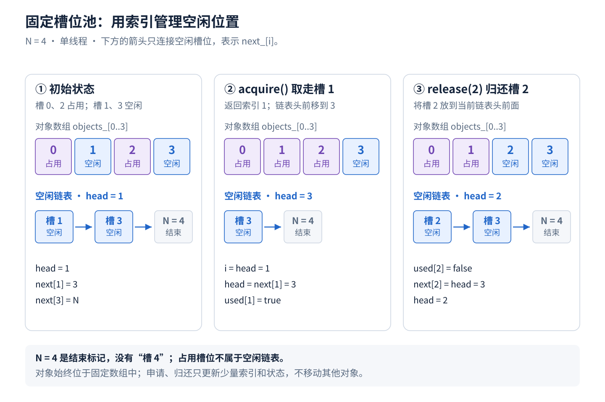
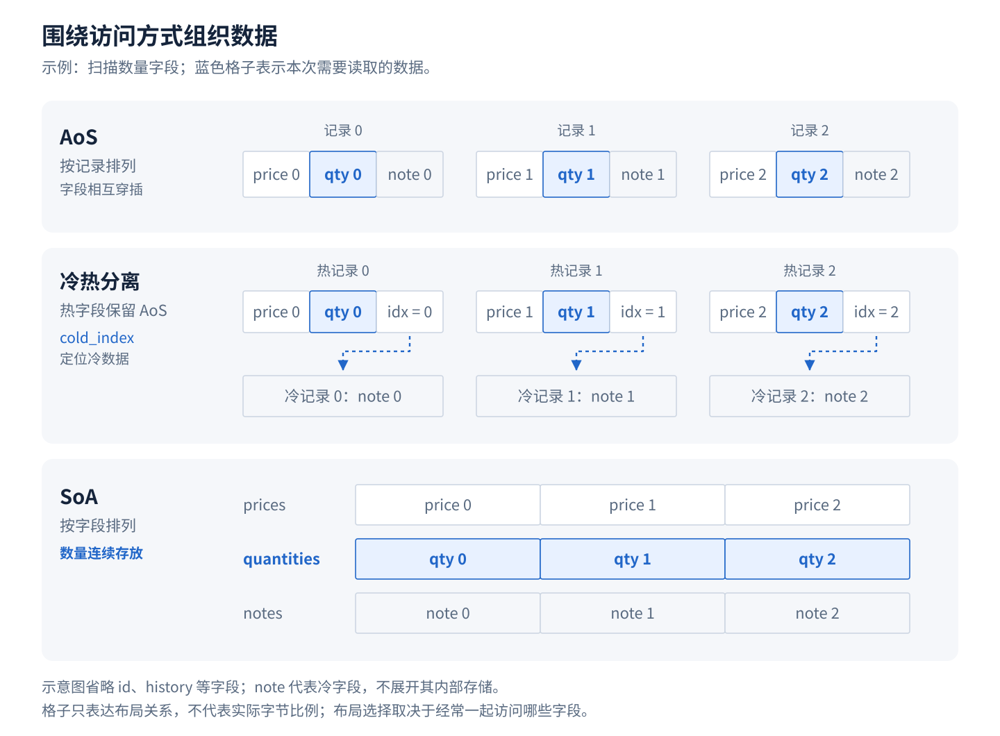
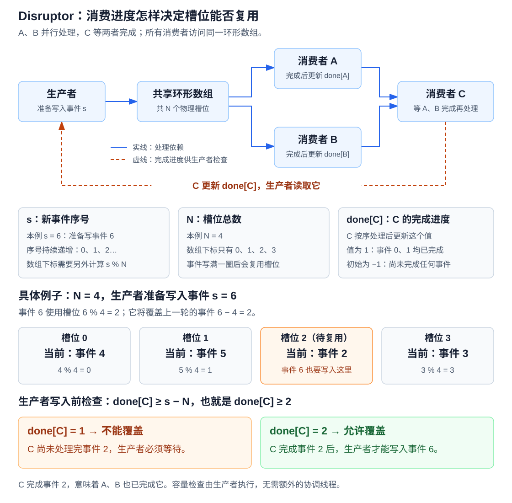
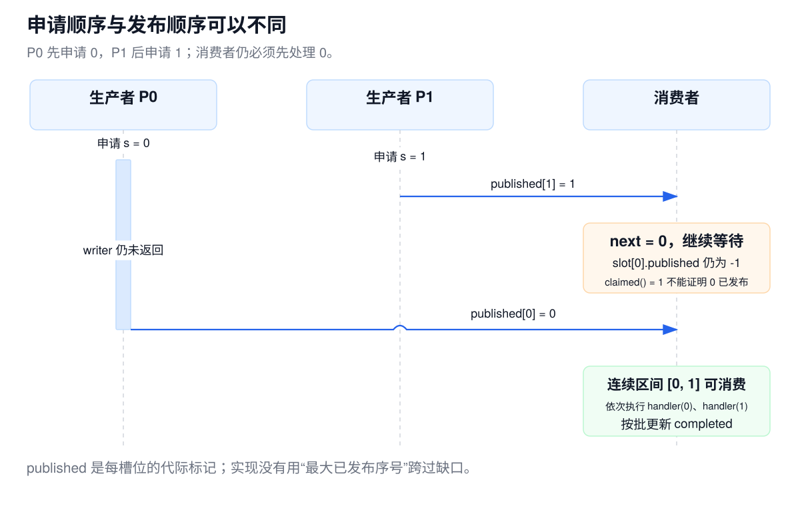

# HFT Engineering从入门到入土（2）—— 常见低延迟系统访存与计算的优化手段

目前主流的HFT系统普遍都已经做到了亚微秒交易的Latency级别，在这种情况下，我们的编程技巧将和实现常见的high throughput system的有很大的不同，因为我们将需要从计算、访存、IO去抠指令级、ns级的Latency Reduce。

下文将从进程内的访存和计算进行分析，阐述一下HFT System中常见的编程技巧（IO相关的优化会在下一篇文章介绍）。

这篇文章所列举的优化手段主要参考了 [Building Low Latency Applications with C++](https://github.com/PacktPublishing/Building-Low-Latency-Applications-with-CPP)、[C++ design patterns for low-latency applications including high-frequency trading](https://arxiv.org/abs/2309.04259)，以及 [LMAX Group 的技术博客](https://technology.lmax.com/)。

## 1. 延迟优化的前提是先要具备测量的手段

看到一段代码用了哈希表、虚函数或者动态内存分配，很容易想到几种优化办法。但动手之前，可以先回答一个更实际的问题：一条行情从进入程序到产生订单，时间到底花在了哪里？

在一般追求应用的吞吐上，我们对于延迟的测算往往直接使用基于steady clock的软件时间戳即可，并且绝大多数情况也不会考虑测量本身带来的开销。但如果我们要做亚微秒级的交易系统，测量是一门可以deep dive的学问

### 1.1 先确定测量的起点和终点

一次行情驱动的交易，大致经过下面这条路径：

```text
行情进入网卡 → 应用取得行情 → 解码 → 更新订单簿 → 策略 → 风控与编码
    H0            C0                                      C4
                                                          │
                          交易所处理 ← 网络 ← 网卡发出 ← 提交发送
                                               H1
```

这里有两种不同的测量

`C4 - C0` 是应用取得行情到订单准备完毕的进程内耗时；`H1 - H0` 则覆盖了本机从收行情到发订单的路径，常被称为 tick-to-trade latency。后者包含网卡与主机之间的数据传递，以及收发路径中的等待。这些减法都要求两端时钟可比较；**此处需要注意的是，来自不同时钟域的时间戳（例如nic上的tsc和cpu上的tsc），往往不能直接做运算/比较**

`H0` 和 `H1` 可以来自网卡硬件时间戳，即网卡在收发报文经过特定位置时记录的时刻。它比应用调用收发函数时打点更接近网络边界。在支持该功能的 Linux socket 路径中，可以用 `SO_TIMESTAMPING` 请求硬件时间戳；接收时间戳随报文返回（一般会replace掉frame中的部分内容，例如对于一个以太网帧来说，可能会替代掉其fsc，代价是无法做crc校验数据是否正确）。发送时间戳则在发送后从socket错误队列异步读取。接口和关联方法见 [Linux 时间戳文档](https://docs.kernel.org/networking/timestamping.html)。

即使拿到了发送硬件时间戳，也只确定了本机发送边界。`send()` 返回、网卡发出、交易所接受订单、订单成交，是不同的完成点。本文主要讨论 `C0` 到 `C4` 之间的计算、访存和线程交接；网络 I/O 与内核旁路留到下一篇展开。

### 1.2 沿同一条消息拆分进程内耗时

先看所有业务阶段都在同一线程中执行的情况。与其给每个阶段分别读两次时钟，可以在相邻阶段之间共用一个时间点：

```text
C0          C1               C2           C3                C4
│── 解码 ──│── 更新订单簿 ──│── 策略 ──│── 风控与编码 ──│
└──────────────── 应用处理总耗时 ───────────────────────────┘
```

这样只需五个时间点，就能计算四段耗时和总耗时：

| 区间 | 计算方式 | 这段变慢时可以继续检查什么 |
|---|---|---|
| 行情解码 | `C1 - C0` | 字段解析、字符串构造、额外复制 |
| 订单簿更新 | `C2 - C1` | 查找、节点分配、缓存未命中 |
| 策略决策 | `C3 - C2` | 特征计算、数据访问、分支路径 |
| 风控与编码 | `C4 - C3` | 账户状态读取、订单构造、格式化 |
| 应用处理总耗时 | `C4 - C0` | 上述串行路径的整体表现 |

下面用 `std::chrono::steady_clock` 写一个最小的分段打点示例。四个回调由caller提供

```cpp
#include <array>
#include <chrono>
#include <cstddef>
#include <cstdint>

using TraceClock = std::chrono::steady_clock;

struct StageTrace {
    std::uint64_t event_id;
    std::array<TraceClock::time_point, 5> time;
};

template<class Decode, class UpdateBook, class Decide, class RiskEncode>
StageTrace measure_stages(std::uint64_t event_id,
                          Decode&& decode, UpdateBook&& update_book,
                          Decide&& decide, RiskEncode&& risk_encode) {
    StageTrace trace{event_id, {}};
    trace.time[0] = TraceClock::now();
    decode();
    trace.time[1] = TraceClock::now();
    update_book();
    trace.time[2] = TraceClock::now();
    decide();
    trace.time[3] = TraceClock::now();
    risk_encode();
    trace.time[4] = TraceClock::now();
    return trace;
}

// 在统计线程中调用
auto stage_durations_ns(const StageTrace& trace) {
    std::array<std::int64_t, 4> result{};
    for (std::size_t i = 0; i < result.size(); ++i) {
        result[i] = std::chrono::duration_cast<std::chrono::nanoseconds>(
            trace.time[i + 1] - trace.time[i]).count();
    }
    return result;
}
```

这里保留原始时间点，把单位换算和统计留到后面。同一条记录中的 `event_id` 用来把各阶段关联起来。

### 1.3 选时钟时，先考虑可比较性，再考虑成本

在一般的应用程序中，`steady_clock` 比较容易使用，并且在大多数场景可以完全满足需求：它保证时间点不倒退，适合计算时间间隔。但steady clock内部做了额外的工作：将tsc计数转换成具体的unix时间戳，但这种转换操作，我们往往希望会放到metrics report thread上执行。

但如果计算和访存的Latency已经短到读钟成本不可忽略，在 x86 上可以进一步研究 TSC（Time Stamp Counter，时间戳计数器）。`RDTSC`、`RDTSCP` 可以读取它，差值按 TSC 频率换算：

```text
elapsed_ns = (end_tsc - begin_tsc) × 1,000,000,000 / tsc_hz
```

这里的 `tsc_hz` 是经过确认的 TSC 频率，不是 CPU 当前睿频频率（这是为了解决CPU睿频频率不稳定导致时钟测量有误差的问题）

需要注意的是计时边界。裸 `RDTSC` 不能阻止 CPU 乱序执行，`RDTSCP` 也不是完整的双向序列化屏障。用于短区间计时时，需要按目标处理器/编译器语义插入Fence/Barrier

以 Intel x86-64、GCC/Clang 为例，可以把读钟封装成下面的形式

```cpp
#include <cstdint>

inline std::uint64_t ordered_rdtsc() noexcept {
    std::uint32_t lo, hi;
    asm volatile(
        "lfence\n\t"
        "rdtsc\n\t"
        "lfence"
        : "=a"(lo), "=d"(hi)
        :
        : "memory"
    );
    return (static_cast<std::uint64_t>(hi) << 32) | lo;
}
```

| 写法 | 解决的问题 |
|---|---|
| 前面的 `lfence` | 等此前指令完成到相应执行边界，避免读钟提前执行 |
| 后面的 `lfence` | 阻止后续指令越过读钟位置提前执行 |
| `asm volatile` | 避免汇编因输出未使用而被删除；单独使用不保证周围代码不重排 |
| `"memory"` clobber | 告诉编译器该汇编可能读写内存，约束周围内存访问的移动 |

`"memory"` 是编译器层面的内存屏障，不会自行生成 CPU fence；`LFENCE` 则是实际执行的机器指令。这里把三条指令写在同一个汇编块中，也避免编译器在它们之间插入其他指令

这个封装仍然不是“所有代码都不会移动”的通用开关。尤其是纯寄存器计算，`"memory"` 并不保证它留在计时区间内。例如下面的写法只是说明一个陷阱，不能直接作为可靠的乘法微基准：

```cpp
auto begin = ordered_rdtsc();
auto result = x * 123;  // 仍可能被提前计算、常量折叠，或因结果未使用而删除，编译器会有各种优化的手段。
auto end = ordered_rdtsc();
```

最准确的方法是通过编译产物的汇编来确定具体的测量行为是否符合预期。

如果两个时间点分别来自不同 CPU 核，尤其是不同CPU Socket，还需要验证 TSC 的一致性。在真实的生产交易系统中，往往会做极致的亲和性部署（策略进程、交易进程、风控进程通过shared memory进行通信）降低跨Socket带来的TSC误差。

网卡时间戳又属于另一层问题。网卡的 PTP 硬件时钟（PHC）和 CPU 的 TSC，可能有不同的起点和计数速率，这就是不同的时钟域。即使都表示成纳秒，也不能直接计算 `应用时间 - 网卡时间`。跨域相减之前需要建立时钟映射并评估误差；跨机器测量还需要同步。PTP 提供同步机制。相关基础接口见 [Linux PHC](https://docs.kernel.org/driver-api/ptp.html)。

由于我们这个章节只关心进程内各阶段时，先统一使用一种可靠的单调时钟，后续章节会补齐全链路上的延迟测量手段。

### 1.4 既看分布，也保留同一条消息的分段记录

吞吐量代表一秒处理多少消息，延迟代表一条消息要等多久。批量处理可能提高吞吐量，却让第一条消息等得更久；增加工作线程可能分摊计算，也可能增加队列与缓存一致性开销。因此，至少应同时观察吞吐量、p50、p99、p99.9，以及测试期间的最慢样本。平均值会掩盖少量慢请求。

下面是一个最小的延迟记录器。初始化时预留空间，采样只追加整数，排序放到测量结束以后；超过容量会记录丢失的样本数。

```cpp
#include <algorithm>
#include <chrono>
#include <cstddef>
#include <cstdint>
#include <stdexcept>
#include <vector>

class LatencySamples {
    std::vector<std::int64_t> ns_;
    std::size_t limit_;
    std::size_t dropped_ = 0;
public:
    explicit LatencySamples(std::size_t limit) : limit_(limit) {
        ns_.reserve(limit);                         // 初始化阶段
    }

    void record(std::chrono::steady_clock::time_point begin,
                std::chrono::steady_clock::time_point end) {
        if (ns_.size() == limit_) { ++dropped_; return; }
        ns_.push_back(std::chrono::duration_cast<std::chrono::nanoseconds>(
                          end - begin).count());
    }

    // 停止采样后调用。nearest-rank 百分位；空样本没有百分位。
    std::int64_t percentile(unsigned permille) {
        if (ns_.empty() || permille == 0 || permille > 1000)
            throw std::invalid_argument("invalid percentile or empty samples");
        std::sort(ns_.begin(), ns_.end());
        const auto n = ns_.size();
        const auto rank = (n / 1000) * permille +
                         ((n % 1000) * permille + 999) / 1000;
        return ns_[rank - 1];
    }

    std::size_t dropped() const { return dropped_; }
};

// 用法：record(arrival_time, send_time)；结束后读取 percentile(990)。
```

对于前面的 `StageTrace`，可以为四个阶段分别建立记录器，再单独建立一个总耗时记录器。用 `record(trace.time[0], trace.time[4])` 记录总耗时，用相邻时间点记录各阶段。正式热路径中更适合先保存整条 `StageTrace`，随后在停止测量或安全移交给统计线程后做这些操作，避免边处理业务边更新多个统计容器。

各阶段的 p99 不能相加得到总耗时的 p99：不同阶段最慢的样本，可能来自不同消息。正确做法是先对每条消息计算总耗时，再对这些总耗时求分位数

### 1.5 控制测量本身的干扰

读钟、写时间戳和搬运统计数据，都要消耗 CPU、缓存和内存带宽。前面的示例适合建立阶段边界，但不是无开销的生产级追踪器。如果整个消息处理只有很短时间，增加五次时钟读取就可能明显改变结果。

热路径应只保存必要的整数、时间点和标识。**格式化、排序、分位数计算和文件输出放到路径之外**。每个线程独占自己的记录缓冲区，后台读取时再通过明确的所有权移交或队列协议同步

### 1.6 用 SPSC 队列把时间戳交给统计线程

同一个进程里的线程本来就共享地址空间，不需要为了上报时间戳再建立一块 `mmap` 共享内存。真正需要解决的是：worker 还在写数据时，统计线程不能读；统计线程还没读完时，worker 不能覆盖。

这里可以直接使用第 2.5.3 节的 SPSC 环形队列。SPSC 表示单生产者、单消费者：一个 worker 负责写入，一个统计线程负责读取。队列在启动时创建，两端持有同一个队列对象的引用，其寿命覆盖两端线程的整个运行期。

```text
worker                       预分配的环形队列                  统计线程
业务处理、记录时间戳
        │
完整的 StageTrace
        └── try_push ──────→ [记录][记录][空槽] ─── try_pop ──→ 局部副本
        │                                                       │
继续下一条业务消息                                         计算时间差、更新直方图
                                                          定期上报聚合指标
```

统计线程读取的是队列内部数组中的槽位，不是 worker 栈上的 `trace`。一次交接按下面的顺序完成：

1. worker 检查槽位可用，把完整记录复制进去，再通过 release 操作发布写入位置。
2. 统计线程通过 acquire 操作观察到新位置，才读取对应槽位，将记录复制到自己的局部变量。
3. 统计线程通过 release 操作发布消费进度；worker 通过 acquire 观察到空间后，才能复用槽位。统计计算继续使用局部副本。

```cpp
// worker 调用。dropped 只由这个 worker 访问；满队列不重试。
template<class Queue>
void submit_trace(Queue& queue, const StageTrace& trace,
                  std::uint64_t& dropped) {
    if (!queue.try_push(trace)) ++dropped;
}

// 统计线程调用。aggregate 在本线程内更新直方图，不做网络 I/O。
// 每轮最多取 256 条已有记录，不等待凑够一个批次。
template<class Queue, class Aggregate>
std::size_t drain_traces(Queue& queue, Aggregate&& aggregate) {
    StageTrace local{};
    std::size_t count = 0;
    while (count < 256 && queue.try_pop(local)) {
        aggregate(local.event_id, stage_durations_ns(local));
        ++count;
    }
    return count;
}
```


### 1.7 延迟数据交接大概要付出多少延迟

| 指标 | 起点与终点 | 用途 |
|---|---|---|
| worker 入队耗时 | 调用 `try_push` 到返回 | 估算业务线程增加的直接成本 |
| 记录交接延迟 | 入队前到统计线程成功取出 | 检查发布、跨核传递、排队和轮询等待 |
| 指标上报延迟 | 记录产生到聚合结果上报完成 | 判断监控数据的新鲜度 |

worker 不需要等到统计线程拿到记录才返回，因此后两项不能直接加到 worker 的处理耗时里。反过来，`try_push()` 返回也不能证明统计线程已经看到了记录。

以常见的 64 位实现为例，如果一个 `time_point` 占 8 字节，`StageTrace` 就是 8 字节 ID 加 5 个时间点，共 48 字节，实际应检查 `sizeof(StageTrace)`。成功入队主要做一次判满、复制这 48 字节和发布游标。

一个公开的数量级参照是 [Rigtorp SPSCQueue 基准](https://github.com/rigtorp/SPSCQueue#benchmarks)：在 AMD Ryzen 9 3900X 的同一 chiplet、不同核心上，用两个队列传递 `int`，报告的往返延迟为 **133 ns**。不过它测的是一次往返，不是一次 `try_push()`

一般来说，可以先按**几十到几百纳秒的 worker 入队成本做预算敏感性分析**

## 2. 常见的 Latency 优化手段

在上面我们介绍了延迟如何测量，接下来我们要从指令级开始抠一个亚微秒级交易系统的延迟了，在本文的重点就是先梳理一些最常见的手段

<a id="prepare"></a>

### 2.1 编译期计算与静态分派

#### 2.1.1 constexpr 编译期计算与查表

协议字段宽度、固定换算系数、消息类型对应表，通常在编译时或启动时就能确定。真正的常量可以在编译期生成；来自配置文件的参数，应在初始化阶段解析和校验。TLDR就是计算前移到编译期或者进程启动时（进程启动时进行计算的思想也会运用到后续的page prefault中，整体上来说是一个低延迟系统中非常常见的技巧）

下面是一个按十进制精度取得缩放系数的demo代码：

```cpp
#include <array>
#include <cstddef>
#include <cstdint>
#include <optional>

// Bad case：每次调用都重新表达一遍相同计算。
std::optional<std::uint64_t> scale_bad(unsigned decimals) {
    if (decimals > 9) return std::nullopt;
    std::uint64_t scale = 1;
    for (unsigned i = 0; i < decimals; ++i) scale *= 10;
    return scale;
}

constexpr auto make_scales() {
    std::array<std::uint64_t, 10> table{};
    table[0] = 1;
    for (std::size_t i = 1; i < table.size(); ++i)
        table[i] = table[i - 1] * 10;
    return table;
}

// constexpr 变量的初始化要求常量求值。
inline constexpr auto scales = make_scales();

std::optional<std::uint64_t> scale_good(unsigned decimals) {
    if (decimals >= scales.size()) return std::nullopt;
    return scales[decimals];
}

static_assert(scales[4] == 10'000);
```

`constexpr` 函数表示它**可以**用于常量求值。拿运行时输入调用它，**仍然可能执行运行时计算**；

#### 2.1.2 函数模板、CRTP 与编译期静态分派

每条消息都经由虚函数或 `std::function` 调用策略，编译器未必能看到实际目标。对于启动后不变的行为，可以把选择放在外层，让内层处理具体类型。

```cpp
#include <cstdint>

struct Quote { std::int64_t bid_ticks, ask_ticks; };

// Bad case：对于已经固定的策略，仍逐条做动态分派。
struct DynamicRule {
    virtual bool accept(const Quote&) const noexcept = 0;
    virtual ~DynamicRule() = default;
};
bool check_bad(const DynamicRule& rule, const Quote& q) {
    return rule.accept(q);
}

struct SpreadRule {
    bool accept(const Quote& q) const noexcept {
        return q.bid_ticks < q.ask_ticks;
    }
};

// Good case：具体类型可见，编译器有机会内联并继续优化。
template<class Rule>
bool check_good(const Rule& rule, const Quote& q) noexcept {
    return rule.accept(q);
}

bool example() {
    return check_good(SpreadRule{}, Quote{100, 101});
}
```

目标函数可见以后，除了省去间接跳转，编译器还有机会继续做常量传播、删除无用分支。实现这种静态分派，一般来说通过普通模板函数就够了。

如果希望把统一接口或公共处理流程放进基类，再由不同规则提供具体实现，可以使用 CRTP（Curiously Recurring Template Pattern，奇异递归模板模式）。它的写法是让派生类把自己的类型传给基类：`Derived : Base<Derived>`。

沿用上面的 `Quote`，价差检查可以写成下面这样。这段代码接在前面的定义之后即可编译。

```cpp
template<class Derived>
class RuleBase {
protected:
    RuleBase() = default;
    ~RuleBase() = default;  // 不支持通过基类指针 delete 派生对象。

public:
    bool accept(const Quote& q) const noexcept {
        // 约定：当前基类子对象确实属于 Derived 对象。
        return static_cast<const Derived&>(*this).accept_impl(q);
    }
};

class CrtpSpreadRule final : public RuleBase<CrtpSpreadRule> {
public:
    bool accept_impl(const Quote& q) const noexcept {
        return q.bid_ticks < q.ask_ticks;
    }
};

template<class Derived>
bool check_crtp(const RuleBase<Derived>& rule, const Quote& q) noexcept {
    return rule.accept(q);
}

bool crtp_example() {
    CrtpSpreadRule rule;
    return check_crtp(rule, Quote{100, 101});
}
```

调用链是 `check_crtp()` → `RuleBase<CrtpSpreadRule>::accept()` → `CrtpSpreadRule::accept_impl()`。编译器在实例化时已经知道 `Derived` 是 `CrtpSpreadRule`，这里没有虚函数调用，也不需要在运行时查询实际类型；实现可见时，编译器有机会把整条调用链内联起来。

`static_cast` 不会检查对象的动态类型，所以模板参数必须与实际派生对象匹配。它也要求基类是可访问、无歧义的非虚基类。不能让其他不匹配的类型继承 `RuleBase<CrtpSpreadRule>` 后照样调用 `accept()`；示例中的 protected 构造函数主要限制独立创建基类对象，并不能自动检查所有继承用法。相关转换条件见 [C++ static_cast 规则](https://eel.is/c++draft/expr.static.cast)。

CRTP 与前面的普通函数模板都能实现静态分派。区别在于，CRTP 让基类能够调用派生类提供的实现，适合复用一套公共接口或处理流程；如果只需要调用 `rule.accept(q)`，普通函数模板更直接。`RuleBase<A>` 和 `RuleBase<B>` 也是两个不同类型，不能像同一个虚基类那样直接放进统一的基类指针容器。**不要仅为了性能把简单模板改成 CRTP：两者可能生成相同的机器码。**

插件和运行时替换适合保留动态分派；目标可推断时，编译器也可能自行去虚拟化。**静态分派的代价是模板实例化带来的代码增长，过多模板的实例化会增加icache压力**。

<a id="memory"></a>

### 2.2 内存分配、零拷贝视图与索引查找

#### 2.2.1 预分配与固定容量缓冲区

动态内存分配的问题不仅是平均耗时，还包括分配器内部竞争、resize导致的数据migration和首次触页导致的minor page fault。低延迟路径通常会在启动时准备好内存空间，在处理时复用。

```cpp
#include <cstddef>
#include <cstdint>
#include <span>
#include <vector>

struct Update { std::uint32_t instrument; std::int64_t price_ticks; };

// Bad case：每批重新建立容器，增长期间可能多次扩容。
std::vector<Update> collect_bad(std::span<const Update> input) {
    std::vector<Update> out;
    for (const auto& u : input) out.push_back(u);
    return out;
}

class BatchBuffer {
    std::vector<Update> data_;
    std::size_t limit_;
public:
    explicit BatchBuffer(std::size_t limit) : limit_(limit) {
        data_.reserve(limit);                      // 启动时分配
    }
    // input 不得引用本对象 data_ 内的元素。
    bool collect(std::span<const Update> input) {
        if (input.size() > limit_) return false;   // 超限交给调用方处理，避免push back触发resize
        data_.clear();                            // 保留 capacity
        for (const auto& u : input) data_.push_back(u);
        return true;
    }
    // 返回视图只在下一次成功 collect() 或对象销毁之前有效。
    std::span<const Update> view() const { return data_; }
};
```

#### 2.2.2 对象池与空闲链表

订单、订单簿节点和内部消息常常有已知的数量上限。与其每次 `new`、结束时 `delete`，可以预先放好一组对象，再用空闲链表管理槽位。



*图 1：空闲链表只保存索引。申请和归还都修改少量元数据，不扫描全部槽位。*

下面是一个**单线程、固定类型**的槽位池。它复用的是已经存在的 `Order` 对象，不涉及通用 placement new 或复杂析构。

```cpp
#include <array>
#include <cstddef>
#include <cstdint>
#include <optional>

struct Order { std::uint64_t id; std::int64_t price_ticks; };

template<std::size_t N>
class OrderPool {
    static_assert(N > 0);

    // 真正存放订单的数组。池创建时对象就已存在，申请时覆盖其内容。
    // 槽位下标不是 Order::id；同一槽位可以先后存放不同订单。
    std::array<Order, N> objects_{};

    // 用下标串起空闲槽位：next_[i] = j 表示 i 后面的空闲槽位是 j。
    // 只有 i 空闲时，这个值才参与空闲链；i 已借出时可保留旧值。
    std::array<std::size_t, N> next_{};

    // true 表示槽位已借出，false 表示空闲。{} 将初值全部设为 false。
    std::array<bool, N> used_{};

    // 第一个空闲槽位。有效下标为 [0, N)，用 N 表示没有空闲槽位。
    std::size_t head_ = 0;
public:
    OrderPool() {
        // 初始化为空闲链 0 -> 1 -> ... -> N-1 -> N（结束）。
        // N 只是结束标记，不能用来访问 objects_[N] 或 next_[N]。
        for (std::size_t i = 0; i < N; ++i) next_[i] = i + 1;
    }

    // 借出一个槽位并写入订单；成功返回槽位下标，池满返回 nullopt。
    std::optional<std::size_t> acquire(Order value) noexcept {
        if (head_ == N) return std::nullopt;
        const auto i = head_;   // 取走当前链表头，不扫描整个数组。
        head_ = next_[i];       // 原来的第二个空闲槽位成为新链表头。
        objects_[i] = value;    // 赋值给已有对象，不执行 new。
        used_[i] = true;        // i 已借出，不再属于空闲链。
        return i;
    }

    // 只查询，不申请。越界或槽位空闲时返回 nullptr。
    // 返回指针的业务使用权在 release(i) 时结束。
    Order* get(std::size_t i) noexcept {
        return i < N && used_[i] ? &objects_[i] : nullptr;
    }

    // 归还槽位：只恢复可复用状态，不清空字段，也不析构 Order。
    bool release(std::size_t i) noexcept {
        // 拒绝越界或归还仍为空闲状态的槽位，避免重复接入空闲链。
        if (i >= N || !used_[i]) return false;
        used_[i] = false;
        next_[i] = head_;       // i 指向旧链表头；不要求 i < head_。
        head_ = i;              // i 成为新链表头，下次申请优先取走它。
        // 顺序不能反过来，否则会把 next_[i] 写成 i，形成自环。
        return true;
    }
};

bool pool_example() {
    OrderPool<8> pool;
    // 初始 head_ 为 0，因此这里取得槽位 0，订单的业务 ID 则为 7。
    const auto handle = pool.acquire(Order{7, 10'005});
    if (!handle) return false;  // 判断 optional 是否有值，不是判断下标非零。
    pool.get(*handle)->price_ticks = 10'006;
    // 用完后归还；此后不再用旧 handle 或旧指针访问这笔订单。
    return pool.release(*handle);
}
```

`next_` 保存的是链表关系，不是数组中的相邻关系。初始链恰好按下标递增，只是因为构造函数这样连接；经历申请和归还后，它完全可以变成 `3 -> 0 -> 1 -> 2`。订单在 `objects_` 中的位置不动，变化的只有管理下标。

例如，`OrderPool<4>` 当前的槽位 `0、1、2` 空闲，槽位 `3` 已借出，空闲链是：

```text
head_ = 0
空闲链：0 -> 1 -> 2 -> 4（结束标记）
已借出：3
```

现在调用 `release(3)`，虽然旧 `head_ = 0` 的数值比 `3` 小，仍然执行同样的头插操作：

```cpp
// release(3) 内部的状态变化：
used_[3] = false;
next_[3] = head_;  // next_[3] = 0：新归还的槽位指向旧链表头。
head_ = 3;        // 再把新归还的槽位设为链表头。
```

结果是：

```text
head_ = 3
空闲链：3 -> 0 -> 1 -> 2 -> 4（结束标记）
```

下一次 `acquire()` 返回 `3`，并把 `head_` 更新为 `next_[3]`，也就是 `0`。这里的“前后”指链表中的逻辑顺序，与数组下标大小无关。若原来没有空闲槽位，即 `head_ == N`，归还后就是 `i -> N`，同样成立。

#### 2.2.3 非必要不创造数据副本

解析消息时，先把缓冲区复制成字符串，再切出字段字符串，是很多系统中是很常见的额外计算工作的来源。

```cpp
#include <charconv>
#include <cstdint>
#include <optional>
#include <string>
#include <string_view>
#include <system_error>

// Bad case：为已有字符再构造一份拥有存储的 string。
std::optional<std::uint32_t> parse_bad(std::string_view field) {
    if (field.empty()) return std::nullopt;
    const std::string copy(field);                 // 长字段可能分配
    std::uint32_t value{};
    const auto [p, ec] = std::from_chars(
        copy.data(), copy.data() + copy.size(), value);
    if (ec != std::errc{} || p != copy.data() + copy.size())
        return std::nullopt;
    return value;
}

std::optional<std::uint32_t> parse_good(std::string_view field) {
    if (field.empty()) return std::nullopt;
    std::uint32_t value{};
    const auto [p, ec] = std::from_chars(
        field.data(), field.data() + field.size(), value);
    if (ec != std::errc{} || p != field.data() + field.size())
        return std::nullopt;
    return value;                                  // 返回拥有自身存储的值
}
```

#### 2.2.4 返回值优化（NRVO）与隐式移动

减少复制不等于给每个变量加上 `std::move`。返回局部变量时，多写一个 move 反而可能妨碍命名返回值优化（NRVO）。

```cpp
#include <cstddef>
#include <cstdint>
#include <utility>
#include <vector>

std::vector<std::uint64_t> make_bad(std::size_t n) {
    std::vector<std::uint64_t> values(n, 7);
    return std::move(values);                      // 阻止此处的 NRVO
}

std::vector<std::uint64_t> make_good(std::size_t n) {
    std::vector<std::uint64_t> values(n, 7);
    return values;                                // 可 NRVO，否则可隐式移动
}
```

#### 2.2.5 稠密 ID 映射与数组直接索引

在交易系统场景中，外部订单号和标的代码可能很稀疏，但进入内部系统以后，完全可以映射成紧凑编号。若编号范围已知，数组访问能省去哈希计算、桶访问和节点间接寻址。

```cpp
#include <array>
#include <cstdint>
#include <unordered_map>

struct State { std::int64_t position = 0; };

struct MapStates {
    std::unordered_map<std::uint32_t, State> states;
    State* find(std::uint32_t id) {
        auto it = states.find(id);                 // 稠密小整数也要做通用查找
        return it == states.end() ? nullptr : &it->second;
    }
};

struct DenseStates {
    std::array<State, 4096> states{};
    std::array<bool, 4096> active{};
    State* find(std::uint32_t id) {
        if (id >= states.size() || !active[id]) return nullptr;
        return &states[id];
    }
};
```

<a id="layout"></a>

### 2.3 数据布局与缓存局部性

#### 2.3.1 结构体布局与冷热数据分离

CPU 从内存搬运数据时，以缓存行为单位。一次只用几个字节，也可能把附近暂时无用的字段带进缓存。低延迟代码中，数据布局经常比某条算术指令更值得优化。

先看结构体填充：

```cpp
#include <cstdint>

struct OrderBad {
    std::uint8_t side;
    std::uint64_t id;
    std::uint32_t qty;
    std::uint64_t price_ticks;
};

struct OrderGood {
    std::uint64_t id;
    std::uint64_t price_ticks;
    std::uint32_t qty;
    std::uint8_t side;
};
```

在常见的 64 位 ABI 上，两者通常分别占 32 和 24 字节，具体以目标平台的 `sizeof` 为准。重新排列字段减少填充，但不改变字段含义。

如果一个订单对象还挂着几十字节的备注、字符串和历史统计，仅调整顺序不够。应进一步考虑把经常一起访问的字段放在一起，把很少访问的字段移到旁边。



*图 2：按订单处理时可以保留紧凑结构体；只扫描数量时，连续的数量数组能避免带入无关字段。图中格子表达布局关系，不代表精确字节数。*

```cpp
#include <array>
#include <cstdint>
#include <string>

struct WholeOrder {
    std::uint64_t id;
    std::int64_t price_ticks;
    std::uint32_t qty;
    std::string note;                              // 扫描价格时不需要
    std::array<std::uint64_t, 8> history;
};

struct HotOrder {
    std::uint64_t id;
    std::int64_t price_ticks;
    std::uint32_t qty;
    std::uint32_t cold_index;
};

struct ColdOrder {
    std::string note;
    std::array<std::uint64_t, 8> history;
};
```

冷热分离让热点循环少搬运无关数据，代价是访问冷字段时需要额外定位。是否划算，取决于热字段和冷字段各自的访问频率。

#### 2.3.2 AoS、SoA 与顺序访问

AoS（array of structures，结构体数组）适合一次处理一条记录；SoA（structure of arrays，把各字段分别存成数组）适合一次处理同一个字段。比如一个批次只统计数量是否超过阈值，SoA 可以只读目标的数量数组，不会有非必要数据被搬迁到cacheline中。

```cpp
#include <cstddef>
#include <cstdint>
#include <span>
#include <vector>

struct Level {
    std::int64_t price_ticks;
    std::uint32_t qty;
    std::uint32_t order_count;
};

std::size_t count_aos(std::span<const Level> levels, std::uint32_t limit) {
    std::size_t count = 0;
    for (const auto& level : levels) count += (level.qty > limit);
    return count;
}

struct LevelsSoA {
    std::vector<std::int64_t> prices;
    std::vector<std::uint32_t> quantities;
    std::vector<std::uint32_t> order_counts;
};

std::size_t count_soa(std::span<const std::uint32_t> quantities,
                      std::uint32_t limit) {
    std::size_t count = 0;
    for (auto qty : quantities) count += (qty > limit);
    return count;
}
```

#### 2.3.3 预缺页（Prefault）与预取（Prefetch）

首次访问内存时的缺页处理提前完成，这就是 **prefault（预缺页）**。在 Linux 上，申请一段匿名映射后，拿到地址不意味着整个区间都已经建立了可写的物理页映射。若直到第一条行情到来才写入，页面分配、清零和页表更新等工作就可能进入业务路径；这类匿名内存的首次缺页通常是 minor fault，并不需要从磁盘读取数据。

最直观的做法是在初始化阶段，向每个页面写一个字节。下面用匿名内存映射演示，这个缓冲区只存放字节，创建后先完成 prefault，再交给业务使用；对象析构时释放内存映射。

```cpp
#include <cerrno>
#include <cstddef>
#include <span>
#include <stdexcept>
#include <system_error>
#include <sys/mman.h>
#include <unistd.h>

class PrefaultBuffer {
    void* data_ = MAP_FAILED;
    std::size_t size_;
public:
    explicit PrefaultBuffer(std::size_t bytes) : size_(bytes) {
        if (bytes == 0) throw std::invalid_argument("empty buffer");

        // 查询基础页大小，不把 4KB hardcode在代码中。
        const long page_size = ::sysconf(_SC_PAGESIZE);
        if (page_size <= 0)
            throw std::runtime_error("cannot get page size");
        const auto page = static_cast<std::size_t>(page_size);

        // mmap 返回页对齐地址；此处尚未逐页触碰。
        data_ = ::mmap(nullptr, size_, PROT_READ | PROT_WRITE,
                       MAP_PRIVATE | MAP_ANONYMOUS, -1, 0);
        if (data_ == MAP_FAILED)
            throw std::system_error(errno, std::generic_category(), "mmap");

        // 只对这段尚无业务数据的缓冲区执行。
        // volatile 保留实际写入，避免编译器删除看似无用的触页操作。
        auto* touch = static_cast<volatile unsigned char*>(data_);
        for (std::size_t offset = 0; offset < size_;) {
            touch[offset] = 0;  // 写访问，提前触发所需的可写页面映射。
            if (size_ - offset <= page) break;  // 下一步越出区间，避免加法溢出。
            offset += page;
        }
        // size_ 已检查非零。补写末字节，让这套触碰方法也适用于非对齐起点。
        touch[size_ - 1] = 0;
    }

    // 一个对象独占一段映射，禁止浅拷贝后重复 munmap。
    PrefaultBuffer(const PrefaultBuffer&) = delete;
    PrefaultBuffer& operator=(const PrefaultBuffer&) = delete;

    ~PrefaultBuffer() { ::munmap(data_, size_); }

    std::span<std::byte> view() noexcept {
        return {static_cast<std::byte*>(data_), size_};
    }
};

void prefault_example() {
    PrefaultBuffer buffer(16 * 1024 * 1024);  // 初始化阶段触碰 16 MiB。
    auto bytes = buffer.view();
    // 正式处理阶段复用 bytes；视图不能超过 buffer 的生命周期。
    bytes[0] = std::byte{0x42};
}
```

这里需要区分 `mmap` 和 `malloc` 的对齐保证。页对齐指的是**返回的虚拟地址**为页大小的整数倍，不表示物理页连续，也不表示页面已经驻留：

| 获取内存的方式 | 是否保证起始地址按页对齐 | 对 prefault 的影响 |
|---|---|---|
| 本例的 Linux `mmap(nullptr, ...)` | 成功时返回页对齐地址 | 从偏移 0 按页大小递进，就能触碰映射涉及的每一页 |
| 普通 `malloc(size)` | 不保证页对齐；它满足普通对象所需的对齐要求 | 返回地址可能位于页内，按页步进后还需考虑末尾跨页 |

即使 `malloc` 为大块分配在内部使用了 `mmap`，也不能据此推断返回给调用方的指针按页对齐；分配器管理的映射起点与用户可用区起点未必相同。`vector.data()` 同样没有通用的页对齐保证。从页对齐的映射中截取一段子区间，也可能得到未对齐的起点。[Linux mmap 文档](https://man7.org/linux/man-pages/man2/mmap.2.html)、[Linux malloc 文档](https://man7.org/linux/man-pages/man3/malloc.3.html)

为什么可能漏掉最后一页？**缓冲区长度是一页，不代表它只覆盖一个页面。** 假设页大小为 4096 字节，缓冲区从某页内偏移 1024 的位置开始，长度为 4096 字节。以下地址均相对于该页页首：

```text
第 1 页：[0, 4096)          第 2 页：[4096, 8192)
缓冲区：[1024, 5120)       最后一个字节位于 5119

缓冲区偏移 0    -> 地址 1024：位于第 1 页，循环会写这里。
缓冲区偏移 4096 -> 地址 5120：已经越出缓冲区，不能写。
缓冲区偏移 4095 -> 地址 5119：位于第 2 页，末字节补写会覆盖这里。
```

如果只有按页步进的循环，它写完偏移 0 就退出了，因为下一个偏移 4096 已经等于缓冲区长度；但缓冲区实际跨了两个页面，第二页还没触碰。最后追加 `touch[size_ - 1] = 0`，就补齐了这一页，而且没有越界。

对于更长的区间，相邻触碰地址相差恰好一页，会落在连续页面的相同页内偏移上，不会跳过中间页面。最后一次循环写入到区间末尾的距离不足一页，因此最多漏掉末尾那一页，补写末字节即可。对于本例页对齐的 `mmap` 地址，这次补写只是再次触碰已经覆盖的页面。

这里选择**写入**而不只是读取，是因为匿名内存的首次读取可能只建立到共享零页（Linux zero page）的只读映射，后续第一次写入仍需分配私有页面。这里的零页是内容全为零、可由多个虚拟页共享的物理页，不是虚拟地址 0 所在的页面。Linux 官方文档的 [Anonymous Memory 小节](https://docs.kernel.org/admin-guide/mm/concepts.html#anonymous-memory)说明了这一过程：读取时可以建立指向特殊全零物理页的页表项，写入时再分配物理页来保存数据。

写入能把这部分成本也提前承担。`volatile` 仅用于保留触页操作，避免编译器触发dead code优化将这段逻辑删除掉。

Linux 5.14 起也可以在支持的可写映射上使用 `madvise(addr, length, MADV_POPULATE_WRITE)`，让内核完成可写 prefault，避免用户态逐页写零。需要检查返回值：失败时可能已有部分页面完成处理，不能把失败当成完全未执行。它同样不等于锁页。[Linux madvise 文档](https://www.man7.org/linux/man-pages/man2/madvise.2.html)

```cpp
// Linux：放在构造函数中，mmap 成功之后。
if (::madvise(data_, size_, MADV_POPULATE_WRITE) == -1) {
    const int error = errno;
    // 构造函数抛异常时不会执行本对象的析构函数，必须先释放映射。
    ::munmap(data_, size_);
    data_ = MAP_FAILED;
    throw std::system_error(error, std::generic_category(),
                            "MADV_POPULATE_WRITE");
}
```

prefault的几种写法的区别可以归纳为：

| 写法 | 用户代码做什么 | 适用目的 |
|---|---|---|
| 按页步进写零，并补写末字节 | 覆盖每页，最后一页可能触碰两次 | 对新缓冲区做手动可写 prefault，写入次数较少，能降低启动成本 |
| 整段写零 | 覆盖每个字节，同时触页 | 启动成本不重要，此时使用memset做一次简单的prefault |
| `MADV_POPULATE_WRITE` | 请求内核建立可写页表，不主动改写原有字节内容 | 支持该接口的 Linux 上做可写 prefault |

软件预取则是在运行过程中提示 CPU 提前取将来会用的数据。顺序的内存访问常常已有硬件预取

```cpp
#include <cstddef>
#include <cstdint>
#include <span>

// 前提：ids 中每个下标均已在入口处检查，小于 values.size()。
std::uint64_t sum_indirect(std::span<const std::uint64_t> values,
                           std::span<const std::size_t> ids) {
    constexpr std::size_t distance = 16;
    std::uint64_t sum = 0;
    for (std::size_t i = 0; i < ids.size(); ++i) {
#if defined(__GNUC__) || defined(__clang__)
        if (ids.size() - i > distance)
            __builtin_prefetch(&values[ids[i + distance]], 0, 1);
#endif
        sum += values[ids[i]];
    }
    return sum;
}
```

<a id="execution"></a>

### 2.4 分支、循环与数值计算优化

#### 2.4.1 短路求值与条件检查顺序

一条订单需要通过多项检查。有些只读几个字段，有些要查表或遍历状态。如果前面的检查已经失败，后面的计算通常没有必要继续。

```cpp
#include <cstdint>
#include <span>

struct Request { std::uint32_t qty; };

bool account_open(std::span<const std::uint8_t> flags) {
    for (auto flag : flags) if (flag == 0) return false;
    return true;
}

// Bad case：数量已经不合法，仍然先扫描账户限制。
bool accept_bad(Request r, std::span<const std::uint8_t> flags) {
    const bool account_ok = account_open(flags);
    const bool quantity_ok = r.qty > 0 && r.qty <= 10'000;
    return account_ok && quantity_ok;
}

bool accept_good(Request r, std::span<const std::uint8_t> flags) {
    return r.qty > 0 && r.qty <= 10'000 && account_open(flags);
}
```

`&&` 和 `||` 有短路语义，`&` 和 `|` 没有。但如果check本身具备side effect，这里需要谨慎思考是否可以短路掉逻辑

#### 2.4.2 延迟格式化与 cold/noinline 冷路径分离

热路径里经常藏着这样的开销：检查本身很便宜，但调用检查函数之前，已经把错误字符串拼好了。

```cpp
#include <cstdint>
#include <stdexcept>
#include <string>

struct OrderCheck { std::uint64_t id; std::uint32_t qty; };

void require(bool ok, const std::string& message) {
    if (!ok) throw std::runtime_error(message);
}

void validate_bad(OrderCheck o) {
    require(o.qty != 0, "zero quantity, order=" + std::to_string(o.id));
}

#if defined(__GNUC__) || defined(__clang__)
[[gnu::cold, gnu::noinline]]
#endif
void reject_zero_qty(std::uint64_t id) {
    throw std::runtime_error("zero quantity, order=" + std::to_string(id));
}

void validate_good(OrderCheck o) {
    if (o.qty == 0) [[unlikely]] {
        reject_zero_qty(o.id);
    }
}
```

这个例子包含两个可以分别理解的优化。第一，把字符串拼接、内存分配和异常构造推迟到检查失败之后，正常订单不再执行这些工作。第二，把失败处理抽成独立函数，让正常路径只保留条件检查和一个很少执行的调用。即使已经把格式化放进 `if` 分支，第二个优化仍然有意义。

**把冷代码移出热函数，减少热路径的指令体积。** CPU 的指令缓存（I-cache）保存机器指令，假如一个频繁调用的函数里还包含大段诊断、错误格式化或恢复逻辑，这些代码可能夹在正常处理的基本块之间，拉大代码跨度；函数被内联到多个调用点后，还可能增加重复的冷代码。

抽离之后，常见路径可以更紧凑地排列；多个调用点共享一个冷函数，减少冷代码随内联复制的机会。这有利于降低热代码的指令缓存占用和取指压力。这里并不是说“没有执行的分支一定会全部装进 I-cache”：具体收益取决于编译器最终布局、缓存行边界和实际执行路径。

**热函数变小，也更容易被内联到上层调用者。** 例如，一个行情处理函数每次都调用 `validate_good`。抽离前，内联检查函数可能把格式化、异常构造及清理逻辑一起带入调用者；抽离后，编译器只需要考虑展开一个检查和一个冷调用。即使上层接收循环很大，也更有机会把这段小检查内联进去，从而省掉正常路径上的调用，并结合调用点信息继续优化。

这里要区分两个函数：希望被内联的是 `validate_good` 这样的热函数；标记 `noinline` 的是 `reject_zero_qty` 这样的冷函数。

| 手段 | 主要作用 | 不保证什么 |
|---|---|---|
| 将冷分支抽成独立函数 | 把少见处理从热函数的函数体中移出 | 编译器仍可能把普通函数重新内联回来 |
| `[[gnu::noinline]]` | 阻止冷函数的函数体被内联到调用点 | 不表示该函数执行频率低，也不指定代码段位置 |
| `[[gnu::cold]]` | 告诉编译器该函数很少执行，影响优化与布局；GCC 在许多目标上会把冷函数集中到专门的代码子段 | 不等于 `noinline`，也不是让 CPU 自动识别冷热代码的指令 |
| `[[unlikely]]` / `__builtin_expect` | 提供分支概率提示，帮助编译器安排控制流和代码布局 | 不负责抽取冷函数，也不保证运行时分支预测正确 |

**怎样配合使用 `always_inline` 与 `noinline`**

严格说，它们是编译器提供的函数属性，不是 C++ 标准关键字。GCC/Clang 可以写成 `[[gnu::always_inline]]`、`[[gnu::noinline]]`，也支持 `__attribute__((always_inline))`、`__attribute__((noinline))` 的写法。

`always_inline` 比普通 `inline` 更强，会要求编译器绕过通常的内联收益阈值尝试展开。

| 函数特征 | 属性使用方式 | 对 I-cache 的取舍 |
|---|---|---|
| 极短、调用频繁，且内联后能简化的小函数 | 默认先让编译器决定；确认漏掉有价值的内联后，再考虑 `always_inline` | 可能减少调用和辅助指令，但仍要检查多个调用点累计的代码体积 |
| 很少执行，含大量格式化、诊断或恢复代码 | 抽成独立函数，使用 `cold` + `noinline` | 保留一份共享冷代码，避免随热函数内联到多处 |
| 执行频繁，但函数体很大 | 不要仅因为“热”就强制内联；强制内联后可能形成多份代码副本，增加icache压力 | 应该通过具体的benchmark和profile决定 |

适合抽离的通常是少见且代码较多的错误处理、详细诊断或恢复分支。冷路径发生时仍然要承担函数调用及可能的指令缓存未命中成本；如果“冷分支”实际很频繁，或者整个分支只有一两条简单指令，抽离未必划算。是否频繁应根据真实工作负载判断，有条件时使用基于运行时Profile的优化（PGO）帮助编译器做决策。

#### 2.4.3 无分支计算

假设成交方向已经校验，只可能是买入和卖出。可以把方向编码成 `+1`、`-1`，减少更新持仓时的选择。

```cpp
#include <cstdint>

enum class Side : std::int8_t { Buy = 1, Sell = -1 };

// 前提：side 已校验；qty 非负；结果在 int64_t 可表示范围内。
std::int64_t update_branch(std::int64_t position, Side side,
                           std::int32_t qty) {
    if (side == Side::Buy) return position + qty;
    return position - qty;
}

std::int64_t update_arithmetic(std::int64_t position, Side side,
                               std::int32_t qty) {
    return position + static_cast<std::int64_t>(side) * qty;
}
```

方向编码也常用于数组索引，例如把买卖两侧映射到两个槽位。入口处需要先排除非法枚举值，保证下标始终落在数组范围内。

沿用上面的 `Side`，可以把买方数据放在 `levels[0]`，卖方数据放在 `levels[1]`。注意，前面的 `+1/-1` 是用于持仓加减的方向符号，不能直接作为这两个槽位的下标。下面先校验方向，再显式映射到 `0/1`；代码接在 `Side` 定义之后即可编译。

```cpp
#include <array>
#include <cstddef>
#include <cstdint>
#include <optional>

struct Level {
    std::int64_t price_ticks;
    std::uint32_t qty;
};

std::optional<std::size_t> side_index(Side side) noexcept {
    // enum class 仍可能通过显式转换得到未命名值，不能跳过校验。
    if (side != Side::Buy && side != Side::Sell)
        return std::nullopt;

    // 已确认只有两种方向：Buy -> false -> 0，Sell -> true -> 1。
    return static_cast<std::size_t>(side == Side::Sell);
}

bool update_level(std::array<Level, 2>& levels,
                  Side side, Level value) noexcept {
    const auto index = side_index(side);
    if (!index) return false;  // 非法方向：拒绝更新，不访问数组。

    // 检查 optional 是否有值，而不是检查 *index 是否非零。
    // 下标 0 是合法的买方槽位。
    levels[*index] = value;
    return true;
}

bool side_index_example() {
    std::array<Level, 2> levels{};
    if (!update_level(levels, Side::Buy,  Level{100, 10})) return false;
    if (!update_level(levels, Side::Sell, Level{101, 20})) return false;

    // 0 不是 Side 中定义的有效方向，应返回 false，两个槽位保持不变。
    const bool invalid_accepted = update_level(
        levels, static_cast<Side>(0), Level{999, 99});

    return !invalid_accepted &&
           levels[0].price_ticks == 100 && levels[0].qty == 10 &&
           levels[1].price_ticks == 101 && levels[1].qty == 20;
}
```

这段代码把“根据方向选择买方还是卖方”统一成了一次数组访问

#### 2.4.4 循环展开和多路计算

下面的求和有一条连续依赖：下一次加法要使用上一次的 `sum`。拆成几个独立累加器，可以给 CPU 更多并行执行的机会, 并且也能有效减少控制指令的执行次数

```cpp
#include <cstddef>
#include <cstdint>
#include <span>

std::uint64_t sum_simple(std::span<const std::uint64_t> x) {
    std::uint64_t sum = 0;
    for (auto v : x) sum += v;
    return sum;
}

std::uint64_t sum_unrolled(std::span<const std::uint64_t> x) {
    std::uint64_t a = 0, b = 0, c = 0, d = 0;
    std::size_t i = 0;
    for (; x.size() - i >= 4; i += 4) {
        a += x[i];     b += x[i + 1];
        c += x[i + 2]; d += x[i + 3];
    }
    for (; i < x.size(); ++i) a += x[i];           // 处理不足四个的尾部
    return (a + b) + (c + d);
}
```

#### 2.4.5 SIMD 自动向量化与 __restrict__

SIMD（Single Instruction, Multiple Data）是一条指令同时处理多个数据元素。基础工作通常是让同类数据连续存放、减少循环中的调用，并消除阻碍并行计算的数据依赖。

```cpp
#include <cstddef>

// GCC/Clang 扩展；其他编译器退化为普通指针参数。
#if defined(__GNUC__) || defined(__clang__)
#define LL_RESTRICT __restrict__
#else
#define LL_RESTRICT
#endif

// 前提：三个区间各有 n 个 float，且 out 与 a、b 均不重叠。
// a 和 b 都只读，可以互相重叠。
void add_arrays(const float* LL_RESTRICT a,
                const float* LL_RESTRICT b,
                float* LL_RESTRICT out, std::size_t n) {
    for (std::size_t i = 0; i < n; ++i) out[i] = a[i] + b[i];
}

#undef LL_RESTRICT
```

这里的 `__restrict__` 向编译器承诺：`out` 的写入区间与 `a`、`b` 的读取区间不重叠；只读的 `a` 和 `b` 可以重叠。编译器据此优化访存，违反前提会破坏程序正确性。调用方无法满足这一条件时，使用普通指针参数。

不过，减少算术指令不一定能缩短整段计算。**向量化的数据组织成本，指的是为了让多个数据元素一起计算，程序需要做的装载、重排、类型转换，以及计算后的结果整理。** 这些操作中，需要关注的是相对于标量实现增加了什么。

以前面介绍的 AoS 和 SoA 为例。假设四组报价已经在内存里，我们要分别计算它们的价差：

```cpp
#include <array>
#include <cstddef>

// 简化的布局示例，用 float 展示四个元素的向量运算。
struct QuotePair {
    float bid;
    float ask;
};

std::array<float, 4> spreads_aos(const std::array<QuotePair, 4>& quotes) {
    std::array<float, 4> result;
    for (std::size_t i = 0; i < result.size(); ++i)
        result[i] = quotes[i].ask - quotes[i].bid;
    return result;
}
```

在常见的布局下，报价字段按下面的顺序排列。若采用四路向量减法，一种实现需要先准备两组操作数，让对应报价的买卖价处于同一个元素位置，也就是同一个 lane：

```text
AoS 内存： [bid0 ask0] [bid1 ask1] [bid2 ask2] [bid3 ask3]

操作数 A： [ask0 ask1 ask2 ask3]
操作数 B： [bid0 bid1 bid2 bid3]
向量相减： [ask0-bid0  ask1-bid1  ask2-bid2  ask3-bid3]
```

从交错排列的字段得到这两组操作数，可能需要先连续加载，再用 shuffle 指令调整元素位置；对于位置更分散的数据，还可能使用 gather，把多个地址上的元素收集到向量寄存器中。

如果报价原本就按 SoA 保存，同一侧的四个价格已经连续，可以直接作为向量装载的输入：

```cpp
#include <array>
#include <cstddef>

struct QuotesSoA {
    std::array<float, 4> bid;  // bid0 bid1 bid2 bid3
    std::array<float, 4> ask;  // ask0 ask1 ask2 ask3
};

std::array<float, 4> spreads_soa(const QuotesSoA& quotes) {
    std::array<float, 4> result;
    for (std::size_t i = 0; i < result.size(); ++i)
        result[i] = quotes.ask[i] - quotes.bid[i];
    return result;
}
```

#### 2.4.6 浮点精度混用

浮点类型混用可能引入额外转换。例如，`float` 变量乘上不带后缀的浮点字面量，会先提升到 `double`：

```cpp
float mixed_precision(float value) {
    return static_cast<float>(value * 1.23);       // 提升到 double 后计算
}

float single_precision(float value) {
    return value * 1.23f;                         // float 精度下计算
}
```

#### 2.4.7 signed/unsigned、整数转换与循环优化

下面两个函数只统计循环次数，参数 `i` 都是 `int`，区别在于循环变量 `k` 的类型：

```cpp
int f_signed(int i) {
    int count = 0;
    for (int k = i; k < i + 10; ++k)
        ++count;
    return count;
}

int f_unsigned(int i) {  // 注意：参数 i 仍是 int。
    int count = 0;
    for (unsigned k = i; k < i + 10; ++k)
        ++count;
    return count;
}
```

signed 版本：

```asm
f(int):
    mov eax, 10
    ret
main:
    sub rsp, 8
    call rand
    mov eax, 10
    add rsp, 8
    ret
```

unsigned 循环变量版本：

```asm
f(int):
    lea eax, [rdi+10]
    cmp edi, eax
    sbb eax, eax
    and eax, 10
    ret
main:
    sub rsp, 8
    call rand
    lea edx, [rax+10]
    cmp eax, edx
    sbb eax, eax
    add rsp, 8
    and eax, 10
    ret
```

C++ 标准规定，有符号整数溢出是未定义行为。在默认溢出语义下，signed 版本对所有有定义输入都执行 10 次，所以编译器可以直接生成 `mov eax, 10`，省去循环和比较。[C++ 整数运算规则](https://eel.is/c++draft/basic.fundamental#2)

unsigned 版本中，`i + 10` 仍按 `int` 计算，同样不能溢出；比较时，它的结果会转换成 `unsigned`。例如 `i = -5` 时，`k` 转换成很大的无符号值，上界却是 `5`，循环执行 0 次。因此返回值可能是 0 或 10，编译器必须保留比较和结果选择指令。[整数转换规则](https://eel.is/c++draft/conv.integral#3)、[混合类型运算规则](https://eel.is/c++draft/expr.arith.conv#1.5.3)

选择类型首先要满足业务的取值范围和溢出语义。下表示例以 `int` / `unsigned int`、默认溢出语义和优化编译为前提：

| 场景 | 哪种类型可能受益 | 原因与前提 |
|---|---|---|
| 比较或循环可以利用“不发生有符号溢出”的条件 | signed | 例如 `int x` 的 `x + 1 > x` 可简化为真；unsigned 版本必须考虑最大值加 1 后回绕到 0 |
| 除以正的 2 的幂，例如 `x / 8` | unsigned | 可以简化为逻辑右移；signed 输入可能为负时，需要满足向零截断的规则，通常需要额外修正 |
| 对正的 2 的幂取余，例如 `x % 8` | unsigned | 可以简化为 `x & 7`；signed 输入可能为负时，还要保留负余数的语义 |
| 相同位宽的普通加减与乘法，只需同位宽结果 | 通常没有固有优势 | signed 运算不溢出的前提下，常见处理器上通常使用相同指令，差异更多来自周围代码能否进一步优化 |

<a id="concurrency"></a>

### 2.5 并发通信与缓存一致性优化

#### 2.5.1 单一写入者与线程局部计数

当多个线程反复修改同一个对象，即使使用原子操作，也会争用承载这个对象的缓存行。一个常见改法是按照不同的标的物 / 账户划分状态，让每份状态由固定线程写入。

用计数器说明最直接：

```cpp
#include <atomic>
#include <cstdint>
#include <span>

// Bad case：每条消息都更新全局热点。
void count_shared(std::span<const std::uint8_t> accepted,
                  std::atomic<std::uint64_t>& total) {
    for (auto value : accepted)
        if (value) total.fetch_add(1, std::memory_order_relaxed);
}

// Good case：线程内累加，调用方在 join 后统一汇总返回值。
std::uint64_t count_local(std::span<const std::uint8_t> accepted) {
    std::uint64_t local = 0;
    for (auto value : accepted) local += (value != 0);
    return local;
}
```

#### 2.5.2 伪共享（False Sharing）与缓存行对齐

两个线程修改不同的计数器，如果计数器恰好落在同一缓存行，仍可能引起缓存一致性流量。这就是 false sharing

```cpp
#include <atomic>
#include <cstddef>
#include <cstdint>

struct CountersBad {
    std::atomic<std::uint64_t> producer{0};
    std::atomic<std::uint64_t> consumer{0};
};

// 本例按目标 CPU 的 64 字节缓存行设计，移植时需核对。
inline constexpr std::size_t cache_line = 64;
struct alignas(cache_line) Counter {
    std::atomic<std::uint64_t> value{0};
};
struct CountersGood {
    Counter producer;
    Counter consumer;
};
```

对齐后的 `Counter` 大小也必须满足其对齐要求，因此两个成员不会挤在同一个 64 字节区间中。Cacheline的大小也可以参考 `std::hardware_destructive_interference_size` 这个常量

#### 2.5.3 SPSC 环形队列与 acquire/release 内存序

这个技巧算非常common的技巧，在非低延迟系统也经常使用

若线程间只有一个生产者和一个消费者，可以使用 SPSC（single producer, single consumer）环形队列。生产者写入槽位并公布写指针；消费者读取槽位，再公布读指针。后一个动作告诉生产者，这个位置以后可以覆盖了。


*图 3：两个方向都需要同步。先写事件再发布；先读完事件再归还槽位*

下面的实现只用两个下标记录队列状态：`read_` 指向下一条待读消息，`write_` 指向下一次写入的位置。下标到达数组末尾后会回到 0，因此它们只记录位置，不记录已经绕了几圈。

如果允许写满全部 `N` 个槽位，写下标绕一圈后就会追上读下标，此时 `write_ == read_`。但队列为空时，这两个下标也相等，仅凭它们便无法区分满和空。以 `N = 4`、消费者暂时不读取为例：

| 状态 | `read_` | `write_` | 含义 |
|---|---:|---:|---|
| 初始状态 | 0 | 0 | 队列为空 |
| 写入槽位 0、1、2 后 | 0 | 3 | 已有 3 条消息，槽位 3 留空 |
| 假如继续写入槽位 3 | 0 | 0 | 实际有 4 条消息，下标却与空队列相同 |

所以这份实现会在最后一步之前拒绝写入，始终保留一个空槽，并采用两条判断规则：

- **空：** `write_ == read_`。
- **满：** 写下标的下一个位置等于读下标，即 `(write_ + 1) % N == read_`。代码要求 `N` 是 2 的幂，因此用 `& (N - 1)` 代替 `% N`。

因此，数组长度为 `N`，可用容量为 `N - 1`。空槽并不是固定的某个位置：上例中消费者读走槽位 0 后，生产者就可以写入槽位 3，随后槽位 0 成为保留的空槽。若另外记录元素数量或区分跨圈的序号，也可以使用全部 `N` 个槽位；这里选择留空一格，让满、空判断只依赖这两个循环下标。

```cpp
#include <array>
#include <atomic>
#include <cstddef>
#include <type_traits>

template<class T, std::size_t N>
class SpscRing {
    static_assert(N >= 2 && (N & (N - 1)) == 0);
    static_assert(std::is_trivially_copyable_v<T>);
    static_assert(std::is_default_constructible_v<T>);
    static_assert(std::is_nothrow_copy_assignable_v<T>);
    static_assert(std::atomic<std::size_t>::is_always_lock_free);

    alignas(64) std::array<T, N> slots_{};
    alignas(64) std::atomic<std::size_t> write_{0};
    alignas(64) std::atomic<std::size_t> read_{0};
public:
    bool try_push(const T& value) noexcept {
        const auto w = write_.load(std::memory_order_relaxed);
        const auto next = (w + 1) & (N - 1);
        if (next == read_.load(std::memory_order_acquire)) return false;
        slots_[w] = value;
        write_.store(next, std::memory_order_release);
        return true;
    }

    bool try_pop(T& value) noexcept {
        const auto r = read_.load(std::memory_order_relaxed);
        if (r == write_.load(std::memory_order_acquire)) return false;
        value = slots_[r];
        read_.store((r + 1) & (N - 1), std::memory_order_release);
        return true;
    }
};
```

两条同步关系分别保护不同的事情：

1. 生产者填好 `slots_[w]`，随后 release 发布 `write_`；消费者通过 acquire 观察到发布后，才能读取新数据。
2. 消费者复制完 `slots_[r]`，随后 release 更新 `read_`；生产者通过 acquire 观察到空间可用后，才能复用旧槽位。

本线程独占写入的游标可以 relaxed 读取，但不能把所有原子操作一律改成 relaxed

#### 2.5.4 异步日志与批量输出

同步日志把字符串格式化、流锁和 I/O 放进业务路径。异步日志可以减少这些工作，但前提是调用方没有先把整条日志拼好。

```cpp
#include <cstdint>
#include <ostream>

struct LogRecord {
    std::uint64_t order_id;
    std::uint32_t code;
};

void log_bad(std::ostream& out, LogRecord r) {
    out << "order=" << r.order_id << " code=" << r.code << std::endl;
}

// Queue 可以使用上一节的 SpscRing<LogRecord, 1024>。
// 只用于允许丢弃的诊断日志；dropped 由这个生产者线程独占。
template<class Queue>
void log_good(Queue& queue, LogRecord r, std::uint64_t& dropped) {
    if (!queue.try_push(r)) ++dropped;
}

// 在日志线程调用：只处理已有数据，最多 64 条，不等待凑满。
template<class Queue>
void drain_logs(Queue& queue, std::ostream& out) {
    LogRecord r{};
    for (unsigned i = 0; i < 64 && queue.try_pop(r); ++i)
        out << "order=" << r.order_id << " code=" << r.code << '\n';
}
```

#### 2.5.5 Disruptor：事件广播和消费依赖

Disruptor 的核心是预分配的环形数组，加上生产者和每个消费者各自维护的序号。在广播模式下，同一条事件会被所有相关消费者处理；消费者读取事件后，只推进自己的进度，事件仍留在槽位里，供其他消费者访问。

下面先实现一个生产者、三个消费者的菱形依赖：A、B 分别计算事件的 `left`、`right`，C 等两者完成后汇总。

先看图里用于判断槽位能否复用的三个变量。图与后面的伪代码统一使用 `s`、`N` 和 `done[C]`：

| 变量 | 含义 | 例子 |
|---|---|---|
| `s` | 生产者本次准备写入的新事件序号，不是数组下标 | `s = 6` 表示准备写入序号为 6 的事件；实际下标是 `6 % N` |
| `N` | 环形数组的槽位总数 | `N = 4` 表示只有 4 个槽位，下标为 0、1、2、3 |
| `done[C]` | C 已经连续处理完成的最大事件序号，由 C 在处理完事件后更新 | 值为 5 表示事件 0～5 都已完成，共 6 条；初始值 −1 表示尚未完成任何事件 |

当数组绕回旧槽位时，新事件 `s` 将覆盖上一轮的事件 `s - N`。因此，生产者必须等到 `done[C] >= s - N`，确认 C 已经处理完旧事件，才能覆盖它。这是生产者读取 C 的进度后执行的条件检查，不需要单独的协调线程。



*图 4：A、B 并行处理，C 等两者完成。容量为 4 时，事件 6 和事件 2 使用同一个槽位；生产者必须等 C 完成事件 2，才能写入事件 6。*

**环形数组与进度序号**

事件序号从 0 开始递增，数组下标是 `sequence % N`。例如 `N = 4` 时，序号 0、4、8 都使用槽位 0。序号保留了轮次，因此可以区分“数组为空”和“写满一圈”，不需要像上一节那样留出一个空槽。

```text
N = 4
slots = 预分配 N 个 Event { id, left, right }
total = 0                      // 汇总结果，线程启动后只由 C 修改。

next_claim = 0                  // 生产者私有：下一条事件的序号。
published = atomic(-1)          // 已连续发布到哪个序号。
done[A] = atomic(-1)            // A 已连续处理完哪个序号。
done[B] = atomic(-1)
done[C] = atomic(-1)

dependencies[A] = []            // A、B 只需等待事件发布。
dependencies[B] = []
dependencies[C] = [A, B]        // C 还需等待 A、B 处理完同一事件。
gates = [C]                    // 生产者复用槽位时，需要检查的末端消费者。
```

`-1` 表示尚未发布或处理任何事件；`done[X] = s` 表示 X 已处理完从 0 到 s 的全部事件。以下伪代码使用足够宽的有符号序号，暂不考虑序号溢出，省略批量处理、异常和停止逻辑。`pause()` 表示忙等中的短暂停顿。

**生产者：检查容量，写入事件，再发布序号**

写入序号 `s` 会复用 `s - N` 的槽位，所以必须等所有相关消费者都处理完旧事件。`gates` 保存需要检查的消费者，容量判断取它们完成序号的最小值：

```text
produce(id):
    s = next_claim

    while true:
        consumed = min(done[g].load_acquire() for g in gates)
        if s - N <= consumed:
            break               // 旧事件已处理完，可以覆盖这个槽位。
        pause()

    next_claim = s + 1           // 申请到序号，但此时还没有发布。
    slots[s % N] = Event { id, 0, 0 }
    published.store_release(s)  // 事件写完整后，消费者才可以读取。
```

初始时 `consumed = -1`，序号 0 到 3 都能写入；准备写序号 4 时，必须等 C 处理完序号 0。单生产者按序写入和发布，因此 `published = s` 就能表示此前所有事件都已发布。

**消费者：等待发布和前置依赖，处理后公布进度**

每个消费者都有独立的待处理序号 `s`，都从 0 开始。它能处理到哪里，由“生产者已发布到哪里”和“前置消费者已处理到哪里”共同决定：

```text
consume(name):
    s = 0                       // 当前消费者私有，不与其他消费者共用。

    while true:
        available = published.load_acquire()
        for dependency in dependencies[name]:
            available = min(available, done[dependency].load_acquire())

        if s > available:
            pause()
            continue

        event = 引用 slots[s % N]
        if name == A:
            event.left = event.id * 3
        else if name == B:
            event.right = event.id * 7
        else if name == C:
            total += event.left + event.right    // total 仅由 C 修改。

        done[name].store_release(s)              // 对这个槽位的访问已全部结束。
        s = s + 1

// 初始化完成后，分别在三个线程中运行 consume(A)、consume(B)、consume(C)。
```

A、B 没有前置消费者，看到事件发布就可以处理；C 的可读上限是 `min(published, done[A], done[B])`。这个等待条件就是消费依赖屏障：C 不能越过较慢的一方。A、B 修改不同的标量字段，C 等两者完成后才读取结果。

这里的 acquire/release 对应三次交接：生产者把事件交给 A、B，A、B 把计算结果交给 C，C 把可复用的槽位交还生产者。消费者只有在结束对槽位的全部访问后，才能更新 `done`，不能把引用交给尚未结束的异步任务后就宣布完成。

**多个消费者怎样共同限制生产进度**

假设容量为 4，生产者已发布序号 0 到 3，当前 `done[A] = 3`、`done[B] = 1`、`done[C] = 1`。在消费者进度暂时不变的情况下：

| 接下来的操作 | 判断条件 | 结果 |
|---|---|---|
| C 处理序号 2 | `2 <= min(3, 3, 1)` | 不成立，等待 B 处理完 2 |
| 生产者写入序号 4 | `4 - 4 <= done[C]` | 成立，复用槽位 0 |
| 生产者写入序号 5 | `5 - 4 <= done[C]` | 成立，复用槽位 1 |
| 生产者继续写序号 6 | `6 - 4 <= done[C]` | 不成立，等待 C 处理完 2 |

生产者只检查 C 就足够，因为 C 处理完序号 s，意味着 A、B 都已经处理完 s。如果只有独立的 A、B 两个消费者，应设置 `gates = [A, B]`；如果另有一个独立消费者 D，则设置 `gates = [C, D]`。因此，一个慢消费者最终会阻止生产者覆盖它还需要的数据，这就是背压。

**多个生产者：申请序号和发布事件必须分开**

上面的 `published` 只适用于单生产者按序发布。多个生产者可以通过原子操作申请不同序号，但完成写入的顺序可能不同：P1 申请 10 后尚未写完，P2 已经发布 11，此时不能让消费者跳过 10。

一种简化实现是增加每个槽位的发布序号，用它区分同一物理槽位的不同轮次：

```text
next_claim = atomic(0)           // 替换单生产者私有变量。
ready = N 个 atomic(-1)         // 替换单一 published 游标。

produce_multi(event):
    s = next_claim.fetch_add(1, relaxed)   // 只拿到唯一序号，尚不能直接写槽位。
    while s - N > min(done[g].load_acquire() for g in gates):
        pause()
    slots[s % N] = event
    ready[s % N].store_release(s)

// 消费者处理自己的序号 s 前，用下面的检查替换前面代码的整个等待部分：
while ready[s % N].load_acquire() != s:
    pause()
for dependency in dependencies[name]:
    while done[dependency].load_acquire() < s:
        pause()
// 接着执行原来的事件处理、done[name].store_release(s) 和 s = s + 1。
```

消费者只检查自己接下来要处理的序号，因此会停在第一个尚未发布的事件上。申请序号的生产者必须最终完成发布，否则这个空洞会阻塞后续按序消费。实际实现也可以保存槽位的轮次标记。



*图 5：申请到序号不代表事件已发布；后面的事件先写完，也不能越过前面的发布空洞。*

这套结构适合事件广播和有先后依赖的处理流程。A、B 的计算如果只有几条指令，线程交接和缓存一致性开销可能超过并行收益。工程实现通常还会加入批量发布、批量更新消费进度和进度缓存，以减少原子操作与跨核通信。


### 2.6 Stop-bit 变长整数：用短字段减少数据搬运

行情协议不一定把整数按固定的 4 或 8 字节传输。例如，上交所 Level-2 产品使用 FIX/FAST 接口，而 FAST 的整数使用 stop-bit 编码。这里的优化机会是：如果大量字段值较小，用更少字节表示它们，可以减少传输量与缓冲区占用；代价则是需要识别字段终点、重建整数。它是否降低整体延迟，要结合数值分布和目标 CPU 测量。[上证所 Level-2 产品说明](https://www.sseinfo.com/services/assortment/level2/)

#### 2.6.1 先固定编码规则，避免混用不同 varint

本例实现 **FAST 风格、非空、无符号 `uint64_t` 的最短编码**：每个字节的低 7 位携带数据，最高位为 `1` 表示最后一个字节，为 `0` 表示后面还有字节；高位数据组先发送。这里不是 Protobuf 的低位组在前、最高位为 `1` 表示继续的 varint。

| 数值 | 线上字节，十六进制 | 说明 |
|---|---|---|
| 0 | `80` | 一个结束字节，载荷为零 |
| 127 | `FF` | 一个字节能表示的最大无符号值 |
| 128 | `01 80` | `(1 << 7) \| 0` |
| 300 | `02 AC` | `(2 << 7) \| 44` |
| `UINT64_MAX` | `01 7F 7F 7F 7F 7F 7F 7F 7F FF` | 最多需要 10 字节 |

这意味着 varint 不是对任何数值都节省空间：完整范围的 64 位整数可能比定长的 8 字节更大。价格差值很小时，差分编码可以先把绝对价格变成小整数，但差分和 stop-bit 是不同的编码优化手段。

#### 2.6.2 编解码实现：短值快路径，长值有界展开

下面是 C++20 对于Stop-bit 变长编码的标量实现（没有上SIMD优化）。它把调用频繁的一、两字节整数单独处理；对较长整数，只有在输入至少还剩 10 字节时才走展开路径，避免逐字节检查输入边界。

编码时，`std::bit_width` 用于计算所需字节数，再直接向目标缓冲区倒序填入数据组，最终在线上仍是高位组在前。这样不需要临时数组和第二遍反转。`encode` 检查容量；调用方已经保证空间充足时，可以使用 `encode_unchecked`。

```cpp
#include <algorithm>
#include <array>
#include <bit>
#include <cstddef>
#include <cstdint>
#include <limits>
#include <span>
#include <type_traits>
#include <utility>

namespace stopbit {
// FAST-style mandatory unsigned integer, shortest representation only.
enum class Status { done, need_more, invalid };
struct UIntState {
    std::uint64_t value = 0;
    unsigned count = 0;
};
struct Result {
    Status status;
    std::size_t consumed; // Bytes consumed from THIS span, including an invalid byte.
};

constexpr std::size_t encoded_size(std::uint64_t value) noexcept {
    return std::max<std::size_t>(1, (std::bit_width(value) + 6) / 7);
}

// Caller guarantees enough writable bytes. Returns bytes written.
inline std::size_t encode_unchecked(std::uint64_t value,
                                    std::uint8_t* out) noexcept {
    if (value < 128) {
        out[0] = static_cast<std::uint8_t>(value | 0x80);
        return 1;
    }
    const auto size = encoded_size(value);
    out[size - 1] = static_cast<std::uint8_t>((value & 0x7f) | 0x80);
    for (auto i = size - 1; i != 0; ) {
        value >>= 7;
        out[--i] = static_cast<std::uint8_t>(value & 0x7f);
    }
    return size;
}

// Zero means insufficient capacity; output remains unchanged.
inline std::size_t encode(std::uint64_t value,
                          std::span<std::uint8_t> out) noexcept {
    if (out.size() < encoded_size(value)) return 0;
    return encode_unchecked(value, out.data());
}

namespace detail {
// Used only when at least 10 input bytes are accessible. I is a byte index.
// Compile-time expansion removes loop bookkeeping and per-byte bounds checks.
template<unsigned I>
inline Result unrolled(const std::uint8_t* p, UIntState& s) noexcept {
    const auto b = p[I];
    if constexpr (I == 9) {
        if (s.value > (UINT64_MAX >> 7) || (b & 0x80) == 0)
            return {Status::invalid, I + 1};
    }
    s.value = (s.value << 7) | (b & 0x7f);
    if (b & 0x80) {
        s.count = 0;
        return {Status::done, I + 1};
    }
    if constexpr (I < 9) return unrolled<I + 1>(p, s);
    return {Status::invalid, I + 1};
}
} // namespace detail

// s must be initialized, or retained from need_more; discard it after invalid.
// On done, s.value is the decoded value and s.count == 0 (ready for next field).
inline Result decode(std::span<const std::uint8_t> input,
                     UIntState& s) noexcept {
    if (input.empty()) return {Status::need_more, 0};
    std::size_t i = 0;
    if (s.count == 0) {
        const auto b = input[i++];
        s.value = b & 0x7f;
        if (b & 0x80) return {Status::done, 1}; // Single-byte fast path.
        if (b == 0) return {Status::invalid, 1}; // Redundant leading zero group.
        s.count = 1;
        if (input.size() == 1) return {Status::need_more, 1};
        const auto second = input[i++];
        s.value = (s.value << 7) | (second & 0x7f);
        if (second & 0x80) {
            s.count = 0;
            return {Status::done, 2};
        }
        s.count = 2;
        if (input.size() >= 10)
            return detail::unrolled<2>(input.data(), s);
    }
    // Short input or a field split across receives: resume without rescanning.
    while (i < input.size()) {
        const auto b = input[i++];
        if (s.count == 9 &&
            (s.value > (UINT64_MAX >> 7) || (b & 0x80) == 0))
            return {Status::invalid, i};
        s.value = (s.value << 7) | (b & 0x7f);
        ++s.count;
        if (b & 0x80) {
            s.count = 0;
            return {Status::done, i};
        }
    }
    return {Status::need_more, i};
}
} // namespace stopbit
```

`decode` 一次只解一个整数，结果分为 `done`、`need_more` 和 `invalid`。`consumed` 始终表示**本次输入**已消费的字节数；`need_more` 时保留 `UIntState`，下一次传入新字节，不要把旧字节重新喂进去。`done` 后 `value` 是完整结果，`count` 归零，下一次调用即可解析下一个字段。

### 2.7 用状态机从字节流解析变长结构体

TCP 不保留应用消息边界。一次接收可能只有某个整数的前半部分，也可能包含多条行情和下一条行情的一部分。即使每个整数都有 stop bit，它也只标记**字段结束**，不能单独告诉我们是哪一个字段、整条行情是否已经完成。

为了简单说明状态机的实现，定义一个基础行情格式：每条消息按顺序包含 `instrument_id、sequence、price_ticks、quantity` 四个非空无符号整数。

```text
消息 A：id=1，seq=128，price=300，qty=10
线上字节：[81] [01 80] [02 AC] [8A]

接收 1：81 01         → id 已完成，seq 只收到第一组
接收 2：80 02         → seq 已完成，price 只收到第一组
接收 3：AC 8A 82 ...  → 完成 price、qty，交付 A；82 开始下一条消息
```

这里有两层状态：

| 状态 | 保存什么 | 什么时候推进 |
|---|---|---|
| 字段内部状态 `integer_` | 已累计的整数值和字节数 | 收到 stop bit，才得到一个完整字段 |
| 消息状态 `field_` | 接下来正在解析四个字段中的哪一个 | 一个字段完成后推进；第四个字段完成后交付消息并回到第一个字段 |

每条连接持有一个 `QuoteStream`。输入字节直接参与移位和合并，已经消费的原始字节不再需要保存；跨接收边界时只留下整数进度和未完成的结构体，因此没有拼接字符串、动态分配或搬移残留字节的操作。


```cpp
namespace stopbit {
// Teaching wire schema: exactly four mandatory unsigned fields, in this order.
// Not a real exchange message, nor the native memory layout of this struct.
struct Quote {
    std::uint64_t instrument_id;
    std::uint64_t sequence;
    std::uint64_t price_ticks;
    std::uint64_t quantity;
    bool operator==(const Quote&) const = default;
};

inline std::size_t encode_quote(const Quote& q,
                                std::span<std::uint8_t> out) noexcept {
    const std::array values{q.instrument_id, q.sequence, q.price_ticks, q.quantity};
    std::size_t size = 0;
    for (auto v : values) size += encoded_size(v);
    if (out.size() < size) return 0;
    auto* p = out.data();
    for (auto v : values) p += encode_unchecked(v, p);
    return size;
}

class QuoteStream {
    Quote current_{};
    UIntState integer_{};
    unsigned field_ = 0;
    bool failed_ = false;
public:
    bool at_message_boundary() const noexcept {
        return !failed_ && field_ == 0 && integer_.count == 0;
    }

    // Emit must synchronously accept the quote, must not throw or re-enter.
    // Copy it if needed later: current_ is reused for subsequent messages.
    // done means this input ended at a message boundary, not connection EOF.
    template<class Emit>
    Result feed(std::span<const std::uint8_t> input, Emit&& emit) noexcept {
        static_assert(std::is_nothrow_invocable_v<Emit&, const Quote&>);
        if (failed_) return {Status::invalid, 0};
        std::size_t used = 0;
        while (used < input.size()) {
            const auto r = decode(input.subspan(used), integer_);
            used += r.consumed;
            if (r.status == Status::invalid) {
                failed_ = true;
                return {Status::invalid, used};
            }
            if (r.status == Status::need_more) return {Status::need_more, used};
            switch (field_) {
                case 0: current_.instrument_id = integer_.value; break;
                case 1: current_.sequence = integer_.value; break;
                case 2: current_.price_ticks = integer_.value; break;
                case 3: current_.quantity = integer_.value; break;
            }
            if (++field_ == 4) {
                emit(std::as_const(current_));
                field_ = 0;
            }
        }
        return {at_message_boundary() ? Status::done : Status::need_more, used};
    }
};
} // namespace stopbit
```

使用方式如下。`received_bytes` 只覆盖本次实际收到的字节，解析器对象在连接存续期间保留：

```cpp
stopbit::QuoteStream parser; // 放在连接对象中，不是每次接收时重新构造。

// 接收回调中：on_quote 必须同步接纳数据、noexcept，且不能重入 parser。
auto result = parser.feed(received_bytes, on_quote);
if (result.status == stopbit::Status::invalid) {
    // 停止使用该流，由连接管理层处理错误、断线和恢复。
}
// need_more 不需要阻塞等待；下次有新字节时再次调用 feed。
// TCP EOF 时另外检查 parser.at_message_boundary()，false 表示有残缺消息。
```

<a id="validation"></a>

## 3. 怎样验证一次优化

### 3.1 让基准测到真正想比较的工作

下面用 Google Benchmark 比较普通求和与四路累加。输入在循环外生成，结果通过 `DoNotOptimize` 交给基准工具（避免编译器dead code优化）。编译器仍然可以对求和进行向量化、展开等优化，这正是需要比较的最终执行效果。

```cpp
#include <benchmark/benchmark.h>
#include <cstddef>
#include <cstdint>
#include <random>
#include <vector>

template<bool Unroll>
static void BM_Sum(benchmark::State& state) {
    std::vector<std::uint64_t> values(static_cast<std::size_t>(state.range(0)));
    std::mt19937_64 rng(42);
    for (auto& value : values) value = rng();

    for (auto _ : state) {
        benchmark::DoNotOptimize(values.data());
        benchmark::ClobberMemory();               // 输入内存可能发生变化
        std::uint64_t a = 0, b = 0, c = 0, d = 0;
        std::size_t i = 0;
        if constexpr (Unroll) {
            for (; values.size() - i >= 4; i += 4) {
                a += values[i];     b += values[i + 1];
                c += values[i + 2]; d += values[i + 3];
            }
        }
        for (; i < values.size(); ++i) a += values[i];
        auto result = (a + b) + (c + d);
        benchmark::DoNotOptimize(result);
    }
}

BENCHMARK_TEMPLATE(BM_Sum, false)->Arg(64)->Arg(4096);
BENCHMARK_TEMPLATE(BM_Sum, true)->Arg(64)->Arg(4096);
BENCHMARK_MAIN();
```

```bash
g++ -std=c++20 -O3 -DNDEBUG -pthread bench.cpp -lbenchmark -o /tmp/ll-bench
/tmp/ll-bench --benchmark_repetitions=5
```


### 3.2 用性能计数器解释变化

如果一项修改变快了，接下来应弄清楚少掉的成本在哪里。在支持相应事件的 Linux 环境中，可以先看：

```bash
perf stat -r 5 -e cycles,instructions,branches,branch-misses,cache-misses \
  /tmp/ll-bench --benchmark_filter='BM_Sum<false>/4096$' --benchmark_min_time=0.5s
```

### 3.3 读一次时间戳也有成本

`RDTSC` 可以在用户态直接读取时间戳计数器，正常执行时不需要陷入内核。不过，一条指令也可能需要几十个核心周期。uops.info 在重复执行裸 `RDTSC` 的实验中，测得以下平均成本：

| 测试 CPU | 架构 | 平均核心周期数/条 | 假设核心频率为 3 GHz 时的换算值 |
|---|---|---:|---:|
| Intel Core i5-6500 | Skylake | 25 | 约 8.3 ns |
| Intel Core i5-12600K 的 P 核 | Alder Lake-P | 26 | 约 8.7 ns |
| AMD Ryzen 5 7600X | Zen 4 | 35 | 约 11.7 ns |

这里还要分清两种计数：表中的核心周期数描述执行成本，`RDTSC` 返回的则是 TSC ticks。现代支持 invariant TSC 的处理器按固定速率推进 TSC，不能用 CPU 当前的睿频频率去换算 TSC 差值。

这组数据说明，时钟读取本身就可能占掉十纳秒量级的预算。**若为了测量几条指令，在它们前后各读一次时间戳，计时开销便可能与目标代码相当**。用于可靠测量时，还需要正确处理指令排序和编译器重排

### 4. 总结

整体来说，由于超低延迟交易系统已经到了亚微秒级别的优化，所以我们很多时候需要到非常微观的层面上去抠优化点。这一点跟传统的high throughput system完全不一样。并且由于Quant这个行业的特性，相关的best pratice实际上并没有非常多的blog和论文进行解释，上述信息是笔者根据有限的可检索信息整理出来的。

说不定在真正的HFT头部团队内，又会有非常多的没有见过的编程魔法（需要持续保持学习了
