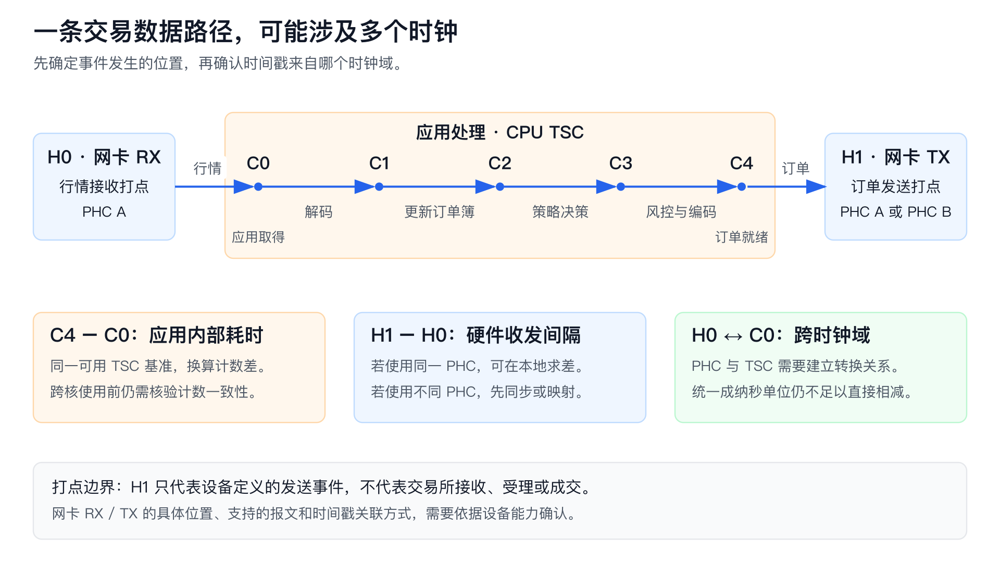
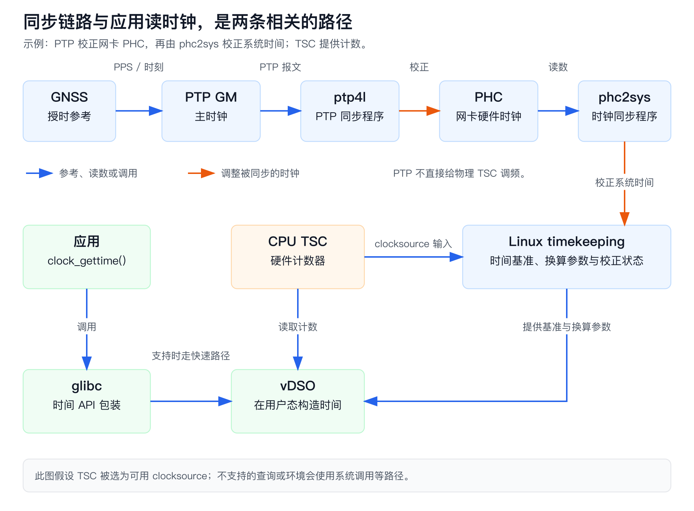
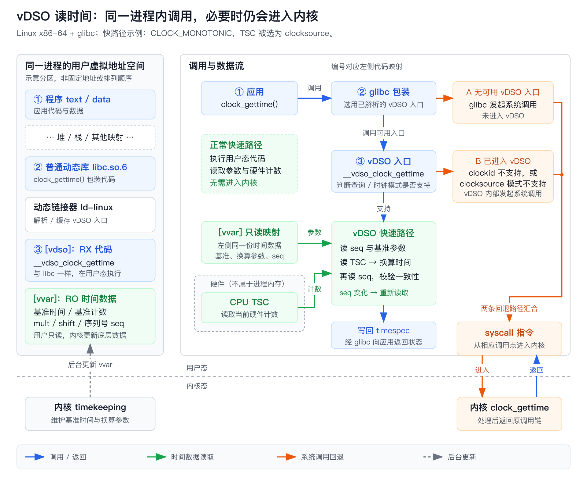
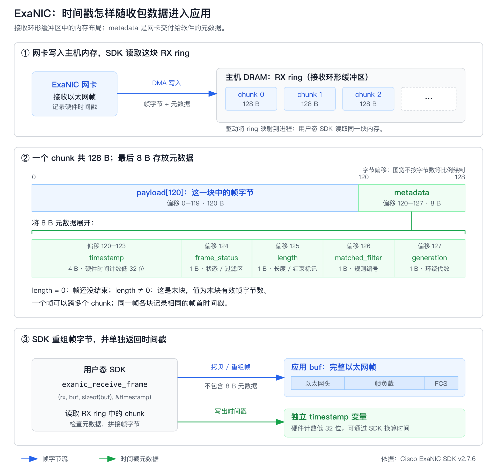
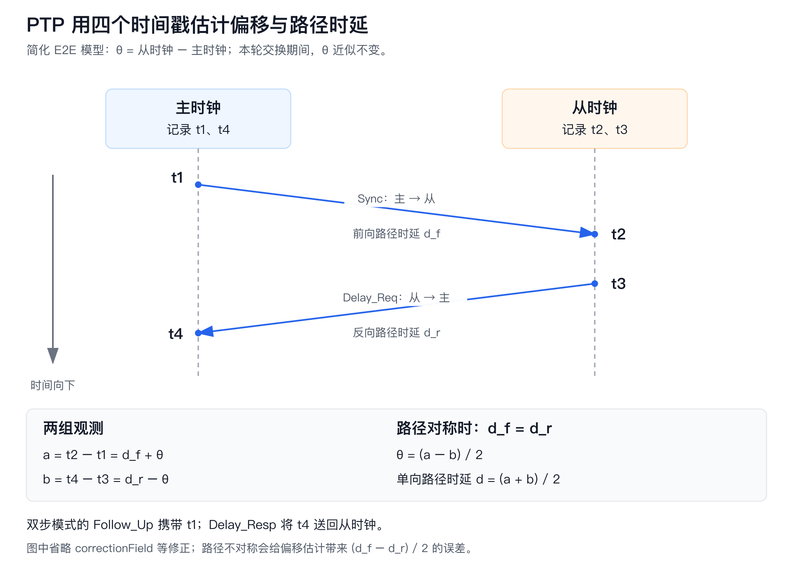
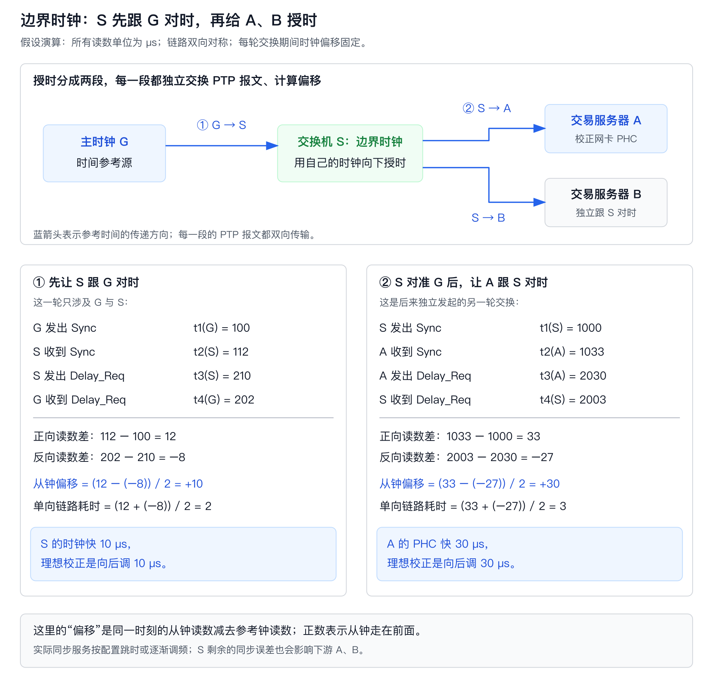
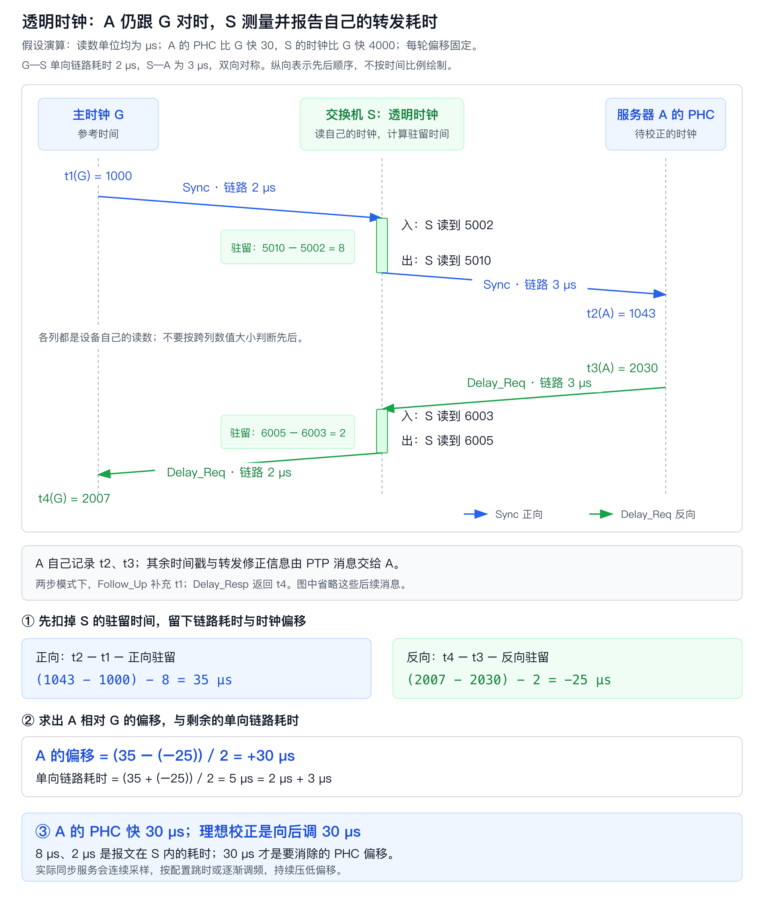

# HFT Engineering从入门到入土（4）—— 深入理解计算机时钟

判断交易系统快慢之前，有一个问题贯穿整条交易路径：我们用来测量耗时的时间，到底是怎么得到的？

一条行情到达网卡后，程序读取行情、更新订单簿、执行策略，最后发出订单。网卡可以记录收发报文的时间，程序可以在各阶段读取 CPU 计数器，交易所回报里也可能带有自己的时间戳。这些数字虽然都表示时间，起点、单位和生成方式却未必相同。

解释一个时间戳，要知道**它记录了什么事件、由哪个时钟生成、采用什么时间基准，以及存在多大的误差**。这些信息决定了硬件计时、Linux 接口、网络同步和稳定性测量各自要解决的问题。CPU 计数器部分以 x86 TSC 为例。

<a id="sec-1"></a>
## 1. 高频交易系统为什么需要时钟

### 1.1 同一个交易系统，需要回答几种不同的时间问题

分析策略决策时，我们关心计算用了多久；排查跨机故障时，希望把几台机器的日志对应起来；观察一次下单时，则关心从行情到订单的 tick-to-order 延迟。

| 场景 | 具体问题 | 对时钟的主要要求 |
|---|---|---|
| 进程内性能分析 | 更新订单簿和策略计算各花了多久？ | 区间可比较、读取成本低、打点不扰乱热路径 |
| 本机行情到发单 | 行情进入网卡，到订单离开网卡用了多久？ | 收发边界清楚、硬件时间戳可对应 |
| 跨机日志与单向延迟 | A 发出后，B 何时收到？ | 两端时间基准可比较，同步误差足够小 |

### 1.2 从一条行情到一笔订单，先标清测量边界

沿用前文的记号：`H0` 是网卡接收行情的硬件打点，`C0` 是应用取得行情，`C4` 是订单完成风控与编码，`H1` 是网卡发送订单的硬件打点。



`C4 - C0` 覆盖应用内部处理；`H1 - H0` 覆盖本机从接收行情到发出订单的路径。固定测量口径后，优化前后的结果才有可比性。

网卡常使用 PHC（PTP Hardware Clock，精确时间协议的硬件时钟）生成时间戳。如果 `H0`、`H1` 由同一个 PHC 产生，且测量区间没有时钟跳变，通常可以直接计算这两个硬件打点之间的时间。

<a id="sec-2"></a>
## 2. 先分清我们需要哪一种时间

### 2.1 绝对时间、时间间隔与时钟域

绝对时间把事件放到一条公共时间线上，例如日志中的日期与时刻。时间间隔描述两个事件之间经过了多久，关注的是这段持续时间。

时钟域在这里指采用同一套计时基准和解释规则的时间戳集合。一台机器可以同时有 CPU TSC、多个网卡 PHC，以及具有不同语义的系统时钟；两个进程也可以读取同一台机器上的相同系统时钟。因此，时钟域与机器、进程并非一一对应。

时钟域之间的差异包括起点、计数单位、频率，以及接受的时间校正。

<a id="sec-3"></a>
## 3. 时间从哪里来

### 3.1 振荡器产生节拍，计数器累计节拍

可以把本地计时拆成两步：振荡器产生周期信号，计数器记录经过了多少个周期。软件再利用频率和一个已知时间点，把计数换算成时间：

$$
t=t_0+\frac{c-c_0}{f}
$$

其中，`c0` 是基准时刻的计数，`t0` 是它对应的时间，`f` 是用于换算的计数频率。换算结果取决于三个因素：`t0` 的准确度、`f` 的稳定性，以及读到的 `c` 对应事件的哪个位置。

石英振荡器利用晶体的机械谐振产生频率参考。现有的振荡器会通过不同方式减小环境影响。但温度、振动和器件老化仍可能改变其频率。[NIST：石英振荡器][nist-quartz]

服务器的 RTC（实时时钟）通常由备用电池供电，在主机关闭后仍继续记录日期和时刻。操作系统启动时，可以读取 RTC，为系统日历时间设定初值。[Linux RTC 手册](https://man7.org/linux/man-pages/man4/rtc.4.html)

系统运行后，Linux 通常利用 CPU 的 TSC 等硬件计数器计算时间。内核保存一个基准时间及其对应的计数值；程序读取时间时，再读取当前计数，将计数增量换算成经过的时间，加到基准时间上，就得到当前时间。因此，程序读取系统时间通常不需要访问 RTC。[Linux timekeeping][timekeeping]

### 3.2 CPU TSC 与 RDTSC

x86 的 TSC（Time Stamp Counter）是处理器提供的时间戳计数器，`RDTSC` 是读取它的指令。读取结果是计数值，通过相应的换算关系才能把计数差解释成纳秒。

在支持 invariant TSC 的处理器上，TSC 按固定速率推进，不随核心的动态频率状态一起变化。

固定的计数速率解决了“按什么速度走”的问题。把两个 TSC 读数相减来测量耗时时，还会遇到三种情况。

**第一种：起点和终点在不同的 CPU 核上读取。** 两个核心即使计数速度相同，同一时刻的读数也未必相同。假设核心 B 始终比核心 A 多计数 100，两者的变化如下：

| 时刻 | 核心 A 的 TSC | 核心 B 的 TSC |
|---|---:|---:|
| 开始测量时 | 1000 | 1100 |
| 经过 200 个计数后 | 1200 | 1300 |

如果线程在 A 上读取起点，随后迁移到 B 上读取终点，直接相减得到 `1300 - 1000 = 300`。实际只经过了 200 个计数，多出来的 100 来自两个核心的计数偏移。

同一台机器的不同 socket 之间也涉及这种比较。socket 指物理 CPU 插槽；双路服务器中的两颗 CPU 各自包含多个核心。线程换核，或由两个线程分别记录起点和终点时，能否直接相减取决于这些核心的 TSC 是否对齐，以及剩余偏差是否满足测量要求。始终在同一个逻辑 CPU 上完成两次读取，可以避开跨核计数偏移这一项；跨核测量则要依据平台的同步保障与实际偏差来判断。[Linux TSC 同步说明](https://docs.kernel.org/virt/kvm/x86/timekeeping.html#tsc-synchronization)

**第二种：两次都在同一个核上读取，但读数没有夹住被测计算。** 源代码虽然写成“读取起点 → 执行计算 → 读取终点”，CPU 却可以在计算尚未完成时执行结束处的裸 `RDTSC`。这样得到的差值漏掉了后半段耗时。计数器仍然正常递增，错误出在读取时间戳的时机。约束 CPU 的执行顺序和编译器重排，才能把打点放到预期位置；5.4 节给出了具体的指令结构。[Intel 指令集参考][intel-sdm-vol2]

**第三种：起点和终点来自不同的服务器。** 例如，服务器 A 在发送消息时读取 TSC，服务器 B 在收到消息时读取 TSC。两台机器各有自己的计数起点与频率；都支持 invariant TSC，只说明各自的计数速率不随核心动态频率变化，不说明两台机器已经对时。直接用 B 的接收计数减去 A 的发送计数，会把时钟之间的差异也算进网络延迟。跨机测量时，先将两边读数转换到共同的时间基准，并评估同步和换算误差，再计算时间差。

### 3.3 网卡 PHC 与交换机时钟

PHC 是 PTP Hardware Clock 的缩写。在支持的 Linux 驱动中，设备时钟可以注册为 `/dev/ptpN`，应用既能读取它，也能通过相关接口获取能力、调整时间或频率。具体哪些功能可用，取决于设备和驱动。[Linux PHC 接口][linux-phc]

网卡在报文经过指定硬件位置时捕获时钟读数，形成硬件时间戳。多端口网卡可以共享 PHC，也可以采用其他时钟布局；设备信息中的时钟布局决定了各端口的PHC读取行为。

交换机同样可以在端口或内部转发路径中记录时间。

### 3.4 原子钟与卫星授时提供什么

原子钟利用稳定的原子跃迁频率作为参考，通过反馈控制本地振荡器，再由计数构造时间。它仍然涉及振荡、计数和校准，只是参考机制具有更好的长期稳定性。[NIST：原子振荡器][nist-atomic]

交易服务器通常通过授时链路取得参考。一个常见部署是：GNSS（全球卫星导航系统，例如 GPS）接收机提供时间与频率参考，主时钟设备结合本地振荡器生成授时输出，再通过网络把时间分发给服务器。GPS 驯服振荡器会持续调整本地振荡器，使它与接收的参考信号保持一致。[NIST：驯服振荡器][nist-disciplined]

<a id="sec-4"></a>
## 4. 时钟为什么逐渐不一致

### 4.1 先分清偏移、频率误差和漂移

本地时钟比参考时钟领先 5 微秒，这 5 微秒就是**时间偏移**，描述的是两个时钟现在差多少。

如果本地时钟每秒还会多走 1 微秒，说明它走得偏快，**相对频率误差**为 +1 ppm。ppm（parts per million）表示百万分之一。假如它一直保持这个速度，期间没有校正，那么 10 秒后又会多走 10 微秒，加上原先领先的 5 微秒，就一共领先了 15 微秒。

如果走得偏快的程度也在变化，例如温度升高后，从每秒多走 1 微秒逐渐变成每秒多走 2 微秒，这就是**频率漂移**。

### 4.2 一次时钟对齐为什么不够

把两个时钟在某个时刻设成相同读数，只消除了当时的偏移。只要后续推进速度不同，偏差还会重新增长。温度变化、预热、供电与器件老化，又会让频率误差随时间变化。[NIST：漂移与驯服][nist-disciplined]

同步程序通过持续观测偏差、调整时间或频率来维持两个时钟的关系。直接把时钟改到另一个值称为跳变校正（step）；逐渐改变推进速度、让偏差慢慢消失称为渐进校正（slew）。具体策略由同步软件和配置决定。

### 4.3 测量噪声也会出现在偏差曲线里

在用户态先读时钟 A，再读时钟 B，两次读取之间存在时间差。系统调用、设备访问或线程抢占都可能扩大这个间隔；网络同步还会受到排队、打点位置和路径不对称的影响。

偏差曲线上出现尖峰时，采样窗口、同步状态和参考源变化可以帮助定位原因。把这些观测与曲线对应起来，可以进一步判断波动来自哪些环节。

<a id="sec-5"></a>
## 5. Linux 程序如何读取时间

### 5.1 硬件计数与系统时间之间，还有 timekeeping

Linux 把用于计时的硬件计数来源称为 clocksource。在合适的 x86 平台上，TSC 可以成为 clocksource。内核会记下某一时刻的系统时间，以及当时的硬件计数值。之后读取时间时，先算出计数增加了多少，再换算成经过的纳秒数，加到之前记下的时间上，就得到当前时间。

假设计数器每增加 1，代表经过 2.5 纳秒，那么新增 100 个计数就对应 250 纳秒。计算时，“乘以 2.5”可以改写成“先乘以 5，再除以 2”。对于这里的非负整数，右移 1 位就相当于除以 2 后舍去余数，因此也可以写成“先乘以 5，再右移 1 位”。

代码中的 `mult` 就是乘数，`shift` 就是右移的位数；在这个例子里，分别是 `5` 和 `1`。实际使用的参数由内核根据计数器频率预先计算。换算过程可以简化成下面两行，其中 `delta_cycles` 是新增的计数，`delta_ns` 是换算出的纳秒数，`base_ns` 是之前记下的基准时间，也以纳秒表示：

```text
delta_ns ≈ (delta_cycles * mult) >> shift
time_ns  ≈ base_ns + delta_ns
```

这样就能用整数运算完成从计数到纳秒的换算。实际代码还要处理计数器的位数限制和溢出，遵守不同类型时钟的计时规则，并保证读取过程不会混用更新前后的数据。[Linux timekeeping][timekeeping]

系统时间校正会更新相应的软件时间状态和换算关系。通过 PTP 校准 PHC、再校准系统时间时，**改变的是对应时钟及软件换算关系，物理 TSC 并未被设成某个 UTC 数值。**



同步程序负责维持时钟关系，应用则沿读取路径取得打点所需的读数。具体部署可以选择不同的 clocksource 或参考源。

### 5.2 clock_gettime 的重点在 clock ID

`clock_gettime(clockid, &ts)` 的根据输入的`clockid` 决定读取时钟数值的语义。常用选择如下：[Linux clock_gettime][clock-gettime]

| 接口或时钟 | 适合的用途 | 主要边界 |
|---|---|---|
| `CLOCK_REALTIME` | 日历时间、带外部时间含义的记录 | 可能发生跳变，也接受频率校正 |
| `CLOCK_MONOTONIC` | 通常的耗时、期限与超时判断 | 不随日历时间的直接跳变而跳变，但接受频率校正；不包含系统挂起时间 |
| `CLOCK_MONOTONIC_RAW` | 观察未受软件频率校正的计时行为 | 保留本地频率误差；RAW 不代表更接近外部参考 |
| `CLOCK_BOOTTIME` | 需要包含系统挂起时间的期限 | 具有与 MONOTONIC 不同的挂起语义 |
| `CLOCK_TAI` | 采用 TAI 语义的时间记录(基于原子振荡周期的国际原子时,相对应的是基于地球自转的世界时UTC) | 依赖系统时间与 TAI 偏移配置 |
| `CLOCK_THREAD_CPUTIME_ID` | 当前线程消耗的 CPU 时间 | 不是包含排队和等待的真实经过时间 |

两个进程读取同一台主机上的 `CLOCK_MONOTONIC`，通常可以直接关联时间点；两台机器的 `CLOCK_MONOTONIC` 则没有天然共同起点。`clock_getres()` 返回的是分辨率，与参考时钟之间的误差上界还要有另外的校准或测量依据。

在 C++ 中，`std::chrono` 用 `time_point` 表示时间点，用 `duration` 表示两个时间点之间的时长。不同的时钟类型决定这些读数有什么含义；底层调用哪个接口，则由标准库和操作系统决定。下面以 Linux 上常见的 libstdc++ 实现为例。

**`steady_clock`：用来测经过了多久**

`steady_clock` 适合测量函数耗时、设置超时期限。C++ 要求它的读数随着时间推进不倒退，`is_steady` 为 `true`。这里的“不倒退”允许连续两次读到相同值，并不要求每次调用都比上一次大。它的计时起点由实现决定，使用时主要关心两个时间点之差，而不是把读数转换成某年某月某日。[C++ 时钟要求][cpp-clocks]

在上述 Linux 实现中，`steady_clock::now()` 调用 `clock_gettime(CLOCK_MONOTONIC, ...)`，再把返回的秒和纳秒包装成 C++ 时间点。C++ 标准库负责封装读取结果，保持单调的是 Linux 的计时机制。[libstdc++ 的时钟读取实现][libstdcpp-chrono-source]

Linux 根据硬件计数的增量推进时间，同时维护日历时间与单调时间之间的偏移。当管理员把日历时间拨回 30 秒时，内核会同步调整这个偏移，抵消拨钟对单调读数的影响，使单调时间保持连续。可以理解为：修改了“现在是几点”，却没有把“已经经过了多久”减掉 30 秒。[Linux 时间校正实现][linux-timekeeping-source]

Linux 的 `CLOCK_MONOTONIC` 仍会接受 NTP 等同步程序对走时速度的微调，因此这里的 `steady_clock` 与 `CLOCK_MONOTONIC_RAW` 不同。线程被抢占、等待 I/O 的时间都会计入这个时钟测得的耗时；整个系统挂起期间的时间则不计入。[Linux clock_gettime][clock-gettime]

**`system_clock`：用来记录事件发生在什么时候**

`system_clock` 表示系统的日历时间，适合记录行情到达、订单发出等事件的日期和时刻。从 C++20 起，标准明确规定它使用 Unix 时间：从 1970 年 1 月 1 日 00:00:00 UTC 起计算经过的时间，不计闰秒。[C++ system_clock][cpp-system-clock]

在上述 Linux 实现中，`system_clock::now()` 读取的是 `CLOCK_REALTIME`。[libstdc++ 的时钟读取实现][libstdcpp-chrono-source] 管理员改时间或同步程序执行跳变校正时，它的读数可以向前跳，也可以向后跳。[Linux clock_gettime][clock-gettime]

例如，一段代码实际运行了 2 秒，期间日历时间被拨回 30 秒，用 `system_clock` 的结束读数减去开始读数，就会得到约 -28 秒；同一段代码用 `steady_clock` 测量，仍是约 2 秒。因此，日志记录时刻用 `system_clock`，计算处理耗时用 `steady_clock`。

**`high_resolution_clock`：名字强调分辨率，是否单调要看实现**

`high_resolution_clock` 的标准语义是提供最短的计时刻度，但标准允许它直接成为 `system_clock` 或 `steady_clock` 的别名。它不一定对应第三套独立的底层时钟，也不一定比其他的时钟接口具有更高的精度。[C++ high_resolution_clock][cpp-high-resolution-clock]

例如，libstdc++ 把它定义为 `system_clock` 的别名，因此也会受日历时间跳变影响；libc++ 在支持单调时钟的平台上，则把它定义为 `steady_clock` 的别名。同一段使用 `high_resolution_clock` 的代码，更换标准库后，时钟行为就可能不同。[libstdc++ 类型定义][libstdcpp-chrono-header]、[libc++ 类型定义][libcpp-high-resolution-clock]

计时刻度也不等于测量准确度。即使一个时钟用纳秒表示读数，也不意味着每隔 1 纳秒就能读到不同的值，更不意味着读取一次只花 1 纳秒。当 `high_resolution_clock::is_steady` 为 `true` 时，它保证读数不倒退；实际能分辨多短的间隔、读取开销有多大，还要在目标机器上测量。[C++ Clock 要求][cpp-clock-requirements]

### 5.3 glibc 与 vDSO：一次函数调用未必进入内核

在使用 glibc 的 Linux 程序中，应用通过它调用 `clock_gettime`。当平台、时钟种类和内核实现支持时，glibc 会调用 vDSO（virtual Dynamic Shared Object）。它是内核映射到进程地址空间的小型共享对象，代码在用户态运行。[Linux vDSO][vdso]

以动态链接 glibc 的 Linux x86-64 程序为例，`libc.so.6` 和动态链接器 `ld-linux` 都映射在进程的用户虚拟地址空间中。内核还会映射两块相关区域：`[vdso]` 存放可在用户态执行的代码，`[vvar]` 存放时间基准、换算参数等数据。应用只能读取这些时间数据，由内核负责更新。[Linux vDSO 映射实现][vdso-mapping]

启动时，内核通过辅助向量中的 `AT_SYSINFO_EHDR` 告知 vDSO 的基址。glibc 找到需要的函数入口并保存下来，之后读取时间时就能直接调用。[Linux vDSO][vdso]、[glibc vDSO 初始化][glibc-vdso-setup]



图中左侧展示同一进程中的内存区域，右侧展示调用和数据流。内存区域的顺序与大小仅作示意；快速路径以 `CLOCK_MONOTONIC` 等受支持的高精度时钟、TSC 被选作计数来源的情况为例。

在快速读取路径中，glibc 调用 `__vdso_clock_gettime`，vDSO 读取 `[vvar]` 中的时间基准与换算参数，再读取 TSC，计算当前时间。内核更新参数可能与读取并发发生，因此读取过程会检查序列号；发现数据更新过，就在用户态重新读取，避免拼出由两代参数组成的时间。成功后，vDSO 把秒和纳秒写入调用者提供的 `timespec`，再沿调用链返回。[Linux vDSO 实现][vdso-source]

系统调用回退有两个入口：

- **glibc 没有找到可用的 vDSO 入口**：直接发起系统调用，让内核处理这次查询。[glibc clock_gettime 实现][glibc-clock-gettime]
- **已经进入 vDSO，但这次查询无法走快速路径**：例如请求的 `clockid` 或当前硬件计时模式不受支持，vDSO 会在内部执行回退代码，通过 `syscall` 指令进入内核。[Linux vDSO 实现][vdso-source]、[x86-64 回退代码][vdso-fallback]

PHC 等设备时钟有自己的读取路径，不能直接套用普通系统时钟的快速读取成本。

这条调用链上，glibc 提供应用接口，vDSO 提供用户态实现路径，内核 timekeeping 管理时间状态，硬件计数器提供计数来源。vDSO 可以使用 TSC，两者位于计时链路的不同层。

### 5.4 直接读 TSC 时，要同时控制测量边界

即使 TSC 的计数速率完全稳定，测得的耗时也可能出错，因为**读取时间戳的瞬间，未必落在被测操作的开始和结束处**。其中一个原因就是 CPU 的乱序执行：在满足指令依赖和体系结构规则的前提下，处理器可以让后面的指令先执行，或让多条指令的执行过程重叠。

例如，被测代码先加载数据，再根据数据完成计算。如果结束处直接使用裸 `RDTSC`，一次可能的执行交错如下：

```text
希望测到：起点读数 → 发起加载 → 数据返回 → 计算完成 → 终点读数
可能发生：起点读数 → 发起加载 → 终点读数 → 数据返回 → 计算完成
```

`RDTSC` 不会自动等待此前所有指令完成，所以加载仍在等待数据时，终点读数就可能已经取得，漏掉后半段耗时。起点同样存在问题：被测指令可以在起点读数完成前开始执行。区间外的工作还可能与被测代码重叠、争用资源，使结果混入额外等待。这类误差来自测量边界，增加采样次数或校准 TSC 频率无法修复错误的指令顺序。[Intel SDM：RDTSC、RDTSCP][intel-sdm-vol2]

在支持 `RDTSCP` 的 Intel x86-64 处理器上，测量本核执行区间可以采用下面的指令结构。这里省略了保存读数和计算差值的指令，展示的是最终机器码中的排序关系：

```text
LFENCE
RDTSC       ← 取得起点计数
LFENCE

被测指令

RDTSCP      ← 取得终点计数
LFENCE
```

起点前的 `LFENCE` 等待此前指令在本核完成执行；起点后的 `LFENCE` 阻止被测指令越过读钟位置提前执行。终点的 `RDTSCP` 等待此前指令执行及加载完成，后面的 `LFENCE` 再阻止后续指令越过终点读钟位置。[Intel SDM：LFENCE、RDTSCP][intel-sdm-vol2]

这个结构没有把此前的存储操作全部变为全局可见作为完成条件。若测量目标包含这一步，可以按 Intel 文档在终点 `RDTSCP` 前加入 `MFENCE`；若起点也要等待此前存储全局可见，可以使用 `MFENCE; LFENCE; RDTSC`。存储全局可见与消费线程已经读取、处理完数据，仍是不同的完成点；测量线程交接时，后者由消费端打点或确认。[Intel SDM：RDTSC、RDTSCP][intel-sdm-vol2]

编译器重排发生在更早的阶段。即使 CPU 屏障安排正确，编译器也可能提前计算表达式、把计算移出区间，或删除没有被使用的结果。以 GCC 内联汇编为例，`asm volatile` 可以防止读钟汇编因输出未使用而被删除，或被当成不变结果移出循环；`memory` clobber 约束编译器对内存访问的移动。纯寄存器计算仍可能跨越这些汇编。被测结果要被实际使用，输入输出约束也要表达必要的数据依赖，最后检查优化后的汇编，确认目标计算仍在计时区间内。[GCC 扩展汇编][gcc-extended-asm]

屏障和读钟本身也有成本，测得的差值会包含部分测量开销。可以先测同样指令结构的空区间，观察基线及其波动，再测目标代码。由于屏障改变了原本可以重叠的执行过程，空区间耗时不能作为一个通用常数，从任意结果中精确扣除。尤其在交易热路径上，每个阶段都加屏障可能改变被测程序的延迟，打点频率与测量扰动也要一起评估。

### 5.5 读得准与执行得准是两个问题

用单调时钟计算出一个撤单期限，只说明目标时刻如何表示。线程何时醒来、何时获得 CPU、何时完成发单，仍受调度和执行路径影响。

假设线程要等待 20 µs 再继续执行。调用 `nanosleep()` 或 `clock_nanosleep()` 后，线程会进入休眠，定时器到期后还要等待调度器让它重新运行。因此，接口能接收纳秒单位的参数，并不意味着线程能在指定的纳秒准时恢复。[Linux clock_nanosleep][clock-nanosleep]

**如果线程已经运行在专用 CPU 上，而且允许等待期间持续占用 CPU，对 20 µs 这样的短等待，我会优先选择忙等：反复读取单调时钟，到期限就退出循环。** 这样省去了主动休眠后的唤醒和调度过程。DPDK v25.11 的 `rte_delay_us()` 默认采用这一类实现：读取计数器，检查经过的时间，在循环中执行 `rte_pause()`。[DPDK 延时实现][dpdk-delay-source]

这种短等待的一个实际用途，是**按原始节奏回放行情，测试系统处理真实流量的表现**。Beeks 在 2024 年介绍 mdPlay 的技术文章中，记录了他们对三种回放方案的比较：先录制某大型交易所繁忙时段的一小时行情，再回放并重新抓包，比较逐包间隔和累计时间偏差。回放用于算法验证、压力测试和故障复现；还原行情的微突发，是其中一个关键要求。[Beeks：Multicast Market Data Replay][beeks-market-replay]

用一个简化例子看，假设抓包记录中的三个行情报文按下面的时间到达。20 µs 是这里选取的演示间隔，实际回放使用每个报文自己的时间戳。

| 报文 | 相对首包的到达时间 | 回放时的目标发送时刻 |
|---|---:|---|
| A | 0 µs | `t0` |
| B | 20 µs | `t0 + 20 µs` |
| C | 40 µs | `t0 + 40 µs` |

如果把三个报文紧挨着发送，就人为制造了更密集的突发；如果每次原本想等 20 µs，却等了 80 µs，被测系统就有了更多空闲时间，测试压力偏低。精确控制等待时间，是为了尽量保持原始流量节奏。

软件回放可以先确定起点 `t0`，再按表中的绝对期限提交报文。如果从 `t0` 到准备好 B 已经过了 3 µs，就只等待剩下约 17 µs。C 的目标时刻仍是 `t0 + 40 µs`，这样不会把前面发送和等待的额外开销逐次累加到后续期限。

这段软件等待控制的是应用提交发送的时刻，报文真正离开网卡还受发送队列和设备处理影响。Beeks 的对比中，一种方案在软件中等待发送时机；**在那次测试中表现最好的方案则把报文提前交给专用网卡，由网卡自己的时钟控制发送**。[Beeks 的回放实现与测试][beeks-market-replay]

<a id="sec-6"></a>
## 6. 网卡和交换机如何给事件打时间戳

### 6.1 打点位置决定了延迟包含什么

应用调用接收函数后再读取时间，得到的是应用已经拿到数据时的读数。报文此前可能已经经过网卡、DMA（直接内存访问）、驱动、内核网络栈和调度等待。使用内核旁路时，路径会变化，但应用打点与硬件接收之间仍然存在一段处理过程。

硬件时间戳把事件捕获位置移到了设备内部，减少了应用调度对事件时间的影响。它究竟对应哪个瞬间，取决于设备在 PHY（物理层）、MAC（介质访问控制层）或其他参考平面的打点位置，以及对报文首部、尾部和固定补偿的定义。

发送方向也一样：应用提交发送请求时，数据可能还在队列里；真正的发送硬件打点发生在后续设备路径中。打点位置改变后，测量覆盖的区间也改变了。

### 6.2 Linux socket 与专用 SDK 如何交付时间戳

在标准 socket 路径中，应用配置设备与驱动支持的硬件打点能力，并通过 `SO_TIMESTAMPING` 请求相应类型的时间戳。接收时间戳通过 `recvmsg()` 的辅助数据返回；发送时间戳则在稍后通过 `recvmsg(..., MSG_ERRQUEUE)` 读取。[Linux 网络时间戳][timestamping]

这条路径将时间戳与业务 payload 分开交付。Linux 提供时间戳关联 ID 等机制，把发送时间戳对应到原来的发送事件。多个请求同时在途时，返回顺序未必与调用 `send()` 的顺序一致。TCP 还存在字节流与报文边界的差异：一条业务消息可以跨包，一个包也可以包含多条业务消息，因此包与订单的时间戳之间还依赖消息层的对应规则。

专用网卡还可以把时间戳写进 SDK 约定的接收元数据。以 Cisco Nexus SmartNIC（原 ExaNIC）及 `libexanic v2.7.6` 为例，网卡通过 DMA 将接收数据写入主机内存中的环形缓冲区。这个缓冲区由 128 字节的块（chunk）组成：前 120 字节是帧数据区，后 8 字节是时间戳、长度和状态等元数据。SDK 通过用户态映射读取这片接收内存。[Cisco 接收架构][exanic-internals]、[SDK 接收映射][exanic-rx-mapping]



图中的 `payload[120]` 存放以太网帧的字节片段，包括相应位置的协议头。**后面的 8 字节是网卡写入主机内存时附带的元数据，不是网络报文自身的尾部。** 一个较长的帧会占用多个 chunk；`length = 0` 表示当前 120 字节已满、后面还有块，非零则表示这是最后一块，并给出这块有效的帧字节数。[接收块结构定义][exanic-rx-layout]

`timestamp` 占 4 字节，记录帧开始到达时网卡时钟计数的低 32 位。同一帧的各个 chunk 携带相同的时间戳，因此即使 SDK 最后从末块取出这个值，它表示的仍是帧开始到达的时刻。另几个字段分别用于记录帧状态、命中的过滤规则，以及环形缓冲区绕回的代数。[接收块结构定义][exanic-rx-layout]、[Cisco 接收接口说明][exanic-lib]

应用调用完整帧接收接口时，帧字节与时间戳分别进入两个输出位置：

```c
// rx 已指向接收缓冲区。
char buf[2048];
exanic_cycles32_t timestamp;
ssize_t len = exanic_receive_frame(rx, buf, sizeof(buf), &timestamp);
// len > 0 时，buf 中有 len 字节的完整帧，timestamp 中有硬件时间戳。
```

SDK 将各个 chunk 的有效帧字节拼接、复制到 `buf`，并把时间戳写入独立变量 `timestamp`。`buf` 中包含以太网帧头、数据和 FCS（帧校验序列），不包含那 8 字节接收元数据。`timestamp` 的原始值以网卡时钟计数为单位；接收后及时用 `exanic_expand_timestamp()` 恢复高位、扩展为 64 位，可以避免低 32 位回绕产生的歧义，再通过 `exanic_cycles_to_ns()` 等接口换算时间。[SDK 帧接收实现][exanic-rx-source]、[Cisco 时间戳接口说明][exanic-lib]

<a id="sec-7"></a>
## 7. 多台设备如何同步时钟

### 7.1 同步需要估计偏移，还要处理传输延迟

主时钟发送“现在是某个时刻”时，消息到达接收端已经过去了一段时间。接收端若直接把时钟设成消息中的时间，就会落后一个传输延迟。

NTP（Network Time Protocol）和 PTP（Precision Time Protocol）都通过估计时间偏移与网络延迟来同步时钟。NTP 常用于系统日历时间同步；PTP 则围绕设备时钟、硬件打点和网络设备协作提供同步机制，适合受控网络中的精细同步。最终误差由参考源、打点路径、网络和控制算法共同决定。[NTPv4 RFC][ntp-rfc] [LinuxPTP ptp4l][ptp4l]

LinuxPTP 是在 Linux 上实现 PTP 协议的开源软件包。PTP 规定设备之间怎样交换授时信息，LinuxPTP 则提供实际运行的程序，让服务器参与同步、持续校正本机时钟。`ptp4l` 和 `phc2sys` 是其中两个常用程序。[LinuxPTP 项目介绍][linuxptp]

### 7.2 用四个时间戳理解 PTP

先看一个简化的端到端延迟测量模型。设主时钟为参考，从时钟相对主时钟的偏移为 `θ`，即“从钟减主钟”。假设一次交换期间 `θ` 近似不变，先忽略打点噪声和中间设备的修正项。



四个时间戳分别是：

| 时间戳 | 事件 | 使用的时钟 |
|---|---|---|
| `t1` | 主时钟发送 Sync | 主时钟 |
| `t2` | 从时钟接收 Sync | 从时钟 |
| `t3` | 从时钟发送 Delay_Req | 从时钟 |
| `t4` | 主时钟接收 Delay_Req | 主时钟 |

令主到从的延迟为 `df`，从到主的延迟为 `dr`，则：

$$
t_2-t_1=d_f+\theta,\qquad
t_4-t_3=d_r-\theta
$$

如果往返路径对称，即 `df = dr = d`，就能得到：

$$
\widehat{\theta}=\frac{(t_2-t_1)-(t_4-t_3)}{2},\qquad
\widehat d=\frac{(t_2-t_1)+(t_4-t_3)}{2}
$$

从时钟自己记录了 `t2` 和 `t3`，还需要主时钟把 `t1` 和 `t4` 告诉它。在两步模式下，主时钟先发送 Sync，再通过 `Follow_Up` 消息补充它的准确发送时刻 `t1`；收到 `Delay_Req` 后，通过 `Delay_Resp` 消息返回接收时刻 `t4`。拿齐这四个时间戳，从时钟就能按上述公式估计时间偏移和链路延迟。[NIST PTP 测量说明][nist-ptp]

### 7.3 硬件时间戳无法自动消除路径不对称

如果两个方向延迟不同，却仍按对称公式估计偏移，会得到：

$$
\widehat{\theta}-\theta=\frac{d_f-d_r}{2}
$$

例如两个方向的剩余延迟相差 400 ns，偏移估计就会带入 200 ns 偏差。增加采样次数可以帮助分析随机波动，固定的方向偏差则仍会保留。

硬件打点主要减少软件收发路径的不确定性。光纤、链路、设备内部延迟和打点参考位置仍可能带来不对称。LinuxPTP 的 `ptp4l` 提供 `delayAsymmetry`、`ingressLatency` 和 `egressLatency` 等配置，用于填写有校准依据的补偿值。[LinuxPTP ptp4l][ptp4l]

### 7.4 交换机中的边界时钟与透明时钟

场景是：**主时钟 G 提供参考时间，交易服务器 A、B 各自把网卡 PHC 对准这个参考，而它们与 G 之间隔着交换机 S。** A、B 不互相对时；G 是授时源，S 才是报文途中经过的设备。如果 S 只做普通转发，报文在两个方向上的排队时间不同，就会干扰时钟偏移的估计。[Cisco：交换机延迟与 PTP][cisco-ptp-switch]

下面分别把 S 配置成边界时钟和透明时钟，用 A 的对时过程展开计算，B 独立执行相同流程。两组算例都采用两步消息模式。数字均用于演算，单位为 **μs**，时间戳省略共同的日期时间前缀；假定每轮交换期间时钟偏移不变，扣除交换机驻留时间后，两个方向的链路延迟相等。

**边界时钟 BC（Boundary Clock）：G 先给 S 对时，S 再给 A、B 对时**

S 的上联端口作为从时钟跟随 G，下联端口作为主时钟给 A、B 授时。G 发来的对时消息在 S 结束，S 用自己的硬件时钟生成下游的 Sync 消息，因此这是两段独立的对时交换。[TI：边界时钟][ti-ptp]



第一段，G 与 S 交换消息，记录到：

| 时间戳 | 事件 | 读哪只钟 | 读数（μs） |
|---|---|---|---:|
| `t1` | G 发出 Sync | G | 100 |
| `t2` | S 收到 Sync | S | 112 |
| `t3` | S 发出 Delay_Req | S | 210 |
| `t4` | G 收到 Delay_Req | G | 202 |

S 自己有 `t2`、`t3`，再通过 `Follow_Up`、`Delay_Resp` 取得 G 记录的 `t1`、`t4`，就能计算：

```text
正向读数差 = 112 − 100 = 12 μs
反向读数差 = 202 − 210 = −8 μs

S 相对 G 的偏移 = [12 − (−8)] / 2 = +10 μs
单向链路延迟   = [12 + (−8)] / 2 =   2 μs
```

正向的 `12 μs` 包含“链路延迟 + S 的偏移”，反向的 `−8 μs` 包含“链路延迟 − S 的偏移”。两者相减，链路延迟抵消，剩下两倍的偏移，所以再除以 2 就得到偏移。相加则会抵消偏移，得到往返链路延迟。

`+10 μs` 表示 S 比 G 快了 10 μs。反向读数差为负，是因为两次读数来自不同的钟，不表示反向链路延迟是负数。

为方便继续演算，设 S 校正后已与 G 对齐。第二段由 S 给 A 对时，另一次交换得到：

| 时间戳 | 事件 | 读哪只钟 | 读数（μs） |
|---|---|---|---:|
| `t1` | S 发出新的 Sync | S | 1000 |
| `t2` | A 收到 Sync | A 的 PHC | 1033 |
| `t3` | A 发出 Delay_Req | A 的 PHC | 2030 |
| `t4` | S 收到 Delay_Req | S | 2003 |

```text
正向读数差 = 1033 − 1000 =  33 μs
反向读数差 = 2003 − 2030 = −27 μs

A 相对 S 的偏移 = [33 − (−27)] / 2 = +30 μs
单向链路延迟   = [33 + (−27)] / 2 =   3 μs
```

A 据此知道自己的 PHC 比 S 快了 30 μs，可以进行校正。这里 S 已对准 G，所以对准 S 就间接对准了 G；真实部署中，S 自身留下的同步误差也会影响下游。

**透明时钟 TC（Transparent Clock）：A 与 G 对时，S 提供转发耗时**

把 S 换成透明时钟后，A 的对时对象是 G。下面采用端到端（E2E）方式：G 与 A 交换四个时间戳，S 记录正向 Sync 和反向 Delay_Req 各自在交换机内停留了多久，并把这些驻留时间随 PTP 消息交给 A。[Cisco：透明时钟][cisco-ptp-switch]



这一轮交换，G 与 A 记录到：

| 时间戳 | 事件 | 读哪只钟 | 读数（μs） |
|---|---|---|---:|
| `t1` | G 发出 Sync | G | 1000 |
| `t2` | A 收到 Sync | A 的 PHC | 1043 |
| `t3` | A 发出 Delay_Req | A 的 PHC | 2030 |
| `t4` | G 收到 Delay_Req | G | 2007 |

S 用自己的同一个计时基准记录报文进入、离开的时刻：

| 报文方向 | 进入 S（μs） | 离开 S（μs） | S 内部的驻留时间 |
|---|---:|---:|---:|
| 正向 Sync：G → A | 5002 | 5010 | `5010 − 5002 = 8 μs` |
| 反向 Delay_Req：A → G | 6003 | 6005 | `6005 − 6003 = 2 μs` |

S 的读数与 G、A 看起来相差很大，但这不影响计算：这里是在 S 的同一个时钟内相减，求出报文经过 S 所花的时间。S 的计时频率仍要准确，才能把这段间隔量准。

在图示的两步模式中，A 从本地网卡取得 `t2`、`t3`，从 `Follow_Up` 取得 `t1` 及正向驻留时间修正，从 `Delay_Resp` 取得 `t4` 及反向驻留时间修正。A 收齐的是四个端点时间戳和两项修正量，S 的原始进出读数用于说明修正量怎么算，不必全部传给 A。[TI：透明时钟的消息处理][ti-ptp]

先从两个方向的读数差里，分别扣除交换机已经测出的驻留时间：

```text
扣除正向驻留后的读数差 = (1043 − 1000) − 8 =  35 μs
扣除反向驻留后的读数差 = (2007 − 2030) − 2 = −25 μs
```

再按双向测量的办法求偏移和剩余链路延迟：

```text
A 相对 G 的偏移     = [35 − (−25)] / 2 = +30 μs
剩余单向链路延迟   = [35 + (−25)] / 2 =   5 μs
```

算出的 `5 μs` 对应 G 到 S、S 到 A 两段链路的单向延迟之和。算法靠测量推算这个值，不需要预先知道两段分别用了多久。在图中的设置里，两段分别是 2 μs 和 3 μs，正好相加为 5 μs。

如果忽略 S 提供的修正，直接拿原始的 `43 μs` 和 `−23 μs` 计算，就会得到 `(43 − (−23)) / 2 = 33 μs`，把 A 的偏移多估计了 3 μs。误差来自两个方向驻留时间的不对称：`(8 − 2) / 2 = 3 μs`。因此，**8 μs 和 2 μs 是报文在交换机内的耗时，30 μs 才是这次测出的 PHC 偏移。**

这里补偿的是交换机内部的停留时间，剩余链路仍依赖双向对称假设。采用 P2P（Peer-to-Peer，逐跳）方式时，设备还会测量相邻端口之间的链路延迟，并把它纳入修正。[TI：逐跳链路测量][ti-ptp]

**根据部署选择 BC 或 TC**

两种方式都能让 A、B 跟随 G，也都能为跨机延迟测量提供时间基准。选择主要取决于同步网络怎样组织：

| 部署需求 | 可优先评估的方式 | 原因 |
|---|---|---|
| 保留服务器与 G 的端到端对时关系，同时补偿中间交换机的转发等待 | TC | 交换机逐包测量 PTP 驻留时间，交给终端补偿；例如几台交易服务器经支持 TC 的交换机跟随 G。[Juniper：透明时钟][juniper-ptp-tc] |
| 给多个机柜、大量服务器分层授时，分担上游的 PTP 交互负载 | BC | 每个 BC 跟随上游，再负责给自己的下游授时，减少主时钟直接服务的对象。[Juniper：边界时钟][juniper-ptp-bc] |

例如采用 E2E 对时的 10 个机柜，每柜 40 台服务器：如果沿途只有 TC，各服务器的 Delay_Req 仍要到达 G，由 G 响应；如果每柜部署一个 BC，柜内服务器就向本柜 BC 发请求，G 主要处理这 10 个 BC 的对时请求。BC 在这里的价值是分担授时负载，实际精度还取决于各层时钟和链路质量。

**测出偏移后，如何把 PHC 对准参考时钟**

在上述硬件时间戳部署中，服务器上的 `ptp4l` 收集时间戳和修正信息，计算本机 PHC 相对参考钟的偏移，再把结果交给时钟控制算法，决定怎样调整 PHC。BC 模式下 A 的直接参考是 S，TC 模式下则是 G。

如果采用直接跳时，校正量就是偏移的相反数：A 快 30 μs，就将当前 PHC 时间减去 30 μs；若 B 在自己的交换中测得慢 20 μs，就将当前 PHC 时间加上 20 μs。以同一个参考时刻为例：

| 设备 | 测得偏移 | 调整时的 PHC 读数（μs） | 校正量 | 校正后的读数（μs） |
|---|---:|---:|---:|---:|
| A | +30 μs | 1,000,030 | −30 μs | 1,000,000 |
| B | −20 μs | 999,980 | +20 μs | 1,000,000 |

调整的是**执行校正那一刻的 PHC 当前时间**。此前的 `t1`、`t2` 等时间戳已经是过去的读数，直接把它们写回时钟，会漏掉测量后已经过去的时间。[LinuxPTP 的 PHC 校正逻辑][linuxptp-clock-adjust]

另一种做法是平滑调频：让偏快的 PHC 暂时走慢一点，或让偏慢的 PHC 暂时走快一点，逐渐消除已有偏移。是否直接跳时，由 `ptp4l` 的配置和控制算法状态决定；程序也会持续交换 PTP 消息、调整走时速度，以跟踪晶振的频率变化。[LinuxPTP ptp4l][ptp4l]

例如在路径稳定、期间未调整时钟的条件下，两次相隔 1 秒的测量分别得到 `+30 μs`、`+32 μs`，说明 PHC 每秒额外快了约 2 μs，也就是约 2 ppm。将它的走时速度降低约 2 ppm，可以抑制偏移继续增长；已有的偏移则由跳时或一段时间的平滑调频来消除。实际控制算法会结合连续样本，避免把单次网络测量的波动当成频率变化。

Linux 将网卡 PHC 暴露为 `/dev/ptpN` 这样的设备。`ptp4l` 通过 `clock_adjtime()` 等内核接口提交时间或频率调整，网卡驱动再把调整应用到 PHC 硬件；后续硬件时间戳就基于这只校正后的钟产生。[Linux PHC 接口][linux-phc]

以上修正信息针对 PTP 对时报文。若想导出普通行情包在 S 内部的停留时间，还要确认交换机是否另有业务报文打点与导出功能。

### 7.5 Linux 上需要明确谁在调整哪个时钟

以服务器使用网卡硬件时间戳、跟随网络主时钟的部署为例，LinuxPTP 中的两个程序分别负责一段同步：

- `ptp4l` 负责通过网络对时。它与上游主时钟交换 PTP 报文，利用收发时间戳估计偏移和链路延迟，再校正网卡的 PHC。
- `phc2sys` 负责本机内的时钟同步。在这个部署中，它以已经对准的 PHC 为参考，持续校正 Linux 系统时钟，也就是应用通过 `CLOCK_REALTIME` 读取的时间。[LinuxPTP ptp4l][ptp4l]、[phc2sys][phc2sys]

同步方向是：**网络主时钟 →（`ptp4l`）网卡 PHC →（`phc2sys`）Linux 系统时钟**。PHC 与系统时钟是两只独立的钟，只对准 PHC，系统时钟并不会自动跟着对准。同步方向也可以按部署配置反过来，例如服务器向网络提供时间时，可以先用系统时钟校正 PHC，再向其他设备授时。

`phc2sys` 还会处理 PTP 时间尺度与系统时间之间的整秒关系。使用自动配置或等待 `ptp4l` 的方式，可以取得相应偏移信息，避免在程序里永久写死秒数。`phc2sys -a` 本身不包含系统时钟，常用配置通过增加 `-r` 将系统时钟纳入同步。[LinuxPTP phc2sys][phc2sys]

`chronyd` 是 chrony 软件包中负责时间同步的后台进程。它的常见用法是通过 NTP 与时间服务器交换消息，估计本机系统时钟的偏移和走时速度，再持续校正系统时间。

在前面的 PTP 部署中，`phc2sys` 以网卡 PHC 为参考校正系统时钟；在上述 NTP 部署中，`chronyd` 以 NTP 时间服务器为参考校正系统时钟。两者调整的是同一只系统时钟。如果两个进程同时独立校正它，一个进程的调整就会改变另一个进程正在观察的偏移，彼此干扰。配置服务时，要明确由哪个服务负责实际校正系统时钟。

<a id="sec-8"></a>
## 8. 如何比较不同时钟域的时间戳

### 8.1 单机内部就可能需要转换

计算“行情到达网卡，到应用取得行情”的延迟时，最直接的做法是：**应用取得行情后，再读一次产生接收时间戳的那只 PHC，用当前读数减去报文的硬件时间戳 `H0`。** 在测量区间没有时钟跳变的情况下，两端来自同一只钟，可以直接求差。不过，终点是这次操作实际采到 PHC 读数的时刻，比应用刚取得行情的时刻稍晚；读取过程中，在采样之前花掉的时间也会计入结果。

是否改用 TSC，主要取决于逐报文读取 PHC 的成本。在 Linux 常规接口下，应用打开 `/dev/ptpN`，将文件描述符转换成时钟 ID，再调用 `clock_gettime()`。这种设备时钟读取会进入内核，由驱动访问网卡时钟，不走普通系统时钟的 vDSO 快速路径。[Linux PHC 接口][linux-phc]、[vDSO 实现][vdso-source]

从访问路径看，CPU 主动读网卡 PHC 通常比直接读自身的 TSC 开销更大，也会引入设备访问的延迟波动。如果处理每个报文都做一次，就会把这个成本放进每个报文的处理路径。它占整条链路的比例，则取决于网卡、驱动或 SDK 的读取方式，以及其余处理步骤的耗时，需要实测。

网卡随报文交付的硬件时间戳是另一种情况：网卡在收包时已经记录了时间，再通过描述符或其他元数据交给应用。应用取出这个已有的读数，并不等于再次主动查询 PHC 的当前时间。[Linux 网络时间戳][timestamping]

如果逐报文读 PHC 的开销已经影响处理延迟，可以定期采集 TSC 与 PHC 的对应读数，建立换算关系；处理报文时只读 TSC，之后再换算成 PHC 时间。校准阶段仍然要读 PHC，但同一组有效的换算参数可以服务许多次报文打点，减少逐报文访问设备的成本，代价是增加校准和换算误差。

采用这种方式后，网卡的时间戳 `H0` 来自 PHC，程序在 `C0` 处取得的是 TSC 计数。两者的单位和起点不同，先把 TSC 读数换算成 PHC 时间，才能计算时间差。

换算的思路是：**先记住一个时刻两个时钟分别读多少，再根据 TSC 增加了多少，推算 PHC 经过了多久。**

这组对应读数由程序主动采集。例如，应用在开始测量前运行一段校准代码：用 TSC 读取指令取得 CPU 当前计数，再通过网卡 PHC 的读时钟接口取得 PHC 当前时间，把两项读数保存下来；稍后再采集一组，用来估计两只钟的换算比例。

从采集到的记录中选一组作为换算起点，这组记录就是这里说的“基准”。它不是 CPU 预先规定的某个计数，也不要求从开机时开始计时。本例假设取得下面两组读数，并选择第一组作为基准。为了先看清计算过程，把每组中的两次读取看作发生在同一时刻；实际读取的时间差在 8.2 节处理。

| 校准时刻 | TSC 读数（计数） | PHC 读数（ns） |
|---|---:|---:|
| 第一次，选作基准 | 1,000,000 | 5,000,000 |
| 稍后一次 | 1,003,000 | 5,001,000 |

程序将第一组的 TSC 计数 `1,000,000` 保存为 `c0`，将对应的 PHC 时间 `5,000,000 ns` 保存为 `b`。之后提到“基准 TSC 计数”和“基准 PHC 时间”，指的就是这两个保存的值。也可以选其他有效的对应记录作为基准，但 `c0` 和 `b` 要来自同一组对应关系。

这段时间内，TSC 增加了 `3000`，PHC 增加了 `1000 ns`，因此可以估计：**TSC 每增加 3 个计数，PHC 就前进 1 ns。**

现在程序在取得行情时读到 TSC 为 `1,006,000`。利用前面保存的基准和估计出的换算比例，计算分三步：

```text
1. 本次 TSC 减去保存的基准计数：1,006,000 − 1,000,000 = 6000 个计数
2. 这些计数对应多久：  6000 ÷ 3 = 2000 ns
3. 加回基准 PHC 时间： 5,000,000 + 2000 = 5,002,000 ns
```

也就是说，程序打点的那个时刻，如果用 PHC 表示，估计是 `5,002,000 ns`。原来的公式就是把上述三步合在一起：

$$
t_{\mathrm{PHC}}\approx a\,(c_{\mathrm{TSC}}-c_0)+b
$$

| 符号 | 含义 | 本例中的值 |
|---|---|---:|
| `c_TSC` | 要换算的那次 TSC 读数 | 1,006,000 |
| `c0` | 校准基准时刻的 TSC 读数 | 1,000,000 |
| `a` | 每个 TSC 计数对应多少 PHC 纳秒 | 1/3 ns/计数 |
| `b` | 同一个基准时刻的 PHC 读数 | 5,000,000 ns |
| `t_PHC` | 换算得到的 PHC 时间 | 5,002,000 ns |

`c_TSC − c0` 是“经过了多少个计数”，乘以 `a` 就变成“经过了多少纳秒”，加上 `b` 才得到 PHC 上的具体时刻。先减去基准，还能避免直接把很大的绝对计数转换成浮点数时损失精度。

如果网卡记录的行情到达时间 `H0` 是 `5,001,500 ns`，现在两端都用 PHC 时间表示，就能估计这段延迟：

```text
程序取得行情的时间 − 行情到达网卡的时间
= 5,002,000 − 5,001,500
= 500 ns
```

### 8.2 两台机器的单向延迟，需要两端可比较

设 A 的发送时间戳误差为 `eA`，B 的接收时间戳误差为 `eB`，真实单向延迟为 `L`，则：

$$
\widehat L=L+e_B-e_A
$$

测得负延迟时，常见原因是时钟关系、时间尺度或事件关联出了问题。两台机器运行 PTP 后，仍要确认打点时钟与同步链路的关系，并评估剩余误差。

测量往返时间时，A 可以用同一个时钟记录请求发出和响应返回，在本地完成求差。该区间包含去程、B 的处理与回程，直接除以二会把处理时间与路径不对称一起带入单向网络延迟的估计。

<a id="sec-9"></a>
## 9. 检查时钟稳定性

说一只钟“稳不稳”，其实是在说它**相对另一只更可信的钟**稳不稳。沿用第 7、8 章的部署，服务器上的时间沿着一条链传下来：主时钟 → 网卡 PHC → CPU TSC。所以检查也按这条链分三段，每一段都先说清用谁做参考、看哪些指标、结果怎么读：

| 检查对象 | 参考 | 主要指标 | 结果直接影响什么 |
|---|---|---|---|
| PHC 对主时钟 | 主时钟；最好再有一路独立的 GNSS PPS | offset 的分布与峰值、`freq` 的变化、主时钟切换和失锁事件 | 跨机时间戳能不能比较 |
| TSC 对 PHC | 已同步的 PHC | 采样窗口宽度、按 8.1 节换算外推的误差 | 用 TSC 换算出的硬件时间准不准 |
| 不同 socket 的 TSC | 同一台机器上的另一颗 CPU | 偏移区间是否包含 0、TSC_ADJUST 是否一致 | 两个线程各打一点再相减，结果可不可信 |

三段的误差最后叠加在同一个事件的时间戳上，所以最弱的那段决定整体精度。

### 9.1 PHC 与主时钟

**先看同步软件自己报告的数据。** `pmc` 可以向正在运行的 `ptp4l` 查询当前状态，命令只读，不会调整时钟：

```bash
pmc -u -b 0 'GET TIME_STATUS_NP'   # master_offset、gmIdentity
pmc -u -b 0 'GET PORT_DATA_SET'    # portState
```

第一条命令的回复中包含 `master_offset` 和 `gmIdentity`。回复节选如下，数值和时钟标识仅用于演示：

```text
master_offset              20
gmIdentity                 001122.fffe.334455
```

这里 `master_offset 20` 表示 PHC 相对上游主时钟的最近一次偏差估计为 +20 ns；`gmIdentity` 表示当前跟随的是哪台最终主时钟。`portState` 则来自第二条命令的回复；在本文的客户端部署中，跟随上游的端口正常进入 `SLAVE` 状态。`pmc` 默认连接 `/var/run/ptp4l`、使用 domain 0，部署不同时用 `-s`、`-d` 指定。[pmc 手册][pmc]、[pmc 输出实现][linuxptp-pmc-output]

`ptp4l` 的日志采用另一种格式。逐次输出会把偏差写成 `master offset`，中间是空格，并带上 `s2` 等校时状态：

```text
ptp4l[1000.000]: master offset 20 s2 freq +1200 path delay 500
```

`summary_interval` 控制日志统计窗口；窗口内包含多次更新时，输出改为下面的汇总形式：

```text
ptp4l[1016.000]: rms   24 max   70 freq  +1200 +/-   8 delay   500 +/-  12
```

`rms 24 max 70` 表示这个窗口内偏差的 RMS 是 24 ns，最大绝对偏差是 70 ns。它们由窗口内多个偏差样本统计得到，替代了逐次日志中的 `master offset`。这行汇总日志不包含 `gmIdentity`、`portState` 或 `s2`；主时钟身份和端口状态仍通过前面的 `pmc` 命令查询。`freq +1200 +/- 8` 是频率控制值的均值和标准差，单位为 ppb，程序把它取反后作用到 PHC 上。`delay` 是 PTP 估计的单向路径延迟。[ptp4l 手册][ptp4l]、[ptp4l 日志与校正逻辑][linuxptp-clock-log]

结合 `pmc` 查询结果、逐次日志和汇总日志，可以观察以下变化：

- **偏差有没有变大**。观察汇总日志中的 `max` 和 RMS 随时间怎样变化；如果还要计算偏差的分位数，需要保留逐次偏差样本。出现尖峰时，再结合同期的网络和主时钟切换记录排查。
- **晶振有没有在漂**。`freq` 是伺服为了跟上主时钟施加的补偿量，它的时间序列近似反映 PHC 晶振相对主时钟的频率误差。均值缓慢移动、并且和机房温度一起变化，是晶振受环境影响的典型表现。
- **同步状态有没有变**。持续查询 `pmc`，可以发现 `gmIdentity` 改变或端口离开 `SLAVE`；逐次日志中的 `s0`/`s1` 则反映校时控制器尚未锁定或请求跳时。这些变化发生时，相关时间戳质量需要单独评估。

### 9.2 TSC 与 PHC

8.1 节用两组 TSC–PHC 对应读数建立了换算关系 $t_{\mathrm{PHC}}\approx a\,(c_{\mathrm{TSC}}-c_0)+b$。这一段要测的就是这个换算的误差。误差有三个来源：

1. **采样窗口**。每组读数中的两个读数并不是同一时刻取得的，中间的读取耗时直接成为不确定度。
2. **两只钟的相对频率在变**。TSC 由 CPU 晶振驱动，自由运行；PHC 一直被 `ptp4l` 调频。所以斜率 `a` 并不是常数。
3. **外推距离**。离校准时刻越远，斜率误差累积得越多。

**先确认采样能做到多准。** 内核提供三种读取 TSC–PHC 对应关系的 ioctl。精度最高的是 `PTP_SYS_OFFSET_PRECISE`，它依靠硬件交叉时间戳（例如 Intel ART），同一时刻同时锁存两边的读数。其次是 `PTP_SYS_OFFSET_EXTENDED`，它在驱动里紧贴读 PHC 的寄存器操作前后各读一次系统时间。[PTP UAPI][ptp-uapi]

```bash
testptp -d /dev/ptp0 -X      # 交叉时间戳：成功说明网卡和驱动支持 PRECISE
testptp -d /dev/ptp0 -x 10   # 10 组“系统时间前 / PHC / 系统时间后”读数，观察窗口宽度
```

### 9.3 跨 Socket / NUMA Node 的 TSC

3.2 节提到，同一台机器不同核心上的 TSC 读数未必相同。这里要回答的问题是：**两个线程分别在不同 socket 上打点，再直接相减，偏移是否大到可以观测。**

**先看系统层面的证据：**

```bash
# invariant TSC：频率恒定，不随 C-state 停止
grep -o -w -E 'constant_tsc|nonstop_tsc' /proc/cpuinfo | sort | uniq -c

# 内核启动和 CPU 上线时的同步检查结果
dmesg | grep -i -E 'TSC synchronization|TSC warp|TSC ADJUST|unstable'

# IA32_TSC_ADJUST（MSR 0x3B）：每个逻辑 CPU 一份，记录 TSC 被软件写过的偏移量
sudo modprobe msr && sudo rdmsr -a -d 0x3b | sort | uniq -c
```

正常情况下，所有逻辑 CPU 的 `TSC_ADJUST` 值相同（通常都是 0），dmesg 中也没有警告。几条关键日志的含义如下：

| 日志 | 含义 |
|---|---|
| `TSC ADJUST differs within socket(s), fixing all errors` | 同一个 socket 内各 CPU 的 TSC_ADJUST 不一致，通常是固件写过，内核已把它们统一 |
| `TSC ADJUST compensate: CPU... observed ... warp` | 内核检测到跨 socket 偏移，并通过 TSC_ADJUST 做了补偿 |
| `Measured ... cycles TSC warp between CPUs, turning off TSC clock.` | 补偿后仍然不同步，内核放弃使用 TSC 作为 clocksource |

内核的检查逻辑位于 `arch/x86/kernel/tsc_sync.c`。新上线的 CPU 和一颗已在线的 CPU 抢同一把自旋锁，轮流读 TSC，看后读到的值是否比先读到的小。一个 package 的第一颗 CPU 测 20 ms，后续 CPU 测 2 ms。[Linux tsc_sync.c][tsc-sync-source]

这个检查只给出“过或不过”。而且只有偏移大于锁在两颗 CPU 之间交接的耗时，才会被看成一次回跳；源码注释提到，这种同步机制本身的开销大约是 200 个 TSC 周期，具体数值随 CPU、节点距离和频率变化。所以检查通过只能说明偏移小于这个量级，不知道具体是多少。

**要得到具体数值，可以用双向乒乓测量。** CPU A 把自己的 TSC 写进一条缓存行，CPU B 看到后立即读自己的 TSC，得到 $d_1=\delta+L_1$；B 再把自己的 TSC 写回去，A 看到后得到 $d_2=-\delta+L_2$。其中 $\delta=\mathrm{TSC}_B-\mathrm{TSC}_A$ 是两颗 CPU 的偏移，$L_1$、$L_2$ 是缓存行从一边传到另一边的耗时，一定大于 0。重复多轮，两个方向各取最小值：

$$
-\min d_2 \;<\; \delta \;<\; \min d_1,\qquad
\hat\delta=\frac{\min d_1-\min d_2}{2},\qquad
\text{半宽}=\frac{\min d_1+\min d_2}{2}
$$

左边的区间只依赖“传递耗时大于 0”，是严格成立的。中点估计还额外假设两个方向的传递耗时相同。

```cpp
// tsc_skew.cpp：估计两颗逻辑 CPU 之间的 TSC 偏移区间。只读 TSC，不写 MSR。
// g++ -std=c++17 -O2 -pthread tsc_skew.cpp -o tsc_skew && ./tsc_skew 0 <另一 socket 上的 CPU>
#include <pthread.h>
#include <sched.h>
#include <x86intrin.h>
#include <atomic>
#include <cstdint>
#include <cstdio>
#include <cstdlib>
#include <functional>
#include <limits>
#include <thread>

struct alignas(64) Mailbox { std::atomic<std::uint64_t> tsc{0}; };
Mailbox a_to_b, b_to_a;                 // 两个方向各用一条缓存行
std::atomic<int> ready{0};

inline std::uint64_t read_tsc() {       // 与 5.4 节相同：RDTSCP 后接 LFENCE
    unsigned aux;
    std::uint64_t t = __rdtscp(&aux);
    _mm_lfence();
    return t;
}

void pin_and_wait(int cpu) {
    cpu_set_t s;
    CPU_ZERO(&s);
    CPU_SET(cpu, &s);
    if (pthread_setaffinity_np(pthread_self(), sizeof s, &s) != 0) {
        std::perror("pthread_setaffinity_np");
        std::exit(1);
    }
    ready.fetch_add(1);
    while (ready.load() < 2) _mm_pause();
}

// 发送方写出自己的 TSC；接收方看到新值后立即读自己的 TSC，差值 = 偏移 + 传递耗时
void run(int cpu, Mailbox& out, Mailbox& in, bool send_first, long rounds, std::int64_t* min_d) {
    pin_and_wait(cpu);
    std::uint64_t seen = 0;
    std::int64_t best = std::numeric_limits<std::int64_t>::max();
    for (long i = 0; i < rounds; ++i) {
        if (send_first) out.tsc.store(read_tsc(), std::memory_order_release);
        std::uint64_t got;
        while ((got = in.tsc.load(std::memory_order_acquire)) == seen) _mm_pause();
        std::int64_t d = static_cast<std::int64_t>(read_tsc() - got);
        if (d < best) best = d;
        seen = got;
        if (!send_first) out.tsc.store(read_tsc(), std::memory_order_release);
    }
    *min_d = best;
}

int main(int argc, char** argv) {
    if (argc < 3) {
        std::fprintf(stderr, "usage: %s cpuA cpuB [rounds]\n", argv[0]);
        return 2;
    }
    int a = std::atoi(argv[1]), b = std::atoi(argv[2]);
    long rounds = argc > 3 ? std::atol(argv[3]) : 1000000;
    std::int64_t d1 = 0, d2 = 0;        // d1: A→B，d2: B→A
    std::thread tb(run, b, std::ref(b_to_a), std::ref(a_to_b), false, rounds, &d1);
    std::thread ta(run, a, std::ref(a_to_b), std::ref(b_to_a), true, rounds, &d2);
    ta.join();
    tb.join();
    std::printf("CPU%d vs CPU%d: offset(B-A) in (%lld, %lld) cycles, midpoint %.1f, half-width %.1f\n",
                a, b, static_cast<long long>(-d2), static_cast<long long>(d1),
                (d1 - d2) / 2.0, (d1 + d2) / 2.0);
    std::printf("%s\n", (d1 <= 0 || d2 <= 0) ? "interval excludes 0: offset observable"
                                             : "interval contains 0: no offset observable at this resolution");
}
```

用 `lscpu -p=CPU,SOCKET,NODE` 找出每个 socket、每个 NUMA node 上的一颗 CPU，和 CPU 0 逐一配对测量，周期数除以 TSC 频率（MHz）再乘 1000，就换算成 ns。读结果时注意：

- **区间包含 0**：在这个方法的分辨率内，看不出偏移。剩余误差的上界就是半宽，跨机误差预算里记的是这个数，而不是 0。
- **区间不包含 0**：偏移已经大到能观测。这时回头检查 `TSC_ADJUST` 和 dmesg，跨 socket 的 TSC 正常情况下在复位时一起清零，常见原因是固件或虚拟化层写过 TSC。
- **偏移随时间变化**：隔几个小时重复测量，中点估计应该保持不变。invariant TSC 在不同 socket 上同频，只可能存在固定偏移；偏移持续变化说明平台有问题，这台机器上跨核心比较 TSC 不可靠。
- **分辨率有下限**：半宽由缓存行在两颗 CPU 间往返的耗时决定，跨 socket 时会明显大于同 socket，因为要经过 UPI、Infinity Fabric 等互联。比半宽更小的偏移，这个方法测不出来。
- **NUMA node 不等于 socket**：开启 SNC（Intel）或 NPS（AMD）后，一个 socket 会分成多个 NUMA node，但它们仍属于同一个 package，共用同一次 TSC 复位。真正需要重点检查的是跨 package 的配对。

如果业务需要比半宽更精确地比较跨线程的时间戳，工程上通常不再依赖跨 socket 的 TSC：要么把需要相减的两个打点放在同一个 socket 上，要么统一使用网卡 PHC 的硬件时间戳作为时间基准。

## 参考资料

- [Intel Software Developer's Manual][intel-sdm]：TSC、invariant TSC、`RDTSC` 与 `RDTSCP`。
- [Intel SDM 指令集参考卷][intel-sdm-vol2]：`RDTSC`、`RDTSCP`、`LFENCE` 与 `MFENCE` 的排序语义。
- [GCC 扩展汇编][gcc-extended-asm]：`asm volatile`、`memory` clobber 与编译器重排。
- [Linux timekeeping][timekeeping]、[vDSO 手册][vdso]与[vDSO 源码][vdso-source]：计数器、时间换算与用户态读取路径。
- [Linux clock_gettime][clock-gettime]与[clock_nanosleep][clock-nanosleep]：时钟语义、动态 clock ID 与期限。
- [Linux 网络时间戳][timestamping]、[PHC 接口][linux-phc]与[PTP UAPI][ptp-uapi]：硬件打点、时间戳交付和交叉时间戳。
- [LinuxPTP ptp4l][ptp4l]、[phc2sys][phc2sys]与[pmc][pmc]：同步职责、时间尺度和管理接口。
- [testptp][testptp]与[Linux tsc_sync.c][tsc-sync-source]：PHC 引脚、外部时间戳、交叉时间戳与内核的跨 CPU TSC 同步检查。
- [NIST 频率稳定性分析][nist-stability]与[PTP 测量说明][nist-ptp]：稳定性统计、测量条件和同步模型。

[clock-gettime]: https://man7.org/linux/man-pages/man2/clock_gettime.2.html
[vdso]: https://man7.org/linux/man-pages/man7/vdso.7.html
[timekeeping]: https://docs.kernel.org/timers/timekeeping.html
[vdso-source]: https://github.com/torvalds/linux/blob/v6.6/lib/vdso/gettimeofday.c
[vdso-mapping]: https://github.com/torvalds/linux/blob/v6.6/arch/x86/entry/vdso/vma.c
[vdso-fallback]: https://github.com/torvalds/linux/blob/v6.6/arch/x86/include/asm/vdso/gettimeofday.h
[glibc-vdso-setup]: https://github.com/bminor/glibc/blob/glibc-2.39/sysdeps/unix/sysv/linux/dl-vdso-setup.h
[glibc-clock-gettime]: https://github.com/bminor/glibc/blob/glibc-2.40/sysdeps/unix/sysv/linux/clock_gettime.c
[linux-phc]: https://docs.kernel.org/driver-api/ptp.html
[timestamping]: https://docs.kernel.org/networking/timestamping.html
[ptp-uapi]: https://github.com/torvalds/linux/blob/master/include/uapi/linux/ptp_clock.h
[linuxptp]: https://www.linuxptp.org/
[ptp4l]: https://www.linuxptp.org/documentation/ptp4l/
[linuxptp-clock-adjust]: https://github.com/richardcochran/linuxptp/blob/227bbd4715bf4cb735be4947e987032f41457585/clock.c#L2114-L2148
[linuxptp-clock-log]: https://github.com/richardcochran/linuxptp/blob/227bbd4715bf4cb735be4947e987032f41457585/clock.c#L2114-L2165
[linuxptp-phc2sys-log]: https://github.com/richardcochran/linuxptp/blob/227bbd4715bf4cb735be4947e987032f41457585/phc2sys.c#L617-L680
[linuxptp-sysoff]: https://github.com/richardcochran/linuxptp/blob/227bbd4715bf4cb735be4947e987032f41457585/sysoff.c
[phc2sys]: https://www.linuxptp.org/documentation/phc2sys/
[testptp]: https://github.com/torvalds/linux/blob/v6.12/tools/testing/selftests/ptp/testptp.c
[tsc-sync-source]: https://github.com/torvalds/linux/blob/v6.12/arch/x86/kernel/tsc_sync.c
[pmc]: https://www.linuxptp.org/documentation/pmc/
[linuxptp-pmc-output]: https://github.com/richardcochran/linuxptp/blob/227bbd4715bf4cb735be4947e987032f41457585/pmc.c#L413-L433
[chronyc]: https://chrony-project.org/doc/4.8/chronyc.html
[chrony-intro]: https://chrony-project.org/
[chrony-conf]: https://chrony-project.org/doc/4.8/chrony.conf.html
[allantools]: https://allantools.readthedocs.io/en/stable/readme_copy.html
[intel-sdm]: https://cdrdv2-public.intel.com/868137/325462-089-sdm-vol-1-2abcd-3abcd-4.pdf
[nist-quartz]: https://www.nist.gov/pml/time-and-frequency-division/popular-links/time-frequency-z/time-and-frequency-z-q-ra
[nist-atomic]: https://www.nist.gov/pml/time-and-frequency-division/popular-links/time-frequency-z/time-and-frequency-z-am-b
[nist-disciplined]: https://www.nist.gov/pml/time-and-frequency-division/popular-links/time-frequency-z/time-and-frequency-z-d
[nist-stability]: https://nvlpubs.nist.gov/nistpubs/Legacy/SP/nistspecialpublication1065.pdf
[nist-ptp]: https://nvlpubs.nist.gov/nistpubs/TechnicalNotes/NIST.TN.2030.pdf
[ti-ptp]: https://www.ti.com/lit/pdf/snla104
[cisco-ptp-switch]: https://www.cisco.com/c/en/us/td/docs/IIOT/switches/ie3x00/config/sys-mgmt/sys-mgmt-ie3x00/g_configuring-precision-time-protocol/precision-time-protocol.html
[juniper-ptp-bc]: https://www.juniper.net/documentation/us/en/software/junos/time-mgmt/topics/concept/ptp-boundary-clock-overview.html
[juniper-ptp-tc]: https://www.juniper.net/documentation/us/en/software/junos/time-mgmt/topics/concept/ptp-transparent-clocks.html
[ntp-rfc]: https://www.rfc-editor.org/rfc/rfc5905.html
[ethtool]: https://man7.org/linux/man-pages/man8/ethtool.8.html
[cpp-clocks]: https://eel.is/c++draft/time.clock
[cpp-system-clock]: https://eel.is/c++draft/time.clock.system.overview
[cpp-high-resolution-clock]: https://eel.is/c++draft/time.clock.hires
[cpp-clock-requirements]: https://eel.is/c++draft/time.clock.req
[libstdcpp-chrono-source]: https://github.com/gcc-mirror/gcc/blob/releases/gcc-14.2.0/libstdc%2B%2B-v3/src/c%2B%2B11/chrono.cc#L50-L94
[libstdcpp-chrono-header]: https://github.com/gcc-mirror/gcc/blob/releases/gcc-14.2.0/libstdc%2B%2B-v3/include/bits/chrono.h#L1225-L1287
[libcpp-high-resolution-clock]: https://github.com/llvm/llvm-project/blob/llvmorg-19.1.0/libcxx/include/__chrono/high_resolution_clock.h#L25-L29
[linux-timekeeping-source]: https://github.com/torvalds/linux/blob/v6.12/kernel/time/timekeeping.c#L1441-L1482
[clock-nanosleep]: https://man7.org/linux/man-pages/man2/clock_nanosleep.2.html
[gcc-extended-asm]: https://gcc.gnu.org/onlinedocs/gcc/Extended-Asm.html
[intel-sdm-vol2]: https://cdrdv2.intel.com/v1/dl/getContent/671110
[dpdk-delay-source]: https://github.com/DPDK/dpdk/blob/v25.11/lib/eal/common/eal_common_timer.c
[arm-waiting]: https://developer.arm.com/community/arm-community-blogs/b/architectures-and-processors-blog/posts/multi-threaded-applications-arm
[accurate-sleep-blog]: https://blog.bearcats.nl/accurate-sleep-function/
[osnoise]: https://docs.kernel.org/trace/osnoise-tracer.html
[timer-slack]: https://man7.org/linux/man-pages/man2/PR_SET_TIMERSLACK.2const.html
[beeks-market-replay]: https://beeksgroup.com/blog/multicast-market-data-replay/
[exanic-internals]: https://www.cisco.com/c/en/us/td/docs/dcn/nexus3550/smartnic/sw/user-guide/cisco-nexus-smartnic-user-guide/internals.html
[exanic-lib]: https://www.cisco.com/c/en/us/td/docs/dcn/nexus3550/smartnic/sw/user-guide/cisco-nexus-smartnic-user-guide/libexanic.html
[exanic-rx-layout]: https://github.com/cisco/exanic-software/blob/430e5eb35d455b06e84ba8053b1456c86d3f21a2/libs/exanic/fifo_if.h#L15-L73
[exanic-rx-source]: https://github.com/cisco/exanic-software/blob/430e5eb35d455b06e84ba8053b1456c86d3f21a2/libs/exanic/fifo_rx.c#L365-L445
[exanic-rx-mapping]: https://github.com/cisco/exanic-software/blob/430e5eb35d455b06e84ba8053b1456c86d3f21a2/libs/exanic/fifo_rx.c#L84-L85
