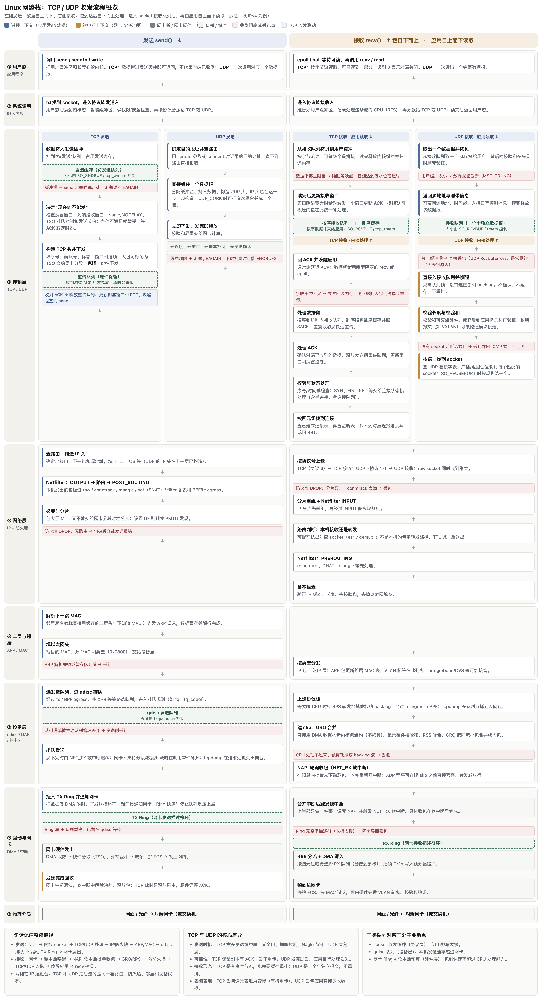
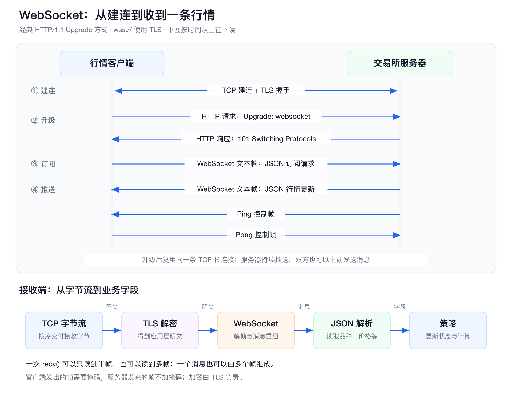
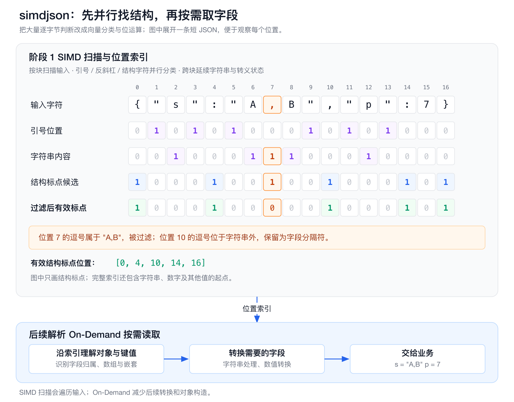

# HFT Engineering 06：网络通信——从内核网络栈到ByPass Kernel

行情从网卡到达策略，订单从程序发往交易所，中间会经过协议处理、缓冲区复制和队列等待。降低网络延迟，就是减少这条链路中不必要的工作与等待，让关键消息尽早进入业务处理。

可以把整条链路想象成一条**带多级暂存仓的流水线**：消息每经过一个环节，要么被加工（协议解析、校验、加头），要么被搬运（复制、DMA），要么在等待（中断、排队、调度、凑批）。网络优化的本质就是三件事：

- **少等**：不要为了凑批、攒包、睡眠唤醒而白等；
- **少搬**：减少数据复制和跨核转移；
- **少打扰**：减少中断、系统调用和上下文切换。

这个章节我们从传统网络栈的流程、优化点探讨到bypass kernel网络栈。全章分四部分：

1. **传统网络栈的收发流程**：一条消息从网卡到策略（或反向）到底经过了什么，时间花在哪；
2. **保留内核网络栈时的 14 个优化点**：不换架构，用普通 socket 就能做的调优；
3. **用户态收发与硬件旁路**：ExaNIC、DPDK、RDMA、Solarflare 四条绕开内核的路线；
4. **Crypto 行情中的 WebSocket 与 JSON**：当入口是加密长连接 + 文本协议时，额外的延迟来自哪里、怎么优化。

## 1. 传统网络栈的收发流程

普通 Linux 程序通过 socket 调用 `send()`、`recv()`。传输控制协议（Transmission Control Protocol，TCP）提供可靠、有序的字节流，用户数据报协议（User Datagram Protocol，UDP）提供数据报传输，两者都可以通过 socket 使用。下面这张图左侧是发送，从应用向下读到网卡；右侧是接收，从网卡向上读到应用。



对照这张图，一次典型的发送是：应用调用 `send()` → 数据复制进内核缓冲区 → TCP/UDP 加传输层头 → IP 层加 IP 头、查路由、过防火墙 → 填 MAC 头 → 进入网卡发送队列 → 网卡通过 DMA 取走数据并发到线上。接收方向相反：网卡把帧 DMA 进内存 → 中断通知 CPU → 内核软中断收包、逐层剥头 → 数据挂到 socket 的接收队列 → 应用调用 `recv()` 复制走。

对低延迟交易程序，主要成本集中在三处：

- **进入内核与等待调度。** `send()`、`recv()` 等系统调用要切换执行特权级。线程若阻塞，还要经历睡眠、唤醒和重新调度。通俗说，就是线程在"睡着等门铃 → 被叫醒 → 重新排队上 CPU"，这一睡一醒本身就是微秒级的开销，而且唤醒时机不稳定。
- **处理器参与协议与队列处理。** 驱动、TCP/UDP 协议处理、路由、过滤和各级队列管理都消耗处理器时间。中断处理、协议栈处理与业务线程之间的核间通信和等待，还会带来延迟波动。数据即使本身到得很快，被另一个核心"转手"一次，也要付出缓存失效和跨核通知的代价。
- **额外的payload复制。** 普通复制式 socket 发送会把应用数据复制到内核缓冲区，接收会把内核中的数据复制到应用缓冲区。应用再拼接消息、转交线程时，还可能增加复制。每多一次复制，就多一次内存读写和缓存占用。

网卡与主机内存之间的数据搬运，已经可以由直接内存访问（Direct Memory Access，DMA）完成，无须处理器逐字节搬运；主要差别在于搬到哪里，以及之后还要经过多少软件处理、等待和复制。协议栈各层可以复用同一份payload，并非图中每经过一层就复制一遍。[Linux DMA 指南](https://docs.kernel.org/core-api/dma-api-howto.html)、[AMD 传统网络栈与旁路对比](https://docs.amd.com/r/en-US/ug1586-onload-user/Contrasting-with-Conventional-Networking)

> **本节要点**：传统栈不是某一帧特别慢，而是链路上有大量"为通用性和吞吐而设计"的等待与搬运。后面的优化分别对应三条主线——让数据**少等**（中断、轮询、Nagle）、让 CPU **少搬**（零拷贝、批量系统调用）、让处理**少绕路**（RSS 绑核、卸载给网卡）。

## 2. 保留内核网络栈时，怎样降低延迟

内核旁路之前，普通 socket 还有不少优化空间。低延迟的重点是让关键消息及时进入处理器、减少核间通信，并避免为了吞吐而长时间等待。

下面 14 个手段可以先按"解决什么问题"分成六组，建议按这个顺序理解，而不是孤立地记参数：

| 分组 | 小节 | 解决的核心问题 |
| --- | --- | --- |
| 让数据更早被 CPU 看到 | 2.1 中断合并、2.2 忙轮询、2.3 RSS 与中断亲和性 | 缩短"包到了网卡"到"CPU 开始处理"之间的等待和绕路 |
| 让小消息按预期时机发出 | 2.4 TCP_NODELAY、2.5 MSG_MORE / TCP_CORK | 控制内核要不要替你"攒小包" |
| 减少系统调用与内存操作 | 2.6 sendmsg、2.7 recvmmsg、2.8 复用接收缓冲区 | 同样的活少进几次内核、少申请几次内存 |
| 缓冲与队列的取舍 | 2.9 SO_RCVBUF、2.10 有界待发队列 | 抗短时突发，但不让过时消息无限堆积 |
| 把活交给网卡 | 2.11 校验和卸载、2.12 TSO、2.13 GRO | CPU 不做的，就不消耗 CPU 时间 |
| 彻底去掉一次复制 | 2.14 MSG_ZEROCOPY | 发送时网卡直接读用户内存 |

下面的 C 片段面向 Linux，使用已有 socket `fd`，省略头文件与建立连接过程。`check()` 检查系统调用结果，`require()` 检查必要条件，`send_all()` 在阻塞 TCP 上处理短写与信号中断。

```c
static long check(long rc) {
    if (rc < 0) { perror("socket demo"); exit(EXIT_FAILURE); }
    return rc;
}

static void require(bool condition, const char *message) {
    if (!condition) { fprintf(stderr, "%s\n", message); exit(EXIT_FAILURE); }
}

static void send_all(int fd, const char *data, size_t size, int flags) {
    while (size) {
        ssize_t n = send(fd, data, size, flags | MSG_NOSIGNAL);
        if (n < 0 && errno == EINTR) continue;
        check(n);
        require(n > 0, "send made no progress");
        data += n;
        size -= (size_t)n;
    }
}
```

网卡命令中的 `eth0`、CPU 编号和中断号按目标机器替换。

### 第一组：让数据更早被 CPU 看到

### 2.1 中断合并

**问题是什么**：在中断驱动的收包路径中，网卡先把数据 DMA 到接收缓冲区，再通过中断通知处理器。如果每来一个包就中断一次，包速率高时 CPU 会被中断淹没。于是网卡默认会"攒一攒"：等包数达到门槛或定时器到期，再集中通知。这就像快递员选择"攒一筐再送上门"而不是"每件都敲门"——**门铃次数少了，但最先到的那件在门口多等了一段时间**，尾延迟也可能随之增大。

**怎么做**：缩短定时等待、降低包数门槛，能让处理器更早开始收包，代价是更频繁的中断。[ethtool 合并配置](https://docs.kernel.org/networking/ethtool-netlink.html#coalesce-get)

先记录当前配置，再尝试关闭接收方向的自适应合并和定时等待：

```bash
ethtool -c eth0
sudo ethtool -C eth0 adaptive-rx off rx-usecs 0 rx-frames 1
ethtool -c eth0
```

`rx-usecs 0` 表示不设置这项定时等待，`rx-frames 1` 把帧数门槛设为 1（等价于"来一个就通知"）。驱动可能只支持其中部分参数；最后一行查看实际结果，比较结束后恢复先前记录的值。

> 注意这是用**中断频率换延迟**：低延迟交易机能接受更高的中断开销；吞吐型机器则通常保留适度合并。

### 2.2 SO_BUSY_POLL：忙轮询

**问题是什么**：普通阻塞接收在没有数据时会让线程睡眠，之后经历网卡中断、内核收包和线程唤醒。Linux 的 NAPI 是驱动从网卡队列取包并交给协议栈的处理机制：驱动从网卡队列批量取包、再交给协议栈处理，平时由中断"叫醒"它。`SO_BUSY_POLL` 的思路很直接——**与其睡下等门铃，不如让线程站在门口主动等一会儿**：接收线程进入 `recv()` 时，可以先在内核中主动轮询对应的 NAPI 实例。如果包在这段时间内到达，就有机会直接处理，减少等待中断和重新调度的时间。

**代价**：这项优化用持续占用处理器换取较低的等待延迟，TCP/UDP 协议处理和接收复制仍在内核中完成。另外要注意，只在用户态反复调用非阻塞 `recv()`，不会自动启用 NAPI 忙轮询，必须通过这个 socket 选项开启。[Linux NAPI 忙轮询](https://docs.kernel.org/networking/napi.html#busy-polling)

```c
int us = 50;
check(setsockopt(fd, SOL_SOCKET, SO_BUSY_POLL, &us, sizeof(us)));
char buf[2048];
ssize_t n = check(recv(fd, buf, sizeof(buf), 0));
```

`50` 的单位是微秒，限制的是忙轮询时间，超过后仍按 socket 的阻塞规则等待。socket 从支持该功能的网卡收到数据、关联到对应 NAPI 实例后，才有实际的忙轮询对象。[SO_BUSY_POLL 接口](https://man7.org/linux/man-pages/man7/socket.7.html)

### 2.3 RSS 与中断亲和性

**问题是什么**：一块现代网卡有多个接收队列，可以把流量分散到多个 CPU 核心并行处理，避免单核成为瓶颈。接收侧扩展（Receive Side Scaling，RSS）让网卡对报文的源、目的地址及端口等字段做哈希，再查映射表选择接收队列；配置稳定时，同一条流会落到同一个队列（类似超市的"熟客固定通道"，同一会话每次都排同一队，缓存热度得以保留）。中断亲和性再决定由哪个核心处理该队列的中断。

**原则**：让收包、协议处理和业务线程尽量靠近，可以减少跨核通知、缓存数据转移和额外排队。如果硬件队列已经合理分配，再用软件把每个包转交给另一个核心，就会增加一次核间通信。单核能承担整条处理链时，可以尽量在同一核心完成；负载超过单核能力时，再按流拆分到多个核心。[Linux 网络栈扩展与队列分配](https://docs.kernel.org/networking/scaling.html)

单接收核实验可以先把 RSS 分配集中到队列 0，再绑定这个队列的中断。下面假设从 `/proc/interrupts` 找到的队列 0 中断号是 `42`，目标核心是 CPU 2：

```bash
ethtool -x eth0                         # 记录原 RSS 分配
sudo ethtool -X eth0 equal 1             # RSS 哈希桶集中到队列 0
rg 'eth0' /proc/interrupts               # 找到队列对应的中断号
echo 2 | sudo tee /proc/irq/42/smp_affinity_list
cat /proc/irq/42/effective_affinity_list # 确认实际生效的 CPU
```

网卡队列在 `/proc/interrupts` 中的名称由驱动决定。若 `irqbalance` 正在管理该中断，还要避免它把亲和性改回。RSS 和中断亲和性的接口分别见 [ethtool](https://man7.org/linux/man-pages/man8/ethtool.8.html) 与 [Linux IRQ affinity](https://docs.kernel.org/core-api/irq/irq-affinity.html)。

### 第二组：让小消息按预期时机发出

### 2.4 TCP_NODELAY

**背景：内核默认会替你"攒车"**。Nagle 算法为了减少小包，会在连接上已有未确认数据时，暂存后续不足一个完整 TCP 段的数据，等确认到达或数据积累到足够再发——像一辆没坐满不发车的班车。对几十字节的订单，这种合并会把本来已经准备好的消息留在发送缓冲区。

**做法**：`TCP_NODELAY` 关闭这项等待，让小消息尽早提交发送；代价是报文数量增加，拥塞窗口、接收窗口和发送队列仍会限制实际发送时机（也就是它只能让消息"别在本地攒着"，不能突破网络本身的发送限制）。[Nagle 算法](https://www.rfc-editor.org/rfc/rfc9293.html#section-3.7.4)、[TCP_NODELAY 接口](https://man7.org/linux/man-pages/man7/tcp.7.html)

```c
int one = 1;
check(setsockopt(fd, IPPROTO_TCP, TCP_NODELAY, &one, sizeof(one)));
send_all(fd, "BUY\n", 4, 0);
```

### 2.5 MSG_MORE 与 TCP_CORK

Nagle 是**内核猜**你后面还有数据而替你攒包；这两个接口则是**应用主动明确地告诉内核**"这条消息后面还有数据"。在 TCP 发送中，内核可以先保留不足一个完整段的尾部，把紧接着提交的头部、消息体合并发送，减少小包数量。两者区别在于作用范围：`MSG_MORE` 随每次发送传入，`TCP_CORK` 则是跨调用保留的 socket 状态。

低延迟的用法是**只合并且一次写调用中已经准备好的内容**，最后一段及时清除标记或解除 cork，避免等待下一笔尚未产生的订单——否则"为合并而等待"反而制造了延迟。[MSG_MORE 接口](https://man7.org/linux/man-pages/man2/send.2.html)、[TCP_CORK 接口](https://man7.org/linux/man-pages/man7/tcp.7.html)

下面两段数据合起来是一条完整消息，第二次发送不再传 `MSG_MORE`：

```c
send_all(fd, "PRICE=", 6, MSG_MORE);
send_all(fd, "123\n", 4, 0);
```

如果之前通过 `TCP_CORK` 暂缓发送，完整消息提交后解除：

```c
int zero = 0;
check(setsockopt(fd, IPPROTO_TCP, TCP_CORK, &zero, sizeof(zero)));
```

### 第三组：减少系统调用与内存操作

### 2.6 sendmsg：分散缓冲区一次提交

**问题是什么**：消息头和 payload 经常放在不同的应用缓冲区。先拼成连续数组，会增加一次应用内复制；分别调用 `send()`，又会增加系统调用（每进一次内核都有固定开销）。`sendmsg()` 接收一组 `iovec`，每项只记录地址和长度，内核在一次调用中按顺序读取这些区域，省掉应用拼接和多次进入内核的开销。这是一次"分散-聚集（gather）"式提交：数据不用物理上挨在一起，只要告诉内核去哪几块内存读。普通发送仍会把 payload 复制到内核缓冲区（省的是系统调用和应用内拼接，不是内核复制）。[sendmsg 接口](https://man7.org/linux/man-pages/man2/sendmsg.2.html)

在已连接的 UDP socket 上，下面发送一条内容为 `PX=123` 的数据报：

```c
char header[] = "PX=", body[] = "123";
struct iovec parts[] = {{header, 3}, {body, 3}};
struct msghdr msg = {.msg_iov = parts, .msg_iovlen = 2};
check(sendmsg(fd, &msg, 0));
```

### 2.7 recvmmsg：批量接收

**问题是什么**：逐条调用 `recv()`，每条消息都要支付一次系统调用的固定开销。`recvmmsg()` 在一次调用中取出多条消息，分别写入各自的缓冲区，保留数据报边界——相当于"一次把信箱里的信全取走"。配合 `MSG_DONTWAIT`，它只处理当前已经到达的消息，不等未来消息凑满一批；减少的是进入、退出内核的次数，payload 复制仍然存在。[recvmmsg 接口](https://man7.org/linux/man-pages/man2/recvmmsg.2.html)

示例先向接收队列放入两条短 UDP 消息，再用四个位置接收：

```c
char buf[4][128];
struct iovec iov[4];
struct mmsghdr msgs[4] = {0};
for (int i = 0; i < 4; ++i) {
    iov[i] = (struct iovec){buf[i], sizeof(buf[i])};
    msgs[i].msg_hdr = (struct msghdr){.msg_iov = &iov[i], .msg_iovlen = 1};
}
int n = (int)check(recvmmsg(fd, msgs, 4, MSG_DONTWAIT, NULL));
```

此时 `n` 为 2，无须等到四个位置填满。第 `i` 条消息的长度在 `msgs[i].msg_len`；如果 `msg_flags` 带有 `MSG_TRUNC`，说明该条消息超过缓冲区，应丢弃并处理缺口。队列为空时返回 `-1/EAGAIN`，事件循环可以稍后再读。重复接收时可以复用这些数组，不必每轮重新分配。

### 2.8 复用应用接收缓冲区

**问题是什么**：每条消息都申请、释放内存，会反复执行分配器逻辑；首次触碰新页面还可能触发缺页处理（临时分配的内存第一次写入时，内核才真正分配物理页，这是一次可能发生在关键路径上的停顿）。预先分配并复用缓冲区，可以减少这些工作，也有利于复用缓存中的数据。`recv()` 仍把内核数据复制进这块内存，因此上一条消息要消费完，再覆盖同一缓冲区。

接收两条小于 2 KiB 的 UDP 消息时，只准备一份应用缓冲区：

```c
char buf[2048];
for (int i = 0; i < 2; ++i) {
    ssize_t n = check(recv(fd, buf, sizeof(buf), 0));
    printf("%.*s\n", (int)n, buf);  // 同步消费；下一次 recv 会覆盖 buf
}
```

这里用打印展示收到的内容，交易程序中替换为字段解析。

### 第四组：缓冲区与队列：抗突发，但不制造速度

### 2.9 SO_RCVBUF：内核接收缓冲区

**它是什么**：数据经过协议处理后，先留在 socket 的内核接收队列，等应用调用 `recv()` 取走。`SO_RCVBUF` 控制这部分缓冲的内存额度。把它想成柜台前的等候区：**等候区变大不会让柜台处理得更快，只能在人突然变多时少拒几位客人**。适当增大可以容纳应用短暂来不及处理的突发行情，减少 UDP 因队列溢出而丢包；但持续过载时，更大的队列只是让旧行情等待更久——对交易而言，"迟到的行情"往往等于"错误的行情"。它不会提高应用处理速度。

设置后读回实际值：

```c
int bytes = 256 * 1024;
check(setsockopt(fd, SOL_SOCKET, SO_RCVBUF, &bytes, sizeof(bytes)));
socklen_t size = sizeof(bytes);
check(getsockopt(fd, SOL_SOCKET, SO_RCVBUF, &bytes, &size));
printf("SO_RCVBUF=%d\n", bytes);
```

Linux 会限制请求值，并在返回值中包含额外的内核记账空间，因此读回值不一定等于传入值。[SO_RCVBUF 接口](https://man7.org/linux/man-pages/man7/socket.7.html)

### 2.10 有界待发队列

**问题是什么**：策略产生订单的速度超过发送端处理速度时，无界队列会持续积压，轮到发送的订单可能已经过时（行情早变了，这单发出去就是亏损）。固定容量的环形队列预先分配槽位，并在满时拒绝继续入队，让上游及时重试、停止产生或放弃已失效的订单。它既省掉逐条分配，也把过载暴露给调用方，避免把压力全部转化成等待——这是一种显式的**背压（backpressure）**机制。

下面是单线程队列的入队操作，满时返回 `false`，由调用方决定稍后重试或放弃该笔尚未提交的订单：

```c
enum { CAP = 8 };
struct Order { int price; };
struct Queue { struct Order items[CAP]; unsigned head, tail, count; };
bool try_push(struct Queue *q, struct Order order) {
    if (q->count == CAP) return false;
    q->items[q->tail] = order;
    q->tail = (q->tail + 1) % CAP;
    ++q->count;
    return true;
}
```

队首订单处理完后，推进 `head` 并减少 `count`，即可复用空位。这个容量限制作用于应用尚未提交的订单；已经提交给 TCP 的字节仍按连接顺序发送。

### 第五组：把活交给网卡

### 2.11 校验和计算卸载到网卡

**先理解校验和是什么**：校验和（checksum）是报文携带的一个校验值，用来检测传输中的数据差错。以 TCP 为例，发送端根据 TCP 头、payload，以及包含源地址、目的地址等信息的“伪首部”计算一个 16 位校验和，写入 TCP 头；接收端按同样的规则验证收到的数据。[TCP 校验和定义](https://www.rfc-editor.org/rfc/rfc9293.html#section-3.1)

**为什么它是一项 CPU 负担**：假设一条 TCP 报文带有 1000 字节 payload，计算校验和就要把这 1000 字节都纳入计算。网卡通过 DMA 读取报文，只完成数据搬运；如果校验仍由软件执行，CPU 还要承担相应的加法、进位处理和取反运算。[Internet 校验和算法](https://www.rfc-editor.org/rfc/rfc1071.html)

**offload 改变的是"这部分计算由谁执行"：**

| 分工 | 关闭发送校验和 offload | 开启发送校验和 offload |
| --- | --- | --- |
| CPU | 构造报文，并根据报文内容算好完整校验和 | 构造报文，准备计算范围、结果位置及必要的初始值 |
| 网卡 | DMA 读取已经算好校验和的报文，再发送 | DMA 读取报文，完成校验和计算并填入报文，再发送 |

驱动会把“从哪里开始计算、结果写入头部哪个位置”等信息交给网卡，网卡的数据处理硬件完成剩余计算。线上发出的仍是带有正确校验和的标准 TCP 报文，对端无须改变协议。接收方向也可以卸载：网卡验证校验和并报告结果，内核对已验证的报文省去重复计算。[Linux 校验和卸载](https://docs.kernel.org/networking/checksum-offloads.html)

因此，它减少的是 CPU 的校验计算。软件实现若单独扫描报文，还能减少这次遍历；若把复制与校验合在一次遍历中完成，则主要省下校验运算。系统调用和用户缓冲区到内核缓冲区的复制仍然存在。报文较大或包速率较高时，这些计算累积起来会占用更多 CPU；卸载后能把处理器时间留给协议处理和交易逻辑。

先记录当前状态，再启用发送校验和卸载：

```bash
ethtool -k eth0
sudo ethtool -K eth0 tx on     # 发送校验和卸载
```

### 2.12 TSO：发送分段卸载

**背景**：线上的 TCP 段受 MTU 限制（通常每段约 1500 字节），但协议栈手里可能是几十 KB 的大块数据。传统做法是 CPU 在软件里把它切成一段段、每段单独加头算校验和。TCP 分段卸载（TCP Segmentation Offload，TSO）让内核把较大的数据块、分段大小和报文头信息一起交给网卡，由网卡切成线上允许的多个 TCP 段，并生成各段的头部和校验和。处理器因此少做逐段处理，较大的发送更容易受益；单条很小的订单本来就只有一个段，节省的工作有限。[Linux TSO](https://docs.kernel.org/networking/segmentation-offloads.html#tcp-segmentation-offload)

下面关闭 TSO，用于比较开关前后的单条消息延迟与处理器占用：

```bash
sudo ethtool -K eth0 tso off   # 观察关闭 TSO 后的变化
```

### 2.13 GRO：接收合并

**与 TSO 对称的接收侧优化**：通用接收合并（Generic Receive Offload，GRO）由内核软件在收包过程中，把同一条流中符合条件的连续报文合成较大的报文表示，再交给上层协议处理。这样可以减少逐包调用和重复处理报文头的开销，线上报文并没有改变（合并只发生在主机内部）。它合并的是收包过程中已经取得的数据；额外等待多久，还取决于中断合并和 NAPI 定时配置——所以在小消息延迟敏感的场景，GRO 的"再等等看有没有后续包"也可能成为延迟来源，需要实测开关对比。[Linux GRO](https://docs.kernel.org/networking/segmentation-offloads.html#generic-receive-offload)、[NAPI 合并与定时配置](https://docs.kernel.org/networking/napi.html#software-irq-coalescing)

观察小消息延迟时，可以单独关闭 GRO 做对比：

```bash
sudo ethtool -K eth0 gro off   # 观察关闭 GRO 后的变化
```

### 第六组：彻底去掉一次复制

### 2.14 MSG_ZEROCOPY：发送 payload 零拷贝

普通 `send()` 先由处理器把用户缓冲区复制到内核缓冲区，再让网卡通过 DMA 读取。`MSG_ZEROCOPY` 尝试省掉前一次复制，让网卡直接读取用户缓冲区对应的内存页；系统调用、协议处理和报文头生成仍由处理器完成。

为什么这件事不容易？因为 `send()` 正常返回后应用随时可以复用缓冲区，而网卡可能还没把数据发完，TCP 甚至可能在丢包后重传。零拷贝的解法是**把"什么时候可以复用缓冲区"的所有权交接显式化**。在能够保持零拷贝的发送路径中，基本过程是：

1. **内核固定用户页。** 应用只传入虚拟地址和长度，内核找到对应页面并 pin 住，避免这些页在使用期间被回收或换出；内核报文描述结构 `sk_buff`（简称 `skb`）通过页引用、偏移和长度描述 payload，省去另存一份 payload。[Linux skb 结构](https://docs.kernel.org/networking/skbuff.html)
2. **驱动建立 DMA 映射。** 驱动通过 Linux DMA API 得到网卡可用的 DMA 地址。启用输入输出内存管理单元（Input-Output Memory Management Unit，IOMMU）时，这通常是 I/O 虚拟地址（I/O Virtual Address，IOVA），由 IOMMU 翻译到物理地址；应用无须查找或传递物理地址。[Linux DMA 地址映射](https://docs.kernel.org/core-api/dma-api-howto.html)
3. **网卡读取 payload。** 驱动把 DMA 地址和长度写入发送描述符，网卡自身的 DMA 引擎按描述符读取数据。支持分散聚集（scatter-gather）的网卡可以从多段内存取数，用户缓冲区不必在物理内存中连续。
4. **内核通知页面可以复用。** 等网络栈释放对这些页面的引用后，内核向 socket 的错误队列放入完成通知。应用通过 `recvmsg(..., MSG_ERRQUEUE)` 读取，再复用对应缓冲区。TCP 为重传保留的数据引用也会影响这个时机。[Linux MSG_ZEROCOPY](https://docs.kernel.org/networking/msg_zerocopy.html)

**两个必须记住的坑：**

- **pin 住页面不会阻止应用写入；在完成通知到来前覆盖缓冲区，可能改变尚未发出的内容。** 也就是说，pin 只保证页不被内核回收，不限制你自己写它——收到通知前必须把这块内存当作"还在内核手里"。
- 完成通知只表示原缓冲区已可复用；发生退回复制时，它甚至可以早于实际发包。页面管理、DMA 映射和通知都有成本，所以这项优化更适合较大的发送；几十到几百字节的小订单，直接复制往往更划算。

下面只在一个新建、已连接的 IPv4 UDP socket 上提交一次数据，对应的零拷贝完成编号为 `0`。`wait_zerocopy_0()` 先等待错误队列可读，再检查通知来源和完成编号；通知内容来自 `<linux/errqueue.h>` 中的 `sock_extended_err`：

```c
static void wait_zerocopy_0(int fd) {
    struct pollfd p = {.fd = fd, .events = POLLERR};
    require(check(poll(&p, 1, 1000)) == 1, "zerocopy notification timed out");
    union { struct cmsghdr align; char bytes[128]; } control;
    struct msghdr msg = {.msg_control = control.bytes,
                        .msg_controllen = sizeof(control.bytes)};
    check(recvmsg(fd, &msg, MSG_ERRQUEUE));
    require(!(msg.msg_flags & MSG_CTRUNC), "completion control data truncated");
    for (struct cmsghdr *c = CMSG_FIRSTHDR(&msg); c; c = CMSG_NXTHDR(&msg, c)) {
        if (c->cmsg_level != SOL_IP || c->cmsg_type != IP_RECVERR ||
            c->cmsg_len < CMSG_LEN(sizeof(struct sock_extended_err))) continue;
        struct sock_extended_err e;
        memcpy(&e, CMSG_DATA(c), sizeof(e));
        if (e.ee_origin != SO_EE_ORIGIN_ZEROCOPY || e.ee_errno != 0) continue;
        require(e.ee_info == 0 && e.ee_data == 0, "unexpected completion IDs");
        printf("MSG_ZEROCOPY: completion 0, copied=%d\n",
               e.ee_code == SO_EE_CODE_ZEROCOPY_COPIED);
        return;
    }
    require(false, "no matching zerocopy completion");
}
```

发送后等到通知，再覆盖原缓冲区：

```c
int one = 1;
check(setsockopt(fd, SOL_SOCKET, SO_ZEROCOPY, &one, sizeof(one)));
char buf[32768] = {0};
check(send(fd, buf, sizeof(buf), MSG_ZEROCOPY));
wait_zerocopy_0(fd);
memset(buf, 'X', sizeof(buf));  // 收到完成通知后才允许复用
```

> **第二部分小结**：这些手段的共同点是"把吞吐导向的默认值改成延迟导向"。它们不是越多越好——中断合并、GRO、TSO、缓冲区大小都要在自己的工作负载下实测开关前后的延迟分布（尤其关注尾延迟），再决定取舍。

## 3. 用户态收发与硬件旁路

前面的优化都在内核网络栈**内部**做文章。内核旁路（kernel bypass）则更进一步：把关键数据收发移出普通内核网络栈。需要注意的是，"旁路"不等于"完全不要内核"——设备初始化、内存映射和权限管理仍由驱动配合；只是在**稳定运行时**，应用直接访问收发队列或映射的缓冲区，热路径上不再有系统调用、内核协议处理和内核缓冲复制。

打个比方：传统栈像走公共邮政系统，每个包裹都要经过分拣中心的统一流程；内核旁路则是在你的机房和交易所机房之间修一条专用通道，日常运输直接走专线，但修路、划地、安检仍要一次性完成。

下面四类技术采用了不同的分工：有的提供原始包接口，有的实现用户态 TCP/UDP，有的把传输工作交给网卡。可以按"应用需要自己承担多少工作"来排序：越往下越接近硬件、越快，但应用要管的事情也越多。

### 3.1 ExaNIC

ExaNIC 是 Cisco Nexus SmartNIC 的原名。它的设计哲学是**卡上尽量不缓存**，把到达的数据分块 DMA 到主机接收环；应用通过 `libexanic` 轮询并直接读取这些内存。支持的接口还允许在整帧到齐前先处理已经到达的部分，重叠线路接收与解析工作（网卡还在收后半帧，CPU 已经开始解析前半帧）。发送则可以由应用写入映射的卡上发送缓冲区，再触发网卡发送。[Cisco ExaNIC Internals](https://www.cisco.com/c/en/us/td/docs/dcn/nexus3550/smartnic/sw/user-guide/cisco-nexus-smartnic-user-guide/internals.html)

它的关键在于减少缓存等待和搬运核间通信。代价也要清楚：应用接管帧解析，也要跟上接收环的推进速度，否则旧数据会被新数据覆盖（环形缓冲没有人为你排队）；提前解析时，还要等完整帧的有效性结果（比如校验和），再决定是否采用这条消息，不能只解析了一半就下单。`libexanic` 的原始帧接口适合直接处理行情包，完整的 TCP 连接仍由额外的协议栈维护。

### 3.2 DPDK

数据平面开发套件（Data Plane Development Kit，DPDK）通过轮询模式驱动（Poll Mode Driver，PMD）在用户态收发包——没有中断，线程永远在轮询队列。网卡把数据 DMA 到预先准备的内存池，应用取得描述报文的 `mbuf`，完成处理后回收，或者转交发送队列。它把轮询、批量收发、内存池和核心分工组织在一起，减少逐包中断、临时分配和通用内核处理成本。[DPDK PMD](https://doc.dpdk.org/guides/prog_guide/ethdev/ethdev.html)

DPDK 适合可分配专用核心、需要高包速率的行情接收和分发。要注意边界：它提供的是**包处理框架**（拿到的是原始以太网帧），TCP 的建连、重传和流控仍要由附加协议栈完成；它也要求独占 CPU 核心和网卡，不能和内核网络栈混用同一张卡。批量取包时，一次取走当前队列里的多个包可以减少开销；但主动等队列凑满才处理，会增加低流量时的等待——低延迟场景应当"有多少处理多少"，而不是"凑一批再动"。

### 3.3 RDMA

远程直接内存访问（Remote Direct Memory Access，RDMA）把通信区域预先注册给网卡，应用提交发送、读取或写入请求，由网卡执行传输，再通过完成队列报告结果。在硬件 RDMA 路径中，数据可以直接从一端的应用内存到另一端的应用内存，减少内核缓冲区复制，并由网卡承担相应传输协议工作。[NVIDIA RDMA 编程指南](https://networking-docs.nvidia.com/doca/archive/3-5-0/rdma-aware-networks-programming-guide)

单边读写尤其直观：远端应用先注册内存并授予访问权限，之后一次远程读/写可以由网卡完成，无须远端业务线程逐次执行接收调用——数据像被"隔空放"进了对方内存。但要区分两个时间点：**本地传输完成 ≠ 远端业务处理完成**，业务线程仍负责消费数据和维护状态。RDMA 更适合双方可控、硬件与网络匹配的内部集群（例如机房内各服务之间）；交易所只提供 TCP/WebSocket 入口时，客户端无法单方面把连接改成 RDMA。

### 3.4 Solarflare：Onload、TCPDirect 与 ef_vi

Solarflare 的软件接口可以按应用愿意承担多少工作来理解：

| 接口 | 核心做法 | 应用怎样接入 |
| --- | --- | --- |
| Onload | 在用户态实现 TCP/UDP，尽量兼容现有 socket 编程方式 | 延续 `send()`、`recv()` 等调用方式，对受支持的连接进行加速 |
| TCPDirect | 用更精简的功能和专用接口实现用户态 TCP/UDP | 改造事件循环，由应用主动推进协议处理，并使用直接访问缓冲区等能力 |
| `ef_vi` | 暴露更接近网卡的帧与事件接口 | 应用取得原始帧，自行安排上层协议和业务处理 |

Solarflare TCPDirect 是其中面向低延迟应用的用户态 TCP/UDP 协议栈。关键收发操作绕过内核，线上仍然使用标准 TCP/UDP 报文，对端可以继续使用普通网络接口（旁路是本机的事，交换机和对端无感知）。应用在同一线程中推进网络、解析行情和计算策略，可以减少系统调用、线程唤醒及缓冲区复制。[TCPDirect 项目说明](https://github.com/Xilinx-CNS/tcpdirect)

应用通过 `zf_reactor_perform()` 推进收包、协议状态和定时任务——这是用户态协议栈的典型模型：**协议不会自己往前走，必须由应用的事件循环反复"驱动"它**。零拷贝接收接口让应用直接读取协议栈中的数据，处理完后归还缓冲区。协议处理仍由处理器执行，应用长时间不推进 reactor，网络处理也会停下来。[TCPDirect 用户指南](https://www.amd.com/content/dam/amd/en/support/downloads/solarflare/onload/openonload/packages/SF-116303-CD-9_TCPDirect_User_Guide.pdf)

这套技术的重点是让协议处理贴近应用，并利用配套网卡减少数据搬运。支持的网卡还可以使用直通程序控制输入输出（Cut-Through Programmed I/O，CTPIO）：处理器向网卡写入报文时，网卡在数据尚未全部写完前就开始发往线路，重叠"主机到网卡"和"网卡到线路"两段传输——连"写完再发"的串行等待都被压缩掉。[Onload 用户指南](https://docs.amd.com/r/en-US/ug1586-onload-user/all)、[`ef_vi` 接口说明](https://github.com/Xilinx-CNS/onload/blob/master/src/onload/distfiles/README.ef_vi)、[CTPIO 说明](https://docs.amd.com/r/en-US/ug1586-onload-user/CTPIO)

选择原始包接口，意味着自己承担更多协议和缓冲区管理；选择 TCPDirect、Onload，则可以沿用成熟 TCP/UDP 实现，把精力放在交易逻辑上。对于固定使用 TCP 的交易所入口，完整的用户态 TCP 栈往往比单纯取得原始帧更接近实际需求。

**四类路线横向对比：**

| 路线 | 应用拿到什么 | TCP/UDP 谁实现 | 典型场景 |
| --- | --- | --- | --- |
| ExaNIC（libexanic） | 映射内存中的原始帧 | 应用自行解析，或另配协议栈 | 超低延迟行情捕获、抢跑解析 |
| DPDK（PMD） | 原始帧（`mbuf`） | 需要附加用户态协议栈 | 高包速率行情接收、分发网关 |
| RDMA | 已到应用内存的消息/单边读写 | 网卡硬件实现传输 | 双方可控的内部集群 |
| Onload / TCPDirect | socket 或专用 API 的消息 | 成熟的用户态 TCP/UDP 栈 | 现有 TCP 策略程序的低延迟改造 |
| `ef_vi` | 原始帧与事件 | 应用自行实现 | 需要完全自控的定制协议栈 |

> **第三部分要点**：内核旁路不是银弹。它用"专用核心、专用网卡、应用承担更多责任"换来热路径上的低延迟；能否使用，还取决于交易所开放什么入口（RDMA/组播行情还是只有 TCP/WebSocket）。

## 4. Crypto 行情中的 WebSocket 与 JSON

前面讨论的优化针对"数据在本机怎么收发"。但消息到达应用之前的**表达方式**同样影响延迟：传统头部交易所已经有面向专业接入的二进制行情协议，例如 Nasdaq ITCH 直接规定消息类型、字段长度和二进制编码——程序拿到字节流后按固定偏移就能取出价格，几乎没有解析成本。Crypto 的低延迟接入能力则更不统一，面向普通开发者的公开行情入口仍广泛采用 WebSocket 与 JSON；Binance 的普通现货行情流就是一个具体例子。接入这种接口时，交易程序还要承担解密、消息重组和文本解析。[Nasdaq ITCH 规范](https://www.nasdaqtrader.com/content/technicalsupport/specifications/dataproducts/NQTVITCHSpecification.pdf)、[Binance WebSocket 行情](https://github.com/binance/binance-spot-api-docs/blob/master/web-socket-streams.md)

这种差异更适合按实际入口讨论：Binance 已经提供简单二进制编码（Simple Binary Encoding，SBE）行情流，并通过 WebSocket 二进制帧传输。因此，WebSocket 可以承载 JSON，也可以承载二进制消息；能否使用更直接的编码，取决于交易所开放了什么接口。[Binance SBE 行情](https://github.com/binance/binance-spot-api-docs/blob/master/sbe-market-data-streams.md)

### WebSocket：为什么需要它，数据怎么流过来

先解决一个常见疑问：既然底层就是 TCP，为什么还要 WebSocket？因为原生 TCP 只给字节流，没有"消息边界""订阅关系""浏览器可用的全双工通道"这些概念。WebSocket 在一条长期保持的 TCP 连接上提供双向消息通信，且可以复用 HTTP 的 80/443 端口和升级机制。

以经典的 HTTP/1.1 Upgrade 方式为例，建连和收行情的完整过程是：

1. 客户端与服务器建立 TCP 连接，再通过超文本传输协议（Hypertext Transfer Protocol，HTTP）发送一个带升级请求的 HTTP 报文；
2. 服务器返回 `101 Switching Protocols`，连接此后不再走 HTTP 规则，改为 WebSocket 帧；
3. 客户端发送订阅消息（订阅哪个品种、什么深度）；
4. 服务器持续主动推送更新，无须客户端为每条行情再发起一次 HTTP 请求。

`wss://` 还使用传输层安全协议（Transport Layer Security，TLS）加密连接。JavaScript 对象表示法（JavaScript Object Notation，JSON）则负责表达行情里的品种、价格、数量等业务字段。下面把建连过程和一条行情的接收过程放在同一张图中。



### 一次 recv() 的三种"不对齐"

应用收到字节后，不能直接当完整消息解析，因为各层都有自己的分片规则：

- **WebSocket 层**：帧带有操作码、长度和分片信息，用来识别文本、二进制数据，以及 Ping、Pong、Close 等控制消息；一条业务消息可以拆成多个帧。[WebSocket RFC 6455](https://www.rfc-editor.org/rfc/rfc6455)
- **TCP 层**：只提供连续字节流，没有边界。一次 `recv()` 既可能只读到半个帧，也可能读到多个帧。因此接收程序要自己做**粘包/半包处理**：先完成 TLS 解密和 WebSocket 消息重组，攒出一条完整业务消息，再把完整 JSON 交给解析器。
- **TCP 丢包**：后续字节要等缺失部分补齐后才能按序交付（队头阻塞），这段等待也会原样传递到行情解析——即使后面的字节早就到了，也不能越过缺口先解析。

客户端发送的 WebSocket 帧还要按协议使用掩码（服务器发来的帧不使用掩码，这是协议硬性规定）；加密由 TLS 负责。若连接协商了 `permessage-deflate` 扩展，接收链上还会增加解压步骤——用 CPU 换带宽，低延迟场景要权衡。[WebSocket 压缩扩展](https://www.rfc-editor.org/rfc/rfc7692)、[TCP 规范](https://www.rfc-editor.org/rfc/rfc9293.html)

对于这类入口，本地优化可以减少协议和解析开销；但交易所选择的推送频率、服务端排队以及网络距离，仍决定消息何时能够到达。客户端更换网卡或使用内核旁路，改变的只是本机这一段。

### JSON 解析慢在哪，SIMD 怎么帮忙

JSON 易于查看，但解析器面对的是文本。例如 `"price":"123.4500"`，程序要先找到字段名和字符串边界，再把价格转换为可计算的数值；消息里还有对象、数组、转义字符和不同类型的值。逐字节判断字符类型、维护解析状态（现在在字符串里吗？这个引号是结束还是被转义？），会产生大量重复的分支判断——分支预测失败还会打断 CPU 流水线。

SIMD（单指令多数据）允许一条指令同时处理多个数据元素。一个直观的比喻：标量指令像一个工人一次检查一个字符；256 位 SIMD 则像 **32 个工人站成一排，同时检查 32 个字节**。例如，一个 256 位向量可以装下 32 个字节，并对这些字节同时进行比较。simdjson 把这种能力用于 JSON 扫描：按块读取输入，用向量比较和查表同时识别引号、反斜杠、空白及 `{ } [ ] : ,` 等结构字符，再把结果压成位掩码——位掩码中的每一位对应输入里的一个字符位置，后续可以用少量位运算（而不是逐字节循环）处理整块结果，例如快速跳过字符串、定位逗号、建立结构索引，再按需解析字段。[simdjson 论文](https://arxiv.org/abs/1902.08318)



如果是Crypto场景典型的WebSocket + JSON的场景，类似于simdjson的手段是一个非常有效的降低延迟的方法——因为这条链路上 TLS、文本解析这类"本机必做的工作"占比高，而它们恰好适合向量化和批量化处理。

## 延伸阅读

- 内核路径：[Linux NAPI](https://docs.kernel.org/networking/napi.html)、[网络栈扩展](https://docs.kernel.org/networking/scaling.html)、[socket 接口](https://man7.org/linux/man-pages/man7/socket.7.html)。
- 用户态与硬件旁路：[TCPDirect](https://github.com/Xilinx-CNS/tcpdirect)、[Cisco ExaNIC](https://www.cisco.com/c/en/us/td/docs/dcn/nexus3550/smartnic/sw/user-guide/cisco-nexus-smartnic-user-guide/internals.html)、[DPDK](https://doc.dpdk.org/guides/prog_guide/ethdev/ethdev.html)、[RDMA](https://networking-docs.nvidia.com/doca/archive/3-5-0/rdma-aware-networks-programming-guide)。
- 消息与解析：[WebSocket RFC 6455](https://www.rfc-editor.org/rfc/rfc6455)、[simdjson 论文](https://arxiv.org/abs/1902.08318)、[simdjson On-Demand](https://github.com/simdjson/simdjson/blob/master/doc/ondemand_design.md)。
