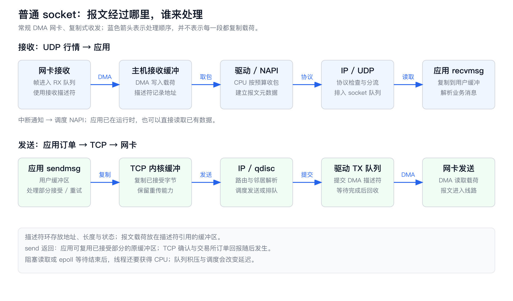
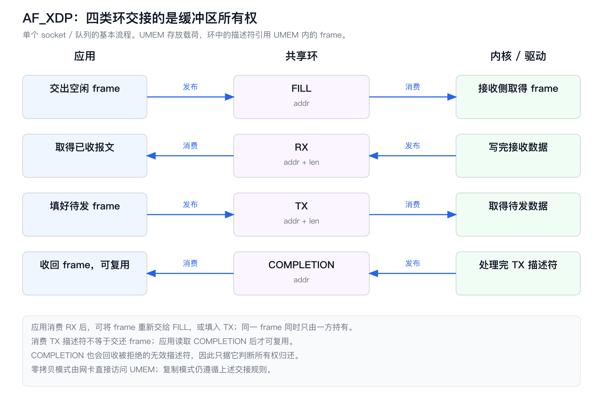

# HFT Engineering 06：网络通信，从行情进入主机到订单发出

两台服务器收到同一条行情，策略计算都很短，订单离开网卡的时间却差了一截。差距可以出现在光纤、交换机、网卡缓冲区，也可以出现在一次中断等待、一次线程唤醒，或发送队列前面排着的几个报文里。只有把这条链路展开，才知道该换网卡、改程序，还是缩短物理线路。

沿用一个具体系统：交易所通过两路 UDP 组播发送行情，一条交易线程更新订单簿、计算信号，再通过已建立的 TCP 连接发单。行情与订单的业务规则由两端约定的应用协议决定。··

## 1. 报文在哪里，什么时刻算完成

一条价格更新在线上是一段以太网帧：帧头说明发送方和接收方的链路层地址，内部装着网际协议（Internet Protocol，IP）包，IP 包里面再装 UDP 数据报和交易所消息。网卡识别帧、检查错误并搬运字节；驱动管理设备队列；协议栈处理 IP、UDP 或 TCP；交易程序解析品种、价格和数量。一个以太网帧可以装多条业务消息，一条 TCP 业务消息也可以跨越多个帧。

因此，UDP、DPDK、TCPDirect、ExaNIC 所回答的问题不同。UDP 规定线上的传输格式；数据平面开发套件（Data Plane Development Kit，DPDK）提供用户态收发包框架；TCPDirect 是一套用户态 TCP/UDP 协议实现；ExaNIC 是 Cisco Nexus SmartNIC 网卡系列的原名。选择 TCPDirect 之后仍在使用 TCP，选择 DPDK 之后仍然要决定如何处理报文里的协议。应用编程接口（Application Programming Interface，API）约定程序怎样调用这些功能；下文把接收简称 RX（Receive），发送简称 TX（Transmit）。

```text
交易所消息       价格、数量、业务序号、订单标识
      ↓ 编码
传输层           UDP 数据报 / TCP 字节流
      ↓ 封装
网络与链路层     IP 包 → 以太网帧
      ↓ 发送
物理线路         光纤 / 铜缆 / 无线链路
      ↓ 接收
网卡与收发接口   内核驱动 / ef_vi / libexanic / DPDK / AF_XDP
      ↓ 交付
协议栈与应用     TCP/UDP 处理 → 业务解码 → 订单簿与策略
```

<a id="completion-points"></a>

一次网络操作有多个完成点，记录延迟时要同时写出起点、终点和观测方式：

| 标记与完成点 | 已经发生的事实 | 常用观测方式 |
| --- | --- | --- |
| RX0：首字节到达 | 帧的开头抵达指定接收端口 | 网卡或线路设备的入口时间戳，具体打点位置由设备定义 |
| RX1：完整帧到齐 | 帧末尾已经到达，可进行完整性检查 | 网卡接收状态、帧结束指示；坏帧仍须丢弃 |
| RX2：应用取得完整消息 | 应用拥有解析该条消息所需的字节 | `recvmsg` 返回后、消息拼接完成处或接收回调 |
| TX0：发送接口接受请求 | 本地接口接受了相应字节或消息，承担后续处理 | `send` 的正返回值、Aeron `offer` 的成功返回等；各接口的接收位置不同 |
| TX1：网卡发出 | 帧到达设备定义的发送打点位置 | 发送硬件时间戳；注明对应帧头、帧尾或其他位置 |
| TX2：远端传输层确认 | TCP 对端确认某段字节已被接收 | TCP 确认号；确认者也可能是终止连接的网关 |
| EX0：交易所接受订单 | 交易所按该接口的业务定义接受订单 | 订单接受回报，含请求或订单标识 |
| EX1：成交回报到达 | 本地收到一笔成交的业务通知 | 成交回报接收时间及成交标识 |

TX0 到 TX1 衡量本机排队和发送过程；RX0 到 TX1 可以衡量收到行情后发出订单的主机反应；从行情到 EX0 还包含线路、交易所接入与业务处理。成交是否发生由价格、对手盘和撮合规则决定，EX1 不是每笔订单都会经过的终点。

EX0 表示远端接受订单的事件；若只能在本地收到接受回报时打点，测到的区间还包含回报生成与返回线路，记录时称为“接受回报到达时间”。

硬件时间戳只有在明确设备打点位置后才能与表中的事件对应。若两个时间来自不同的时钟，还要先建立[跨时钟换算关系](HFT_Engineering_05_高频交易系统中的时钟.md)。

## 2. Linux 内核怎样把数据交给应用

### 2.1 从网卡到 `recvmsg`

先看普通 Linux socket，也就是应用通过文件描述符调用 `send`、`recv` 的收发接口。接收开始前，驱动已在主机内存中准备一批缓冲区，并把地址和容量写入接收描述符。描述符环像一排交接单：它记录哪里可以写、哪里已经写完；真正的报文载荷放在描述符指向的缓冲区里。

直接内存访问（Direct Memory Access，DMA）让网卡自行把数据写入主机内存。驱动交给设备的是 DMA 地址；有输入输出内存管理单元（Input-Output Memory Management Unit，IOMMU）时，它会把设备使用的地址转换为主机物理地址。应用访问的是自己的虚拟地址。几种地址可以指向同一批内存，但不能把应用指针直接当成设备地址。



行情帧抵达后，网卡把字节写入接收缓冲区，更新完成状态，并在常规中断模式下通知处理器。中断处理函数随后调度 NAPI。NAPI 是 Linux 网络事件处理机制，早期名称来自 New API；它让驱动在一次轮询中按预算处理一批已经完成的收发事件。这里的“轮询”发生在内核，应用仍可以睡眠等待。[Linux NAPI 文档](https://docs.kernel.org/networking/napi.html)

中断合并会让网卡积累一定数量的事件，或等待一小段时间再通知处理器，从而减少中断次数。NAPI 本身按预算消费现有事件；它与网卡主动等待凑批是两件具体的操作。常规 NAPI 主要在软中断上下文执行，内核在处理硬中断之外集中完成网络工作。若软中断处理达到时间或重启次数限制，仍待处理的工作会交给 `ksoftirqd` 内核线程继续执行；显式启用 threaded NAPI 时，也可以使用专门的 NAPI 内核线程。

驱动围绕收到的数据构建 `sk_buff`。这个结构保存长度、协议、校验和状态和数据引用，载荷可以放在单独的页或片段中。数据沿以太网、IP、UDP 层向上推进时，内核会移动偏移、检查首部并查找接收 socket；每经过一层并不都复制一份载荷。实际复制位置取决于驱动如何组织接收内存以及启用了哪些处理功能。[`sk_buff` 结构](https://docs.kernel.org/networking/skbuff.html)

UDP 根据目的地址、端口、绑定设备等条件找到 socket，把数据报加入接收队列。应用通过 `recvmsg` 得到这次数据报；如果应用提供的缓冲区太小，截断信息可以通过返回标志获知，解析器应直接拒绝不完整行情。TCP 则维护接收序号与乱序数据。例如前一段包含字节 1000—1099，后一段包含 1100—1199，若后一段先到，TCP 会暂存它，等前面的缺口补齐后才把连续字节交给应用。等待发生在传输层，应用再快也读不到尚未连续的那部分数据。

队列变成可读后，内核唤醒等待该 socket 的线程。`epoll` 是 Linux 的事件就绪通知接口：它告诉应用哪个文件描述符值得读取；真正取数据仍由 `recv` 或 `recvmsg` 完成。线程从“可运行”到实际得到处理器之间，还有调度等待。如果线程本来就在执行、数据早已在队列中，这次读取可以直接完成。普通复制式接收会把载荷从内核管理的内存复制到用户缓冲区，应用再解码业务消息。[Linux `recv` 手册](https://man7.org/linux/man-pages/man2/recv.2.html)

TCP 提供的是字节流。即使发送端每次 `send` 都提交一条订单，接收端仍可能一次读到半条，也可能同时读到几条。消息长度字段、固定长度格式或分隔符负责找出业务边界。UDP 保留数据报边界，不过一个数据报内装多少条行情，仍由交易所格式决定。

### 2.2 从 `send` 到发送队列

策略生成订单后，普通复制式 `send` 把被接受的用户数据复制到内核缓冲区。TCP 为这些字节分配序号，维护待发数据与重传状态，并根据对端接收窗口、网络拥塞窗口和小包发送策略决定何时发送。UDP 直接构造相应数据报，应用自行承担需要的确认和恢复。

IP 层查找路由，邻居子系统确定下一跳的链路层地址。以 IPv4 为例，地址解析协议（Address Resolution Protocol，ARP）把下一跳 IP 地址解析为以太网地址。若邻居信息尚未建立，首个业务包可能先等待解析完成。随后报文经过排队规则（queueing discipline，qdisc），由内核决定发送次序与节奏；空队列等条件允许直接发送时，不必先排入软件队列。[Linux 网络设备接口](https://docs.kernel.org/networking/netdevices.html)

驱动把报文所在内存及长度描述为发送描述符，通知网卡获取任务。常规网卡通过 DMA 读取数据，经卡上队列发到线路。发送完成事件让驱动回收描述符和本次设备访问需要的资源；TCP 仍保留重新发送未确认字节的能力，直到对端确认或连接失败。

由此可以沿着一块发送缓冲区看清三个生命周期。应用的原始缓冲区，在普通复制式 `send` 接受相应字节后即可复用；设备相关资源，在驱动确认网卡不再访问它们后回收；TCP 的重传数据，在传输协议允许时释放。这三个时刻由不同执行者推进。

非阻塞 socket 的发送缓冲区没有空间时，`send` 返回 `EAGAIN` 或 `EWOULDBLOCK`。TCP 也可以只接受请求的一部分，例如返回 40 表示本次接受 40 字节，剩余部分仍归应用管理。应用保留偏移，等可写后继续提交剩余字节。如果把整个订单重发一次，字节流中就会出现重复内容。[Linux `send` 手册](https://man7.org/linux/man-pages/man2/send.2.html)

| 职责 | TCP socket | UDP socket |
| --- | --- | --- |
| 通信状态 | 维护连接、序号与关闭过程 | 收发数据报；`connect` 可固定对端，但不建立可靠会话 |
| 交付边界 | 有序字节流，应用切分消息 | 保留数据报边界 |
| 确认与重传 | 协议栈确认字节并恢复丢失数据 | 应用协议按业务需要补充 |
| 乱序处理 | 暂存后到的连续区间，补齐后按序交付 | 应用决定等待、去重或丢弃 |
| 流量控制 | 接收窗口约束未确认数据规模 | 无内建接收窗口 |
| 拥塞控制 | 拥塞窗口、发送节奏等约束网络负载 | 发送应用承担网络负载控制 |

这些职责来自 [TCP 规范](https://www.rfc-editor.org/rfc/rfc9293.html)和 [UDP 规范](https://www.rfc-editor.org/rfc/rfc768)。把协议栈移到用户态时，职责本身仍然存在。

### 2.3 socket 基线有哪些调整空间

用户态与内核态之间的系统调用有进入和退出成本；线程睡眠、被抢占或切换到其他线程时，才进一步涉及任务调度与上下文切换。对一个一直有数据可读的 socket，只把延迟归因于“每个包都切一次线程”，会把排查方向带偏。

普通 socket 有几种可以先验证的调整。`recvmmsg` 和 `sendmmsg` 在一次系统调用中处理多条数据报，摊薄调用成本；接收端可使用非阻塞方式取出当前已有的数据，无须等到数组填满。`SO_BUSY_POLL` 让应用在支持的接收路径上主动推动忙轮询，减少等待中断的时间，代价是处理器持续忙碌。`TCP_NODELAY` 关闭 Nagle 小包合并，适合订单这类希望尽快提交的小消息。[Linux socket 选项](https://man7.org/linux/man-pages/man7/socket.7.html)

网卡的接收侧扩展（Receive Side Scaling，RSS）根据报文头的哈希把流分到多个接收队列。然后中断、NAPI 和应用线程[分别在哪个核心执行](HFT_Engineering_04_高频交易系统的部署.md)，决定数据要跨越多少次缓存与处理器边界。非一致性内存访问（Non-Uniform Memory Access，NUMA）机器上，每个处理器访问本地内存更直接；网卡、接收缓冲区与处理线程跨 NUMA 节点时，数据会额外穿过处理器互连。队列多并不会自动让一条行情流更快，单流哈希常落在同一队列上。[Linux 网络栈扩展](https://docs.kernel.org/networking/scaling.html)。

通用接收合并（Generic Receive Offload，GRO）把符合条件的收到的数据合并交给协议栈；通用分段卸载（Generic Segmentation Offload，GSO）让软件较晚地拆分大块数据；TCP 分段卸载（TCP Segmentation Offload，TSO）把拆分工作交给网卡。这会改变处理次数，也会改变抓包时看到的报文大小。比较两条路径时记录这些开关，否则容易把聚合后的软件处理次数拿去和真实线速报文数量比较。[Linux 分段卸载文档](https://docs.kernel.org/networking/segmentation-offloads.html)

## 3. 线路长度、帧长与交换机

光纤中的传播时间可以先按长度估算。取有效群折射率约 1.47，传播速度约为真空光速除以 1.47，每千米约 4.9 微秒。Corning 一款单模光纤在 1550 纳米处给出的有效群折射率为 1.4682，可作为这个量级的依据。实际线路长度由铺设路径决定，而不是两座机房的地图直线距离。[Corning 光纤参数](https://www.corning.com/media/worldwide/coc/documents/Fiber/product-information-sheets/PI-1424-AEN.pdf)

若光纤路线长 100 千米，单程传播约 490 微秒。相同几何长度的空气传播约 334 微秒，微波、毫米波链路因此有缩短传播时间的空间，但线路还受到视距、天气、可用频谱与带宽约束。两者都要再加收发设备、交换与排队。把进程中的一次复制省掉，改善的是其中一段；迁入交易所机房则直接改变整条线路的长度。

一帧数据也不会在同一时刻全部进入线路。长度为 $L$ 字节、速率为 $R$ 比特每秒时，帧本体的串行化时间是：

$$
T_{\mathrm{serial}}=\frac{8L}{R}.
$$

64 字节最小以太网帧在 10 Gb/s 上占 51.2 纳秒。再计入 8 字节前导码及帧起始定界符、12 字节帧间隙，连续发送时每帧占用 67.2 纳秒；在 25 Gb/s 上相应为 26.88 纳秒。帧间隙是下一帧开始前的空闲时间，计算“当前帧末尾到达”时应使用前导码加帧本体的时间。最大传输单元（Maximum Transmission Unit，MTU）为 1500 字节且不含虚拟局域网（Virtual Local Area Network，VLAN）标签时，以太网帧本体为 1518 字节，在 10 Gb/s 上约占 1.214 微秒。

交换机有两种相关转发方式。存储转发先收齐整帧并检查帧校验序列（Frame Check Sequence，FCS），再发往出口；直通转发读到足够的目的信息后就开始输出，使接收和发送重叠。出口比入口更快时，过早开始输出会把已收到的字节耗尽，因此设备可能改用存储转发。Cisco Nexus 3000 的文档明确列出了这种速率条件。出口拥塞时，即使启用了直通，报文仍要等前面的流量离开。[Cisco 交换模式说明](https://www.cisco.com/c/en/us/td/docs/switches/datacenter/nexus3000/sw/layer2/7x/b_Cisco_Nexus_3000_Layer_2_Switching_Config_7x/b_Cisco_Nexus_3000_Layer_2_Switching_Config_7x_chapter_0101.pdf)

物理层交换机，常称 L1 交换机，可以把一个入口的信号复制到多个出口，用于行情扇出。它按预配置的物理连接关系转发；链路层 L2 交换机依据以太网地址等信息处理帧，网络层 L3 设备进一步依据 IP 路由转发。若需要组成员管理、按消息筛选、不同速率之间缓冲，相关处理仍要有设备或软件承担。[Cisco Nexus 3550 产品资料](https://www.cisco.com/c/en/us/products/switches/nexus-3550-series/datasheet-listing.html)

托管机房内部还有交叉连接、配线架和接入交换机。Nasdaq 的网络运营商条款把特定分界点之间的“等长”定义为相同线缆距离与介质类型，并允许用光纤盘纤实现等长交叉连接。它约束的是明确划定的连接段，服务器处理、网卡与客户侧网络仍各有差异。阅读机房服务说明时，把等长段的起点和终点标进实际拓扑。[Nasdaq Network Operator Terms](https://www.nasdaq.com/docs/network-operator-agreement)

## 4. UDP 组播与丢包发生的位置

IP 组播让发送方发出一份数据，由网络在需要分叉的地方复制给多个接收者。接收主机通过互联网组管理协议（Internet Group Management Protocol，IGMP）表达加入或离开某个组；支持 IGMP snooping 的交换机会观察这些消息，维护哪些端口有订阅者。网卡再根据组播过滤配置接收相应帧，操作系统把它交给加入该组的 socket。组播减少了发送方逐个单播的负担，每个接收端仍要独立承受全部订阅流量。[IGMPv3 规范](https://www.rfc-editor.org/rfc/rfc3376)

双路行情 A、B 常用于减少单路丢包的影响。在协议规定两路表达同一逻辑序列时，合并器以通道和序号识别消息，先到的处理，后到的去重。例如期望 501，A 先送来 501，就直接推进；A 缺了 502，但 B 有 502，仍可连续处理。若两路都只有 503，相关订单簿先进入[待恢复状态](HFT_Engineering_08_交易所协议.md)，后续消息保留在有界缓冲区，等缺口补齐后再推进。市场具体恢复机制可以参照 [CME MDP 3.0 Recovery Services](https://cmegroupclientsite.atlassian.net/wiki/spaces/EPICSANDBOX/pages/457325847/MDP%2B3.0%2B-%2BRecovery%2BServices%2Bfor%2BUDP)。

应用只看到“少了一条”，并不知道报文丢在哪里。把同一时间窗口的计数器增量沿接收方向排开，更容易缩小问题范围。

| 位置 | 要观察的计数 | 增长时优先检查什么 |
| --- | --- | --- |
| 交换机出口 | 出口队列丢弃、错误帧、端口拥塞 | 突发扇入、出口速率、线缆与光模块 |
| 网卡接收 | `rx_missed_errors`，以及驱动的无缓冲、无描述符计数 | 接收环耗尽、处理器长期未收包 |
| Linux 网络处理 | `/proc/net/softnet_stat` 的 dropped 与 time_squeeze | 输入积压、处理预算；time_squeeze 表示处理受预算限制，本身不是丢包数 |
| UDP socket | `UdpRcvbufErrors` 或 `/proc/net/snmp` 中的 `RcvbufErrors` | socket 缓冲区耗尽、应用读取过慢 |
| 应用合并器 | 每通道序号缺口、重复、乱序、恢复等待时间 | 网络损失与解析拒绝分别计数，核对两路是否同缺口 |
| 云网卡 | 带宽、包速率与连接跟踪 allowance 计数 | 实例配额、连接跟踪容量，见第 10 节 |

`ethtool -S` 中的设备专用名字由驱动定义；Linux 通用统计与设备统计也存在包含关系，直接相加容易重复计数。用户态收包绕过 UDP socket 后，`RcvbufErrors` 无法覆盖该路径，此时观察对应驱动、收发框架和应用计数。[Linux 网络统计文档](https://docs.kernel.org/networking/statistics.html)

## 5. 用户态收发与缓冲区所有权

### 5.1 保留 socket，还是接手网卡队列

内核路径已经承担设备管理、缓冲区回收、协议状态、路由和线程通知。所谓内核旁路，是把其中一部分数据处理从内核转移到用户态；初始化、权限管理和设备故障处理仍可能依赖内核。比较方案时，最有用的问题是“应用现在接到了哪一层”。

Onload 用用户态库加速受支持网卡上的 TCP/UDP，并尽量保留 socket 编程接口。应用原来调用 `send`、`recv`、`epoll` 的结构可以延续，但实际是否被加速，要由连接、网卡和功能使用情况确认。TCPDirect 则提供专门的 TCP/UDP 接口，应用定期调用 `zf_reactor_perform()` 推进协议处理，包括接收事件和定时工作。若交易线程陷入一次长计算，推进协议的频率也随之下降。[AMD Onload 用户指南](https://docs.amd.com/r/en-US/ug1586-onload-user/all)、[TCPDirect 源码](https://github.com/Xilinx-CNS/tcpdirect/tree/13acc6886e5cdc47c4a5bd5bdcba01fadc50d9e1)

这个改变缩短了线程间交接，也把“协议栈什么时候运行”交给了应用。TCPDirect 的复制式发送接口会接收并复制相应数据，零拷贝接收接口则借出协议栈拥有的数据，应用处理后调用对应完成接口归还。借出的指针如果被放到异步日志队列，日志线程稍后才读取，就可能读到已经复用的数据。需要跨越借用期时，复制少量必要字段到自己的对象，比保存整块借用内存更清楚。

`ef_vi` 和 `libexanic` 提供更靠近以太网帧的接口。应用负责过滤和解析帧，也要自行安排所需的 IP、UDP 或 TCP 功能。直接收到一个 TCP 段，距离可靠的 TCP 字节流仍有连接、序号、重传和流控工作。TCPDirect 的用户态 TCP 实现可以承担这些工作；DPDK、`ef_vi` 这类包接口本身则没有替应用完成它们。[`ef_vi` 接口说明](https://github.com/Xilinx-CNS/onload/blob/8171e9292b66c0f876f9aee9d31eed76ef441aca/src/onload/distfiles/README.ef_vi)

### 5.2 ExaNIC 的接收内存与发送内存

ExaNIC 提供一个很直观的例子：接收缓冲区在主机内存，发送缓冲区却在网卡上。接收时，网卡把到达的数据持续 DMA 到主机环形缓冲区。`libexanic` 的原地接收接口可以把其中一段数据的指针借给应用；网卡不会因为某个应用处理较慢，就无限等待它释放位置。当写指针绕回，旧数据会被覆盖，应用借助代数和位置检查发现自己落后了一圈。[Cisco ExaNIC Internals](https://www.cisco.com/c/en/us/td/docs/dcn/nexus3550/smartnic/sw/user-guide/cisco-nexus-smartnic-user-guide/internals.html)

接收端的“归还”因此没有把生产者挡在原地的作用。应用尽快解析并取走业务字段，再检查借用期间是否发生覆盖；检查失败就丢弃这次结果，并按行情缺口规则恢复。把指针保存起来交给其他线程，延长的是读取时间，并没有延长数据的有效期。

ExaNIC 还允许[按块读取尚未收齐的帧](HFT_Engineering_05_高频交易系统中的时钟.md)。应用可以在前几个块到达后先解析头部，但末块携带的完整帧状态仍决定这次报文是否有效。早解析与早产生不可撤销的业务动作之间，隔着一次完整性判断。

发送方向的映射则指向卡上内存。PCI Express（PCIe）是处理器与网卡之间的高速互连；基地址寄存器（Base Address Register，BAR）描述设备对主机暴露的地址窗口。驱动把发送窗口映射到进程虚拟地址后，应用写这个地址，实际进行的是内存映射输入输出（Memory-Mapped I/O，MMIO），数据经 PCIe 到达网卡。它和普通主机内存里的 DMA 接收环位于不同位置。

`exanic_begin_transmit_frame()` 分配一段可写发送区域，应用填入帧，再用 `exanic_end_transmit_frame()` 提交。库按设备要求保证数据写入与触发发送的顺序，网卡发送后向主机反馈区写回反馈标识，用来判断哪些发送空间可以回收。应用如果跳过库的排序操作，或提前重写尚未释放的发送区域，网卡读取到的就可能是另一笔订单的字节。[固定版本发送接口](https://github.com/cisco/exanic-software/blob/430e5eb35d455b06e84ba8053b1456c86d3f21a2/libs/exanic/fifo_tx.h)

### 5.3 DPDK 与 AF_XDP

DPDK 的轮询模式驱动（Poll Mode Driver，PMD）让用户线程轮询设备收发队列。报文通过 `mbuf` 表示，它包含数据位置、长度、卸载标志等信息，实际存储来自预先建立的缓冲池。接收函数返回一批 `mbuf` 后，应用持有它们；解析结束就释放，或转交发送队列。发送函数若只接受请求中的前 `n` 个包，前 `n` 个交给驱动管理，其余仍由应用处理。对已经接受的 `mbuf` 再次释放，会破坏驱动之后的访问。[DPDK PMD 文档](https://doc.dpdk.org/guides-25.11/prog_guide/ethdev/ethdev.html)

批量接口只规定一次最多取多少。队列里现在有 3 个包，应用可以立刻处理这 3 个；如果应用故意等到 32 个再处理，才引入了凑批延迟。吞吐测试中的最佳批量大小，不能直接作为稀疏订单链路的设置。连续轮询还会占用专门的处理器时间，部署时要把驱动工作、业务计算和其他线程的处理器预算放在一起看。

AF_XDP 是 Linux 为高性能包处理提供的地址族。它通过快速数据路径（eXpress Data Path，XDP）程序，将指定网卡队列的帧重定向到用户态 socket。用户内存区 UMEM 是应用注册的一块连续虚拟内存，划分成多个帧缓冲区；四类环通过地址和长度转移这些缓冲区的使用权。[Linux AF_XDP 文档](https://docs.kernel.org/networking/af_xdp.html)



应用把空闲缓冲区地址放入 FILL 环，交给内核用于接收；内核接到帧后，在 RX 环发布地址和长度，应用取得数据。处理完后，可以把地址重新放回 FILL 环，也可以把准备好的帧放入 TX 环发送。TX 提交以后，应用一直等到 COMPLETION 环归还该地址，才重新使用它。COMPLETION 表达的是归还所有权，其中也可能有无效发送描述符被拒绝后回收的帧；发送错误计数和发送时间戳分别回答拒绝与实际发出的事实。

AF_XDP 的零拷贝模式让设备直接使用 UMEM，省掉内核接收缓冲区到 UMEM 的载荷复制。驱动不支持时会使用复制模式；显式请求 `XDP_ZEROCOPY` 可在不支持时使绑定失败，也可以读取 `XDP_OPTIONS_ZEROCOPY` 确认实际模式。四个环遵守单生产者、单消费者约束，多线程同时操作同一环时，应用要自行协调访问。

| 接口 | 队列与协议由谁处理 | 应用等待方式 | 应用缓冲区何时能复用 |
| --- | --- | --- | --- |
| 普通 socket | 内核驱动访问设备队列，内核维护 TCP/UDP | 阻塞、`epoll` 或支持的忙轮询 | 复制式发送接受相应字节后；接收复制到应用自有缓冲区 |
| Onload | 用户态协议栈加速受支持连接，配合驱动与内核控制功能 | 保留 socket 使用方式，可配置轮询 | 按所调用的复制或零拷贝接口合同 |
| TCPDirect | 用户态栈维护 TCP/UDP，应用推进 reactor | 主动轮询或其事件接口 | 复制发送接受后；借用接收在归还前有效 |
| `ef_vi` / `libexanic` | 帧接口与库管理设备资源，应用承担所需上层协议 | 轮询事件或接收位置 | DMA 发送等完成；ExaNIC 接收另受覆盖约束 |
| DPDK | PMD 管设备队列，应用或附加协议栈处理协议 | 批量轮询 | 未被 TX 接受的仍归应用；已接受的交由驱动回收 |
| AF_XDP | 内核驱动与 XDP 转交帧，应用处理上层协议 | 环轮询，按模式唤醒驱动 | RX 消费后由应用转交；TX 等 COMPLETION 归还 |

零拷贝的收益来自少一次具体复制，代价则是更明确的借用期和交接规则。对几十字节的业务状态，复制到线程私有对象有时能简化整个生命周期；对大量原始帧的转发，保留同一块缓冲区则更有价值。

## 6. 一笔小订单怎样离开主机

订单很小，产生时间又不均匀。TCP 的 Nagle 算法在已有未确认数据时，会合并后续不足一个最大报文段的小数据，以减少零碎报文。`TCP_NODELAY` 关闭这项等待，但接收窗口、拥塞窗口、qdisc 与网卡队列仍继续约束发送。应用自己设置 `MSG_MORE` 或等待凑批，也仍会把字节留在本地。调节发送策略时，直接观察 TX0 到 TX1 的变化。[TCP Nagle 规则](https://www.rfc-editor.org/rfc/rfc9293.html#section-3.7.4)

当发送队列满了，处理返回值是交易流程的一部分。复制式 socket 或 TCPDirect 接口接受了多少字节，应用就推进多少；直接帧接口接受了哪些缓冲区，应用就等待哪些资源归还。还未提交的订单可以进入有界待发队列，由上层决定超时后放弃、重新计算或停发。无限积累虽然减少了立即报错，却把“现在的策略决定”延迟成“稍后发出的旧订单”。

稀疏发送还有另一个成本：代码、连接状态和地址转换信息在空闲期间被挤出缓存。地址转换后备缓冲区（Translation Lookaside Buffer，TLB）保存虚拟地址转换结果，失效后访问相关内存会增加工作。TCPDirect 的 `zft_send_single_warm()` 和 `zfut_send_single_warm()` 会预热发送路径而不实际发包；`ef_vi` 的 `efsend_pio_warm` 展示了类似做法。PIO 指程序控制输入输出（Programmed I/O），处理器直接向设备发送窗口写入小报文。[TCPDirect 用户指南](https://www.amd.com/content/dam/amd/en/support/downloads/solarflare/onload/openonload/packages/SF-116303-CD-9_TCPDirect_User_Guide.pdf)

预热作用于主机执行路径和相应设备写入过程；减少线程睡眠依靠轮询与调度安排，减少网络拥塞依靠发送控制。空闲时反复预热也会消耗处理器与 PCIe 资源，所以测量时同时记录触发间隔、预热频率、发送首包延迟和持续负载表现。

原始帧发送还可以预构造固定首部和业务字段，只在发单时更新价格、数量、序号以及相关校验和。一个 16 位字段由旧值 $m$ 改为新值 $m'$，旧互联网校验和为 $HC$，增量更新为：

$$
HC'=\sim(\sim HC+\sim m+m').
$$

这里的加法使用一补码运算，溢出的进位加回低 16 位。它省掉对全部未变化字节的重新求和；多个字段逐个更新即可。TCP 序号、确认号、窗口、时间戳选项等动态状态仍由协议栈或应用维护。直接复制昨天的一份 TCP 首部再改订单价格，无法满足今天连接的状态。[RFC 1624](https://www.rfc-editor.org/rfc/rfc1624)

本篇附带的[校验脚本](examples/network_06/checksum_update.py)把增量更新与完整 IPv4 首部重新求和比较：65,536 种单字段替换、固定随机种子的 10,000 组多字段替换，以及 RFC 1624 的正零/负零边界案例全部通过。运行命令为 `python3 hft/examples/network_06/checksum_update.py`。这个检查验证字节运算，线上发包延迟由设备实验测量。

`ef_vi` 的直通 PIO（Cut-Through PIO，CTPIO）进一步让网卡在报文经 PCIe 到达过程中开始发送，从而重叠两段传输。存储转发模式则先收齐卡上的报文，再送往线路。可用模式受网卡型号、固件、链路速率和接口设置约束；应用也要按库的要求提供后备发送与资源回收处理。[`ef_vi` 用户指南](https://www.amd.com/content/dam/amd/en/support/downloads/solarflare/onload/openonload/packages/SF-114063-CD-10_ef_vi_User_Guide.pdf)

订单离开网卡后，还要经过线路和远端服务。TCP 确认使本端能够释放已确认字节，交易所订单接受回报才使订单状态进入相应业务阶段。若连接断开时订单是否被接受尚不明确，重连后通过[查询、会话重放和请求去重](HFT_Engineering_08_交易所协议.md)恢复订单状态。

## 7. TLS、WebSocket 与 JSON 接入

加密资产交易所常见的一条接入链是：应用把订单编码为 JSON，放进 WebSocket 帧，再由 TLS 加密，通过 TCP 发送。JSON 是 JavaScript Object Notation，以文本表示对象、数组和数值；WebSocket 在连接上划分消息和控制帧；传输层安全协议（Transport Layer Security，TLS）提供加密、完整性保护与对端认证。`wss://` 表示通过 TLS 保护的 WebSocket。不同交易所也有[二进制、FIX 等入口](HFT_Engineering_08_交易所协议.md)。

```text
接收：网卡 → TCP 连续字节 → TLS 解密 → WebSocket 重组 → JSON 取字段 → 策略
发送：网卡 ← TCP 待发字节 ← TLS 加密 ← WebSocket 封帧 ← JSON 编码 ← 订单
         网络与队列         记录层             消息层          业务层
```

TLS 1.3 握手建立身份和密钥，记录层再把应用字节封装为带认证保护的数据。稳定连接主要支付记录封装、加解密和数据搬运成本；断线重连还要支付建连、握手与应用登录成本。会话恢复减少部分握手工作，零往返（Zero Round-Trip Time，0-RTT）早期数据允许握手尚未完成时发送应用数据，同时存在重放风险，涉及订单这类改变状态的请求时，只有接口和业务明确处理重放语义才适合使用。[TLS 1.3 规范](https://www.rfc-editor.org/rfc/rfc8446)

Linux 的内核 TLS（kernel TLS，kTLS）把记录层对称加解密放到内核，部分组合还能交由网卡卸载；握手和密钥管理仍由用户态 TLS 库负责。它附着在 Linux TCP socket 上。TCPDirect 的专用连接对象不具备这个内核 socket 的记录层，接入 TLS 时可由用户态 TLS 库通过自定义输入输出适配其字节流。保留普通内核 TCP socket 则是使用 kTLS 的直接路线。Onload 加速连接涉及另一套用户态 TCP 数据通路，使用 socket 名称并不足以证明 kTLS 已经生效，验证时查看连接是否加速以及 `/proc/net/tls_stat` 的会话计数。[Linux kTLS](https://docs.kernel.org/networking/tls.html)、[TCPDirect 接口](https://github.com/Xilinx-CNS/tcpdirect/tree/13acc6886e5cdc47c4a5bd5bdcba01fadc50d9e1/src/include/zf)

WebSocket 帧包含长度、操作码和分片标志。客户端向服务器发送时，每个帧都带新的掩码键，对载荷逐字节异或；即便外面已经有 TLS，这项协议要求仍然存在。一个业务消息可以被分成多个帧，ping/pong 等控制帧也会穿插到连接中。解析器先处理帧结构与控制消息，再把完整业务消息交给策略。[WebSocket 规范](https://www.rfc-editor.org/rfc/rfc6455)

若握手协商了 `permessage-deflate`，消息还会经过压缩和解压。它减少字节量，同时引入压缩状态和处理成本。选择是否启用时，比较的是目标消息尺寸、网络带宽和处理器开销；记录协商结果比只看客户端的默认配置更可靠。[WebSocket 压缩扩展](https://www.rfc-editor.org/rfc/rfc7692)

JSON 解析中，字段查找、字符串处理和数值转换都可能占用时间。simdjson 的按需解析会先建立有助于定位结构的索引，再随应用读取执行相应解析，减少未使用字段的物化与对象构造。输入缓冲区的生命周期依然要覆盖读取过程。价格若表示为字符串 `"123.4500"`，可以按该品种的价格尺度转换为整数 1234500，避免先经过二进制浮点再换回定点；转换同时检查小数位、符号、整数溢出与合法价格步长。[simdjson On-Demand 设计](https://simdjson.org/api/3.0.0/md_doc_ondemand_design.html)

给这条链做预算时，可以记录“TCP 字节可用、TLS 明文可用、WebSocket 消息完整、业务字段就绪、订单编码完成、发送接受、硬件发出”几个时间。先对齐同一条消息，再计算各段与整条路径的分布；各段的 p99 相加，得不到整条链的 p99。

## 8. 内部分发中的缺口、窗口与恢复

增加一台行情分发机后，网络双方由自己控制。分发机接收交易所数据，再向几台策略服务器发送统一事件。为了让每个消费者重建一致的状态，可以给消息分配内部序号，并采用可靠有序传输。

```text
分发机                         接收方
  N ──────────×                 期望 N
  N+1 ───────────────────────→  保存 N+1，发现缺口
      ←────── 缺口通知/确认 ──   暂停按序交付
  N（重传）──────────────────→  补齐 N
                                 交付 N，再交付 N+1
```

这里要付出的成本很具体：发送方保存可重传数据，接收方保存乱序数据，协议定时或根据反馈发起恢复。若不要求按序交付，也可以先消费后来的消息，但那会改变业务语义；订单簿增量依赖前面的状态，不能简单略过中间一次删除或数量更新。

接收窗口表达接收方还可以容纳多少数据，防止把接收内存压满；拥塞窗口约束网络中未确认的数据规模，用于响应网络拥塞；发送节奏控制这些数据以什么间隔离开，避免允许的窗口一次突发出去；本地队列上限则限制尚未送入协议或设备的数据。四项配置对应四个不同位置。接收方很快而链路很窄时，仍会拥塞；链路空闲而业务线程卡住时，仍会耗尽接收窗口。

KCP 是一个由应用驱动的可靠传输实现，可以承载在 UDP 上。应用把数据交给 `ikcp_send`，定期调用更新时间，再将输出回调中的包交给 UDP；收到 UDP 包后送回 `ikcp_input`。因此它的进展同时取决于网络反馈和应用调用频率。这里固定讨论源码提交 [`b1a7a210`](https://github.com/skywind3000/kcp/blob/b1a7a2101dcbb96017681a500d6b82bbe5a88766/ikcp.c)。

`ikcp_nodelay(kcp, nodelay, interval, resend, nc)` 中，`nodelay` 改变重传时序，`interval` 设置周期性刷新间隔，`resend` 设置快速重传阈值，`nc` 控制是否跳过内置拥塞窗口。在没有安装自定义拥塞控制回调 `ccops` 时，`nc=1` 跳过内置拥塞窗口，发送窗口和远端接收窗口仍生效；安装了 `ccops` 后，代码仍纳入拥塞窗口约束。

这份源码把 `interval` 限制在 10—5000 毫秒；启用 `nodelay` 后，默认最小重传超时为 30 毫秒。快速重传可在超时之前触发，但整体设计依赖毫秒级时钟和刷新机制。它适合评估跨区域云上行情中继等存在丢包的广域传输，不适合拿这些默认参数追求微秒级交易所入口延迟。关闭拥塞窗口后，还要控制发送节奏并测试竞争流：如果恢复通过增加注入量完成，拥塞链路上的其他流量会承担更多排队或损失。[KCP 固定版本源码](https://github.com/skywind3000/kcp/blob/b1a7a2101dcbb96017681a500d6b82bbe5a88766/ikcp.c)、[UDP 使用指南](https://www.rfc-editor.org/rfc/rfc8085)

[Aeron](HFT_Engineering_07_开源项目解析.md) 的 UDP 传输也有序号与恢复。接收者发现缺口后发送否定确认（Negative Acknowledgement，NAK），要求补发相应区间；状态消息携带消费位置和接收窗口，发送方据此限制推进范围。发布者把数据写到本地日志缓冲区后，如果发送方或消费者推进不够快，本地发布接口会返回背压。[Aeron 传输协议](https://github.com/aeron-io/aeron/wiki/Transport-Protocol-Specification)

TCP 仍是少量点对点有序流的基线。现代 TCP 支持选择性确认（Selective Acknowledgment，SACK），接收方可以描述已经收到的非连续区间，帮助发送方恢复缺口。比较 TCP、KCP 和 Aeron 时，固定消息大小、发送节奏、按序交付规则和慢消费者策略，再观察恢复时间、重传字节与竞争流表现，才知道某项收益来自实现效率还是不同的拥塞取舍。[TCP SACK 规范](https://www.rfc-editor.org/rfc/rfc2018)

## 9. 自控集群中的 RDMA

远程直接内存访问（Remote Direct Memory Access，RDMA）让网卡直接在两端已注册的内存之间搬运数据。典型流程是：应用注册内存并获得访问键，建立队列对（Queue Pair，QP），提交工作请求，网卡执行操作，应用从完成队列（Completion Queue，CQ）取回完成事件。内存注册把可访问区域和权限交给设备，QP 与 CQ 分别管理待执行任务及完成通知。[NVIDIA RDMA 编程指南](https://networking-docs.nvidia.com/doca/archive/3-5-0/rdma-aware-networks-programming-guide)

双边 SEND/RECV 由接收方先发布可接收缓冲区；单边 READ/WRITE 使用远端地址与访问键读写注册内存。一次 WRITE 完成后，远端业务线程仍可能尚未读取新数据，所以业务还要约定发布标志、读取顺序与处理确认。把 RDMA 完成事件直接记为“策略已经处理”，会漏掉远端线程自己的排队。

InfiniBand 使用专门的网络体系；基于融合以太网的 RDMA（RDMA over Converged Ethernet，RoCE）在以太网中提供相应能力，并依赖匹配的网络设计。这适用于双方可控的内部集群；本文使用的交易所 TCP/UDP 入口没有提供对应 RDMA 接口。AWS 的弹性结构适配器（Elastic Fabric Adapter，EFA）提供另一条支持操作系统旁路的实例间通路，EFA 设备流量限制在同一可用区和同一虚拟私有云内，可跨符合条件的子网；它的适用范围和 ENA Express 不同。[AWS EFA](https://docs.aws.amazon.com/AWSEC2/latest/UserGuide/efa.html)、[EFA 跨子网公告](https://aws.amazon.com/about-aws/whats-new/2024/07/elastic-fabric-adapter-cross-subnet-communication/)

## 10. 公有云中的内部链路与交易所入口

云中的 region 是地理区域，可用区（Availability Zone，AZ）是该区域内具有独立故障隔离设计的部署位置；虚拟私有云（Virtual Private Cloud，VPC）提供租户自己的虚拟网络。优化时先把两条线路分别画出来：

```text
内部：行情分发实例 ── 云内网络 ── 策略实例
外部：策略实例 ── 公网或私有接入 ── 交易所入口 ── 交易所业务服务
```

AWS 的弹性网络适配器（Elastic Network Adapter，ENA）是实例使用的高性能网络接口。ENA Express 在满足条件的实例之间使用可扩展可靠数据报（Scalable Reliable Datagram，SRD）传输，通过多条云内路径分发数据并在接收端恢复顺序。2026 年 5 月起，它支持同一区域内跨可用区流量，仍有区域例外；双方都要采用支持的实例类型、启用对应协议的 Express 配置，路径也不能包含不受支持的中间设备。配置不满足条件时会回退为普通 ENA。[ENA Express 文档](https://docs.aws.amazon.com/AWSEC2/latest/UserGuide/ena-express.html)、[跨 AZ 公告](https://aws.amazon.com/about-aws/whats-new/2026/05/ena-express-availability-zones/)

ENA Express 关注的是拥塞下的吞吐与尾延迟。AWS 文档同时说明，低负载时中位延迟可能增加数十微秒；做小包交易链路测试时，同时看 p50 和 p99，而不能只看一种尾部指标。到交易所的外部连接，只有交易所一端及整条路径也符合条件，才会使用这项机制。

云实例还受带宽、每秒包数和连接跟踪配额约束。一个很小的数据报，即使只消耗几十字节，也占用一次包处理额度。ENA 通过 `ethtool -S` 暴露下面的计数，超额时流量会被整形或丢弃：

| 计数器 | 对应约束 |
| --- | --- |
| `bw_in_allowance_exceeded` | 入站带宽额度 |
| `bw_out_allowance_exceeded` | 出站带宽额度 |
| `pps_allowance_exceeded` | 每秒包数额度 |
| `conntrack_allowance_exceeded` | 连接跟踪资源 |
| `linklocal_allowance_exceeded` | 到链路本地服务的包速率额度 |

应用看到延迟或缺口后，把这些计数器的前后差值与第 4 节的接收统计关联，就能判断是否撞到实例约束。安全组的连接跟踪会占用相关资源；AWS 对符合特定安全组规则的流量允许不跟踪，但部分服务或路径始终自动跟踪。调整时按实际通信规则与官方条件判断，而不是统一放宽安全组。[ENA 性能监控](https://docs.aws.amazon.com/AWSEC2/latest/UserGuide/monitoring-network-performance-ena.html)、[安全组连接跟踪](https://docs.aws.amazon.com/AWSEC2/latest/UserGuide/security-group-connection-tracking.html)

| 云平台 | 普通实例网络加速 | RDMA 类能力与范围 |
| --- | --- | --- |
| AWS | ENA；满足条件的双方可用 ENA Express | 支持机型上的 EFA，遵守 EFA 设备通信范围 |
| Azure | Accelerated Networking，使用单根输入输出虚拟化减少虚拟交换处理 | 特定高性能计算机型提供 InfiniBand，按机型与部署要求组网 |
| Google Cloud | gVNIC，即 Google Virtual NIC，支持对应机型的高速虚拟网卡接口 | Cloud RDMA 仅适用于支持的机型和专门网络配置 |

对应能力以 [Azure Accelerated Networking](https://learn.microsoft.com/en-us/azure/virtual-network/accelerated-networking-overview)、[Azure InfiniBand](https://learn.microsoft.com/en-us/azure/virtual-machines/sizes/high-performance-compute/setup-infiniband)、[Google gVNIC](https://docs.cloud.google.com/compute/docs/networking/using-gvnic) 和 [Cloud RDMA](https://docs.cloud.google.com/compute/docs/instances/create-vm-with-rdma) 文档为准。

组播也有独立限制。AWS Transit Gateway 组播文档明确提醒其可能不适合高频交易，并且不通过 Direct Connect、站点 VPN 等附件路由组播；Azure VNet 不支持原生组播；Google Cloud Multicast 已提供带准入名单的正式服务，受区域、机型和拓扑限制，且不通过 Cloud Interconnect 或 Cloud VPN 引入外部组播。把交易所组播转换为云内单播或内部广播，需要一台实际接收并转发行情的网关，它的位置和排队也进入延迟预算。[AWS 组播](https://docs.aws.amazon.com/vpc/latest/tgw/tgw-multicast-overview.html)、[Azure VNet FAQ](https://learn.microsoft.com/en-us/azure/virtual-network/virtual-networks-faq)、[Google Cloud Multicast](https://docs.cloud.google.com/vpc/docs/multicast/overview)

## 11. 怎样决定是否替换收发接口

接口替换的价值来自目标链路中已经识别出的成本。若主要延迟是云入口和交易所响应，先换原始包接口会带来大量协议实现工作，却很少触及主要等待；若行情密集到 socket 接收队列持续溢出，专用接收核心、批量读取或用户态收包就直接影响可处理输入量。

| 当前条件 | 优先比较的方案 | 评估时保留的业务能力 |
| --- | --- | --- |
| 外部入口固定为 TCP/TLS，现有程序使用 socket | 调整 socket 基线、连接复用、TLS 与解析；有对应网卡再评估 Onload | 登录、加密、订单会话和恢复 |
| 对端固定 TCP/UDP，有 Solarflare 设备且可修改事件循环 | TCPDirect 与调优后的内核路径 | 协议状态、定时推进、背压和重连 |
| 高频原始 UDP 行情，愿意管理缓冲区 | AF_XDP、DPDK、`ef_vi` 或 `libexanic` | 通道识别、序号、双路合并与缺口处理 |
| 自控点对点有序流 | TCP 与 Aeron | 相同消息交付与慢消费者策略 |
| 自控广域中继，有可观察的丢包 | TCP、Aeron、不同拥塞设置的 KCP | 恢复期限、竞争流影响和队列上限 |
| 自控机房或匹配云机型，适合注册内存通信 | RDMA 类方案 | 远端处理确认与故障后重新建立通信 |

一份可用的结果记录同时给出消息尺寸、发送节奏、样本数、处理器占用、丢弃数、失联次数和恢复等待。延迟按消息标识关联到同一请求，再[计算 p50、p99、p99.9](HFT_Engineering_03_C++线程通信与性能测量.md)；p99 表示 99% 样本不超过该值。丢失的样本单独保留数量与超时规则，否则最差事件被删除后，尾延迟会显得更好。

## 附录：设备实验复现指南

本地完成了第 6 节的校验和一致性验证。当前环境是 Darwin arm64，没有 Linux 网卡驱动、AF_XDP 和 `tc netem`；收发性能、可靠传输和云网络的比较由以下设备实验测量。

### A. 主机收发与缓冲区生命周期

使用两台 Linux 机器和独立测试接口，先确认网卡型号、驱动、固件、队列数及时间戳能力。把 `eth1` 改为测试接口名，保存测试前后的完整输出；以下命令只读取状态。

```bash
uname -a
ethtool -i eth1
ethtool -l eth1
ethtool -g eth1
ethtool -c eth1
ethtool -k eth1
ethtool -T eth1
ethtool -S eth1
ip -s link show dev eth1
nstat -az
cat /proc/net/softnet_stat
```

让发送器以固定长度消息携带递增消息标识，接收端做相同字段提取和回送。UDP 先建立普通 `recvmsg` 基线，再比较非阻塞 `recvmmsg`、`SO_BUSY_POLL` 和一条 AF_XDP 或 DPDK 路径。原始帧方案由测试程序补齐相同以太网、IP、UDP 格式与校验，使用同一端到端消息语义。TCP 的对照则继续保留可靠字节流和相同消息切分规则，记录 `TCP_NODELAY` 与部分发送处理。

分别测试稀疏小包、持续输入和突发输入。稀疏小包暴露中断与唤醒等待，持续输入观察处理能力和处理器占用，突发输入观察队列吸收与丢弃。保持消息尺寸不变，逐次只调整中断合并、批量上限或卸载开关中的一项，并在修改前保存原配置。发送与接收线程绑核，记录网卡及内存所在 NUMA 节点。忙轮询可以使用整颗核心，比较结果同时报告吞吐、延迟和处理器投入。

为缓冲区分配单调递增的使用代数，在 RX 取得、转交 TX、TX 归还三个位置记录缓冲区编号和代数。AF_XDP 的 TX 后到 COMPLETION 前，缓冲区保持不可改写；DPDK 单独记录未被 `rte_eth_tx_burst` 接受的部分。开启故意慢处理后，观察是接收缓冲耗尽、ExaNIC 覆盖，还是协议栈背压，验证应用确实进入了预期恢复状态。

单机往返时延可以用同一时钟测量；若报告单程延迟，先完成两端时钟校准。具备发送和接收硬件时间戳时，用消息标识关联软件事件与硬件事件。Solarflare 或 ExaNIC 实验再加入预热开关，分别测空闲后首包与持续发送，并确认预热没有产生额外业务包。

### B. 丢包恢复、慢消费者与竞争流

在隔离测试链路上，用 Linux 流量控制工具 `tc` 的网络仿真模块 `netem` 注入故障。下面三行分别建立三种测试条件，每次运行完整一组流量再进入下一种；操作会替换该测试接口的根 qdisc，先保存原配置。

```bash
sudo tc qdisc replace dev eth1 root netem delay 1ms loss 0.1%
sudo tc qdisc replace dev eth1 root netem delay 1ms reorder 10% 50%
sudo tc qdisc replace dev eth1 root netem delay 1ms loss 1%
```

这些值用于构造输入条件。TCP、Aeron 和 KCP 均运行同一组消息大小与发送节奏；KCP 至少比较 `ikcp_nodelay(kcp, 1, 10, 2, 0)` 和 `ikcp_nodelay(kcp, 1, 10, 2, 1)`，保持窗口大小、更新调用频率和本地队列上限一致，并记录是否安装 `ccops`。让接收业务线程间歇暂停，观察窗口关闭、队列增长和恢复过程。

除了主流，再加入一条固定工作负载的竞争 TCP 流。分别记录缺口出现到补齐的时间、重传字节数、主流和竞争流的吞吐与延迟、队列最高水位。只有主流变快而竞争流明显恶化时，结论就包括这项资源分配变化。

`netem` 修改经过该内核 qdisc 的流量。用户态直接控制网卡的收发路径可能完全绕过它，测旁路实现时改用中间 Linux 转发机、交换机故障注入或专用设备，并验证实际丢包位置。实验结束后恢复测试接口原来的 qdisc；若原来没有自定义根 qdisc，可删除测试项：

```bash
sudo tc qdisc del dev eth1 root
```

### C. 云内与外部连接

同一对实例先在普通 ENA 下测试，再启用 ENA Express；记录实例类型、驱动、同 AZ 或跨 AZ、放置方式和实际生效计数。前后都采集 `ethtool -S`，尤其是 allowance 与 `ena_srd` 相关计数。只看控制台开关无法确认某条流量是否真正使用 SRD。

交易所外部连接另建测试记录，使用允许的测试环境或只读行情入口采样。分别记录行情到达、解析完成与订单测试响应，标明入口地址、私有接入或公网路径、重连次数和应用协议限流。云内链路的测量结果填写在云内这一段，外部连接按自己的消息标识与完成点计算。

## 参考资料

1. Linux：[NAPI](https://docs.kernel.org/networking/napi.html)、[`sk_buff`](https://docs.kernel.org/networking/skbuff.html)、[网络设备接口](https://docs.kernel.org/networking/netdevices.html)、[网络栈扩展](https://docs.kernel.org/networking/scaling.html)、[分段卸载](https://docs.kernel.org/networking/segmentation-offloads.html)。
2. Linux 接口：[socket](https://man7.org/linux/man-pages/man7/socket.7.html)、[send](https://man7.org/linux/man-pages/man2/send.2.html)、[recv](https://man7.org/linux/man-pages/man2/recv.2.html)、[网络统计](https://docs.kernel.org/networking/statistics.html)、[AF_XDP](https://docs.kernel.org/networking/af_xdp.html)。
3. IETF：[TCP / RFC 9293](https://www.rfc-editor.org/rfc/rfc9293.html)、[UDP / RFC 768](https://www.rfc-editor.org/rfc/rfc768)、[IGMPv3 / RFC 3376](https://www.rfc-editor.org/rfc/rfc3376)、[TCP SACK / RFC 2018](https://www.rfc-editor.org/rfc/rfc2018)、[UDP 使用指南 / RFC 8085](https://www.rfc-editor.org/rfc/rfc8085)、[校验和增量更新 / RFC 1624](https://www.rfc-editor.org/rfc/rfc1624)。
4. 物理线路与交换：[Corning 光纤参数](https://www.corning.com/media/worldwide/coc/documents/Fiber/product-information-sheets/PI-1424-AEN.pdf)、[Cisco 交换模式](https://www.cisco.com/c/en/us/td/docs/switches/datacenter/nexus3000/sw/layer2/7x/b_Cisco_Nexus_3000_Layer_2_Switching_Config_7x/b_Cisco_Nexus_3000_Layer_2_Switching_Config_7x_chapter_0101.pdf)、[Nasdaq 网络运营商条款](https://www.nasdaq.com/docs/network-operator-agreement)。
5. 网卡与用户态栈：[Cisco ExaNIC Internals](https://www.cisco.com/c/en/us/td/docs/dcn/nexus3550/smartnic/sw/user-guide/cisco-nexus-smartnic-user-guide/internals.html)、[libexanic `430e5eb3`](https://github.com/cisco/exanic-software/tree/430e5eb35d455b06e84ba8053b1456c86d3f21a2)、[Onload 用户指南](https://docs.amd.com/r/en-US/ug1586-onload-user/all)、[Onload `8171e929`](https://github.com/Xilinx-CNS/onload/tree/8171e9292b66c0f876f9aee9d31eed76ef441aca)、[TCPDirect `13acc688`](https://github.com/Xilinx-CNS/tcpdirect/tree/13acc6886e5cdc47c4a5bd5bdcba01fadc50d9e1)。
6. 收发接口：[TCPDirect User Guide，Issue 9](https://www.amd.com/content/dam/amd/en/support/downloads/solarflare/onload/openonload/packages/SF-116303-CD-9_TCPDirect_User_Guide.pdf)、[ef_vi User Guide，Issue 10](https://www.amd.com/content/dam/amd/en/support/downloads/solarflare/onload/openonload/packages/SF-114063-CD-10_ef_vi_User_Guide.pdf)、[DPDK 25.11 PMD](https://doc.dpdk.org/guides-25.11/prog_guide/ethdev/ethdev.html)。
7. 加密与封装：[TLS 1.3 / RFC 8446](https://www.rfc-editor.org/rfc/rfc8446)、[Linux kTLS](https://docs.kernel.org/networking/tls.html)、[WebSocket / RFC 6455](https://www.rfc-editor.org/rfc/rfc6455)、[压缩扩展 / RFC 7692](https://www.rfc-editor.org/rfc/rfc7692)、[simdjson On-Demand](https://simdjson.org/api/3.0.0/md_doc_ondemand_design.html)。
8. 内部传输：[KCP `b1a7a210`](https://github.com/skywind3000/kcp/blob/b1a7a2101dcbb96017681a500d6b82bbe5a88766/ikcp.c)、[Aeron Transport Protocol](https://github.com/aeron-io/aeron/wiki/Transport-Protocol-Specification)、[NVIDIA RDMA 编程指南](https://networking-docs.nvidia.com/doca/archive/3-5-0/rdma-aware-networks-programming-guide)。
9. AWS：[ENA Express](https://docs.aws.amazon.com/AWSEC2/latest/UserGuide/ena-express.html)、[跨 AZ 公告](https://aws.amazon.com/about-aws/whats-new/2026/05/ena-express-availability-zones/)、[ENA 配额计数](https://docs.aws.amazon.com/AWSEC2/latest/UserGuide/monitoring-network-performance-ena.html)、[连接跟踪](https://docs.aws.amazon.com/AWSEC2/latest/UserGuide/security-group-connection-tracking.html)、[EFA](https://docs.aws.amazon.com/AWSEC2/latest/UserGuide/efa.html)、[Transit Gateway Multicast](https://docs.aws.amazon.com/vpc/latest/tgw/tgw-multicast-overview.html)。
10. Azure：[Accelerated Networking](https://learn.microsoft.com/en-us/azure/virtual-network/accelerated-networking-overview)、[InfiniBand](https://learn.microsoft.com/en-us/azure/virtual-machines/sizes/high-performance-compute/setup-infiniband)、[VNet FAQ](https://learn.microsoft.com/en-us/azure/virtual-network/virtual-networks-faq)。Google Cloud：[gVNIC](https://docs.cloud.google.com/compute/docs/networking/using-gvnic)、[Cloud RDMA](https://docs.cloud.google.com/compute/docs/instances/create-vm-with-rdma)、[Cloud Multicast](https://docs.cloud.google.com/vpc/docs/multicast/overview)。
