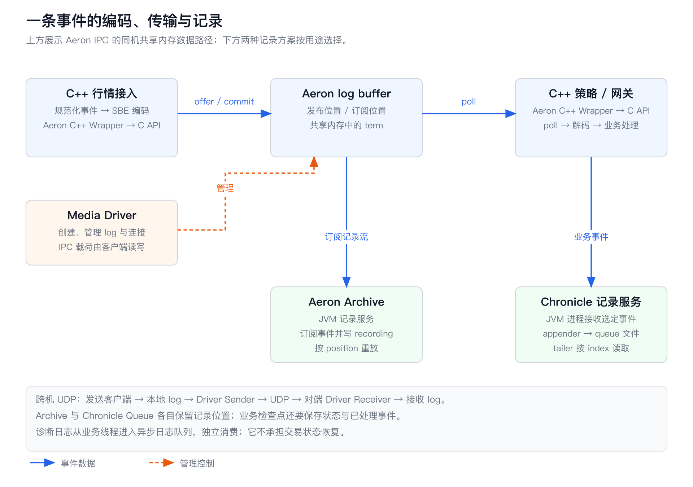
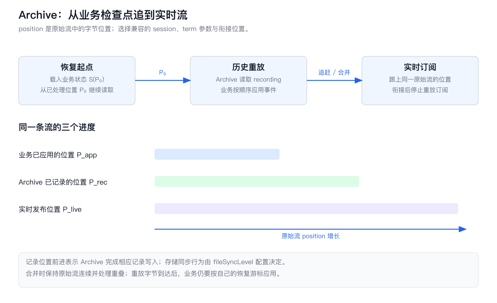

# HFT Engineering 07：开源项目解析——一条交易事件经过哪些组件

接入程序收到一条行情后，策略要读它，记录程序要保存它，排障工具还要知道它来自哪一段原始报文。这几个用途共享同一条事件，却关心不同的事情：策略关心何时能读到，记录程序关心重启后从哪里继续，排障工具关心能否还原当时发生了什么。

## 1. 事件、组件和进程

贯穿全文的行情事件包含五个字段：`instrumentId` 标识合约，`sourceSeq` 保留行情源序号，`price` 与 `quantity` 保存整数价格和数量，`receivedNs` 保存接收时间。价格的缩放因子由合约元数据定义，例如整数 `1234500` 对应什么价格，靠双方约定的指数解释；时间字段同样要约定时钟来源和单位。仅把字段命名为 `timestamp`，接收方无法判断它是交易所时间、网卡时间还是应用读取时间。

C++ 主链中，接入进程把事件交给策略进程。策略更新订单簿，生成带有请求标识的订单意图；记录进程保存输入事件、策略决策和发送结果。原始行情可以单独存放，但内部事件保留 `sourceSeq`、源通道标识以及原始记录位置，便于从一次异常决策追回原始字节。



图中每个 C++ 进程都链接自己的 Aeron Client 库。Media Driver 是管理通信资源的运行实例，可以单独占一个进程，也可以嵌入应用进程。进程间通信（Inter-Process Communication，IPC）走同一份共享日志缓冲区；跨机通信走用户数据报协议（User Datagram Protocol，UDP），由两端 Driver 收发网络报文。这里的“日志缓冲区”是循环使用的传输内存，不是供长期保存的诊断日志文件。

| 组件 | C++ 主链接入方式 | 额外运行组件 |
| --- | --- | --- |
| Simple Binary Encoding（SBE，简单二进制编码） | 构建时生成 C++ 头文件，运行时直接操作字节缓冲区 | 生成器使用 Java；生成的基础 C++ 编解码器无需 JVM |
| Aeron Transport | C API 或建立在其上的 C++ Wrapper；可使用 C Media Driver | Java Media Driver 是另一种实现选择 |
| Aeron Archive | C 或 C++ Wrapper 客户端控制记录与重放 | Archive 服务端是 Java 实现，可连接外部 C Driver |
| Aeron Cluster | 本文采用的开源实现运行在 Java 生态 | 共识、服务容器和恢复机制运行于 Java 虚拟机（Java Virtual Machine，JVM） |
| Chronicle Queue | 开源 Java 记录服务订阅主链事件 | Java 读写程序；商业 C++ 产品单独评估 |
| Quill、NanoLog | C++ 日志库 | 各自的后台处理线程；NanoLog 另有离线解码工具 |

Aeron 的原独立 C++ API 在 1.50.0 被移除。下面的代码入口采用 **Aeron 1.53.0 的 C++ Wrapper → C API**，不是旧版独立 C++ 实现。SBE 固定为 1.40.2；Chronicle Queue 固定为 2026.7；Quill 固定为 13.1.0。［1］

## 2. 自定义结构体能走多远

最直接的方案是把事件定义为一个结构体，复制其对象表示。过去常称这类数据为普通旧式数据（Plain Old Data，POD）；现代 C++ 中，更直接的检查是“能否按字节复制”和“布局是否符合协议约定”。

```cpp
struct Event {
    std::uint32_t instrumentId;
    std::uint64_t sourceSeq;
    std::int64_t  price;
    std::int64_t  quantity;
    std::uint64_t receivedNs;
};
static_assert(std::is_trivially_copyable_v<Event>);
```

在本篇实际运行的 Apple Clang 17、ARM64 环境中，`sizeof(Event)` 是 40，`sourceSeq` 偏移是 8。编译器在第一个 4 字节字段后插入了 4 字节填充，使后面的 64 位字段对齐。按五个字段宽度相加则是 36 字节。

```text
原生 C++ 对象：
偏移  0        4        8          16         24         32        40
      | 合约ID | padding | 源序号  | 价格     | 数量     | 接收时间 |

明确规定的紧凑线格式：
偏移  0        4          12         20         28        36
      | 合约ID | 源序号   | 价格     | 数量     | 接收时间 |
```

同一套程序、同一种架构、同时升级的共享内存生产者与消费者，可以约定这个 40 字节布局。代码加上 `static_assert(sizeof(Event) == 40)`、关键字段 `offsetof` 检查，并固定字节序。接收时先检查长度，再用 `memcpy` 复制到有效的 `Event` 对象。`std::bit_cast` 也能在等长、可平凡复制的类型之间转换对象表示，但它不会替你解决字节序或字段版本。

`#pragma pack(1)` 可以压缩填充，却把字段变成非自然对齐的位置。某些架构会增加访问指令，有些访问方式还会违反语言的对齐要求。对网络字节直接执行 `reinterpret_cast<Event*>` 然后解引用，风险同时来自长度、对齐和对象生命周期。用 `memcpy` 读取一个整数到局部变量，再按约定转换字节序，能把这些问题限制在编解码边界。

真正推动格式升级的是独立发布：接入程序新增一个字段，旧策略仍在线；记录文件保留半年，而当前程序已经改变；Java 记录服务也要解释同一份消息。此时 C++ 的应用二进制接口（Application Binary Interface，ABI）已经被拿来承担通信协议的职责。ABI 约束编译后的对象布局和调用方式，线格式则要让不同版本、不同语言的程序解释相同的字节。

可以继续手写“长度＋版本＋字段偏移”，只要同时维护文档、兼容规则和各语言实现。SBE 把这份工作变成 schema 和生成器：字段仍然按偏移读写，布局的依据变成明确的消息定义。［2］

## 3. SBE 的消息布局与访问器

SBE 的 schema 是一份 XML 消息描述，指定字段类型、出现顺序、字节序和引入版本。生成器根据同一份描述生成 C++、Java 等语言的访问器。下面截取本篇[完整 schema](examples/components_07/event-v1.xml)的消息部分：

```xml
<sbe:message name="Event" id="1">
  <field name="instrumentId" id="1" type="uint32"/>
  <field name="sourceSeq" id="2" type="uint64"/>
  <field name="price" id="3" type="int64"/>
  <field name="quantity" id="4" type="int64"/>
  <field name="receivedNs" id="5" type="uint64"/>
  <field name="flags" id="6" type="uint32"
         sinceVersion="1" presence="optional"/>
  <group name="levels" id="10" dimensionType="groupSizeEncoding">
    <field name="price" id="11" type="int64"/>
    <field name="quantity" id="12" type="int64"/>
  </group>
  <data name="source" id="20" type="varStringEncoding"/>
</sbe:message>
```

`levels` 是重复组，一个消息里可以带多个价格档位；`source` 是变长字符串。完整 schema 还定义了消息头、重复组的尺寸头，以及字符串长度的类型。SBE 允许 schema 选择这些类型，这个例子采用 8 字节消息头、4 字节组头和 2 字节字符串长度。

```text
消息起点
  0 ┌ blockLength: uint16 = 40 ┐  固定区长度，不包含消息头、组和字符串
  2 │ templateId:  uint16 = 1  │  选择 Event 模板
  4 │ schemaId:    uint16 = 7  │  选择这一套 schema
  6 └ version:     uint16 = 1  ┘  发送者采用的 schema 版本
  8 instrumentId : uint32
 12 sourceSeq    : uint64
 20 price        : int64
 28 quantity     : int64
 36 receivedNs   : uint64
 44 flags        : uint32        v1 增加；固定区结束于 48
 48 group blockLength: uint16 = 16
 50 group count:       uint16 = 2
 52 第 0 档：price 8 字节 + quantity 8 字节
 68 第 1 档：price 8 字节 + quantity 8 字节
 84 source length: uint16 = 4
 86 source bytes:  "XNAS"        消息结束于 90
```

多字节数值按 schema 的 `littleEndian` 编码，即低位字节先存。消息头是 `28 00 01 00 07 00 01 00`：`0x0028` 是十进制 40。头里的 `blockLength` 只定位固定区之后的内容，完整消息长度来自外层帧，或者从组与变长字段逐段计算；它不是总长度字段。

C++ 生成器给 `price()` 生成的核心操作是：从 `buffer + messageOffset + 12` 复制 8 字节到整数，再转换字节序。字段编号 `id="3"` 用于 schema 标识，固定区并不为每个值额外存一个标签。写入也是直接把数值放到指定偏移，不先构建一棵通用消息对象树。［3］

### 谁拥有字节，谁推进游标

SBE 访问器采用轻量视图（flyweight）：对象保存指针、起点、容量和当前版本等信息，消息字节仍然属于调用方。编码器包装调用方提供的数组，解码器可以包装 Aeron 回调交来的缓冲区。

```cpp
// header 已完成长度、schemaId、templateId 与支持版本检查。
Event decoder;
decoder.wrapForDecode(
    buffer, bodyOffset, header.blockLength(), header.version(), frameLength);
auto instrument = decoder.instrumentId();
auto price = decoder.price();
```

固定字段位置已知，可以直接定位。组与字符串的起点取决于前面读过多少项，因此访问器还维护一个顺序推进的游标。`levels()` 先读取组尺寸，`next()` 进入下一项；处理完各项后，游标才到 `source` 的长度字段。遇到带嵌套组、变长字段的组项，还要按 schema 顺序消费或跳过项内内容，才能进入下一项。

这会带来两个具体的生命周期问题。第一，`getSourceAsStringView()` 返回的视图继续引用原缓冲区。本文实验把底层四字节从 `XNAS` 覆写成 `TEST` 后，先前取得的视图立即读到 `TEST`。异步任务若要长期保存消息，就复制所需字段到自己拥有的对象，或转移一块明确归它管理的缓冲区。第二，直接跳过 `levels` 去读 `source`，会把组头当字符串长度。生成器的访问顺序检查可以在开发阶段拦截这种调用。

检查开关分成生成和编译两步：生成时设置 `sbe.generate.precedence.checks=true`，C++ 编译时定义 `SBE_ENABLE_PRECEDENCE_CHECKS`。它能发现“还未读完组就访问下一字段”，却不负责判断合约是否存在、数量是否允许为负，或消息是否完整。对外部输入，先校验帧长、消息模板、固定区长度，再按剩余长度验证组数量和变长字段。计算 `count × itemLength` 前用除法检查上界，避免整数溢出。［4］

### 新旧进程怎样共存

v0 的固定区是 36 字节，v1 在末尾增加 4 字节 `flags`。旧读者读 v1 时，用报文带来的 `actingBlockLength=40` 定位组头，而不是用自己编译时的 36。新读者读 v0 时，得到 `actingVersion=0`；生成的 `flags()` 发现字段尚未引入，返回该类型约定的空值。本例是 `0xffffffff`，不是业务含义上的“无标志位”。应用再把这个空值转换成明确的业务缺省策略。

兼容演进保留旧字段的类型、偏移和含义，在固定区尾部追加字段，用 `sinceVersion` 标记引入版本。组项固定区追加字段也依靠它自己的 `blockLength` 跳过扩展。新版本的编码器必须把实际版本和实际区块长度放进消息头。

新增组或变长字段要更谨慎。它们改变后续顺序，旧访问器无法靠固定区长度跨过任意未知的可变结构。把新变长字段追加到已有变长区末尾，且外层已经提供整条消息长度，旧读者才能读完已知字段后丢弃剩余尾部。若把新组插到旧字符串前，就会改变旧读者期待的字节类型。一般按 schema 允许的追加规则演进；需要重排时使用新模板，并让消费者显式选择。

枚举也属于版本协议。SBE 1.40.2 的 C++ 生成器默认对未知枚举值抛异常；启用未知枚举解码选项后会返回 `SBE_UNKNOWN`。交易方向、订单类型等字段的未知值应走“拒绝并记录”分支，而行情中的非关键扩展标志可以按业务规则忽略。将一个未知值强制转换成买入，会把格式兼容问题变成真实订单。［3］［4］

生成过程可以从 `SbeTool` 跟到 XML 解析和中间表示，再进入 `CppGenerator`，最终得到 `Event.h`。运行时只包含生成头文件；生成器版本、schema 版本和 C++ 应用版本应分别记录。升级生成器后，把历史字节再次解码，比只检查“新代码能写新消息”更容易发现兼容问题。

## 4. 相同事件，怎样比较编码方案

短消息与复杂消息会把成本放在不同地方。只有五个整数的事件，字段标签、长度头和对齐会占据显著比例；含几十个档位、可选属性和长字符串的事件，则更受分配、遍历和缓存访问影响。比较时保持字段、空值语义、价格精度和需要读取的内容一致。

| 方案 | 字节怎样组织 | 读取与演进方式 | 适合解决的事情 |
| --- | --- | --- | --- |
| 自定义 POD | 编译器对象布局，或手写固定偏移 | 偏移直接访问；版本协议自行维护 | 同版本程序之间的小而稳定的内部消息 |
| SBE | 固定区＋重复组＋变长区 | 固定字段直接访问；可变区顺序推进；schema 定义演进 | 行情、订单意图等结构明确的事件流 |
| Protocol Buffers（Protobuf） | 字段编号与 wire type 标签，加值或长度 | 通用 C++ 用法解析为生成对象；保留或跳过未知字段 | 服务接口、字段经常增删且缺省语义丰富的数据 |
| FlatBuffers | table、vtable 和相对偏移；另有固定布局 struct | 通过偏移访问已验证的缓冲区；table 可增加字段 | 从嵌套数据中随机读取少量字段 |
| Cap’n Proto | 按字对齐的 segment 与指针编码 | 按格式访问内存，遍历时执行边界与资源限制 | 结构化对象传递以及配套远程调用 |
| MessagePack | 类型标记、长度和值组成的动态结构 | 通用解码器解释数组、映射和基础类型 | 动态数据交换、脚本和工具接口 |

Protobuf 的标签编码为 `(field_number << 3) | wire_type`；`wire_type` 告诉解码器如何解释后面的字节。变长整数（varint）用每字节 7 位保存有效值，小整数更短，大整数会占多字节。`int64` 与用于负数的 `sint64` 编码也不同。解析器由标签找到字段，跳过不认识的字段；C++ arena 把一组消息对象放在同一块分配区域，减少分配与释放次数，解析、数值转换和字段赋值仍然发生。［5］

FlatBuffers 的 table 带有指向 vtable 的偏移，vtable 保存字段在对象内的偏移；未出现的字段可以返回缺省值。读取一个嵌套字段时沿相对偏移找到它，省去“整条缓冲区解析成对象树”的过程。table 可以按规则增加字段，固定布局的 struct 则更紧凑，但布局不能按同样方式演进。接收外部缓冲区时先运行 verifier，检查偏移和长度；只统计验证后的单字段访问，会漏掉入口验证成本。［6］

选型可以从一次实际访问开始：策略每条消息只读合约、价格和数量，还是会遍历所有档位？是否独立升级？是否跨语言？是否要把字符串留到回调之后？能否在一次短调用内顺序消费整个消息？这些答案比一张脱离消息大小的速度排名更有用。

“直接读缓冲区”省去的是构造独立对象或复制字段的一部分工作。SBE 编码依然要写入输出缓冲区；调用 Aeron `offer()` 还会把它复制进传输日志；网络协议栈和网卡有各自的搬运；字符串转成 `std::string` 又会复制。只有明确指出省掉哪一次复制，才能判断下一项优化是否值得做。[FIX tag-value 与 FAST](HFT_Engineering_08_交易所协议.md) 受交易所既定线格式约束。

## 5. Aeron IPC：注册、共享内存与发布

Aeron Client 提供 `Aeron`、`Publication`、`Subscription` 等对象。Publication 是应用发布数据的句柄，Subscription 是接收句柄；同一个进程可以同时持有两类对象。Media Driver 管理它们使用的日志文件、计数器、连接状态和生命周期。

客户端先通过 Driver 目录找到命令与控制文件 `cnc.dat`，映射控制环形缓冲区和计数器。调用 `addPublication(channel, streamId)` 后，客户端把注册命令送进控制队列；Driver Conductor 处理命令，创建或复用匹配的资源，将 registration ID 和日志文件信息通知客户端。C++ Wrapper 的 `addPublication` 返回注册标识，应用随后通过 `findPublication` 取得就绪句柄；不能把返回注册标识当成数据通道已就绪。

Subscription 的注册同样经过控制通道。匹配 publication 出现后，客户端得到对应的 Image。Image 是订阅侧对某个发布会话及其日志的读取视图：一个 subscription 接收多个 session 时，就会有多个 Image。Driver、Client 和业务线程各有职责；配置共享 Driver 目录的进程连接同一个 Driver 实例，并不要求这些库对象在同一进程里。［7］

```text
注册流程：
业务线程 → C++ Wrapper → C Client 的注册命令 → cnc.dat 控制队列
                                             ↓
                                      Driver Conductor
                                             ↓
客户端收到资源就绪通知 ← 日志文件名、计数器、registration ID

IPC 数据流程：
发布者映射地址 A ──写──┐
                       ├── 同一份 log 文件对应的共享物理页
订阅者映射地址 B ──读──┘
Driver 更新限制、清理旧 term、管理连接；不逐条转发消息体。
```

映射地址 A 与 B 可以完全不同。共享的是文件页及其数据，跨进程消息中不能把发布进程的指针当成接收进程的地址。事件使用整数标识、相对偏移或内联字节，接收端才能解释它。

### 三个 term 与字节位置

一个 Aeron log buffer 包含三个等长 term 和一段 metadata。term 是连续的日志分区：发布者往当前 term 追加帧，写满后换到下一分区；早先的分区在读者进度允许后清理并循环复用。metadata 保存活动 term、各 term 的尾指针和流配置。［8］

```text
log buffer
┌──────────────┬──────────────┬──────────────┬──────────────┐
│ term[0]      │ term[1]      │ term[2]      │ metadata     │
│ 每个长度 L   │ 每个长度 L   │ 每个长度 L   │ tails、配置… │
└──────────────┴──────────────┴──────────────┴──────────────┘
帧：Aeron header | 用户消息 | 对齐填充
```

position 是流中累计的字节位置，包括 Aeron 帧头和对齐填充。对于当前有效 term 范围，可以把位置理解为：

$$
P=(\text{termId}-\text{initialTermId})\times L+\text{termOffset}.
$$

实现用 term 长度的二进制位数移位计算，并处理 term ID 的环绕。position 不是“第几条业务消息”：90 字节的 SBE 消息还会占用 32 字节 Aeron 数据帧头，并按 32 字节对齐，累计占用 128 字节。消息分片和 term 尾部 padding 也会改变位置增量。

发布者只能在 publication limit 允许的范围里追加。IPC 的 `aeron_ipc_publication_update_pub_pos_and_lmt` 读取活动订阅者的消费位置，以最慢位置加窗口推进限制，并清理可复用区域。默认参与约束的订阅者称为 tethered subscriber。untethered 订阅者长期落后时可被移出约束、休息后重新加入；它的存在不再保证旧字节一直保留。记录程序若要求不漏事件，就要参与限速，或具备从持久记录补齐缺口的机制。

这和单进程预分配环形队列相似：写者知道写到哪，读者知道读到哪，慢读者决定哪些空间能够重用。Aeron 把游标换成字节 position，把共享区域和管理协议扩展到多个进程，并增加 term 轮换与断连处理。

### `offer()`、`tryClaim()` 与回调视图

`Publication::offer()` 进入 `aeron_publication_offer()`。它读取 publication limit 和活动 term，检查是否允许追加；空间足够时预留帧位置、复制用户缓冲区，再发布帧长度。多发布者句柄通过原子操作争用尾指针；单写线程可以使用 `ExclusivePublication` 减少这部分协调，但同一个 exclusive 句柄的发送操作由一个线程负责。［8］［9］

普通 `offer()` 需要一块已经编码好的消息缓冲区。若消息足够短，`tryClaim()` 可以直接预留 log 中的一段空间，把这次复制省掉：

```cpp
BufferClaim claim;
const std::int64_t position = publication->tryClaim(messageLength, claim);
if (position > 0) {
    try {
        // encodeEvent 在给定范围内编码，并且写满约定的消息长度。
        encodeEvent(claim.buffer().buffer() + claim.offset(), claim.length());
        claim.commit();
    } catch (...) {
        claim.abort();
        throw;
    }
}
```

这里的 `encodeEvent` 是业务编码函数，`claim.offset()` 指向 Aeron 帧头之后的用户区。`tryClaim()` 返回正值时只完成了预留；`commit()` 才发布可消费的帧。`abort()` 把这段空间标成 padding，让读者越过去。申请范围不能超过 `maxPayloadLength()`，因此 claim 不负责消息分片。编码时也要预先知道完整长度，否则无法申请正确空间。

一个未提交的 claim 会挡住该位置之后的连续消费。Driver 有 unblock 超时机制，用 padding 解除长时间停滞，目的是让流继续前进。业务代码仍要在同一短调用中提交或取消；把 claim 留给异步工作线程，既延长占位时间，也可能在 Driver 已解堵后继续写入被复用的内存。C++ 封装可以让作用域退出时自动 abort，仅在显式 commit 后解除保护。

接收侧 `Subscription::poll(handler, fragmentLimit)` 把 Image 中连续可读的 fragment 交给回调，返回本次处理的 fragment 数。一个大消息可能包含多个 fragment，使用 `FragmentAssembler` 才会重组成完整消息；重组本身会复制碎片。

回调拿到的 buffer 属于 Aeron。回调中直接用 SBE 读取所需字段，然后更新业务状态最自然。若把 buffer 指针塞进另一个线程的任务队列，原订阅继续推进后，Driver 就可能清理和复用对应 term。跨线程传递的数据要么复制成自有对象，要么在设计中明确保留读取进度；后者会直接影响背压。`controlledPoll` 可通过 `ABORT` 暂不推进当前片段，但它不是供任意长异步任务占住缓冲区的租约。

## 6. Aeron UDP：沿 position 找到落后的一段

跨机时，发送端和接收端各有自己的 log。发送进程先往本地 log 追加；发送端 Driver 的 Sender 读取已提交帧并发出 UDP；接收端 Driver 的 Receiver 把报文按 term ID 和 term offset 放到自己的接收 log；订阅线程最后从接收 log 消费。［10］

```text
发布线程     发送端共享 log      Sender       网络       Receiver     接收端共享 log     策略
  offer ───→ [已提交数据] ─────→ send ─────── UDP ─────→ insert ───→ [连续区|缺口|后续] ─→ poll
              pub-pos          snd-pos                               rcv-pos / rcv-hwm   sub-pos
```

channel 描述传输介质、地址等参数；stream ID 在通道里区分逻辑流，例如行情与订单意图；session ID 区分发布会话。接收端用 Image 表示某个会话的接收日志和进度。两个发布者使用同一 stream ID，也不会因此得到一条全局业务顺序；需要全序时，先由一个排序者给事件分配业务序号。

诊断时至少看下面几种位置，且比较对象必须属于同一条会话：

| 位置 | 谁推进 | 落后时先查什么 |
| --- | --- | --- |
| `pub-pos` | 发布端追加消息 | 上游是否停产、发布线程是否被其他工作阻塞 |
| `pub-lmt` | Driver 根据下游进度更新 | 发布端剩余可写窗口、参与限制的读者 |
| `snd-pos` / `snd-lmt` | Sender / 流控策略 | 发送线程、套接字发送、接收窗口 |
| `rcv-hwm` | Receiver 观察到更高位置 | 后面已到达多少字节，不能据此计算完整可读数据 |
| `rcv-pos` | 接收重建与缺口检测 | 连续区是否被丢包阻挡 |
| `sub-pos` | 应用消费 Image | 解码、业务处理、下游同步调用或停止 poll |

假如位置 `[1024,1152)` 的帧丢了，`[1152,1280)` 已到，Receiver 可以先把后者写到对应偏移。高水位升到 1280，连续可读区仍停在缺口前。负确认（Negative Acknowledgement，NAK）请求补齐缺失范围，重传帧落入原位置后，连续重建才能向前。应用 `poll` 依次扫描帧长度，遇到未提交位置就停，保证单个 Image 中按位置消费。

`aeron_publication_image_insert_packet` 负责接收窗口检查和按位置插入；`aeron_publication_image_track_rebuild` 扫描连续区、发现缺口并更新重建进度。沿这两个函数看，能把“报文已经收到”和“应用可以顺序读到”落实成不同的内存状态。

### 谁参与流控

接收端通过状态消息（Status Message）通告接收位置和窗口。发送端据此计算 sender limit；Sender 无法继续推进时，本地 log 逐渐积压，最终 publication limit 限住发布者。完整传导过程是“应用消费变慢 → 接收窗口受限 → 网络发送受限 → 本地追加受限”。本地还有 spy 订阅者时，它的进度也会影响发送日志何时能被清理。［10］［11］

单播由对应接收端约束；多播或多目标分发要明确选择策略：

- `max` 按接收者给出的较大可发送边界推进，偏向能跟上的接收者。落后的接收者不一定仍能从有限的发送日志中补到旧数据。
- `min` 跟踪活动接收者，以其中较小的边界限制发送；超时退出活动集合后，它不再约束流。
- `tagged` 只让匹配指定组标签的接收者进入限速集合，适合把关键消费与旁路消费放在同一分发体系中。

例如策略进程和录制进程必须跟上，研究进程允许离线补齐：可以让前两者进入 tagged 组，研究进程走实时加 Archive 补读。组里要求多少接收者、接收者失联多久才移出、离开后是否允许主链继续，都要一起配置。`min` 关心当前活动集合，接收者超时消失后仍继续发送，不能单独承担“指定录制程序永久在场”的业务要求。

Aeron 1.53.0 的默认多播流控选择 `max`。把“可靠 UDP”理解成“所有订阅者永远不会遗漏”，会直接配错记录链路。可靠传输在可用重传窗口内修复缺口；长时间离线后的历史获取由记录与重放组件接手。

IPC 的 tethering 与 UDP 的 `fc` 流控策略也处在不同位置：前者约束同机共享 log 的复用，后者汇总远端状态消息来约束 Sender。给 UDP publication 设置 `fc=min`，不会自动把一个无关本地记录线程变成必须完成持久化的消费者。

### 返回值怎样进入业务代码

C++ Wrapper 把 C API 的常见流控状态保留为返回值；非法参数等 `AERON_PUBLICATION_ERROR` 会映射成异常。用一个分支表集中处理，调用点才不会散落着无限重试。［9］

| `offer()` 结果 | 已发生的动作 | 调用方处理 |
| --- | --- | --- |
| 正值 | 消息已写进本地 log，值为追加后的 position | 记住本地提交位置；后续确认按业务要求独立跟踪 |
| `NOT_CONNECTED`，-1 | 尚无符合条件的连接 | 等待连接、转入恢复或有界积压 |
| `BACK_PRESSURED`，-2 | 当前写入超过允许窗口 | 有界重试、暂停上游，或按消息语义合并 |
| `ADMIN_ACTION`，-3 | term 轮换等管理过程使本次未完成 | 下一轮重试原消息 |
| `CLOSED`，-4 | publication 已关闭 | 停止发送并走生命周期恢复 |
| `MAX_POSITION_EXCEEDED`，-5 | 流达到可表示的最大 position | 创建新会话并完成业务序号衔接 |
| 异常 | 参数、资源或底层调用发生错误 | 记录错误原因，按错误类别恢复或终止 |

买一价更新如果只是“当前状态”，可按合约合并为最新值；逐笔成交、订单意图和撤单指令具有独立业务含义，合并会改变结果。事件队列设容量上限和积压时限，超过阈值后让策略暂停、切换到恢复状态，往往比卡在无限重试里更容易保持一致。

正值表示[本地 API 接受请求](HFT_Engineering_06_网络通信.md#completion-points)。若调用方还要求“策略已处理”或“记录已同步”，接收服务需要发送应用确认（application acknowledgement，业务 ACK），带上请求 ID、处理状态或确认游标。超时重发会遇到原请求已经处理但 ACK 丢失的情况，接收方据请求 ID 查找已有结果并返回。跨会话去重采用业务事件标识，Aeron position 只在对应会话和记录范围内有意义。

## 7. Archive：保存流，以及接回实时流

Aeron 的 term 会循环复用。Archive 订阅需要保存的流，把数据帧追加到记录段文件，用 catalog 管理 recording ID、通道、会话、起止位置和分段信息。录制对象是传输流，它保留帧与 position 的对应关系，适合从指定位置恢复消费。［12］

Aeron 1.53.0 的 Archive 服务端在 Java 模块中。一个常见部署是 C++ 接入和策略进程共用 C Media Driver，旁边一个 JVM 运行 `Archive`，通过相同 Driver 目录连接 C Driver；C++ 管理程序使用 Archive C++ Wrapper 发控制请求。直接运行 `ArchivingMediaDriver` 则是组合 Java Media Driver 与 Archive 的另一种启动方式，不能用这个类名推断自己已经部署了 C Driver。

客户端路径是：

```text
cpp_wrapper/client/archive/AeronArchive.h
  → C Archive client 的控制请求与响应
  → ArchiveConductor
  → RecordingSession → RecordingWriter → segment 文件
```

`startRecording(channel, streamId, sourceLocation)` 返回 recording subscription ID，用于控制这次订阅；**它不是 recording ID**。真正开始记录某个会话后，应用通过录制计数器、信号或 catalog 查询找到 recording ID。一个宽泛匹配多个会话的 recording subscription 可以产生多条 recording，不能用两个标识数值相近来替代查询。

`getRecordingPosition(recordingId)` 查询活动录制进度；录制停止后结合 stop position 等接口查看最终位置。控制请求不适合每条消息同步调用，热路径旁的监控线程可以读 recording position counter，或批量检查记录是否追上发布位置。C++ `replay()` 返回一个用于读重放流的 Subscription；`startReplay()` 返回重放 session 标识，供调用方自己建立和管理订阅。

录制位置推进到 P，表示录制程序已把对应数据写入记录文件。Archive 的 `fileSyncLevel` 决定是否执行存储同步：0 为不强制同步，1 强制数据，2 强制数据与元数据；默认是 0。`RecordingWriter` 根据这个配置调用 `FileChannel.force`。如果业务要求已同步到存储再确认，录制配置、catalog 同步级别和确认时点一起决定能承诺到哪里。［12］



策略快照保存最后一条已应用消息的结束 position=P。P 同时是下一条消息的起点，因此恢复过程先加载快照，再从 P 开始重放；若该位置之后是 term 尾部 padding，由传输层跳过 padding 进入下一条数据消息。重放进行时实时流还在前进，恢复者需要暂存或订阅实时流，并追到一个能够无缝切换的位置。比较的是同一原始会话中的位置，而不是两条任意流的“消息条数”。遇到分片消息，切换点还要落在完整消息边界，避免重放拿前半条、实时流拿后半条后重复或丢失。

`ReplayMerge` 封装了指定拓扑下的重放与实时衔接。1.53.0 也提供 `PersistentSubscription`，在 C++ Wrapper 中可见：它用重放和实时两个订阅协调追赶，支持 IPC 等场景，实时订阅落后后可再次回到重放。选择前仍需让录制文件保留期覆盖最长离线时间，并固定 recording 的身份。内部切换处理传输位置，策略“业务状态已保存到哪里”仍由业务快照和恢复游标表达。

保存游标的顺序尤其关键：如果先把游标保存到 P，再保存处理 P 后的状态，崩溃后会跳过尚未进入快照的事件。把状态与游标原子保存，或用可幂等的重放让恢复从较早位置重新执行。重放期间，订单意图只用于恢复内部状态；对外发单需要结合持久请求 ID 和交易所查询进行对账，避免历史订单再次无条件发送。

Aeron Cluster 在 Archive 之上增加基于 Raft 的复制状态机：多个副本通过一致的输入日志更新状态，再用快照和日志恢复。确定性要求意味着相同输入应产生相同状态，墙上时间、随机数和外部查询结果要作为受控输入进入逻辑。保存事件选择 Archive；恢复业务状态增加快照、游标与重放；需要复制一致状态时再评估 Cluster。外部交易所不会随内部日志回滚，订单请求标识和对账恢复仍然保留。［13］

## 8. Chronicle Queue：文件中的发布顺序

Chronicle Queue 是 OpenHFT 提供的 Apache-2.0 开源 Java 持久化队列。它直接以本地内存映射文件（memory-mapped file，mmap 文件）组织队列；写进映射页就是修改文件对应的页缓存，读者映射同一文件读取。读过的记录仍然保留，队列文件由使用方按归档和保留策略管理。Archive 从传输流生成记录，Chronicle Queue 则从本地记录文件提供追加与读取接口。［14］

Java 写入的典型作用域如下：

```java
try (DocumentContext dc = appender.writingDocument()) {
    try {
        dc.wire().write("sourceSeq").int64(sourceSeq);
        dc.wire().write("price").int64(price);
    } catch (RuntimeException | Error e) {
        dc.rollbackOnClose();
        throw e;
    }
}
```

`ExcerptAppender` 是追加句柄，`DocumentContext` 表示当前正在写的一条文档；正常离开作用域调用 `close()`，提交记录头和索引。Java 的 try-with-resources 在异常退出时也会调用 `close()`，所以编码失败的分支先调用 `rollbackOnClose()`，否则已有的半个业务文档也可能被发布。Chronicle Wire 负责消息体的字段编码，队列负责记录边界和读取位置。这个字段化写法方便说明；已有 SBE 编码的系统也可以把完整消息字节作为记录内容，同时保留业务序号和版本信息。

记录前有一个 32 位头：低 30 位保存消息体长度，第 30 位是 `META_DATA`，第 31 位是 `NOT_COMPLETE`。头为 0 时是未初始化、不可消费状态；`NOT_COMPLETE | META_DATA` 另有文件结束标记含义。理解这些标志后，还要沿具体版本的普通写入路径看它实际写了什么。

在 Queue 2026.7、Wire 2026.10 中，`StoreAppender.writingDocument()` 持写锁进入 `Wire.enterHeader()`，普通新记录的头保持 **0**，写位置跳过这 4 字节后填写消息体。`StoreAppenderContext.close()` 调用 `updateHeaderAndIndex()`，再由 `Wire.updateHeader(position, metaData, 0)` 通过比较并交换（Compare-and-Swap，CAS）把 0 替换为最终长度。普通写入并非每条都先设置 `NOT_COMPLETE` 位。［15］

```text
写入中：  [头 = 0，未发布] [消息体已经写了一部分……] [后续空间]
提交后：  [头 = 长度 N]   [完整 N 字节消息体]        [头 = 0]
                              ↑
              先完成消息体，再原子发布最终记录头
```

读者以具备可见性语义的方式读取记录头，只有看到完整头才进入消息体。发布头让其他进程知道“这条记录的字节已经完整”，文件页的磁盘同步是另一步。进程在写一半时退出，读者停在未发布头；恢复写者获得锁后重新定位末尾。`enterHeader()` 遇到可覆盖的未完成头时会将其清回未初始化状态再写，遇到 EOF 标志则走结束处理。实际恢复还包含尾位置与索引查找，不能只扫描一个标志位就自行宣布整段文件有效。

### 写锁、滚动文件和稀疏索引

普通写入先取得 `TableStoreWriteLock`。锁存放在共享的表存储中，以进程 ID 表示持有者，多个进程通过 CAS 竞争；一个进程内也不能让多个线程随意并发使用同一个 appender。持有文档作用域越久，后面的写者就等待越久，因此耗时计算、外部请求和大对象构建放在取得写入作用域之前。

超时处理由 `queue.force.unlock.mode` 决定。2026.7 默认是 `LOCKING_PROCESS_DEAD`：确认持锁进程已死才尝试强制解锁；`NEVER` 直接报告不可恢复超时，`ALWAYS` 允许更激进的强制解锁。持有者仍活着时强行释放，会让旧写者与新写者同时修改文件，把停顿问题升级为数据损坏风险。［16］

文件按 roll cycle 滚动，默认 `FAST_DAILY` 以 UTC 日界切换，默认稀疏索引间隔为 256。逻辑 index 由 cycle 与 cycle 内消息序号组成；它不是文件字节偏移。保存恢复游标时保存完整 index，让 `moveToIndex()` 选择文件并定位记录。

```text
queue 目录
  metadata.cq4t          共享表存储、锁和元数据
  某日F.cq4             cycle A
    文件元数据
    index2index ──→ 第二级索引块 ──→ 序号 0、256、512… 的记录位置
    文档0 | 文档1 | …… | 文档256 | ……
  次日F.cq4             cycle A+1
```

`SCQIndexing` 通过两级索引找到目标序号附近的文件位置，再扫描到目标记录。索引间隔越小，随机定位前的扫描越短，但索引占用也更大；顺序读取则主要沿记录头推进。`ExcerptTailer` 各自维护位置，`toStart()`、`toEnd()` 和 `moveToIndex()` 调整其读取起点，多个 tailer 不会因为某个读者消费就让记录消失。具名 tailer 可以保存自身读取进度，但业务处理与游标持久化的先后仍需要与业务状态恢复配合。［17］

### `sync()` 到底同步了什么

普通记录提交后，其他进程可以从共享文件页读到数据；此时磁盘写回可能尚未完成。`ExcerptAppender.sync()` 的实现值得直接读：

```text
StoreAppender.sync()
  → 当前 wire.bytes().bytesStore()
  → MappedBytesStore.syncUpTo(bytes.writePosition())
  → 按页对齐此次同步范围
  → PosixAPI.msync(address + offset, length, SyncMode 的标志)
```

**默认 SyncMode 是 ASYNC。** Queue builder 未显式设置时，沿用 Chronicle Bytes 的 `MappedFile.DEFAULT_SYNC_MODE`，后者默认读取 `mappedFile.defaultSyncMode=ASYNC`。因此只看到一次 `appender.sync()` 调用，还不知道它是否等待存储完成。设置 `syncMode(SyncMode.SYNC)` 才会使用 `MS_SYNC`；`ASYNC` 使用 `MS_ASYNC`，`NONE` 跳过同步。在 Linux 2.6.19 及以后，`MS_ASYNC` 不主动调度写回，内核依靠自身的脏页跟踪与写回机制处理这些页面；它也不等待页面落盘。［18］

```text
写者                             同机读者                  内核与存储
  写消息体到映射页 ───────────────────────────────────→ 文件页变脏
  CAS 发布记录头 ───────────────→ 读到完整记录
  sync() + ASYNC ────────────────────────────────────→ Linux 不主动调度，也不等待写回
  sync() + SYNC  ────────────────────────────────────→ 等待所选映射范围同步
                 ←────────────────────────────────── 同步调用返回
```

`syncUpTo` 从已同步位置附近的页边界到当前写位置，作用于当前 `MappedBytesStore`；它不等于一次覆盖目录、所有历史 cycle 文件以及业务快照的全局提交。新建滚动文件涉及目录项，业务游标可能在另一个文件，设备写缓存也有自己的掉电保障。这些对象一起决定“机器掉电之后能从哪条记录恢复”。更具体地说，该版本 `performMsync` 遇到非零返回会写错误日志，随后上层仍可能更新同步进度，所以不能仅以 `sync()` 正常返回作为完整的存储健康确认；监控要接住同步错误并停止继续给出持久化承诺。

进程被 `kill -9` 后，操作系统仍在运行，页缓存通常还在；整机断电则把这个前提拿掉。附录分别测试进程退出与整机断电。磁盘空间耗尽也要单独注入：文件扩展可能失败，访问无法兑现的映射页还可能触发操作系统级错误，恢复程序应从最后确认的完整记录重建，并对照输入事件序号检查尾部缺失。

开源库没有供 C++ 直接读写的对应实现。可以让 Java 记录服务订阅 Aeron，再写入 Chronicle Queue；C++ 和 Java 间仍通过明确的事件 schema 交流。这样把文件编码和同步移到记录服务，记录完成时点会后移。记录服务若参与 Aeron 流控，持续落后仍会反压主链；若将其移出流控，主链可以继续，但记录服务就需要补录来源。

跨机复制、Async Mode、Pretoucher 预触页、按时区滚动，以及 C++ 产品和 Java/C++ 互操作，属于相应商业产品范围。开源版默认的 `MS_ASYNC` 与商业 Async Mode 是不同机制：前者是操作系统页面同步接口的标志，后者是产品中的异步读写模式。部署预算同时计入 JVM 进程、记录服务的 CPU 和内存、文件保留量及恢复吞吐。［14］

## 9. Quill 与 NanoLog：诊断日志怎样离开交易线程

诊断日志记“程序做了什么”，行情记录保存“恢复要重放什么”。一条诊断日志可以按策略丢弃，一笔已经发送的订单意图则要能恢复。各自的队列配置决定突发负载下是否允许丢弃、何时暂停业务。

Quill 的每个前端线程拥有一条单生产者单消费者（Single-Producer Single-Consumer，SPSC）队列。线程是这条队列的唯一写者，后台线程是唯一读者。日志宏记录格式元数据、时间戳和参数的二进制表示，把字符串格式化和输出交给后台。后端读取多个前端队列，缓存待处理事件，再按时间戳选择处理顺序。［19］

```text
交易线程 A → SPSC A ─┐
交易线程 B → SPSC B ─┼→ 后台取事件、合并时间戳 → 格式化 → 文件/终端 sink
接入线程 C → SPSC C ─┘
```

前端仍会计算日志参数表达式、取得时间戳并编码参数。若写 `LOG_INFO(logger, "book={}", buildHugeBookString())`，构建字符串的工作已经在交易线程发生，后台格式化无法把它搬走。对于自定义对象，确认 codec 在队列中保存了数据副本还是仅保存引用，避免后台访问已销毁的对象。

Quill 13.1.0 的四种队列类型对热路径有直接影响：

| 类型 | 容量行为 | 空间不足时 |
| --- | --- | --- |
| `BoundedBlocking` | 初始容量固定，不扩容 | 等待后台腾出空间；单条大到永远装不下时走失败处理 |
| `BoundedDropping` | 初始容量固定，不扩容 | 放弃本次日志并计数 |
| `UnboundedBlocking` | 从初始容量增长到配置上限 | 达到上限后等待 |
| `UnboundedDropping` | 从初始容量增长到配置上限 | 达到上限后丢弃 |

默认是 `UnboundedBlocking`，初始容量 128 KiB，可增长的配置上限为 2 GiB。“unbounded”这个类型名在这一版仍受 `unbounded_queue_max_capacity` 约束。扩容分配和阻塞重试都发生在生产者的发送过程里，会把日志开销带回交易线程。延迟敏感且允许丢失的诊断流，可以选择固定容量的 `BoundedDropping`，预先触发线程上下文初始化、分配并触摸队列；同时把丢弃量送入独立计数监控。［20］

时间戳默认可以使用[处理器时间戳计数器](HFT_Engineering_05_高频交易系统中的时钟.md)（Time Stamp Counter，TSC）；Quill 在后台将读数转换成时间。它也支持系统时钟和用户时钟。时间戳排序用于组织输出，跨线程真实因果仍由事件序号、请求 ID 和业务关系表达。不要用两行日志在文件中的相邻顺序，替代消息之间的发布与消费关系。

### NanoLog 把文本恢复放到离线阶段

NanoLog 在编译期提取静态格式，运行时输出紧凑二进制日志，再由离线工具还原可读文本。对 `"order=%lu price=%ld"` 这样的调用，格式串、参数类型和调用位置具有静态性质；频繁变化的只是订单号、价格和时间。每次把完整文本重新写出会重复保存大量相同信息。［21］

其仓库包含两套实现：preprocessor 版本把 Python 预处理器接进构建过程，提前提取更多静态信息；C++17 版本使用模板等语言机制，像普通库一样包含头文件并链接。两者生成的数据和配套解码过程不同，不能混用。运行时缓存动态记录，后台压缩输出；查看时执行与实现对应的 decompressor。

Quill 主要把格式化与输出从交易线程挪到进程内后台，便于现有文本日志工作流接入；NanoLog 把文本生成进一步挪到离线阶段。后者的运维链路要保存解码工具、构建版本和必要元数据，故障时先确认拿到的是对应版本。无论采用哪一种，日志队列里的数据在进程崩溃时仍可能尚未输出，订单恢复使用独立业务记录，日志只承担诊断职责。

## 10. 复用引擎，封装语义

一个可逐步增加能力的组合是：C++ 接入与策略使用 SBE 约定事件，Aeron 负责进程间分发，Quill 负责诊断。需要按原始 position 重放流时加入 Archive；希望围绕本地文件队列组织记录服务、并能接受 JVM 时，选择 Chronicle Queue。两种记录方式可以择一，也可以在明确用途下并存，例如 Archive 保存原始流，Chronicle Queue 保存面向运营的业务记录。

| 层次 | 直接复用 | 业务侧固定下来 |
| --- | --- | --- |
| 编解码 | SBE 生成器与访问器 | schema 版本、数值单位、入口验证、视图有效期 |
| 通信 | Aeron Client、Driver、流控实现 | 返回值策略、关键订阅集合、积压上限、业务 ACK |
| 记录与恢复 | Archive 或 Chronicle Queue | 保留期、已同步边界、状态与游标、重放副作用 |
| 诊断 | Quill 或 NanoLog | 丢弃策略、队列容量、预热、日志关联标识 |
| 交易逻辑 | 自己实现领域规则 | 订单状态、幂等处理、风险检查、策略决策 |

封装接口可以直接表达生命周期：`encodeAndCommit` 在一次作用域内完成 claim；`onEvent` 不允许保留外部视图；`recordingCheckpoint` 返回带 recording ID 的位置；`sendOrderIntent` 返回本地接受状态，并通过另一条状态流更新交易所确认。把这些含义写进接口名和类型，业务调用者就不必在每个位置重新推导底层语义。

同一生态的组件也不必成套使用。Agrona 的集合面向 Java；C++ 可根据对象稳定性和缓存访问要求选择 `boost::unordered_flat_map` 或 `absl::flat_hash_map`。通信采用 Aeron，并不要求策略状态也改写成 Java 数据结构。

自研的理由应该落到具体冲突：消息格式不支持必需的访问方式、通信窗口无法表达消费关系、记录布局不适合恢复查询，或者量化后的运行成本超过预算。替换一个组件时，同时接手其长期维护的部分：旧数据兼容、故障注入、资源清理、错误可观测性和升级回滚。上线检查保留四份工件：schema、生成器及组件版本、历史消息样本、带确认游标的恢复样本。

## 附录：已运行的字节实验与进一步复现

### SBE 新旧版本与边界检查

[实验目录](examples/components_07/README.md)包含两个 schema、C++ 程序和运行脚本。脚本下载并校验 SBE 1.40.2 生成器，实际生成 C++ 访问器，用地址消毒器（AddressSanitizer，ASan）和未定义行为消毒器（UndefinedBehaviorSanitizer，UBSan）编译，再用独立的 Python `struct.pack` 字节编码核对输出。

实际运行环境为 macOS ARM64、Apple Clang 17.0.0、OpenJDK 24.0.2。输出中的 40 字节是该环境的原生 POD 布局；86 与 90 字节是完整 SBE 消息长度，包含两档重复组和四字节字符串。

```text
POD size=40 sourceSeq offset=8
v0=86 v1=90 cross-decode=4/4 truncated-prefixes=90/90 order-check=pass view-alias=pass
independent Python wire oracle=pass
```

四组交叉读取覆盖“旧写旧读、旧写新读、新写旧读、新写新读”。90 种截断前缀全部被实验中的入口校验器拒绝；这个校验器明确支持 v0/v1，并在调用生成访问器前检查头、组和字符串边界。访问顺序实验提前读取字符串，确认开启的顺序检查会抛错；视图实验确认底层字节修改会影响已返回的 `string_view`。这些结果验证的是布局、兼容和生命周期，没有测量吞吐或延迟。

```bash
# JAVA_BIN 指向 JDK 17 或更新版本；CXX 可指定 C++20 编译器。
JAVA_BIN=/path/to/jdk/bin/java python3 hft/examples/components_07/run.py
```

### 通信、恢复与日志的复现步骤

下面的通信负载、存储故障和日志压力实验尚未在本篇环境执行。它们需要目标 Linux 主机、相应运行组件，部分需要两台机器或可断电的虚拟机；复现时分别保留本地提交、应用消费和存储同步的测量结果。

| 实验 | 输入与故障 | 观察和判定 |
| --- | --- | --- |
| 编码方案比较 | 同一份短事件和含组、字符串的事件；POD/SBE/Protobuf/FlatBuffers 字段一致 | 分开测编码、验证、读取指定字段、完整解析；计入字节数与分配次数 |
| Aeron IPC | 连续递增业务序号，足够跨越多个 term；暂停订阅线程 | `pub-pos`、`pub-lmt`、`sub-pos` 与返回值；恢复后已提交事件顺序一致 |
| Aeron UDP | 两台机器；三类接收者分别切换 `max/min/tagged`；受控丢包、乱序 | `snd-pos`、`rcv-hwm`、`rcv-pos`、NAK 与业务序号缺口；退出组后的恢复行为 |
| `offer` 对比 claim | 同样长度与字节；相同流控、核绑定和消费者 | 编码加本地提交的时间、应用消费时间；claim 异常分支能 abort，未提交 claim 能被观测 |
| Archive | 写序号流并记录 P；快照后停止消费者，再从 P 重放 | 原 recording 身份、完整消息切换点、业务去重；同一快照重放得到相同状态 |
| Chronicle 进程退出 | 正常提交后杀进程；另一次在 `DocumentContext` 中途退出 | 最后完整序号、未发布头、写锁恢复、后续能否追加 |
| Chronicle 存储故障 | 分别使用 NONE/ASYNC/SYNC；跨 cycle；受控断电与磁盘满 | 同步错误、文件与目录恢复、最后连续可读序号；与进程退出实验分别报告 |
| Quill 突发日志 | 固定业务循环，四种队列策略，后台限速 | 业务循环 p50/p99/p99.9、队列增长、阻塞次数、日志丢弃量 |

复现存储故障时，在另一个故障域记录“应用观察到的最后提交序号”和“应用承诺已同步的最后序号”。故障后只从恢复文件扫描得到第三个序号，再比较三者；若把证据文件也放在被断电的同一块盘上，就失去了独立参照。

## 源码版本与参考资料

所有源码链接固定到以下 commit；API 行为按这一组版本解释。

| 项目 | 版本或快照 | commit |
| --- | --- | --- |
| Aeron | 1.53.0 | `af20315a6b6323783ae717b075ba4a70c9abbf0c` |
| SBE | 1.40.2 | `05b076c0c64d7164b56db2f9b5e6ca476ac46072` |
| Chronicle Queue | 2026.7；依赖 BOM 2026.26 | `36a4d7dec1223a2759b2fa50ca1e3d9a19035f1f` |
| Chronicle Wire | 2026.10 | `33a92e1ed387c78f317494619adefb8ecaa8568c` |
| Chronicle Bytes | 2026.4 | `e06230d436c0f6890faffaa9bfed19fee02c59eb` |
| Quill | 13.1.0 | `78c0696c5be589488d882c280796dfa06bdcd492` |
| NanoLog | 仓库源码快照 | `2a94d70f9d1db4da416053b1b926387fa068a59b` |

1. [Aeron 1.50.0 的 C++ API 迁移说明](https://aeron.io/other/aeron-community-meetup-whats-new-march-2026/)；[Aeron 固定版本模块目录](https://github.com/aeron-io/aeron/tree/af20315a6b6323783ae717b075ba4a70c9abbf0c)。
2. [C++ 对象表示与可平凡复制类型](https://eel.is/c++draft/basic.types#trivial)；[SBE 固定版本源码](https://github.com/aeron-io/simple-binary-encoding/tree/05b076c0c64d7164b56db2f9b5e6ca476ac46072)。
3. SBE：[SbeTool 入口与生成开关](https://github.com/aeron-io/simple-binary-encoding/blob/05b076c0c64d7164b56db2f9b5e6ca476ac46072/sbe-tool/src/main/java/uk/co/real_logic/sbe/SbeTool.java)、[CppGenerator 字段、版本与枚举生成](https://github.com/aeron-io/simple-binary-encoding/blob/05b076c0c64d7164b56db2f9b5e6ca476ac46072/sbe-tool/src/main/java/uk/co/real_logic/sbe/generation/cpp/CppGenerator.java)、[官方示例 schema](https://github.com/aeron-io/simple-binary-encoding/blob/05b076c0c64d7164b56db2f9b5e6ca476ac46072/sbe-samples/src/main/resources/example-schema.xml)。
4. SBE：[C++ 使用指南](https://github.com/aeron-io/simple-binary-encoding/wiki/Cpp-User-Guide)、[Safe Flyweight Usage](https://github.com/aeron-io/simple-binary-encoding/wiki/Safe-Flyweight-Usage)。本篇实际生成和验证文件见 [components_07](examples/components_07/README.md)。
5. Protobuf：[线格式](https://protobuf.dev/programming-guides/encoding/)、[C++ arena](https://protobuf.dev/reference/cpp/arenas/)。
6. [FlatBuffers Internals](https://flatbuffers.dev/internals/)、[Cap’n Proto Encoding](https://capnproto.org/encoding.html)、[MessagePack Specification](https://github.com/msgpack/msgpack/blob/master/spec.md)。
7. Aeron：[C++ Wrapper Aeron 注册入口](https://github.com/aeron-io/aeron/blob/af20315a6b6323783ae717b075ba4a70c9abbf0c/aeron-client/src/main/cpp_wrapper/Aeron.h)、[C Client Conductor](https://github.com/aeron-io/aeron/blob/af20315a6b6323783ae717b075ba4a70c9abbf0c/aeron-client/src/main/c/aeron_client_conductor.c)、[Driver Conductor](https://github.com/aeron-io/aeron/blob/af20315a6b6323783ae717b075ba4a70c9abbf0c/aeron-driver/src/main/c/aeron_driver_conductor.c)。
8. Aeron：[log buffer 布局](https://github.com/aeron-io/aeron/blob/af20315a6b6323783ae717b075ba4a70c9abbf0c/aeron-client/src/main/c/concurrent/aeron_logbuffer_descriptor.h)、[IPC publication 位置与 tethering](https://github.com/aeron-io/aeron/blob/af20315a6b6323783ae717b075ba4a70c9abbf0c/aeron-driver/src/main/c/aeron_ipc_publication.c)、[Image 消费](https://github.com/aeron-io/aeron/blob/af20315a6b6323783ae717b075ba4a70c9abbf0c/aeron-client/src/main/c/aeron_image.c)。
9. Aeron：[Publication.h](https://github.com/aeron-io/aeron/blob/af20315a6b6323783ae717b075ba4a70c9abbf0c/aeron-client/src/main/cpp_wrapper/Publication.h) → [aeron_publication.c](https://github.com/aeron-io/aeron/blob/af20315a6b6323783ae717b075ba4a70c9abbf0c/aeron-client/src/main/c/aeron_publication.c)；[BufferClaim 的 commit/abort](https://github.com/aeron-io/aeron/blob/af20315a6b6323783ae717b075ba4a70c9abbf0c/aeron-client/src/main/cpp_wrapper/concurrent/logbuffer/BufferClaim.h)。
10. Aeron：[network publication 与 Sender 进度](https://github.com/aeron-io/aeron/blob/af20315a6b6323783ae717b075ba4a70c9abbf0c/aeron-driver/src/main/c/aeron_network_publication.c)、[publication image 的接收与重建](https://github.com/aeron-io/aeron/blob/af20315a6b6323783ae717b075ba4a70c9abbf0c/aeron-driver/src/main/c/aeron_publication_image.c)、[Receiver](https://github.com/aeron-io/aeron/blob/af20315a6b6323783ae717b075ba4a70c9abbf0c/aeron-driver/src/main/c/aeron_driver_receiver.c)。
11. Aeron：[Flow and Congestion Control](https://github.com/aeron-io/aeron/wiki/Flow-and-Congestion-Control)、[C 流控选择](https://github.com/aeron-io/aeron/blob/af20315a6b6323783ae717b075ba4a70c9abbf0c/aeron-driver/src/main/c/aeron_flow_control.c)、[Driver 默认流控](https://github.com/aeron-io/aeron/blob/af20315a6b6323783ae717b075ba4a70c9abbf0c/aeron-driver/src/main/c/aeron_driver_context.c)、[min/tagged 流控实现](https://github.com/aeron-io/aeron/blob/af20315a6b6323783ae717b075ba4a70c9abbf0c/aeron-driver/src/main/c/aeron_min_flow_control.c)。
12. Archive：[C++ 客户端](https://github.com/aeron-io/aeron/blob/af20315a6b6323783ae717b075ba4a70c9abbf0c/aeron-archive/src/main/cpp_wrapper/client/archive/AeronArchive.h)、[RecordingWriter](https://github.com/aeron-io/aeron/blob/af20315a6b6323783ae717b075ba4a70c9abbf0c/aeron-archive/src/main/java/io/aeron/archive/RecordingWriter.java)、[Archive 配置](https://github.com/aeron-io/aeron/blob/af20315a6b6323783ae717b075ba4a70c9abbf0c/aeron-archive/src/main/java/io/aeron/archive/Archive.java)、[PersistentSubscription](https://github.com/aeron-io/aeron/blob/af20315a6b6323783ae717b075ba4a70c9abbf0c/aeron-archive/src/main/cpp_wrapper/client/archive/PersistentSubscription.h)。
13. [Aeron Cluster 概述](https://aeron.io/docs/aeron-cluster/overview/)、[Cluster 固定版本模块](https://github.com/aeron-io/aeron/tree/af20315a6b6323783ae717b075ba4a70c9abbf0c/aeron-cluster/src/main)。
14. Chronicle Queue：[2026.7 README 与产品边界](https://github.com/OpenHFT/Chronicle-Queue/blob/36a4d7dec1223a2759b2fa50ca1e3d9a19035f1f/README.adoc)、[固定依赖 BOM 的 pom.xml](https://github.com/OpenHFT/Chronicle-Queue/blob/36a4d7dec1223a2759b2fa50ca1e3d9a19035f1f/pom.xml)、[商业多语言版本](https://chronicle.software/products/chronicle-queue)。
15. Chronicle：[StoreAppender 写入/提交](https://github.com/OpenHFT/Chronicle-Queue/blob/36a4d7dec1223a2759b2fa50ca1e3d9a19035f1f/src/main/java/net/openhft/chronicle/queue/impl/single/StoreAppender.java)、[Wires 头常量](https://github.com/OpenHFT/Chronicle-Wire/blob/33a92e1ed387c78f317494619adefb8ecaa8568c/src/main/java/net/openhft/chronicle/wire/Wires.java)、[AbstractWire enterHeader/updateHeader](https://github.com/OpenHFT/Chronicle-Wire/blob/33a92e1ed387c78f317494619adefb8ecaa8568c/src/main/java/net/openhft/chronicle/wire/AbstractWire.java)。
16. Chronicle：[TableStoreWriteLock](https://github.com/OpenHFT/Chronicle-Queue/blob/36a4d7dec1223a2759b2fa50ca1e3d9a19035f1f/src/main/java/net/openhft/chronicle/queue/impl/single/TableStoreWriteLock.java)、[AbstractTSQueueLock 默认解锁模式](https://github.com/OpenHFT/Chronicle-Queue/blob/36a4d7dec1223a2759b2fa50ca1e3d9a19035f1f/src/main/java/net/openhft/chronicle/queue/impl/table/AbstractTSQueueLock.java)。
17. Chronicle：[RollCycles](https://github.com/OpenHFT/Chronicle-Queue/blob/36a4d7dec1223a2759b2fa50ca1e3d9a19035f1f/src/main/java/net/openhft/chronicle/queue/RollCycles.java)、[SCQIndexing](https://github.com/OpenHFT/Chronicle-Queue/blob/36a4d7dec1223a2759b2fa50ca1e3d9a19035f1f/src/main/java/net/openhft/chronicle/queue/impl/single/SCQIndexing.java)、[StoreTailer](https://github.com/OpenHFT/Chronicle-Queue/blob/36a4d7dec1223a2759b2fa50ca1e3d9a19035f1f/src/main/java/net/openhft/chronicle/queue/impl/single/StoreTailer.java)。
18. Chronicle：[builder 的 syncMode](https://github.com/OpenHFT/Chronicle-Queue/blob/36a4d7dec1223a2759b2fa50ca1e3d9a19035f1f/src/main/java/net/openhft/chronicle/queue/impl/single/SingleChronicleQueueBuilder.java)、[MappedFile 默认 ASYNC](https://github.com/OpenHFT/Chronicle-Bytes/blob/e06230d436c0f6890faffaa9bfed19fee02c59eb/src/main/java/net/openhft/chronicle/bytes/MappedFile.java)、[MappedBytesStore.syncUpTo 与 msync 错误处理](https://github.com/OpenHFT/Chronicle-Bytes/blob/e06230d436c0f6890faffaa9bfed19fee02c59eb/src/main/java/net/openhft/chronicle/bytes/MappedBytesStore.java)、[Linux msync(2) 语义](https://man7.org/linux/man-pages/man2/msync.2.html)。
19. Quill：[前后端设计](https://github.com/odygrd/quill/blob/78c0696c5be589488d882c280796dfa06bdcd492/docs/overview.rst)、[BackendWorker](https://github.com/odygrd/quill/blob/78c0696c5be589488d882c280796dfa06bdcd492/include/quill/backend/BackendWorker.h)。
20. Quill：[FrontendOptions 的队列默认值](https://github.com/odygrd/quill/blob/78c0696c5be589488d882c280796dfa06bdcd492/include/quill/core/FrontendOptions.h)、[Frontend 的时钟选项](https://github.com/odygrd/quill/blob/78c0696c5be589488d882c280796dfa06bdcd492/include/quill/Frontend.h)。
21. NanoLog：[USENIX ATC 2018 论文](https://www.usenix.org/conference/atc18/presentation/yang-stephen)、[两种实现与解码方式](https://github.com/PlatformLab/NanoLog/blob/2a94d70f9d1db4da416053b1b926387fa068a59b/README.md)、[运行时实现](https://github.com/PlatformLab/NanoLog/tree/2a94d70f9d1db4da416053b1b926387fa068a59b/runtime)。
