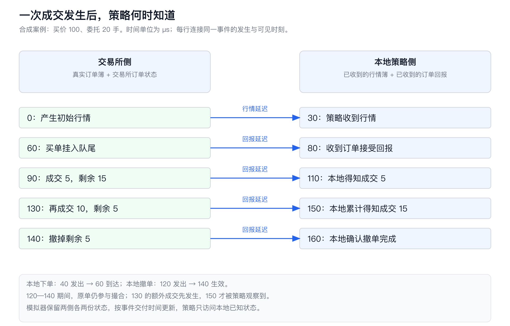
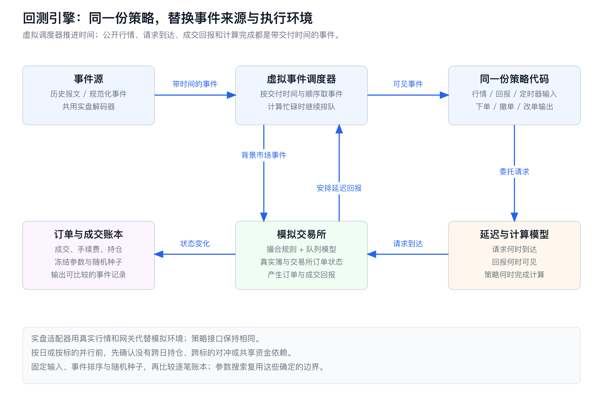
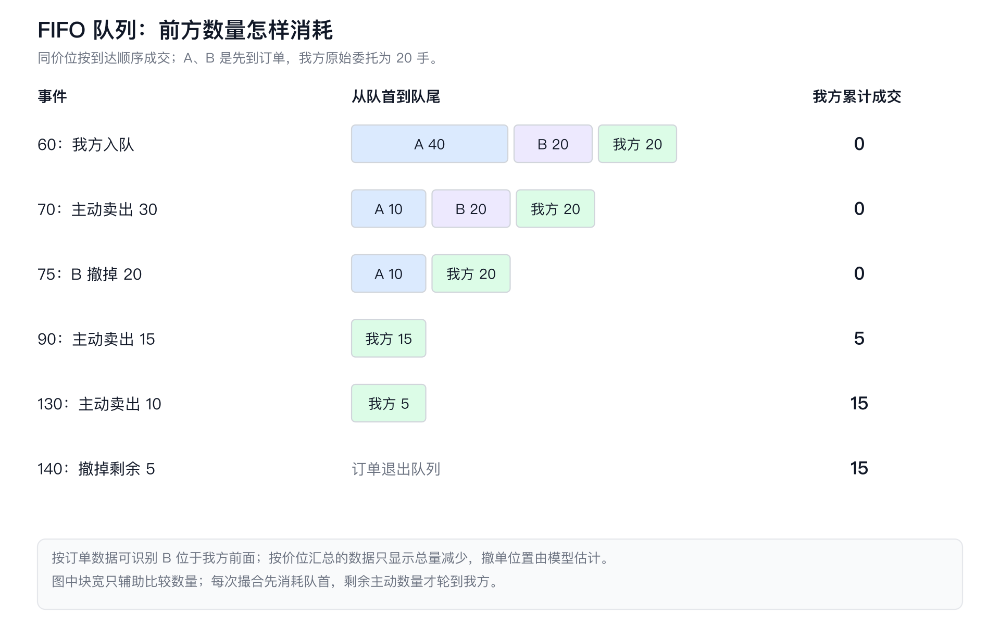
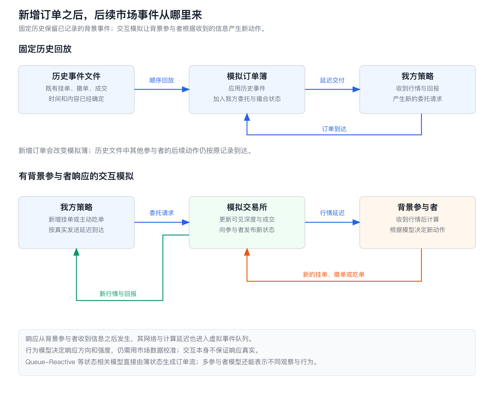

# HFT Engineering 09：高频回测，把一笔挂单放回当时的市场

程序看到买一价是 100，决定买入 20 手。随后，历史行情里出现了一笔价格为 100 的成交。如果回测立即把这 20 手记为买入，它已经跳过了最重要的过程：自己的订单何时到达交易所，前面有多少订单，以及这次主动卖出究竟消耗了谁。

高频交易（High-Frequency Trading，HFT）的回测，把策略放进按事件推进的市场中。输入是行情、延迟和交易规则，首先产出委托与成交记录，随后才由记录计算持仓和盈亏。几微秒改变的往往是某笔订单有没有成交，而成交与否又会改变后续库存、报价和风险额度。

## 1. 同一笔买单的四种成交记录

在价格 100 上，A 已经挂着 40 手买单，B 在 A 后面挂着 20 手。我们的 20 手买单最后到达，因此队列从前往后是 `A 40 → B 20 → 我方 20`。这采用先进先出（First In, First Out，FIFO）规则：同一价格上，先获得优先级的订单先成交。

为了能逐笔手算，下面使用单价位、全可见订单和整数数量的合成市场，时间单位都是相对虚拟时间微秒（µs）。代码中的事件是主动买卖意图和撤单请求，模拟交易所负责撮合；延迟数字用于解释机制。

| 时间 | 发生的事 |
|---:|---|
| 0 | 交易所发布初始买方深度：A 40 手、B 20 手 |
| 30 | 本地收到初始行情，开始计算 |
| 40 | 本地发出价格 100、数量 20 的买单 |
| 60 | 交易所接受买单，将它排在 A、B 后面 |
| 70 | 主动卖出 30 手，消耗 A 的一部分 |
| 75 | B 撤掉自己的 20 手 |
| 80 | 本地收到订单接受确认 |
| 85 | 交易所侧产生一个转差信号 |
| 90 | 主动卖出 15 手，先消耗 A 的剩余量，再轮到我们 |
| 110 | 本地收到第一次成交回报 |
| 115—120 | 本地收到转差信号，计算后发出撤单 |
| 130 | 又有 10 手主动卖出 |
| 140 | 交易所处理我们的撤单 |
| 150、160 | 本地依次收到第二次成交回报和撤单回报 |

只改变模拟方法，同一组事件就会生成不同的账本。随文的 [C++20 实验](examples/backtest_09/backtest.cpp)实际运行得到以下结果：

| 模型 | 成交记录，以交易所时间计 | 最终成交量 |
|---|---|---:|
| 看到成交价格等于挂单价，就把原单全部成交 | 70 时成交 20 | 20 手 |
| 按 FIFO 排队，并保留请求与回报延迟 | 90 时成交 5；130 时成交 10 | 15 手 |
| 保留 FIFO，但把所有网络延迟设为 0 | 90 时成交 5，然后撤掉剩余量 | 5 手 |
| 保留其他配置，只让新订单到 95 时才入队 | 130 时成交 10 | 10 手 |

第一行故意实现了一个错误基线。70 时的 30 手卖单全部由 A 承接，把自己的 20 手也记为成交，相当于给同一笔主动量分配了额外的对手方。第二行才是完整案例的成交过程。第三行中，转差信号更早到达，撤单在 90 时生效；同一时间的卖单按实验的规则先处理，因此仍成交 5 手。第四行中，90 时的卖出已经结束，晚到的订单没有资格追认那次成交。

这些差异直接决定策略此后持有 0、5、10、15 还是 20 手。先核对每一笔成交的原因，比先画一条平滑的收益曲线更容易找到错误。

## 2. 交易所已经发生了什么，策略已经知道什么

90 时，交易所已经让我们买入 5 手；本地到 110 时才收到成交回报。两者之间，模拟器知道真实持仓是 5 手，策略却只能使用自己已经收到的消息。让策略提前读取交易所的成交状态，会把未来信息带进当前决策，这就是前视偏差。



实现时保存四份状态最直观。**交易所行情簿**保存当前可撮合的订单；**本地行情簿**只应用已经送达本地的公开行情。**交易所订单状态**记录原单是否有效、真实成交量和剩余量；**本地订单状态**记录策略目前知道的接受、成交、撤单和拒绝结果。两侧分别更新，策略接口只暴露本地两份状态。

例如在 100 时，交易所已经知道 B 撤单、我方成交 5 手。本地刚收到 70 时的公开行情更新，尚未收到 75 时的撤单深度变化，也没有收到 90 时的私有成交回报。即使公开行情和私有回报都描述同一次成交，它们也经过不同的数据流。本地可以先看到公开成交，再收到自己的成交回报；某些环境下也会反过来。只有协议能把公开订单标识与自己的订单关联起来时，系统才有额外的识别依据。

一条记录至少保留交易所事件时间和本地接收时间。前者描述市场侧的事件，后者描述信息何时进入策略所在的系统。交易所字段有时记录撮合时间，有时记录行情发布或网关处理时间，读取原始协议定义后才能决定事件应插入哪里。hftbacktest 的数据结构分别保存 `exch_ts` 与 `local_ts`，并允许交易所侧顺序和本地侧顺序不同；这正是两个事件流各自排序的原因。[数据格式说明](https://hftbacktest.readthedocs.io/en/latest/data.html)

完整的下单过程还经过“策略开始计算 → 策略结束计算 → 请求发出 → 到达接入点 → 进入撮合处理”。本例把 40—60 这段统一放进订单进入延迟，在 60 时执行模拟撮合。真实日志如果只有本地发送和接受回报，能直接测到的是两者之间的往返时间。把这段时间平均分成去程与回程，会额外引入对路径对称性的假设；接入点排队和撮合处理时间也在其中。

如果数据只有交易所时间，就由行情延迟模型安排本地可见时间：

$$
t_{\text{visible}}=t_{\text{exchange}}+L_{\text{feed}}.
$$

这里的 $L_{\text{feed}}$ 是行情交付延迟。不同地点的时钟先换算到一致时间基准，再估计它；存在时钟偏移时，两个时间戳直接相减会把偏移混进网络延迟。无法测出偏移时，使用有依据的延迟区间做敏感性分析，比把负值全部截成零更有解释力。

信号也在本地时间线上计算。程序在 30 时看到的买一量只能来自 30 时以前已经送达的消息。离线预先算好特征时，如果用交易所时间排序整天数据，再把尚未送达的盘口补进当前行，即使下单模块正确加入了 20 微秒延迟，策略仍然提前看见了市场。

## 3. 事件调度与计算忙碌

离散事件模拟保存一个按虚拟时间排序的事件队列。队首是 60 时的订单到达，就把模拟时钟直接推进到 60，执行订单入队，再安排 80 时的确认回报。下一件事发生在 70，就跳到 70；中间十微秒无需真的等待。虚拟世界里的延迟保持原值，计算机可以用更短的墙钟时间完成整天回测。

事件除了交易所行情和请求到达，还包括本地行情到达、回报到达、计算完成和定时器触发。一次动作创建后续事件，后续事件只能出现在因果上允许的时间。本例初始行情在 30 到达，计算用 10，40 才能发单；订单进入延迟为 20，因此到达事件安排在 60。

计算忙碌也占用虚拟时间。假设一个串行策略线程对每条消息都处理 10 微秒，第 $i$ 条消息的到达时间为 $a_i$，上一条处理完成时间为 $f_{i-1}$，则：

$$
s_i=\max(a_i,f_{i-1}),\qquad f_i=s_i+c_i.
$$

$s_i$ 是本条实际开始处理的时间，$c_i$ 是本条计算耗时。本地已收到而尚未处理的行情保存在队列中；如果实盘使用“只保留最新报价”或批量更新，模拟器也执行相同的合并规则。把忙碌期间的消息悄悄跳过去，会改变信号使用的历史。

实验单独运行了一个四条消息的串行处理器。原始到达时间为 `100、101、102、130`，每条计算时间为 10；均匀化之后变成 `100、110、120、130`，首尾时间和消息数都相同：

| 调度 | 各条消息排队等待时间 | 第三条开始计算的时间 |
|---|---|---:|
| 保留微突发 | 0、9、18、0 | 120 |
| 均匀摊开 | 0、0、0、0 | 120 |

第三条开始时间碰巧相同，但它在原始输入中已经等待 18 微秒。在这段等待中，订单和市场继续推进；如果用“消息到达时间到请求发出时间”统计延迟，均匀化数据会把这段排队完全抹掉。ABIDES 的内核也按参与者的忙碌时间推迟消息处理，计算延迟与消息传输延迟共同决定下一次可执行动作。[ABIDES Kernel](https://github.com/abides-sim/abides/blob/master/Kernel.py)

主案例还做了另一项对照：保留五个外部事件的内容、顺序和首尾时间，把 `70、75、85、90、130` 均匀改为 `70、85、100、115、130`。最终仍成交 15 手，但第一次成交从 90 推迟到 115，撤单生效从 140 推迟到 155。只比较总成交量会漏掉等待时间、库存形成时间和撤单暴露的变化。主案例普通深度更新的处理耗时取零，初始下单和转差撤单计算分别为 10、5；上面的串行忙碌实验单独验证积压，二者的配置没有混用。

同一时间戳的事件也要排序。能取得同一交易所通道的序号，就先遵守序号和撮合事件的依赖；来自不同通道、没有共同序号的消息，保留这部分顺序不确定性。示例事件队列使用 `(时间, 阶段优先级, 插入序号)` 排序，默认同时间的市场事件先于稍后安排的撤单事件；对照配置只改变撤单的阶段优先级。这样既能重现一次运行，也能检查另一种允许顺序的后果。

若目标是测真实程序的队列积压、内核丢包和处理延迟，就按墙钟节奏向真实程序回放，并测量机器上的实际耗时。离散事件回测里的“计算耗时 10 微秒”是模型输入；程序实际能否做到这个时间，由性能实验回答。

## 4. 引擎结构与可复现账本

策略代码最适合放在一个小而稳定的接口后面。输入只有行情事件、订单回报和定时器，输出是下单、撤单和改单请求。策略读取由适配器提供的当前时间、本地行情簿与本地订单状态。在回测中，适配器把请求送进模拟交易所；实盘中，适配器完成编码并交给真实网关。同一份策略逻辑因此可以经过历史回测、实时影子运行和真实委托验证。



事件源负责把原始数据转换成带时间和顺序的事件。它可以读取历史文件、录制的网络报文或合成事件；原始报文继续使用实盘解码器，规范化事件则明确保留市场、标的、交易日、通道序号、订单标识及双时间戳。转换器先处理重传去重、快照衔接和数据缺口，再交给引擎。只有完成恢复的区间，才能进入依赖队列位置的策略评估。

模拟交易所接收两类输入：背景市场事件，以及策略到达交易所的请求。它调用撮合规则和队列模型，改变交易所状态，生成带交易所发生时间的订单与成交回报。延迟模型给这些回报安排交付时间。本地适配器收到回报后才更新策略状态。账本在交易所成交时写入真实成交，在本地收到时另记观察事件，因此可以同时分析“实际持仓暴露”和“策略已知持仓”。

数据存储会决定参数搜索能否及时跑完。按交易日分片的列式文件便于只读取所需标的和字段，压缩后也便于保存大规模历史；定长二进制记录便于顺序读取和内存映射，代价是字段扩展、字节序和格式版本要自行管理。预先解码能减少每组参数重复解析的计算量，但每条记录膨胀后会增加内存带宽和存储读取量。

[Chronicle Queue 和 Aeron Archive](HFT_Engineering_07_开源项目解析.md) 更适合保留运行时事件及其读取位置。拿到记录后，模拟器仍然要解释记录里的时间与交易语义。Archive 的流位置或 Queue 的索引确定“从哪条记录接着读”，交易所序号确定“这条市场事件相对谁先发生”，本地时间戳确定“策略何时看见它”；三者在数据契约里各有字段。比较存储方案时，可以直接测“读取一天数据并完成一组策略参数需要多久”，再拆分解析、事件调度和策略计算的耗时。

hftbacktest 在这里提供了一个可读的实现参照。本篇固定到官方发布的 **Rust `rust-v0.9.4`、Python `py-v2.4.4`**。Rust 核心把本地处理器、交易所处理器、数据读取器、延迟模型、手续费模型和队列模型组合起来，Python 接口便于组织研究任务。该版本确实包含 L2 和 L3：L2 按价位保存深度，L3 按订单保存深度。源码里的 `L3AssetBuilder`、`L3Local` 与 `L3NoPartialFillExchange` 可以直接核对；L3 builder 选择 `PartialFillExchange` 的分支仍是 `unimplemented!()`，不能因为 L2 存在同名选项，就把它当作 L3 已实现的模式。[版本发布](https://github.com/nkaz001/hftbacktest/releases/tag/rust-v0.9.4)、[固定版本源码](https://github.com/nkaz001/hftbacktest/blob/rust-v0.9.4/hftbacktest/src/backtest/mod.rs)

确定性要落实到输出文件。同一份输入、配置和程序版本，产出逐字节一致的成交账本，回归时才能准确定位哪一笔变了。事件排序规则、随机种子、延迟样本选择方法以及随机数算法都写进配置；多线程归并顺序和浮点累计顺序也固定。价格用最小变动价位的整数倍，数量用最小数量单位，可以让撮合数量和价格判断避开浮点舍入问题。若为了随机队列模型固定种子，却让各线程争抢同一个随机数生成器，线程调度仍会改变谁取到哪个样本。

随文实验使用整数数量、固定排序和明确的随机数算法，对每个场景运行两次，同时比较成交账本与完整事件日志。另有手算答案检查：基准账本必须恰好是 `90/110 成交 5` 和 `130/150 成交 10`，并满足 `成交量 + 撤掉的数量 = 20`。确定性检查发现不稳定的执行，手算检查发现稳定但错误的执行。

并行任务优先按真正独立的维度拆分。各交易日从相同初始状态开始，可以按日运行；标的之间没有共享资金、跨标的信号和对冲动作，可以按标的运行。跨日持仓要把上一日结束状态传给下一日，跨标的策略要在同一个因果顺序中处理相关事件。参数组合通常更容易并行，每组独占策略、账本和随机数状态，再按固定顺序归并统计结果。

## 5. 数据契约：这些记录能恢复什么

队列模型能精确到哪里，取决于数据保存了什么。按订单发布的行情称为 Market by Order（MBO），记录可见订单及其新增、执行、撤销等变化；按价位发布的行情称为 Market by Price（MBP），记录每个价位的总数量。L3、L2 经常分别用来描述这两种粒度，但具体字段和覆盖范围仍由产品定义。

| 数据输入 | 能直接取得的信息 | 模拟器还缺什么 |
|---|---|---|
| 完整 MBO 增量与有效起始快照 | 可见订单身份、数量和优先顺序；哪些订单撤销或成交 | 隐藏数量、协议未公布的属性，以及新增策略引起的市场反应 |
| MBP 增量与逐笔成交 | 价位总量、成交价格和数量；变化发生的顺序 | 数量减少发生在我方前面还是后面 |
| 周期快照与累计成交量 | 采样时刻的深度、区间总成交量 | 区间内新增、撤单、成交的具体顺序和各价位分解 |
| 自己的请求与私有回报 | 发送时间、交易所接受与实际成交、撤改结果 | 其他人的完整状态；跨系统时间需要对齐 |

MBO 的订单标识和优先级标识也有不同职责。CME 的官方说明中，OrderID 用于识别订单，PriorityID 用于排序；原生冰山单显示数量刷新后可以沿用 OrderID，优先级却会变化。因而恢复队列时，使用订单 ID 找对象，再按优先级字段和事件规则调整位置，不能把数值更小的订单 ID 永远排在前面。[CME MBO 说明](https://www.cmegroup.com/articles/faqs/market-by-order-mbo.html)

国内期货的综合交易平台（Comprehensive Transaction Platform，CTP）提供行情接入接口，接到的具体数据产品决定更新粒度。以上期所为例，其 Level-1 产品表列出一档行情每秒两次；另行发布的深度行情是每秒四次、五档切片。后者增加档位和采样频率，数据仍然是切片，未记录两次采样之间每次订单变化。[上期所行情产品表](https://www.shfe.com.cn/services/information/sale/202401/W020240127608479575132.pdf)、[深度行情试运行发布通知](https://www.shfe.com.cn/publicnotice/notice/202308/t20230811_800634.html)

在一个固定价格上，深度变化遵守：

$$
D_{\text{end}}-D_{\text{start}}=A-C-V.
$$

$A$ 是区间内新增数量，$C$ 是撤销量，$V$ 是该价位被成交消耗的数量。即使已知 $V$，方程也只确定 $A-C$，新增与撤单仍有多种组合。如果拿到的只是该标的各价位合计的累计成交量，其差分还没有给出各价位的 $V$。持仓量变化反映持仓开平的组合关系，也补不出这些丢失的订单事件。把“深度减少减去成交”直接命名为撤单，会把区间内被新增数量抵消的撤单漏掉。

可以用三个完整市场过程验证这件事。三者都保留同一笔 20 手订单、60 时入队、140 时处理撤单，以及 70、90、130 时的三笔主动卖出；只改变外部撤单：

| 历史 | 区间内外部撤单 | 我方最终成交 | 100 时买方深度 | 150 时买方深度、累计成交量 |
|---|---|---:|---:|---|
| 较少撤单 | 75 时 B 只撤 5 手 | 0 | 30 | 0、55 |
| 主案例 | 75 时 B 撤 20 手 | 15 | 15 | 0、55 |
| 较多撤单 | B 撤 20，80 时 A 再撤 5 | 20 | 10 | 0、55 |

三段历史在 0 时都是深度 60、累计成交量 0。如果只保留 0 和 150 两张快照，输入完全相同，而我方实际成交量分别是 0、15、20。较少撤单时，最后那 25 手卖出恰好全部由前方队列承接；较多撤单时，90 之前前方只剩 5 手，于是后两笔卖出把我方全部成交。自己的剩余量在 140 时退出，最终三段历史都没有剩余买单。

对这样的区间，保守规则只记录所有兼容历史都保证会发生的成交，因此下界为 0；乐观规则允许区间内成交量在订单有效期间越过前方队列，数量上限取未成交量与可归因主动量的较小者，这里上界为 20。报告 `[0,20]` 能保留快照里真实存在的不确定性。用这个乐观规则产生点估计时，结果来自模型安排的区间内顺序。

实验把采样间隔缩到 50 后，100 时的深度分别为 30、15、10，三条候选历史就能区分。这说明增加采样点可以排除部分历史；一个采样区间内仍能容纳多次挂撤单。频率比较应对同一段高粒度数据做不同间隔的降采样，检查成交上下界和实际逐笔结果的差距，不能只按“每秒几次”推断队列精度。上述快照对照固定下单意图和撤单时刻，检验执行信息损失；若连策略信号也改用快照计算，还要重新运行本地观察和决策过程。

自己实盘期间录下的数据还有一层关联问题。若历史公开簿已经包含自己的 20 手，模拟器再插入同一笔单，初始深度就多算一次。能用交易所订单 ID 精确关联时，可以把历史自己的委托、执行与撤销标为一个可替换的订单流。只有时间、价格和数量时，多个参与者可以发出相同订单，匹配结果只能保留为候选；不确定区间单独计数。

删除历史自己的记录，也无法恢复“当时没有自己订单”的市场。自己的主动成交已经消耗了对手挂单，被动挂单也可能影响他人的动作。若从公开成交量剔除自己的成交，还要同步修正关联深度变化，避免同一成交一边删除、一边仍被队列模型消费。工程上保留原始记录，另产出带精确关联或候选关联标记的派生数据，用不同处理方案检查结果，而不覆盖原始历史。

## 6. FIFO 队列与匿名撤单

主案例可以只靠加减法算完。在 60 时入队，前方数量是 $40+20=60$。70 时卖出 30，A 剩 10，前方总量降到 30。75 时 B 的 20 手撤走，前方只剩 A 的 10 手。90 时主动卖出 15，先消耗这 10 手，再成交我方 5 手；我方剩余 15 手继续保留原来的优先级。130 时再卖出 10，全部由我方承接，余下 5 手等到 140 时撤掉。



用 $F$ 表示成交前排在我方前面的数量，$R$ 表示自己的剩余量，$v$ 表示这次到达该价位的主动量，则本次我方成交：

$$
q=\min\bigl(R,\max(0,v-F)\bigr),\qquad
F'=\max(0,F-v),\qquad R'=R-q.
$$

一笔前方撤单只减少 $F$，一笔后方撤单不改变 $F$。公式中的 $v$ 是实际用于该价位的撮合数量；如果主动单先吃掉更好价格的深度，先在那些价格完成分配，再把剩余量送到这里。

现在隐去 B 的身份，只留下价位总量下降 20。主案例仍然可以判断这 20 都在我方前面，因为从入队到撤单之间，没有新的后方订单。一个合理的保守模型也会得到 15 手成交。若它在 75 时仍保留 30 手前方量，就已经超过该价位剩余的 10 手外部可见量。

为了真正制造撤单位置不确定性，实验另加一笔 **65 时到达的 C 40 手**，排在我方后面。70 时卖出后，前方是 30，后方是 40；75 时看到外部深度减少 20。MBO 知道撤掉的是前方 B；MBP 只知道总量下降，以下三种分配就有了实际区别：

| 变体中的队列模型 | 怎样分配 20 手撤单 | 实验最终成交 |
|---|---|---:|
| 保留订单身份 | B 的 20 手全在前方 | 15 手 |
| 优先从后方扣除 | C 的后方量足以吸收 20 手 | 0 手 |
| 按外部单位数量抽样 | 在前后合计 70 手中逐手抽取，固定种子 `20261019` | 1 手 |

抽样模型中，每一个外部数量单位被选为撤单的机会相同，每撤掉一手就重新计算剩余数量。此次随机样本把前方量减少了 6 手，因此 75 之后前方还有 24 手；90 时消耗 15，剩 9；130 时卖出 10，我方恰好成交 1 手。这个样本展示算法如何影响结果，估计概率分布时则运行多个种子，统计成交量和等待时间的分布。

“后方优先扣除”在后方量耗尽后，还要把剩余撤单扣到前方，以保持队列数量与可见深度相容。更复杂的概率模型可以让撤单机会依赖队列位置、等待时长、订单大小和市场状态。校准时比较的是相同盘口和等待条件下的成交概率、首次成交等待时间、成交数量分布；两个模型都能调出 30% 的总体成交率，却可能把完全不同的订单判为成交。

FIFO 之外，队列状态要跟着规则改变。Nasdaq 普通簿处理采用价格、显示属性和时间的优先顺序，同价可见订单排在非显示订单之前。CME 的某些算法包含按数量比例分配的步骤，还结合最小分配量、取整以及后续余量处理。前者要记录订单属性，后者要记录参与分配的各笔数量与算法阶段，单个“前方数量”已经不足以决定成交。[Nasdaq Rule 4757](https://listingcenter.nasdaq.com/rulebook/nasdaq/rules/Nasdaq%20Equity%204)、[CME Matching Algorithm Steps](https://cmegroupclientsite.atlassian.net/wiki/spaces/EPICSANDBOX/pages/457218521/CME+Globex+Matching+Algorithm+Steps)

订单类型也进入模拟交易所的规则层。只挂单（post-only）订单到达后若会立即吃单，按目标交易所规则拒绝或调整处理；立即成交并撤销剩余量（Immediate or Cancel，IOC）可以部分成交；全部立即成交否则取消（Fill or Kill，FOK）先检查是否能够全部执行，失败时整笔取消，成交量为零。把 FOK 写成“先成交能成交的，再取消剩余量”，会凭空产生该订单类型不允许的部分成交。[Binance 现货术语定义](https://developers.binance.com/en/docs/products/spot/faqs/spot_glossary)

自成交防范（Self Trade Prevention，STP）在自己两侧订单相遇时，按配置阻止成交，并撤掉、到期或减量相应订单，具体动作由市场规则决定。模拟器还检查价格是否为最小变动价位的整数倍、数量是否满足下单单位，以及当时是否处于连续交易、集合竞价或暂停撮合阶段。集合竞价用其统一价格和分配规则撮合；涨停价上的买单，在采用价格时间优先的连续交易阶段继续按队列分配可用卖量。这里的运行代码只实现全可见单价位 FIFO；这些市场规则是扩展模拟交易所时各自要实现的行为。[Binance 现货 STP 规则](https://developers.binance.com/en/docs/products/spot/faqs/stp_faq)

## 7. 撤单与改单的在途状态

120 时发出撤单，本地记录“撤单请求在途”。此时本地已知成交 5，仍认为 15 手有可能成交。原单在交易所保持有效到 140；130 时的卖单先到，新增成交 10。于是本地在 150 时收到成交回报，在 160 时才收到撤掉剩余 5 手的确认。

| 时刻 | 交易所累计成交、剩余量 | 本地已知成交、仍需预留的数量 |
|---:|---|---|
| 120，撤单发出 | 5、15 | 5、15；撤单在途 |
| 130，第二次成交发生 | 15、5 | 5、15；新成交尚未送达 |
| 140，撤单生效 | 15、0 | 5、15；两份回报都还未送达 |
| 150，收到第二次成交 | 15、0 | 15、5；仍在等撤单结果 |
| 160，收到撤单确认 | 15、0 | 15、0 |

如果发出撤单就释放全部库存额度，120 时程序会误以为还能再买 15 手，随后旧单成交和新单成交叠加，库存就超过计划。风控计算保留尚未终结的买单敞口：已知净持仓，加上仍可成交的买单剩余量，得到买方最坏方向暴露；卖方按相反方向计算。对在途新单和撤单也按其仍可能生效的状态预留。

把撤单进入延迟从 20 改为 5，撤单在 125 生效，130 时的卖出再也轮不到这笔单，所以最终只成交 5。若改成 10，撤单和卖出都落在 130；市场事件先处理得到 15 手，撤单先处理得到 5 手。完整结果已经保存在 [summary.csv](examples/backtest_09/results/summary.csv)。这种差异来自两个合法事件顺序，不宜靠某个固定的“半个 tick 滑点”吸收。

本地状态机还要容纳撤单失败。如果原单在请求到达之前已经全部成交，模拟交易所返回对应的失败或终结结果；本地保留已成交状态，等待尚未收到的成交回报完成关联。示例代码在没有剩余量时记录 `CANCEL_REJECT`，这是一种合成交易所语义，接入真实协议时映射到它实际规定的回报类型与原因。

改单有同样的竞态。请求发送时原单剩 15 手，请求到达前又成交 10 手，交易所只能对到达时的有效状态处理；请求中“数量”表示目标总量还是目标剩余量，要按协议解释。Nasdaq OUCH 的 Replace 会取得新的时间优先级，Cancel 可以部分减量并保留优先级，Modify 只允许规定范围内的修改。模拟器据此决定减少数量后继续原队列，还是删去原单、把替换单重新入队。对修改失败，模拟器按回报确定原单继续有效还是也被撤掉；已发生的成交始终保留，状态不会回滚到请求发出那一刻。[OUCH 5.0](https://www.nasdaqtrader.com/content/technicalsupport/specifications/TradingProducts/OUCH5.0.pdf)

行情、订单进入和私有回报分别使用延迟模型。取得足够日志后，再按时段、消息突发、网关负载等条件选取联合样本。市场最繁忙时，行情变旧、下单排队、回报变慢常常同时出现；把三个独立的平均数塞进模型，会漏掉这种同时恶化。hftbacktest 提供常数与基于实际测量数据插值的订单延迟模型，接入时仍要把样本时间字段对齐到真实测量的完成点。[延迟模型说明](https://hftbacktest.readthedocs.io/en/latest/latency_models.html)

## 8. 新增的 20 手，会不会改变后面的市场

在固定历史回放中，75 时 B 撤单、90 时卖出 15、130 时卖出 10，这些背景事件已经写在文件里。我们的订单无论挂 1 手还是 200 手，B 都在同一时刻撤掉同样的数量。它适合回答“在这段外部订单流下，自己的订单会怎样执行”，却缺少其他参与者对新订单的反应。

被动买单加入后，买方可见数量增大，买卖盘不平衡发生变化。其他参与者收到更新后，可以决定继续排队、撤单、改价或主动成交。主动吃单则先机械地消耗对手深度，随后其他人看到价格和数量变化，再做新的动作。两类作用都经过观察和处理延迟；在自己的订单尚未公开之前，对手没有理由已经知道这笔新增委托。



实验增加了一个小的响应规则：我方 60 时挂入后，B 在 70 时看到新增买量，计算 3 微秒后决定继续保留自己的 20 手，因此取消尚未发出的预定撤单动作；原计划是在 75 时立即撤掉 B，它在 73 时尚未变成在途请求。其余三笔主动卖出保持原样。70 时 A 剩 10、B 仍有 20；90 时卖出消耗 A 10 和 B 5；130 时再消耗 B 10，B 还剩 5。轮不到我方成交，140 时我方 20 手全部撤掉。程序的 `reactive_B_stays` 场景实际得到成交量 0。

这个规则有意简单：它把“新增订单 → 对手看到 → 对手计算 → 改变动作”接成了一条可运行的因果链。B 是否真的会这样做，须从目标市场数据校准。固定历史模型和这个响应模型的差异为 15 手，差异原因是一笔前方撤单消失，整个过程可以逐项检查。

主动成交更容易暴露历史不相容的问题。假设我们提前买走卖方订单 X，随后历史文件又要求 X 被另一人撤掉，或者被另一笔主动单成交，模拟器此时已经没有这笔订单。忽略无效事件、把数量夹到零，都能让程序继续运行，但后续价格和订单流已偏离原始历史。订单规模相对深度越大、策略越依赖对手看到后的行为，这种反事实差异越值得单独建模。

一种扩展是队列反应模型（Queue-Reactive Model）：用当前订单簿状态决定新增、撤单和主动成交事件的到达强度。买一量改变后，后续事件的概率也随之改变；模型不用逐个解释每个交易者，只估计“在这样的盘口下，每类事件多快发生”。实现时按状态生成下一次事件的类型、时间和数量，并在价格变化时切换相应状态。校准对象包括状态对应的强度、数量分布和价格变化机制。[Queue-Reactive 原论文](https://arxiv.org/abs/1312.0563)

另一种扩展是让参与者直接交互。ABIDES 全称为 Agent-Based Interactive Discrete Event Simulation，是基于参与者的交互式离散事件模拟环境：交易所处理消息与撮合，参与者维护自己的认知和决策，参与者之间配置消息延迟。它能表达不同信息到达时间、库存约束以及看到对手动作后改变报价的行为。[ABIDES 原论文](https://arxiv.org/abs/1904.12066)

增加参与者数量后，还要估计参与者类型、行为参数和信息结构。验证时先检查价差、深度、成交强度、撤单强度、价格波动及其条件关系，再检查自己策略的订单结果。一个能产生热闹订单簿的环境，如果在大买盘出现时总是诱导错误方向的订单流，仍然会把策略排序带偏。

订单占可见深度很小、研究重点是延迟和排队时，可以从固定历史回放起步；想分析挂单可见性、较大主动单或对手反应时，加入机制情景和状态相关订单流。交互模拟使用多少复杂度，由需要解释的那部分误差决定。

## 9. 从成交账本算持仓、成本与执行质量

基准账本只有两笔成交：买入 5 手，再买入 10 手，价格都是 100。撤掉的 5 手没有变成仓位。把这几项连接到资金账本，就能检查交易数量、手续费和期末库存之间是否一致。

对单一线性合约，令买入方向 $s=+1$、卖出方向 $s=-1$，第 $i$ 笔数量为 $q_i$、价格为 $p_i$，合约乘数为 $M$。研究账本的持仓和交易现金流更新为：

$$
Q_i=Q_{i-1}+s_iq_i,
$$

$$
C_i=C_{i-1}-s_i p_i q_i M-\mathrm{fee}_i+\mathrm{rebate}_i.
$$

$C$ 是用于计算损益的累计交易现金流；在保证金交易中，它不等于交易账户的可用资金。期末用约定价格 $m_T$ 估值，扣除独立计入的资金费、借券和申报费用等成本：

$$
\mathrm{PnL}_T=C_T+Q_Tm_TM-\bigl(C_0+Q_0m_0M\bigr)-K_T.
$$

PnL 是 Profit and Loss，即盈亏。已经写入 $C$ 的手续费不再放入 $K_T$，避免扣两次；每日结算、保证金占用和可用资金另用对应资产的账户规则处理。从零仓位出发，主案例的交易损益就是 $15M(m_T-100)$，再扣这 15 手对应的费用及其他适用成本。若要求期末实际平仓，就继续模拟平仓订单，得到真实退出价格和费用；按中间价估值的库存只是一种期末计价。

手续费跟随成交事件计算，返佣也由实际成交身份与费率表决定。申报费则与订单请求有关：一个大量挂撤但很少成交的策略，交易手续费很小，申报费仍然可以很大。费率表按交易所、品种、账户类别和生效时间保存；例如上期所热轧卷板期权、不锈钢期权的上市通知，分别给出了交易费用、特定期间优惠和按客户信息量计收的申报费，优惠还区分被认定的高频交易者。回测某个历史交易日时使用该日适用规则，并把期货公司额外费用纳入账户配置。[上期所相关品种上市通知](https://www.shfe.cn/publicnotice/notice/202608/t20260831_833171.html)

永续合约跨过资金费结算点时，按对应时刻的有效持仓、费率和计价规则生成现金流；借券卖出则加入可借数量、借券费用和召回事件。资金不足、持仓上限、请求限额及发单前风控，都在动作发生时改变允许的订单，而不只在最终收益里减去一笔罚金。

执行质量可以从同一账本得到几个不同的比率。按委托数量计算成交比例，用已成交数量除以已接受的原始委托数量；主案例是 $15/20=75\%$。按订单数计算“至少成交一次的比例”，本例则是 $1/1=100\%$。部分成交后终结的订单也占 $1/1$。改撤链保留同一逻辑订单标识，增加的委托量另记，防止每次替换都重复扩大分母。

撤单竞争统计“撤单发送之后、交易所处理之前”的新增成交量，本例是 10 手；同时统计多少次撤单遇到这类成交，以及实际生效等待时间。库存指标则记录真实持仓和本地已知持仓各自的峰值、持续时间和限额占用。它们分别解释交易风险与控制系统看到风险的速度。

成交后价格变化常用 markout 衡量。固定观察时距 $\tau$，用成交时刻 $t_i$ 之后的中间价 $m(t_i+\tau)$ 与成交价格比较。中间价是最优买价与最优卖价的平均值；按成交数量加权的平均 markout 为：

$$
\operatorname{Markout}(\tau)=
\frac{\sum_i q_i s_i\,[m(t_i+\tau)-p_i]}{\sum_i q_i}.
$$

该式的单位是价格，正值表示成交后的价格对我方有利：买完上涨、卖完下跌都为正。只保留能在数据中观察到 $t_i+\tau$ 的成交，并让分母使用同一批成交数量；交易日末尾缺少未来观察窗口的样本单独计数。若要跨合约汇总货币金额，再乘各自的合约乘数并统一币种。

markout 包含成交瞬间相对中间价取得的价格优势，以及成交后中间价继续变化两部分：

$$
s_i[m(t_i+\tau)-p_i]
=s_i[m(t_i)-p_i]+s_i[m(t_i+\tau)-m(t_i)].
$$

第二项持续为负，说明订单更容易在随后价格对自己不利时成交，这就是逆向选择的表现。队列模型如果漏掉这些成交，回测会同时低估成交数量和亏损库存。把不同等待时间、撤单竞态和市场状态下的 markout 分开看，才能判断“成交更多”增加的是有利交易，还是来不及撤走的订单。

## 10. 怎样与真实订单逐步对齐

合成事件先验证事件调度、数量守恒和状态机。随后用真实日志校准延迟、队列与成本，在按时间留出的新区间检验。训练区间确定的参数和策略参数一起冻结；如果看过新区间结果后又调参数，这个区间就进入了开发过程，下次验证换更晚的时间段。

真实校准的最小单位是一笔逻辑订单。它连接下单前的已知盘口、请求发送记录、交易所接受与撤改结果、全部成交回报，以及后续价格。逐笔比较“预测会不会成交、何时第一次成交、成交多少、何时知道成交”，再按流动性、波动、突发程度、订单大小和队列位置分组。只有总成交率相近时，仍可能由一组多预测和另一组少预测互相抵消。

实时影子运行使用同一份策略代码，只记录拟发请求，不送往交易所。它能验证实时输入适配、特征计算、计算耗时和信号行为；拟下订单没有真实进入队列，因此真实的优先级、成交和市场响应要由后续实际委托验证。小规模实盘从低数量和明确额度开始，逐笔关联日志，并把这批数据留作模型校准或独立验证，事先确定其用途。

敏感性实验每次改变一个有明确含义的因素：订单进入延迟尾部、回报延迟、撤单位置模型、同时间事件顺序、委托规模或背景响应。记录策略排序在哪个区间翻转，并检查翻转由哪些订单贡献。某个策略只在乐观撤单模型下领先，后续采集重点就是那些前后撤单身份不明的区间；若排序由少数极端延迟决定，就优先补足繁忙时期的逐请求测量。

| 回测与实盘的差异 | 优先检查的证据 | 可能对应的模型修正 |
|---|---|---|
| 预测成交，实际未成交 | 真实接受时间、前方队列、隐藏或刷新数量 | 修正订单进入延迟、优先级与队列推进 |
| 预测未成交，实际成交 | 成交发生时间与撤单处理时间、前方撤单 | 补齐撤单在途成交、调整匿名撤单分配 |
| 两边都成交，但数量不同 | 逐笔主动量、部分成交、订单类型和剩余量 | 修正数量消费、FOK/IOC 规则和重复事件 |
| 成交时间接近，回报更慢 | 交易所时间、本地接收时间、处理队列时间 | 修正回报延迟及本地忙碌模型 |
| 高粒度数据可解释，快照回测仍偏差大 | 同一段行情降采样前后的成交区间 | 扩大执行不确定区间或换用高粒度数据 |
| 含自己历史订单的区间误差集中 | 精确 ID 关联、候选匹配、公开与私有成交去重 | 重建派生数据，单独统计身份不确定区间 |
| 订单规模增大后误差加剧 | 深度消耗、无效历史事件、对手响应延迟 | 引入状态相关订单流或交互模型 |

一次模型修正完成后，再运行固定的合成账本和历史回归样本，确认预期改变的订单发生变化，其他输入的结果保持可解释。校准报告保留数据区间、配置、版本、关联失败的订单数和各类误差数量，后来者才能从某个异常成交追溯到当时使用的证据。

## 附录：运行实验与接入真实数据

在仓库根目录运行：

```bash
c++ -std=c++20 -O2 -Wall -Wextra -Wpedantic \
  hft/examples/backtest_09/backtest.cpp -o /tmp/hft-backtest-09
/tmp/hft-backtest-09 /tmp/hft-backtest-09-results
cmp /tmp/hft-backtest-09-results/baseline.fills.csv \
    /tmp/hft-backtest-09-results/baseline.repeat.fills.csv
```

程序内置 13 个场景，每个运行两次并比较完整事件日志与成交账本，随后执行快照反例和串行忙碌实验。通过时末行输出：

```text
PASS: hand-checked fills, quantity conservation, local reports, snapshot ambiguity, deterministic ledgers
```

基准成交文件内容为：

```csv
exchange_us,known_us,order_id,side,price,qty,cumulative
90,110,me,BUY,100,5,5
130,150,me,BUY,100,10,15
```

[实验 README](examples/backtest_09/README.md)解释每个配置与输出字段；[随文结果目录](examples/backtest_09/results/)保存此次实际运行的账本、快照对照和忙碌时间表。实验执行的是事件机制，没有策略收益优化，也没有使用真实市场订单来拟合参数。

真实市场实验接入时，先取得目标市场有权使用的逐笔行情或快照、交易日与交易阶段信息，以及自己的请求和私有回报。CME 的历史 MBO 可以从其 [DataMine 数据目录](https://datamine.new.cmegroup.com/catalog?category=FE10)确认产品；其他市场先核对记录产品的字段、历史覆盖和授权，只有公开日线的下载入口无法替代队列数据。

导入后先做一天的完整性验收：快照与增量能衔接，序号缺口有处置记录，成交没有被两个数据流重复记账，双时间戳使用的时钟与单位明确。选择连续的训练、验证和留出区间，写入配置并固定。训练区间拟合延迟和队列参数，验证区间选择模型；最后在未参与修改的留出区间输出逐订单成交误差、分组 markout、库存暴露和计入适用费用的损益。缺少真实私有回报时，先完成行情重建与机制实验，真实成交误差这一列留空，直到取得能够逐订单关联的记录。

## 参考资料

| 用途 | 一手资料 |
|---|---|
| 核对固定版本的引擎、L2/L3 与模型接口 | [hftbacktest rust-v0.9.4 源码](https://github.com/nkaz001/hftbacktest/tree/rust-v0.9.4/hftbacktest/src)、[发布记录](https://github.com/nkaz001/hftbacktest/releases/tag/rust-v0.9.4) |
| 理解双时间戳、交付顺序与订单延迟 | [hftbacktest Data](https://hftbacktest.readthedocs.io/en/latest/data.html)、[Latency Models](https://hftbacktest.readthedocs.io/en/latest/latency_models.html) |
| 核对订单身份、优先级与撮合 | [CME MBO](https://www.cmegroup.com/articles/faqs/market-by-order-mbo.html)、[CME Matching Algorithm Steps](https://cmegroupclientsite.atlassian.net/wiki/spaces/EPICSANDBOX/pages/457218521/CME+Globex+Matching+Algorithm+Steps)、[Nasdaq Equity 4](https://listingcenter.nasdaq.com/rulebook/nasdaq/rules/Nasdaq%20Equity%204) |
| 将撤单与改单变为事件 | [Nasdaq OUCH 5.0](https://www.nasdaqtrader.com/content/technicalsupport/specifications/TradingProducts/OUCH5.0.pdf) |
| 确认具体快照产品的频率 | [上期所行情产品表](https://www.shfe.com.cn/services/information/sale/202401/W020240127608479575132.pdf)、[五档深度行情发布通知](https://www.shfe.com.cn/publicnotice/notice/202308/t20230811_800634.html) |
| 构造响应市场的事件流 | [Queue-Reactive 论文](https://arxiv.org/abs/1312.0563)、[ABIDES 论文](https://arxiv.org/abs/1904.12066)、[ABIDES 调度内核](https://github.com/abides-sim/abides/blob/master/Kernel.py) |
