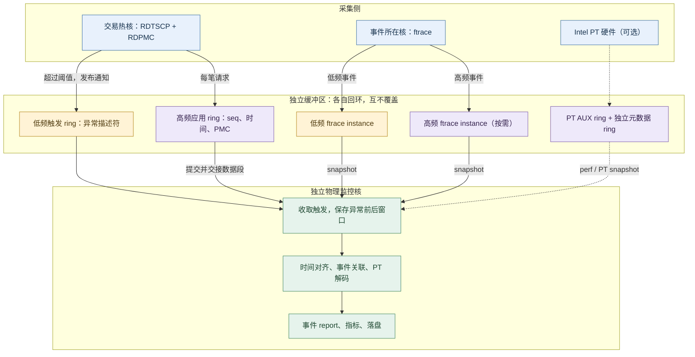

# HFT Engineering从入门到入土（10）出现概率万分之一的Jitter，应该如何采样

做低延迟系统的人大概都遇到过这种时刻：p50 2us，p99 5us。然后某一天盘后复盘，你发现那笔本该抢到流动性的单子晚了三十微秒——行情已经跳走了，单挂在了一个已经没有意义的价位上。后续把 perf、strace、日志全开着复现了三天，这种事情一次都没有再发生。

这是一个很常见的罕见Latency Jitter的问题：系统在绝大多数时候很快，但每隔几万、几十万次请求，会冒出一次几十微秒的尖峰。我们先看清楚为什么常规手段注定抓不到它，再讲一套合理的Profile方法。

## 1. 不能忽略的尾部延迟风险

先统一一下问题的形状。假设你的系统每秒处理几十万笔请求，正常处理时间 2~5µs，但大约每 5 万笔出现一次 40µs 的尖峰。从分布上看是这样的：

[](https://raw.githubusercontent.com/Obscurepawn/TradingSystemLearning/main/hft/assets/hft-10/jitter-01-tail-profile.png)

这个形态有两个值得注意的地方。

第一，只看 p99 根本看不见它。万分之一的概率对应 p99.99 这一档，p99 完全被前面 99% 的正常请求占据。很多团队的监控面板只放到 p99，于是这类事件在监控上等于不存在——它真实地造成了亏损，但没有触发任何告警。

第二，它造成的伤害和它出现的概率完全不成比例。正常请求快几微秒，赚的是排队位置上的边际优势；而一次 40µs 的尖峰发生在仓位暴露的方向上，就是实打实地错过一档成交。

## 2. 常规手段抓不到关键现场的原因

### 2.1 采样器在周期性工作，而你要抓的东西一闪而过

一般来说在常见的系统我们走的是`perf stat`确定硬件计数指标，看大方向上的性能问题->`perf record`打出CPU Cycle/LLC Miss/Page Fault/Off CPU的火焰图->根据火焰图结果做针对性优化

`perf record` 在常见的 PMU 溢出采样配置下，会在达到采样条件时打断程序，记下当前的指令指针和调用栈。例如 `-F 99` 是目标每秒 99 次，平均约 10.1ms 一次；`-F 999` 才接近 1ms 一次。下面用约 1kHz 的采样频率举例。

问题来了：尖峰只活 40µs。

[](https://raw.githubusercontent.com/Obscurepawn/TradingSystemLearning/main/hft/assets/hft-10/jitter-02-sampling-miss.png)

假设采样时刻与尖峰近似独立，一次 40µs 尖峰被约 1kHz 采样命中的概率只有约 4%；99Hz 时则只有约 0.4%。这里说的是“某次尖峰已经发生之后，恰好采到它”的概率，不能直接换算成需要多少条样本；还要看请求速率和异常发生率。即使命中，采样拿到的也是“此刻栈是什么”，难以独自解释“这 40µs 里发生了什么”。等你在报表里看到异常、手动 attach 上去，那次抖动早就结束了。

提高采样率能不能解决？能提高命中概率，但不能解决两个根本问题：一是你仍然无法完整保留异常前后的上下文，二是高采样率本身就会制造延迟，导致采样时看到现场和真实workload下已经不一样，采样结果严重失真。交易线程大部分时间在忙轮询，采样间隔远大于真正的响应时间，关键代码里几乎落不到样本，profiler显示的结果几乎是没有用的。

### 2.2 全量日志下的测量开销不可忽略

另一个直觉方案是"那我把每次调用的详细日志都记下来"。这条路在普通服务端程序上可行，在微秒/亚微秒级热路径上会导致测量的开销在Application的计算开销前不可忽略。

观测开销必须满足成本预算，一般来说，扣掉正常业务之后留给观测的只有几十到几百纳秒。

### 2.3 排队延迟不可忽略

考虑最常见的闭环压测：发一个请求、等它回来、再发下一个。当系统在某一笔请求上卡住 40µs 时，压测线程也跟着堵在这一笔上。这 40µs 里，按照目标速率本应发出的几十个请求，根本就没有发出去。

最终统计里，只有真正卡住的那 1 笔被记成慢请求，卡顿期间"缺席"的几十笔交易从来没有执行，自然也不会出现在延迟直方图的尾巴里。需要把卡顿区间内应发未发的请求按预期发起时间一并记为受影响延迟。

## 3. 总体思路：多层次观测

单次抖动的成因可能出在三个完全不同的层面：应用自己多干了活、内核或硬件打断了它、包根本就迟到了。任何单一工具都只能看到其中一层，所以正确的做法是，针对不同的层次都需要有相应的可观测性手段

[](https://raw.githubusercontent.com/Obscurepawn/TradingSystemLearning/main/hft/assets/hft-10/jitter-04-three-layer-forensics.png)

- **应用层**可以观测"慢了多少、慢在哪一类"。手段是分段 rdtscp 打点、PMU 硬件计数器差分。成本是每笔请求固定的纳秒级开销，可以 7×24 常驻。
- **内核层**可以提供调度、中断、缺页等原因的证据。ftrace、rtla、perf/eBPF 能帮助定位缺页地址、被换入的线程和中断处理区间。具体开销取决于启用的事件、频率与采集配置，不能统一承诺为某个固定的纳秒数。
- **物理网络层**回答"这个包到底几点到的"。光分路器加 FPGA 抓包卡在操作系统之外独立打硬件时间戳，对被测主机零负载。这一层的意义是提供外部视角的独立观测指标

我们的观测重点应该放在第一层，这个层次我们可以自行完全掌控（不需要被公有云的硬件虚拟化所block住）、也是可观测性建设ROI最高的一个层次。

## 4. 应用层：需要常驻的Flight Data Record

### 4.1 Flight Data Record的设计原则

**不管有没有异常，记录一直在进行；异常发生时，异常之前的历史已经在缓冲区里了。**

具体实现可以采用 per-thread 的预分配环形记录区，通过分段提交和所有权交接供监控核读取；每个业务线程另有一条 SPSC 队列，用于提交异常通知：

- 在关键路径的分段边界（RX → 解析 → 决策 → 风控 → TX）打时间戳。Intel 上可用 `RDTSCP; LFENCE`：RDTSCP 等待此前指令执行和 load 完成，后接 LFENCE 确定与后续执行的边界，再配合编译器约束固定打点位置。[指令语义见 Intel SDM][intel-instructions]；
- 每条探测记录（消息 ID、各段时间戳、队列深度等）顺序写进环形缓冲，只保留最近 N 万条；滚动复用时只能覆盖已获准复用的数据段，正在被读取或冻结的段必须保留；
- **热路径上不分配内存、不加锁、不做系统调用、不写磁盘**。这四条是必须执行的规矩，破坏了任何一条，观测开销都会从纳秒级掉到微秒级；
- 缓冲由独立的负责可观测性工作的Cpu Core异步消费，落盘、压缩、上传都收敛到独立的Cpu Core执行；

一个最小的打点长这样：

```c
struct LatencyProbe {
    uint64_t t0, t1;
    unsigned aux0, aux1;
};

/* GCC/Clang、Intel x86 示例：不包含等待 store 全局可见的语义。 */
static inline uint64_t timestamp_boundary(unsigned *aux) {
    __asm__ __volatile__("" ::: "memory");
    uint64_t t = __rdtscp(aux);
    _mm_lfence();
    __asm__ __volatile__("" ::: "memory");
    return t;
}

static inline void on_packet() {
    unsigned aux0, aux1;
    uint64_t t0 = timestamp_boundary(&aux0);
    /* parse + book + signal + risk + order build */
    uint64_t t1 = timestamp_boundary(&aux1);
    /* 提交预分配记录；publish_probe 必须遵守缓冲区所有权协议。 */
    publish_probe((struct LatencyProbe){t0, t1, aux0, aux1});
}
```

代码保留了两端的 `TSC_AUX`，用于辅助检查线程迁移；纯寄存器计算的打点还需要相应的编译器约束。

容量可以简单定量分析一下：每条记录 64 字节、每秒 100 万笔，写入量约 64MB/s，一个 8MiB 的缓冲能保住最近约 131ms 的历史。这个窗口需要覆盖异常前后的记录，以及监控核发现异常、取得快照的时间。

独立的负责可观测性工作的Cpu Core统计应该是使用高性能直方图实现（例如HdrHistogram）常驻维护 p50/p95/p99/p99.9/p99.99/max 全档位

### 4.2 测得延迟超过阈值时，HotPath发出采样信号

RingBuffer 保存最近的历史，阈值判断决定哪一段历史需要留下。

热线程发现 `ΔT > 阈值` 后，向独立的低频 SPSC 队列写入 `(seq, t0, t1, tid, cpu)`，再用 release store 提交队列索引，然后继续处理下一笔请求。监控核以 acquire 语义取出通知，负责保存异常窗口和生成 report。

应用 recorder 采用预分配的数据段：生产者在记录边界提交旧段、交出所有权，再切换到可写段。监控核读取已交出的段，处理完成后再归还。ftrace 与 Intel PT 则使用各自的 snapshot 接口，最后按时间戳关联。完整的数据流见 5.4。

## 5. jitter root cause排查

知道某次处理慢了40µs后，后续我们需要知道这40µs花在了哪。靠软件日志分不出来，但CPU自带的性能监控单元（PMU）可以提供一些线索。

### 5.1 rdtsc 和 rdpmc

先区分两条指令：

- `rdtsc/rdtscp` 读的是时间戳计数器。它是架构级的非特权指令，现代虚拟机（KVM、AWS Nitro）通过 TSC offsetting 透传，通常不会触发 VM-Exit，容器里也能用。注意 vCPU 被宿主机调走期间 TSC 仍然会以固定频率增加计数。
- `rdpmc` 读的是 PMU 硬件计数器（周期数、指令数、缓存缺失等）。这些有限的计数器槽位由内核调度和编程，不能直接假设某个固定编号永远属于自己的事件；用户态读取还需要相应权限和硬件支持。RDPMC 返回累计计数，**应用在边界主动读数、做差后写 ring**，并不会自动为每次 LLC miss 生成一条明细记录。

在 Linux 上，通常通过 `perf_event_open` 注册事件，再 mmap 共享元数据页，按内核发布的 `index`、`offset` 和 `pmc_width` 读取。下面是单事件快路径的协议示意，假设初始化阶段已经检查能力，并选择能够同时驻留的少量计数事件：

```c
static inline bool try_read_pmc(struct perf_state *p, uint64_t *out) {
    for (unsigned attempt = 0; attempt < 3; ++attempt) {
        uint32_t seq = __atomic_load_n(&p->pc->lock, __ATOMIC_ACQUIRE);
        if (seq & 1) { __builtin_ia32_pause(); continue; }

        __asm__ __volatile__("" ::: "memory");
        uint32_t idx = p->pc->index;
        unsigned width = p->pc->pmc_width;
        uint64_t offset = p->pc->offset;
        bool available = p->pc->cap_user_rdpmc && idx != 0;
        uint64_t raw = available ? __rdpmc(idx - 1) : 0;
        __asm__ __volatile__("" ::: "memory");

        if (__atomic_load_n(&p->pc->lock, __ATOMIC_ACQUIRE) != seq)
            continue;
        if (!available || width == 0 || width > 64)
            return false;

        /* 将 pmc_width 位的有符号硬件值扩展到 64 位补码。 */
        uint64_t pmc = raw;
        if (width < 64) {
            uint64_t sign = 1ULL << (width - 1);
            raw &= (1ULL << width) - 1;
            pmc = (raw ^ sign) - sign;
        }
        *out = offset + pmc;
        return true;
    }
    return false;  /* 标记本次指标无效，热路径不回退 read(fd)。 */
}
```

初始化时完成 `perf_event_open`、mmap、预触页和启用。热路径读取失败时标记 invalid，慢路径诊断交给监控侧。[读取协议见 perf_event_open(2)][perf-api]。

单请求计数尽量使用能同时驻留的少量事件，避免 multiplex 留下未观测的时段。RDPMC 的执行边界也需要排序，seqlock 只负责保证共享元数据的一致性。[指令语义见 Intel SDM][intel-instructions]。

### 5.2 ftrace：内核里的事件记录机制

ftrace 是 Linux 内核的 tracing 框架。这里主要使用它的 event tracing：在调度、中断、缺页等位置启用已有的 tracepoint，记录发生了什么、发生在哪个 CPU、具体时间是多少。需要继续追踪内核调用链时，再打开 `function` 或 `function_graph` tracer。[ftrace 文档][ftrace-doc]。

以 IRQ 为例，内核运行到 `irq_handler_entry` 时，会调用已注册的 tracing 回调，取时间戳、填写 IRQ 编号等字段，然后提交到当前 CPU 的 ring buffer。handler 返回时再记录一次 `irq_handler_exit`。两条记录就圈出了这次 handler 的执行区间。记录代码在中断所在的核上执行，监控核稍后读取和分析。[Tracepoints][tracepoints-doc]；[IRQ 事件定义][irq-events]。

关闭事件时，支持 jump label 的内核通过 static key 走极轻的路径，x86 上通常是一段 NOP；启用时再切换到 tracing 分支。事件发生后写入的是二进制记录，格式化和输出留到读取时处理。[Static Keys][static-keys-doc]。

ftrace 的 ring buffer 按 CPU 分配，各核写自己的缓冲。同一核上的中断可以嵌套进入，所以内核的实现还处理了嵌套 writer 的提交顺序。使用 overwrite 模式时，缓冲写满后回环覆盖旧记录，始终保留最近一段历史。[Ring Buffer Design][kernel-ring-doc]。

排查 jitter 时，通常先关注下面几类事件：

| 事件 | 用来观察什么 |
|---|---|
| `sched:sched_switch` | 交易线程何时被换出、何时换入，以及中间运行了哪个线程 |
| `sched:sched_wakeup` | 线程何时被唤醒，与换入时间相减得到等待 CPU 的时间 |
| `irq:irq_handler_entry/exit` | IRQ handler 的执行区间 |
| `irq:softirq_entry/exit` | 网络收包等 softirq 的执行区间 |
| `exceptions:page_fault_user` | 缺页发生时的指令地址、访问地址和错误码 |

例如，一笔请求耗时 40µs，而它的 switch-out 到 switch-in 占了 25µs，就能进一步查看这段时间 CPU 交给了谁。若线程一直在运行，却被一段 softirq 打断，也能直接在同一条时间线上看出来。具体可用事件和字段可以查看 `available_events` 以及各事件的 `format` 文件。[Event Tracing][event-tracing-doc]；[调度事件][sched-events]；[缺页事件][exception-events]。

异常发生后，监控核可以使用 ftrace 的 `snapshot` 保存当前记录，让后续事件继续写入备用 buffer。备用空间在初始化时分配，旧快照提取后再复用。若采用 `trace_pipe` 持续消费，则由监控核维护需要回看的历史窗口。[Snapshot 接口][ftrace-doc]。

### 5.3 magic-trace：英特尔处理器中的硬件事件记录

magic-trace 是 Jane Street 基于 Intel Processor Trace（Intel PT）开发的追踪工具。Intel PT 负责记录 CPU 的执行轨迹，magic-trace 负责采集、解码，并把结果展示成函数调用时间线。[项目说明][magic-project]。

CPU 执行代码时，PT 持续输出压缩后的控制流数据：条件分支是否跳转、间接跳转去了哪里，以及用于定位时间的 TSC/MTC/CYC 等信息。解码器结合当时的程序机器码，还原实际经过的指令路径。这样无需在每个函数入口插入日志，也能回看一次异常请求究竟走了哪些分支、哪个循环多跑了几轮。[Intel PT 文档][intel-pt-doc]。

在 snapshot 模式下，PT 数据写入独立的 **AUX ring buffer**，满了就覆盖旧轨迹。perf 另外保存线程、地址映射等元数据。异常触发后，工具取出这一段历史，结合对应版本的可执行文件和共享库进行解码，再生成调用时间线。[perf 缓冲区文档][perf-ring-doc]。时间包的密度决定时间分辨率；记录更密，所能保留的历史也更短。[时间分辨率配置][magic-timing]。

它与前面几个手段正好互补：RDTSCP 告诉我们哪个阶段变慢，RDPMC 给出该阶段的硬件计数变化，ftrace 提供调度和中断等内核事件，PT 则还原执行路径。比如指令数明显增加时，可以沿 PT 轨迹找出多执行的分支；若执行路径基本相同，就继续结合 PMU 和内核事件分析耗时。

magic-trace 官方给出的经验开销是应用减速约 **2%–10%**，拍快照时还会暂停应用约 **10µs**。因此，常驻采集和异常触发都要算进延迟预算。把解码与 report 放到监控核，可以移走后处理成本；采用原版 magic-trace 的触发方式时，快照暂停仍然存在。[官方 Overhead 说明][magic-overhead]。

Intel PT 是否可用，取决于 CPU、内核和虚拟化环境是否开放这项能力。部署时检查 `/sys/bus/event_source/devices/intel_pt/` 并实际打开事件。有支持就按需加入 PT 轨迹；没有支持，仍可以使用 RDTSCP、可用的 RDPMC 和 ftrace 完成时间与事件关联。[平台说明][magic-platforms]。

### 5.4 联合采集：高低频分 ring，监控核负责 report

把这几条记录通道放在一起，结构如下。ftrace 与 Intel PT 按采集需求和硬件能力启用，也可以同时使用。



**高频记录与低频事件在写入时就分开。** 每笔请求的时间戳和 PMC 差分写应用 ring；超阈值通知写独立的低频 ring。ftrace 也可以通过不同的 trace instance 分配独立的 per-CPU buffers，把高频事件与需要长期保留的低频事件隔离。[Instances 接口][ftrace-doc]。事件频率按目标核的实际负载划分，例如隔离交易核上的调度事件可能很少，而收包 softirq 可能很密集。

分开后的保留时间很直观。假设两类记录都占 64B：

| 数据流 | 写入速率 | 容量 | 可容纳的历史 |
|---|---:|---:|---:|
| 每请求一条探测记录 | 100 万条/s | 8MiB | 约 131ms |
| 超阈值异常通知 | 100 条/s | 1MiB | 约 164s |

如果混写在一个 ring 里，低频通知也会跟着高频数据在约 131ms 后被淘汰。分开后，高频数据继续回环，低频事件使用自己的保留空间。各 ring 分别维护容量和丢失计数。

热核发现异常后，只发布 `(seq, t0, t1, tid, cpu)`，随后继续处理请求。监控核先取得生产者交出的应用数据段，并提取同一窗口内的 ftrace / PT 快照；原始记录保存下来以后，再排队进行解码、格式化和 report；监控核优先处理新的窗口提取任务。

各条记录按同一时间轴关联：ftrace 可选择 `x86-tsc`，或建立其时钟与应用 TSC 的换算；PT 使用 perf 保存的时间转换信息。最终 report 汇总请求延迟、各阶段耗时、PMC 差分、重叠的内核事件，以及可选的执行轨迹。[时钟接口][ftrace-doc]；[perf 时间转换][perf-api]。

## 6. 每个观测手段的大致开销数量级估计

下面的数字用于估算预算，具体数值需要用目标 CPU 和工作负载校准。

| 动作 | 典型成本 | 能不能上热路径 |
|---|---|---|
| RDTSC / RDTSCP | 20~40 cycles（约 7~13ns @3GHz），云上通常无 VM-Exit | 常开 |
| perf_event 快路径读 1 个计数器 | 100~300 cycles（30~100ns） | 常开（固定计数器） |
| 稳态完整记录（TSC×2 + 3 固定 PMC + ring） | 约 100~250ns/请求，边界复用可压到 60~120ns | 常开，约占 5~10µs 路径的 1~4% |
| 应用无锁 ring 写一条 | 10~30ns | 常开 |
| 阈值原子发布 | 5~10ns | 提交异常描述符 |
| ftrace tracepoint | 取时间戳、编码和 ring 写入 | 选定事件常驻，控制事件总量 |
| snapshot + 解码 + 落盘 | 监控核负责；快照涉及缓冲交接或采集器控制 | 超标时 |
| magic-trace（Intel PT） | 官方经验减速约 2%–10%，magic-trace 快照暂停约 10µs | 按硬件能力与延迟预算启用 |
| `read(fd)` / ioctl 内核路径 | 2~9µs | 禁止 |
| perf stat 计数 | <0.5% | 谨慎常驻 |
| perf record -F99 fp | 1~5%，且随机 PMI 污染尾部 | 只做短窗体检 |
| perf record dwarf / -F9999 | 5~30%+ | 只在回放/压测环境 |


落地时可以先接入 per-thread RDTSCP 和延迟直方图，再加入 RDPMC、选定的 ftrace 事件，以及硬件支持时的 Intel PT。各条记录通道独立保留历史，异常报告由监控核生成。


## 参考资料

- Linux 内核文档：[timerlat tracer](https://www.kernel.org/doc/html/latest/trace/timerlat-tracer.html)、[osnoise tracer](https://www.kernel.org/doc/html/latest/trace/osnoise-tracer.html)、[hwlat_detector](https://www.kernel.org/doc/html/v4.19/trace/hwlat_detector.html)、[ftrace](https://www.kernel.org/doc/html/latest/trace/ftrace.html)、[perf-intel-pt](https://raw.githubusercontent.com/torvalds/linux/master/tools/perf/Documentation/perf-intel-pt.txt)
- [perf_event_open(2)](https://man7.org/linux/man-pages/man2/perf_event_open.2.html)、[perf-record(1)](https://man7.org/linux/man-pages/man1/perf-record.1.html)、[perf-mem](https://raw.githubusercontent.com/torvalds/linux/master/tools/perf/Documentation/perf-mem.txt)
- Brendan Gregg：[CPU Flame Graphs](https://www.brendangregg.com/FlameGraphs/cpuflamegraphs.html)、[Off-CPU Analysis](https://www.brendangregg.com/offcpuanalysis.html)、[perf 示例页](https://www.brendangregg.com/perf.html)
- PMC 开销实测：Mühlig, [*How Small Can a Measured Region Be Before perf Counters Lie?*](https://jmuehlig.github.io/when-can-you-trust-your-hardware-counters/)（Zen4/Skylake/SPR, 2025）
- Jane Street：[magic-trace](https://github.com/janestreet/magic-trace)、[Overhead 说明](https://github.com/janestreet/magic-trace/wiki/Overhead)、[System Jitter and Where to Find It](https://www.janestreet.com/tech-talks/system-jitter-and-where-to-find-it/)
- LMAX：[Timing is everything](https://technology.lmax.com/posts/timing-is-everything/)；HRT：[2025 Summer Projects（Stall Monitor）](https://www.hudsonrivertrading.com/hrtbeat/intern-spotlight-2025-software-engineering-summer-projects/)
- 组件：[Chronicle Queue](https://chronicle.software/products/chronicle-queue)、[Aeron](https://real-logic.co.uk/)、[Databento PCAP](https://databento.com/pcaps)、[Pico/Corvil](https://www.pico.net/products/corvil-analytics/)
- Coordinated Omission：[Gil Tene 的测量方法论讨论](https://dev.to/sergiy_lutsak_hft/measuring-latency-in-net-without-fooling-yourself-stopwatch-percentiles-and-coordinated-omission-2711)
- LLVM XRay：[官方文档](https://llvm.org/docs/XRay.html)、[Google 2016 白皮书](https://static.googleusercontent.com/media/research.google.com/en//pubs/archive/45287.pdf)（函数级插桩的成本与语义参考）
- AWS：[Nitro 侧信道白皮书](https://docs.aws.amazon.com/whitepapers/latest/security-design-of-aws-nitro-system/the-ec2-approach-to-preventing-side-channels.html)、[CPU 选项/关 SMT](https://docs.aws.amazon.com/AWSEC2/latest/UserGuide/instance-specify-cpu-options.html)、[Nitro 纳秒硬件包时间戳](https://aws.amazon.com/about-aws/whats-new/2025/06/amazon-time-sync-nanosecond-hardware-packet-timestamps/)、[ENA DPDK PMD](https://doc.dpdk.org/guides/nics/ena.html)、[EC2 HFT 方案](https://aws.amazon.com/cn/blogs/china/building-cefi-high-frequency-trading-system-on-aws/)

- Linux：[Tracepoints][tracepoints-doc]、[Static Keys][static-keys-doc]、[Event Tracing][event-tracing-doc]、[Ring Buffer Design][kernel-ring-doc]、[perf ring buffer][perf-ring-doc]
- 内核事件定义：[IRQ][irq-events]、[调度][sched-events]、[缺页][exception-events]
- magic-trace：[时间分辨率][magic-timing]、[平台支持][magic-platforms]
- Intel：[RDTSCP / RDPMC 指令定义][intel-instructions]

[ftrace-doc]: https://docs.kernel.org/trace/ftrace.html
[tracepoints-doc]: https://docs.kernel.org/trace/tracepoints.html
[static-keys-doc]: https://docs.kernel.org/staging/static-keys.html
[kernel-ring-doc]: https://docs.kernel.org/trace/ring-buffer-design.html
[event-tracing-doc]: https://docs.kernel.org/trace/events.html
[irq-events]: https://github.com/torvalds/linux/blob/master/include/trace/events/irq.h
[sched-events]: https://github.com/torvalds/linux/blob/master/include/trace/events/sched.h
[exception-events]: https://github.com/torvalds/linux/blob/master/include/trace/events/exceptions.h
[magic-project]: https://github.com/janestreet/magic-trace
[intel-pt-doc]: https://raw.githubusercontent.com/torvalds/linux/master/tools/perf/Documentation/perf-intel-pt.txt
[perf-ring-doc]: https://docs.kernel.org/userspace-api/perf_ring_buffer.html
[magic-timing]: https://github.com/janestreet/magic-trace/wiki/Timer-resolution-configuration
[magic-overhead]: https://github.com/janestreet/magic-trace/wiki/Overhead
[magic-platforms]: https://github.com/janestreet/magic-trace/wiki/Supported-platforms,-programming-languages,-and-runtimes
[intel-instructions]: https://cdrdv2.intel.com/v1/dl/getContent/671241
[perf-api]: https://man7.org/linux/man-pages/man2/perf_event_open.2.html
