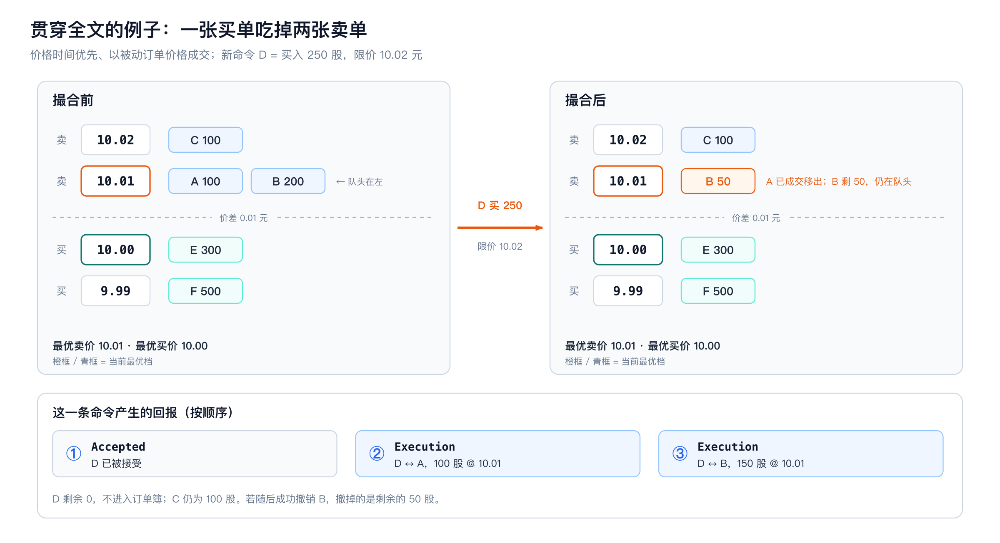
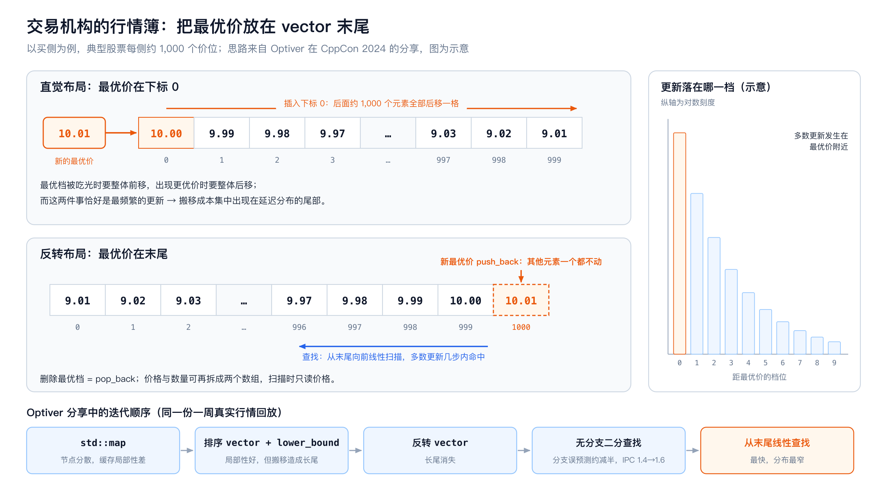
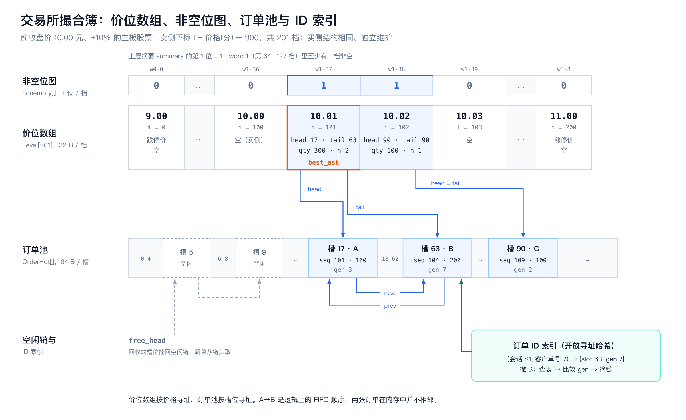
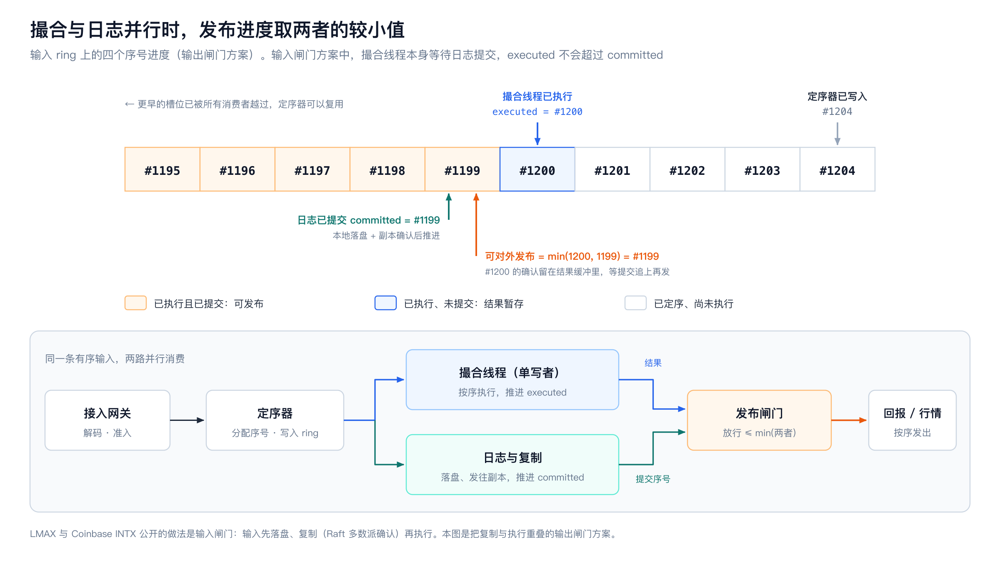
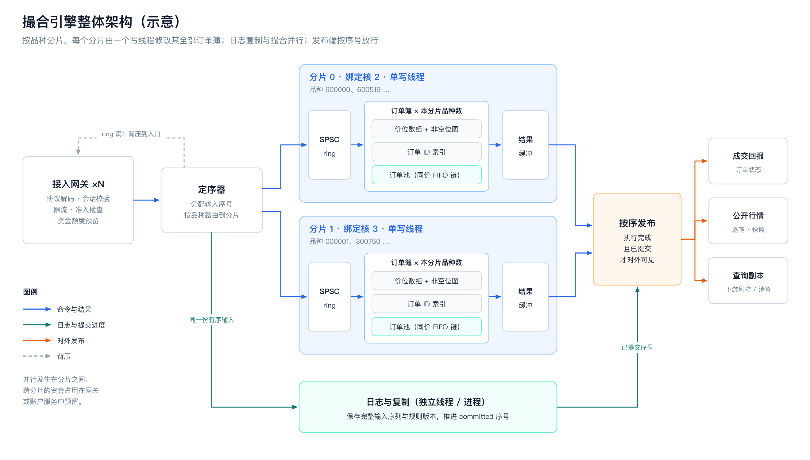

# # HFT Engineering从入门到入土（11）高性能订单簿和撮合引擎的实现和优化

从价格索引、订单布局到单写者撮合，以及交易所和交易机构公开分享过的做法

**OrderBook（订单簿）记录一个交易品种中等待成交的买卖订单，包括价格、剩余数量和排队顺序。Matching Engine（撮合引擎）处理新订单、撤单和改单，按交易规则撮合成交、更新订单簿，并返回处理结果。**

## 0　导读：理解撮合引擎和订单簿的各自语义

“订单簿” 在交易所和交易机构里指的是两种不同的东西，它们的热点操作不同，最快的数据结构也不同。很多文章把两者混在一起讨论，结论就会互相矛盾。


|          | 交易机构的行情簿                               | 交易所的撮合簿                               |
| -------- | -------------------------------------- | ------------------------------------- |
| 输入       | 交易所下发的逐笔或快照行情                          | 参与者提交的新单、撤单、改单                        |
| 要给出的信息   | 每个价位现在有多少量，最优价是多少                      | 新单能和谁成交、成交多少、余量排在哪里                   |
| 每个价位保存什么 | 通常只需价格和汇总量（按价位聚合）                      | 完整的订单 FIFO 队列，逐单保留优先级                 |
| 规模特征     | Optiver 提到典型股票每侧约 1,000 个价位，更新集中在最优价附近 | 由交易规则决定，例如 A 股主板 10 元股票当日只有 201 个合法价位 |
| 正确性要求    | 与交易所事件一致，能检测丢包并补齐                      | 结果确定、可重放、对外确认前已经持久化                   |

后文按 “优化掉某一类的开销” 的顺序组织。每一节先说明一个具体的慢点，再给出做法、代价和公开实现。

| 章节 | 优化掉的开销               | 做法                   | 检索到的公开实践                          |
| -- | ------------------- | -------------------- | --------------------------------- |
| 2  | 树节点分散、vector 头部插入搬移 | 反向 vector，从最优价一端线性查找 | Optiver（CppCon 2024）              |
| 3  | 按价格查树               | 固定价格网格上的连续价位数组       | QuantCup 冠军代码、SimpleOrderbook     |
| 4  | 逐档扫描空价位             | 分层非空位图               | —                                 |
| 5  | 为所有可能价格分配空间         | 分块数组、B-tree、ART      | exchange-core、Abseil B-tree       |
| 6  | 撤单时遍历同价队列           | ID 索引直达节点；网关回传定位号    | Jane Street JX、Liquibook 的反例      |
| 7  | 动态分配与缓存未命中          | 预分配订单池、冷热分离、预取       | exchange-core、Jane Street JX      |
| 8  | 撮合循环里的无关分支          | 按市场规则选择撮合路径          | 沪深交易规则、CME                        |
| 9  | 簿内锁与写冲突             | 每个分片一个写线程            | LMAX、中金所、Nasdaq                   |
| 10 | 撮合线程等待日志和网络         | 日志复制与撮合并行，按序发布       | LMAX、Coinbase INTX、Jane Street JX |
| 11 | 测出来的数字不可信           | 真实回放、完整分布、硬件计数器      | Optiver、exchange-core、LMAX        |

## 1　接口语义与贯穿全文的例子

以普通价格时间优先的连续竞价为例，订单簿有Bids Side bid 和卖侧 ask。买价从高到低、卖价从低到高排列，同价订单按时间优先级排队；每单保存标识、方向、价格、剩余数量和优先级序号。最高买价与最低卖价组成 BBO（best bid and offer），L2 深度按价位汇总数量，逐订单视图则保留同价位内的订单和顺序。隐藏订单及其他优先级规则会扩展这个基础模型。

**订单簿库提供查找、插入、删除和查询盘口等操作。** 以下用示意性的函数名说明这些操作。有的库也把撮合逻辑放在 `OrderBook::add()` 中，阅读实现时要看清这个函数究竟做了哪些事。


| 概念接口                                          | 语义                  | 对数据结构的要求              |
| --------------------------------------------- | ------------------- | --------------------- |
| `find(order_ref)`                             | 定位一张仍有效的订单；标识包含其唯一域 | 从外部 ID 找到稳定节点或 handle |
| `insert_resting(order)`                       | 把订单加入对应价位的队尾        | 找到价位，维护排队顺序和该价位的总挂单量  |
| `reduce(handle, delta_qty)` / `erase(handle)` | 减少剩余量或移除节点，并更新价位统计  | 快速定位节点，删除末单后维护非空档     |
| `best(side)` / `next_level(side, price)`      | 返回该侧最优或后续非空价格层      | 有序价格索引与最优价维护          |
| `depth(n)` / `snapshot()`                     | 读取前 n 档行情，或生成盘口快照   | 快照中各字段对应同一处理进度，并注明序号  |

新订单到达时，撮合引擎先检查它能否与对侧挂单成交。能成交就逐笔处理；还有剩余数量、且订单类型允许继续挂单时，才调用 `insert_resting()` 加入订单簿。行情重建中的 `apply(exchange_event)` 则根据交易所发来的事件更新本地盘口，例如增加订单、撤销订单或扣减成交数量。

**交易参与者向撮合引擎提交新单、撤单等命令，再接收处理结果。** 具体支持哪些命令、哪些时段可以使用，以交易所协议和规则为准。


| 命令或查询                         | 主要输入                                 | 处理语义                                |
| ----------------------------- | ------------------------------------ | ----------------------------------- |
| `NewOrder`                    | 请求标识、客户订单号、账户、品种、方向、类型、数量、可选限价、TIF 等 | 检查申报是否合法，按规则撮合，再按订单类型处理未成交的余量       |
| `Cancel`                      | 请求标识、目标订单标识，必要时含数量参数                 | 处理到该命令时撤销允许撤销的剩余量；已经成交的部分保留         |
| `Amend` / `Replace`           | 目标订单、新价格、新数量，必要时含新的订单标识              | 修改价格或数量；明确能否保留原来的排队位置，以及修改失败时原单是否保留 |
| `MassCancel`                  | 账户、会话、品种或订单组等筛选条件                    | 撤销处理请求时符合条件的订单，并报告处理结果              |
| `QueryOrder` / `BookSnapshot` | 有权限查看的订单或盘口范围，可选观察序号                 | 返回订单或盘口状态，并注明已处理到的序号；可由独立查询服务提供     |

一条命令可以产生多条回报：`Accepted` 表示新单已接受，`Rejected` 表示拒绝，`Execution` 记录成交价格和数量，`Canceled`、`Replaced`、`Expired` 分别报告撤销、替换和到期。订单被接受后，可能立即全部成交，也可能还有余量继续挂单，具体看成交回报与剩余数量。

下面这个例子会在后文反复出现。盘口只含限价单，采用价格时间优先、以被动订单价格成交：卖侧 10.01 元依次排着 A（100 股）、B（200 股），10.02 元有 C（100 股）；Bids Side最优价 10.00 元。此时提交 D：买入 250 股，限价 10.02 元。




引擎先让 D 与 A 在 10.01 成交 100 股，再与 B 在 10.01 成交 150 股。D 全部成交，A 移出订单簿，B 剩余 50 股且保留原有队列位置，C 仍为 100 股。若随后成功撤销 B，撤掉的是剩余 50 股。这一条命令涉及价格选择、FIFO、减量、节点删除和多条结果输出，后面每一节优化的就是其中某一步。

## 2　交易机构的行情簿：先看数据，再选结构

交易机构接收交易所行情，在本地维护每个品种的买卖盘。逐笔行情里的新增、修改、删除都带着订单号，所以无论价位用什么结构保存，外面都要套一张 “订单号 → 方向、价格、数量” 的哈希表；修改和删除先查这张表，再找到对应价位调整数量。

Optiver 在 CppCon 2024 的主题演讲中，用一周、几十只大型科技股的真实行情回放，逐步比较了这个价位结构的实现。[When Nanoseconds Matter](https://www.youtube.com/watch?v=sX2nF1fW7kI)。


1. `std::map`**。** 复杂度看起来很好：插入 O (log M)，迭代器在增删其他元素时保持有效，可以直接存进哈希表。但树节点分散在堆上。在Optiver的压测中，在两次插入之间故意插入一些无关分配来打乱堆布局，模拟生产进程里堆的真实状态，结果是缓存局部性很差。由此得出的第一条原则是：大多数时候不要用基于节点的容器。

2. **排序&#x20;**`std::vector`**&#x20;+&#x20;**`lower_bound`**。** 局部性好得多，但延迟分布出现很长的尾巴。原因在数据里：更新按距离最优价呈指数衰减分布，绝大多数发生在最优价附近；而直觉写法把最优价放在下标 0，于是最频繁的操作恰好引起最多的元素搬移。

3. **反转 vector。** 让最优价位于末尾。新的最优价是 `push_back`，最优档清空是 `pop_back`，靠近最优价的插入只搬移少数元素。长尾随之消失。

4. **无分支二分查找。** `perf` 显示 bad speculation 约占 25%，超过 30% 的 CPU 时间落在 `lower_bound` 的两条条件跳转上。改成无分支版本后，分支误预测约减半，IPC 从 1.4 升到 1.6；代价是没有提前退出，访问的内存更多。

5. **从末尾线性查找。** 他测过大约 30 种实现，最快、延迟分布最窄的就是从最优价一端开始的线性查找。它对缓存和硬件预取最友好，分支也最好预测。




Bids Side的写法如下。价格从低到高存放，末尾是最高买价：


```
struct Level { Price price; Qty qty; };
std::vector<Level> bids_;   // 升序，bids_.back() 是最优买价

void add_bid(Price px, Qty q) {
    int32_t i = bids_.size() - 1; // 假设bids_不是empty
    while (i >= 0 && bids_[i].price > px) --i;      // 从最优价往深处走
    if (i >= 0 && bids_[i].price == px) {
        bids_[i].qty += q;                         // 价位已存在
    } else {
        bids_.insert(bids_.begin() + i + 1, Level{px, q}); // 越靠近最优价，搬移越少
    }
}
```

插入会使迭代器失效，所以哈希表里保存价格而不是迭代器；修改和删除时按价格再找一次，这一次查找同样从末尾开始，通常几步就能命中。Optiver的实践中提到，把价格和数量拆成两个数组、扫描时只读价格数组，有轻微的正收益；至于 SIMD，Optiver提到 AVX 会拉低 CPU 频率，而对 “价格、数量” 成对存放的结构，编译器也不会自动生成 AVX 指令。

这个结论有前提：每侧价位在一千档左右、更新集中在最优价附近。他自己也说，如果某个品种有十万档价位，线性查找可能就不再是最快的。换到别的市场，要先统计自己的数据，再决定是否沿用。他从这个过程中总结的几条原则，对后文同样适用：

* 先理解问题本身，看清数据的分布，再动手优化。

* 利用这个问题特有的性质；不利用这些性质，就很难再快下去。

* 算法要顺应硬件，也就是 mechanical sympathy。

* 做到既快又简单时，就可以停下来了。

## 3　交易所撮合簿：用价格数组代替树查找

交易所的撮合簿需要逐单排队，但同样要按价格找到价位。最直接的实现是 `map<Price, Level>`，每个价格对应一条订单队列。假设有 M 个非空价位，树查找花费 O (log M) 次比较；在节点分散的实现中，比较还伴随着沿指针逐层访问内存。

A 股的价格规则给出了另一种做法。以前收盘价 10 元、涨跌幅限制 ±10% 的主板股票为例，当日价格范围是 9—11 元，tick 为 0.01 元，一共只有 201 个价位。直接为这 201 档分配数组，价格转换成整数分后，10.01 元对应的下标就是 `1001 - 900 = 101`。原来的树查找变成一次减法和一次数组访问。


```
price_tick  = 已按 tick 换算的整数价格
index       = price_tick - lower_tick
level_count = upper_tick - lower_tick + 1
```

这里用的是当日静态涨跌停边界。主板普通股票的涨跌幅限制为 ±10%；自 2026 年 7 月 6 日起，主板风险警示股票也由 ±5% 调整为 ±10%。科创板和创业板为 ±20%，北交所为 ±30%。这些股票的 tick 均为 0.01 元。[上交所交易规则（2026 年修订）](https://www.sse.com.cn/lawandrules/sselawsrules2025/trade/universal/c/c_20260424_10816492.shtml)、[上交所关于修订交易规则的说明](https://www.sse.com.cn/aboutus/mediacenter/hotandd/c/c_20260424_10816474.shtml)、[深交所交易规则](https://docs.static.szse.cn/www/lawrules/rule/trade/current/W020260424690713155663.pdf)。

工程上直接读取当日证券参考数据中的涨停价和跌停价，不自行计算，以免舍入规则与交易所不一致。还要注意不设涨跌幅限制的情形，例如上交所规定首次公开发行的股票上市后前 5 个交易日不实行价格涨跌幅限制。**这些品种没有静态边界，要改用第 5 节的分块数组或稀疏索引**。

如果每侧每档保存队头、队尾、总量和订单数等字段，共占 32 B，双侧价位数组的内存就是 `2 × level_count × 32 B`：


| 参考价格与涨跌幅     | 每侧价位数  | 双侧价位数组     |
| ------------ | ------ | ---------- |
| 10 元，±10%    | 201    | 12.56 KiB  |
| 100 元，±10%   | 2,001  | 125.06 KiB |
| 1,000 元，±10% | 20,001 | 1.221 MiB  |
| 100 元，±20%   | 4,001  | 250.06 KiB |
| 100 元，±30%   | 6,001  | 375.06 KiB |

数组为每个合法价位保留一个位置，包括没有挂单的空档，用空间换掉了查找路径上的比较和指针访问。`std::vector<Level>`、定长数组或预分配 arena 都可以实现这种布局；使用 vector 时，开盘前创建好全部元素，盘中只访问已有位置。注意 `reserve()` 只预留容量，按下标访问前还要用 `resize()` 建立相应的 size。

## 4　用位图跳过空价位

数组解决了 “这个价格在哪里”，但最优卖价被吃完后，还要找到下一个有挂单的卖价。如果从当前位置逐档向上扫描，跨过的空档越多，耗时越长。一个有两万个位置的数组只挂了几十档订单时，这个问题尤其明显。

可以给每侧数组增加一张位图：第 i 位为 1，表示第 i 个价位有订单。连续 64 个价位的状态装进一个 `uint64_t`，查找时一次排除 64 个空档。搜索起点 `start` 使用非负整数；如果 `start >= N`，直接返回没有后续价位。否则从该位置向后寻找卖价，先检查它所在的机器字：

```
const auto word = start / 64;
const auto bit = start % 64;
const std::uint64_t candidates =
    nonempty[word] & (~std::uint64_t{0} << bit);

if (candidates != 0) {
    return word * 64 + std::countr_zero(candidates);
}
// 当前机器字里没有符合条件的价位，再找后面的非零机器字。
```

以第 1 节的例子说明：10.01 元的下标是 101，位于第 1 个机器字（覆盖第 64–127 档）的第 37 位。从 `start = 100` 开始找卖价时，`candidates` 的最低置位就是第 37 位，返回 `64 + 37 = 101`。

如果后面还有很长一段全零的机器字，就再加一层摘要：上层每一位表示下层一个机器字是否非零。依次向上建立摘要，找到非零区域后再向下定位，就得到分层位图。一般搜索成本为 O (log₆₄ N)，N 是价格槽数；固定价格范围下，实际只有一两层。卖侧找最小置位，Bids Side找最大置位（用 `countl_zero`）。

最优价本身仍然缓存下来。新订单建立更优档位时直接更新 best；只有当前最优档被清空，才通过位图寻找下一档。一个价位从零张订单变成一张，或从一张变成零张时，更新对应 bit 及必要的上层摘要；同档内普通的加单、减量不会改变它是否为空，不需要碰位图。

## 5　为稀疏价格域分配存储

把一只 10 元股票的价位表扩展到全市场，空间问题就出现了。仅按 “5,000 个品种、每个参考价 100 元、±10%” 这个容量算例，两侧价位数组就约占 611 MiB，还没算订单和 ID 索引。高价、细 tick、长期不设固定日价格边界的品种，空档占用会更大。

一种折中是分块数组。例如每块覆盖 256 个 tick，块内仍然直接寻址并维护位图，只为实际用到的块准备存储。块之间用有序目录连接；某块清空后，从目录找到下一个非空块，再在块内定位价格。定位不再是单次数组访问，但空间主要花在活跃价格附近。预先准备可复用的块，还能把第一次进入新价格区域时的内存分配移出撮合过程。

块的目录可以用树，也可以用多层稀疏索引。若一个品种活跃价位很少，直接用有序树保存非空价位也很合理。B-tree 在一个节点里保存多个键，减少树高和节点间跳转；代价是插删时会移动元素。订单因此保存稳定的 `BlockId`，树内保存 “价格 → BlockId”，就不必让实际订单指向会搬移的树内对象，只需要从B-tree上检索到相应的块即可。

exchange-core 用 ART 索引价位，同时维护订单链和最优订单指针；扫单沿链前进，只有价位创建、删除等操作才涉及索引维护。[OrderBookDirectImpl](https://github.com/exchange-core/exchange-core/blob/2f8548749839e9095c8dc597e4b61521d259fa5d/src/main/java/exchange/core2/core/orderbook/OrderBookDirectImpl.java#L43)。它的 README 给出了一组可对照的基准：单个订单簿平均约 1,000 张活跃限价单，分布在约 750 个价位上；移动订单平均约 0.5 µs、撤单约 0.7 µs、新单约 1.0 µs。[exchange-core README](https://github.com/exchange-core/exchange-core)。


| 价格组织方式             | 主要省掉的工作          | 主要付出的代价        | 适用场景               |
| ------------------ | ---------------- | -------------- | ------------------ |
| 连续数组＋位图            | 按价格查树、逐个扫描空档     | 为整个价格范围分配价位槽   | 价格带窄且固定的撮合引擎，如 A 股常规交易日 |
| 分块数组＋有序目录          | 为大片空价格区间保存完整价位对象 | 查询块目录、维护新块和空块  | 价格带宽，但活跃区域集中       |
| B-tree / ART 等稀疏索引 | 保存所有可能价格的位置      | 索引路径上的访问与结构更新  | 无日价格边界、活跃价位少       |
| 排序 vector（最优价在末尾）  | 节点分配和分散的指针访问     | 新建、删除深处价位时移动元素 | 按价位聚合的行情簿   |


## 6　撤单：通过订单 ID 直接定位节点

价格能直接定位之后，撤单仍有另一条查找路径：客户给的是订单号，不是队列中的位置。假设涨停价排着十万张买单，撤掉其中一张时，如果从队头逐个比较 ID，即使价位查找只花常数时间，撤单耗时仍会随队列变长而增加。

因此 ID 索引要一直指向可直接操作的订单节点。只找到一个订单对象，再让底层容器搜索一次，仍然会重复付出查找成本。

让索引返回稳定的 handle，并在订单节点中保存 `prev`、`next`，撤销中间订单只需连接它的前后两个邻居。以撤销第 1 节中提到的 B 为例：

```
handle = order_index.find((会话, 客户订单号))      // → {slot 63, generation 7}
node   = pool[handle.slot]
检查 handle.generation == node.generation          // 防止槽位已被新订单复用

如果有前驱：前驱.next = node.next；否则更新该价位的 head
如果有后继：后继.prev = node.prev；否则更新该价位的 tail
扣减该价位的总量与订单数
删除 ID 映射，回收节点
```

已知有效 handle 后，双向链表摘除节点是 O (1)。如果这是该价位最后一张订单，还要清除位图，必要时更新 best；这些工作与节点摘除分开计算。用同一张 ID 索引处理撤单、改单和订单查询，也能避免各入口各自维护一套定位方式。

Jane Street 的 JX 把这一步进一步移出了撮合引擎。撮合引擎预分配所有订单对象，确认订单时把对象位置（实际上是数组下标）交给接入端口；客户撤单时，端口先检查请求是否合法、订单号当天是否被复用，再查出这个定位号，连同撤单命令一起发给撮合引擎。撮合引擎拿到的就是 handle，自己不再查哈希表。[How to Build an Exchange（文字稿）](https://www.janestreet.com/tech-talks/building-an-exchange/)、[视频](https://www.youtube.com/watch?v=b1e4t2k2KJY)。这样做时，撮合引擎仍要比较 generation，因为端口持有的定位号可能已经过期。

还可以更激进：撤单时只把数量置零，保留节点，撮合遍历遇到它时跳过。撤单在 x86-64 上只需一条内存写指令。代价是被撤订单继续占用空间，之后的主动单要穿过这些 “墓碑”；撤单风暴发生在长队列中时，清理成本会集中到后面的撮合命令上。

## 7　预分配订单池并压缩热数据

定位和摘链都变快后，新订单到达时 `new`、订单结束时 `delete` 的成本就更显眼了。订单分配在不同位置，撮合沿队列前进时还会不断访问分散的内存。可以预先分配一批节点，空闲槽位放进 free list；新单取一个槽位，订单结束后再放回去。exchange-core 对订单和价位 bucket 都做了池化，分配与回收沿同一套路径处理。[取得订单对象](https://github.com/exchange-core/exchange-core/blob/2f8548749839e9095c8dc597e4b61521d259fa5d/src/main/java/exchange/core2/core/orderbook/OrderBookDirectImpl.java#L146)、[回收订单与价位](https://github.com/exchange-core/exchange-core/blob/2f8548749839e9095c8dc597e4b61521d259fa5d/src/main/java/exchange/core2/core/orderbook/OrderBookDirectImpl.java#L339)。

可以把节点放进连续池，用 32 位槽位索引代替部分 64 位指针。下面给出一份 32 B 价位、64 B 订单的布局，便于计算容量和检查字段：


```
using Tick = std::int64_t;
using Qty = std::uint64_t;
using Index = std::uint32_t;
constexpr Index nil = UINT32_MAX;

struct Handle {
    Index slot;
    std::uint32_t generation;
};

struct Level {
    Index head = nil;
    Index tail = nil;
    Qty total_qty = 0;
    std::uint32_t order_count = 0;
    std::uint32_t flags = 0;
    std::uint64_t reserved = 0;
};

struct OrderHot {
    std::uint64_t internal_id;
    std::uint64_t priority_seq;
    Tick price;
    Qty leaves_qty;
    Index prev, next;
    std::uint32_t generation;
    std::uint32_t level_index;
    std::uint32_t instrument_id;
    std::uint32_t owner_ref;
    std::uint16_t flags;
    std::uint8_t side, state;
    std::uint32_t reserved;
};
static_assert(sizeof(Level) == 32);
static_assert(sizeof(OrderHot) == 64);
```

撮合频繁读取价格、剩余量、链表索引和少量控制字段；客户字符串标识、审计说明等放到另一份冷数据中，通过编号关联。这样扫单时加载的内存更少。在缓存行大小为 64 B 的机器上，如果希望一个 64 B 节点恰好占一行，池的首地址还要按缓存行对齐；单纯把结构体凑成 64 B，不会自动获得这个效果。

到这里，交易所撮合簿内部的几个结构都已出现。下图把第 1 节的盘口画进这些结构：价位数组按价格寻址，订单池按槽位寻址，ID 索引给出带 generation 的 handle。



节点池与价格索引可以独立选择。连续池里的节点既能组成 FIFO，也能组成树；OpenBook 的 crit-bit tree 就放在 slab 中，以整数句柄连接节点，并维护空闲链。它连续保存的是实际节点，不是所有可能的价格。[OpenBook slab](https://github.com/openbook-dex/program/blob/c85e56deeaead43abbc33b7301058838b9c5136d/dex/src/critbit.rs#L254)。同样，池内地址连续也不保证一条 FIFO 的节点紧挨着，图中 A 在槽 17、B 在槽 63；按品种组织池、尽量复用附近的节点，才有机会改善实际访问的局部性。

即使做到这一步，按 handle 访问订单节点仍可能是缓存未命中。JX在分享中提到，实践中剖析过的高速撮合引擎大约 30% 的时间花在同一行代码上：用数组下标解引用、找到订单。他给出的思路是让多个内存访问同时在途，例如先读入下一批消息，为它们涉及的订单节点发出预取，再逐条处理。[How to Build an Exchange](https://www.janestreet.com/tech-talks/building-an-exchange/)。

复用槽位以后，旧 handle 可能恰好指向一张新订单，因此 handle 同时保存槽位和 generation。每次复用增加 generation，使用前做比较；回绕、日切以及迟到请求由 epoch 和协议去重一起处理。32 位索引、空值哨兵和 generation 都有表示范围，容量配置要落在这个范围内。

查询入口的临时对象也值得检查。例如，用较长的字符串订单号查哈希表时，若先从 `string_view` 复制成 `string`，查询本身就可能分配内存。让索引支持异构查找、直接接受字符串视图，可以省掉这份临时对象；存储在索引中的键仍要有足够长的生命周期。[低延迟 C++ 中的查询分配优化](https://david-grs.github.io/low_latency_presentation/)。

## 8　按市场规则分开撮合路径

价格索引和节点布局确定以后，普通连续竞价的成交循环可以很短：取对侧最优订单，检查价格能否成交，扣减双方数量，输出成交；订单耗尽就摘掉，价格层清空就推进到下一档。价格时间优先的普通挂单沿 FIFO 处理，主要成本随实际成交的订单数增长。

把所有市场、订单类型和交易阶段都塞进这个循环，每处理一张对手单就会重复检查很多无关条件。可以在接单时确定市场和订单类型，在进入撮合循环前选择对应实现：固定 tick 的普通限价单走一条路径，集合竞价、比例分配、冰山单等分别处理，不同实现共用订单池和价格索引。LMAX 公开的下单步骤也把 “为该订单类型选择正确的撮合策略” 列为独立的一步。[The LMAX Architecture](https://www.martinfowler.com/articles/lmax.html)。

A 股的连续竞价和集合竞价就适合这样拆开。集合竞价期间允许买卖挂单交叉：先计算买价 ≥ p 的累计买量 B (p)、卖价 ≤ p 的累计卖量 S (p)，再依据 `min(B(p), S(p))` 和其他规则确定统一成交价。连续数组可以通过一遍累计量扫描完成这一步，再按优先级分配订单。沪深对并列价格的裁决有差异：沪市比较规定的未成交量，仍并列时取中间价并按 tick 规则处理；深市进一步按规定的累计量差和参考价格选择。把它们写成各自的定价函数，比在连续撮合的每次循环里检查 “现在是不是集合竞价” 更清楚。

## 9　用单写者减少簿内争用

回到第 1 节的例子。假设一个线程正在撤销 B，另一个线程正在把 B 的最后 50 股成交。它们都要修改订单剩余量、前后节点、价位总量、ID 索引，还可能删除整个价位。即使每个容器都能并发访问，这一组修改也要确定先后，否则就会出现一边报告撤单成功、另一边又把同一数量成交的情况。

让两条命令进入同一个序列，由一个线程依次处理，能直接消除簿内这些写冲突。一条命令处理完，再处理下一条；订单、价位、索引和位图都只由这个线程修改。查询线程消费快照或事件，在自己的副本上读盘口，避免与撮合线程同时读写节点。

能检索到的公开资料里，单线程撮合是主流选择。LMAX 把所有市场、所有客户的业务逻辑放在一个线程里，在一台 3 GHz 双路四核 Nehalem 服务器上达到每秒 600 万笔订单；团队还提到，仅靠 “顺序、全内存、不做蠢事” 就能写出 1 万 TPS 的代码，把代码拆成职责清晰的小方法后，才提高到 10 万 TPS 量级。[The LMAX Architecture](https://www.martinfowler.com/articles/lmax.html)。Coinbase International Exchange 的撮合与 OMS 同样是单线程、确定性的代码，在 Raft 集群的每个节点上运行同一份输入。[Coinbase re:Invent 2023](https://d1.awsstatic.com/events/Summits/reinvent2023/FSI309_Coinbase-Building-an-ultra-low-latency-crypto-exchange-on-AWS.pdf)。

单写者不等于整个系统只有一个线程，有两种方式利用更多核心。

**一是把撮合前后的工作拆成流水线。** 中金所在《交易技术前沿》中介绍，主交易系统是 “订阅 → 单线程撮合 → 发布” 的结构；其异构交易系统按延时占比把撮合线程拆成撮合前检查、撮合及撮合后处理、发布等阶段，由四个线程通过共享消息队列衔接。同一测试环境下，处理延时从 98 µs 变为 110 µs，吞吐从 7.1 万笔 / 秒提高到 16.5 万笔 / 秒；延时略增是因为架构上增加了本地持久化。[异构交易系统介绍](http://www.sse.com.cn/services/tradingtech/transaction/ITRDC_TechMag_051_202303.pdf)。簿内状态仍然只由撮合阶段修改。

**二是把品种分到不同分片。** 一个分片由一个写线程负责，管理一组订单簿；热点品种可以单独分配核心。线程固定在某个 CPU，订单池也在对应 NUMA 节点分配，减少状态在核心和插槽之间迁移。交易基础设施可以由多个撮合引擎组成，每个引擎负责一段标的范围，例如首字母 A–H 的标的在 1 号引擎，I–O 在 2 号引擎，参与者需要分别连接各引擎。

入口和出口仍要跨线程传递数据。单生产者、单消费者通道可以用预分配的 SPSC ringbuffer：生产者先写槽位内容，再发布写入位置，消费者确认可读后再访问内容。通过对应的 release/acquire 操作同步，并在生产者复用槽位前确认消费者已将它释放。各自频繁修改的计数器分开放置，减少同一缓存行在两个核之间来回传递。LMAX Disruptor 把存储、序号和消费者依赖分开设计，正是为了减少这些共享写入。[Disruptor 原始论文](https://lmax-exchange.github.io/disruptor/disruptor.html)。

多个网关进入同一分片时，还要决定命令合并顺序。接收序号决定 FIFO 的先后，轮询策略影响各入口的等待时间，它们不应由线程调度偶然决定。小批量处理可以摊薄发布位置和跨核通信的成本，但如果为了凑批而等待，就增加了第一条消息的延迟（这是一个吞吐和延迟的tradeoff，需要看具体的业务场景需要做方案选型）。

按品种拆分后，同一账户仍可能同时在多个分片下单。若各分片独立读取同一余额并批准，就会重复使用资金。可以先给各分片分配可独立使用的额度，或由账户服务预留后再放行；涉及跨品种原子成交的组合单，则需要跨簿协调。

## 10　让日志复制与撮合并行

撮合线程已经生成一笔成交，如果紧接着同步写日志、等待副本、编码行情，再向每个客户发送消息，它就要等这些操作结束才能处理下一条命令。订单簿中的一次减量再快，也抵不过后面串行等待的时间。

内存撮合能够成立，前提是状态可以从有序输入重建：只要输入序列被可靠保存，就能通过重放恢复订单簿。


| 做法    | 顺序                                 | 公开实例                                                                              | 代价                             |
| ----- | ---------------------------------- | --------------------------------------------------------------------------------- | ------------------------------ |
| 输入落日志  | 输入先落盘、复制，再交给撮合线程执行                 | LMAX：输入 Disruptor 上的日志、复制、反序列化三个消费者并行，都完成后业务逻辑才处理该消息；Coinbase INTX：Raft 多数派确认后才处理 | 每条命令的延迟包含复制等待                  |
| 输出落日志  | 撮合与日志并行消费同一份有序输入，发布端等两者都完成         | 本文图示方案                                                                            | 需要维护 “已执行” 和 “已提交” 两个进度，结果要先暂存 |
| 输出即日志 | 主撮合引擎定序并直接组播输出，备用引擎和重传服务器消费输出流重建状态 | Jane Street JX                                                                    | 不用共识协议，主备切换由运维流程完成             |

LMAX 的输入 ring 有 2,000 万个槽位；他们每晚做快照，完整重启（含启动 JVM、加载快照、重放一天的日志）不到一分钟。三个业务逻辑处理器同时处理所有输入事件，其中两个在主数据中心、一个在灾备站点，只采用其中一个的输出。[The LMAX Architecture](https://www.martinfowler.com/articles/lmax.html)。Coinbase INTX 用开源的 Aeron 实现 Raft 集群；公开的数据是内部完整往返 p99 低于 1 ms，其中网络约占 80%，OMS 与撮合的处理时间为个位数微秒。[Coinbase re:Invent 2023](https://d1.awsstatic.com/events/Summits/reinvent2023/FSI309_Coinbase-Building-an-ultra-low-latency-crypto-exchange-on-AWS.pdf)。JX 的备用撮合引擎不监听客户端口，因为 UDP 包到达不同节点的顺序没有保证，它只消费主引擎的输出流，运行同一份代码；主引擎即使在生成两笔成交中间崩溃，只要备用引擎看到了触发它们的那张订单，就会生成完全相同的消息。[How to Build an Exchange](https://www.janestreet.com/tech-talks/building-an-exchange/)。

本文的图示采用输出落日志的方案：把同一条有序输入同时交给撮合线程和日志复制线程，撮合线程生成状态变化与成交事件，日志线程保存恢复所需的输入和规则版本，发布线程等两边都完成后再按顺序发出确认。这让内存计算与日志复制重叠，同时保留了 “什么时刻可以告诉客户交易已完成” 的条件。JX 的分享从 “成交回报会触发客户后续交易” 这一点解释了可靠性与复制为何直接影响系统设计。




例如第 1200 条命令已经执行完，但日志只满足了前 1199 条的提交条件，发布线程就暂不发出第 1200 条的最终确认，等提交进度追上后再发送。“副本已收到并保存在内存中” 和 “副本已持久化” 对掉电的保证不同，选择哪一种，要与接口承诺一致。单进程竞赛代码生成一次成交回调时可以省略这一整段工作，生产服务则要把它算进确认延迟。

日志可以批量写入，发布也可以批量推进序号。收益是摊薄固定成本，代价是批内等待；有界队列则限制撮合线程可以领先多少，避免日志或下游变慢时积压无限增长。行情编码、客户端连接和审计输出各自消费已经提交的事件，慢消费者按服务规则触发背压或断开重连。

确定性是这套机制的前提：撮合代码不能直接读本机时钟、随机数或线程调度结果，凡是会影响状态的东西都要作为输入事件进入序列。

## 11　怎样验证这些优化确实有效

前面每一种做法都有代价，是否值得要靠测量判断。公开分享中反复出现的几条测量原则如下。


* **用真实数据回放，而不是均匀随机的合成数据。** 第 2 节中反向 vector 的收益完全来自真实行情中 “更新集中在最优价附近” 的分布，用均匀随机数据测不出来。Optiver 用的是一周、几十只股票的真实行情。[When Nanoseconds Matter](https://www.youtube.com/watch?v=sX2nF1fW7kI)。

* **看完整的延迟分布，不只看几个分位数。** 排序 vector 的问题是长尾，只看中位数会误判。

* **让测试环境的内存状态接近生产。** 连续调用 `malloc` 往往得到连续的内存，会让节点容器显得比生产中更快；可以在插入之间加入无关分配来打乱堆布局。

* **用硬件计数器定位瓶颈。** 先用 `perf stat` 的 top-down 分类（retiring、bad speculation、frontend bound、backend bound）判断瓶颈类型，再用 `perf record` 找到具体指令；也可以在代码中直接读取计数器，验证分支误预测和 IPC 的变化。

* **避免协调遗漏。** 按固定节奏发送请求，一条命令的延迟要计入后续命令的等待，否则吞吐压力下的延迟会被低估。exchange-core 的基准说明专门写明了这一点，并给出不同吞吐下的完整分位数表。[exchange-core README](https://github.com/exchange-core/exchange-core)。

* **写清楚测量范围。** exchange-core 的数字只包含风控和撮合，不含网络、IPC 和日志；Coinbase INTX 的数据则显示内部往返时间中网络约占 80%。比较不同系统的数字前，先确认它们测的是同一段路径。[Coinbase re:Invent 2023](https://d1.awsstatic.com/events/Summits/reinvent2023/FSI309_Coinbase-Building-an-ultra-low-latency-crypto-exchange-on-AWS.pdf)。

* **先确认测试框架本身足够快。** LMAX 团队提到，要先用空实现跑一遍测试，确认测试代码不会成为瓶颈，否则测到的是测试框架而不是被测组件。[The LMAX Architecture](https://www.martinfowler.com/articles/lmax.html)。

## 12　从整体看撮合引擎与订单簿

以 A 股常规涨跌停日的连续竞价为例，把前面的做法组合起来，就得到下图的结构。图中画了两个分片，每个分片管理一组品种，所有簿内修改由该分片的写线程完成；不同分片在不同核心上并行。



沿着第 1 节的 D 看这张图：网关完成协议解码、准入检查和资金额度预留，定序器分配输入序号，并把命令放进 D 所在品种分片的 SPSC ring。撮合线程从对侧最优价 10.01 开始，依次处理同价队列中的 A 和 B；如果最优档被清空，就通过位图找下一档。D 已全部成交，不需要挂单；若还有余量，就按价格下标找到 `Level`，从订单池取一个空闲节点，接到该价位队尾。之后撤销 B 时，用包含唯一域的订单键查询 ID 索引，通过 handle 找到节点并摘链，同时更新数量和价位状态。

同一份有序输入同时进入日志与复制。D 的确认和两笔成交先留在结果缓冲里，发布端等它们的输入序号被提交后，再依次发出成交回报、公开行情和查询副本的更新。ring 满时，背压一路传回入口。

这条路径省掉了几类常见开销：价格数组减少逐层比较和指针跳转，位图跳过成片空档，ID 索引避免遍历同价订单，预分配的节点和缓冲区减少动态分配，紧凑的热数据让一次缓存加载带回更多有用字段，单写者使簿内更新不必争抢锁，固定核心、就近分配内存减少共享状态在核心和 NUMA 节点间迁移。端到端延迟仍包含排队、实际成交的订单数量和提交等待。

最后把主要技术选型决策整理成一张表：


| 决策       | 本文的默认选择                         | 什么时候换                                                 |
| -------- | ------------------------------- | ----------------------------------------------------- |
| 价位索引     | 静态价格带上的连续数组 + 位图                | 新股不设涨跌幅、价格带很宽或无日边界 → 分块数组、B-tree、ART                  |
| 交易机构的行情簿 | 最优价在末尾的 vector + 线性查找           | 每侧价位远多于一千档，或更新不集中在顶部 → 先统计数据，再考虑二分或分块                 |
| 同价队列     | 池内双向链表 FIFO                     | pro-rata 等分配规则 → 档内另行组织                               |
| 撤单定位     | 开放寻址哈希 → `{slot, generation}`   | 网关可以维护映射时，由网关回传定位号                                    |
| 节点回收     | free list + generation          | 有界的单次输入（如竞赛）→ 单调 arena、懒删除                            |
| 线程模型     | 每个分片一个写线程，撮合前后可拆流水线             | 需要跨品种原子风控 → 把相关品种放进同一分片或在上游协调                         |
| 日志与确认    | 输出闸门：撮合与复制并行，按 min (已执行，已提交) 发布 | 想要更简单的推理或使用现成共识库 → 输入闸门（LMAX、Raft）；接受人工切换 → 输出即日志（JX） |

## 参考资料

**交易机构与交易所的公开分享**


* David Gross（Optiver），When Nanoseconds Matter: Ultrafast Trading Systems in C++，CppCon 2024。[视频](https://www.youtube.com/watch?v=sX2nF1fW7kI)、[文字稿](https://www.josherich.me/podcast/when-nanoseconds-matter-ultrafast-trading-systems-in-c-david-gross-cppcon-2024)

* Jane Street，How to Build an Exchange。[文字稿](https://www.janestreet.com/tech-talks/building-an-exchange/)、[视频](https://www.youtube.com/watch?v=b1e4t2k2KJY)

* Martin Fowler，The LMAX Architecture。[文章](https://www.martinfowler.com/articles/lmax.html)

* LMAX，Disruptor 技术论文。[论文](https://lmax-exchange.github.io/disruptor/disruptor.html)

* Coinbase，Building an ultra-low-latency crypto exchange on AWS，AWS re:Invent 2023。[幻灯片](https://d1.awsstatic.com/events/Summits/reinvent2023/FSI309_Coinbase-Building-an-ultra-low-latency-crypto-exchange-on-AWS.pdf)

* 中金所，异构交易系统介绍，《交易技术前沿》2022 年第四期。[PDF](http://www.sse.com.cn/services/tradingtech/transaction/ITRDC_TechMag_051_202303.pdf)

* Nasdaq，Specialized Quote Interface（SQF）规范。[PDF](https://www.nasdaq.com/docs/SQF-v6.5a.pdf)

* David Gross，低延迟 C++ 演讲材料。[幻灯片](https://david-grs.github.io/low_latency_presentation/)

**开源实现**


* QuantCup 1 冠军代码（Andrey Ermolinskiy）。[engine.c](https://www.ermolinskiy.net/engine.c)

* exchange-core。[README](https://github.com/exchange-core/exchange-core)、[OrderBookDirectImpl](https://github.com/exchange-core/exchange-core/blob/2f8548749839e9095c8dc597e4b61521d259fa5d/src/main/java/exchange/core2/core/orderbook/OrderBookDirectImpl.java#L43)

* SimpleOrderbook。[价位结构](https://github.com/jeog/SimpleOrderbook/blob/3411cebb9756b80fd2cb3b442cfb109ca853068b/include/simpleorderbook.hpp#L506)

* Liquibook。[同价位查找](https://github.com/enewhuis/liquibook/blob/2427613b32f1667abae68a01df6af9ba8270f8e7/src/book/order_book.h#L642)

* OpenBook。[crit-bit slab](https://github.com/openbook-dex/program/blob/c85e56deeaead43abbc33b7301058838b9c5136d/dex/src/critbit.rs#L254)

* OrderBook-rs。[跨价位操作的同步](https://github.com/joaquinbejar/OrderBook-rs/blob/54df8ebcd99b4b3fb7373cf848b76e89da1b1361/src/orderbook/book.rs#L426)

* brprojects Limit-Order-Book。[AVL 高度计算](https://github.com/brprojects/Limit-Order-Book/blob/af6e5349874649fe196bd6c26653d357f5a751f2/Limit_Order_Book/Book.cpp#L288)

* Abseil。[B-tree 设计](https://abseil.io/about/design/btree)、[Swiss Tables 设计](https://abseil.io/about/design/swisstables)

**交易规则与协议**


* [上海证券交易所交易规则（2026 年修订）](https://www.sse.com.cn/lawandrules/sselawsrules2025/trade/universal/c/c_20260424_10816492.shtml)、[修订说明](https://www.sse.com.cn/aboutus/mediacenter/hotandd/c/c_20260424_10816474.shtml)

* [深圳证券交易所交易规则](https://docs.static.szse.cn/www/lawrules/rule/trade/current/W020260424690713155663.pdf)

* [HKEX 价差表](https://www.hkex.com.hk/Services/Trading/Securities/Overview/Trading-Mechanism/Reduction-of-Minimum-Spreads?sc_lang=en)

* [CME Globex 分配算法](https://cmegroupclientsite.atlassian.net/wiki/spaces/EPICSANDBOX/pages/457218521/CME+Globex+Matching+Algorithm+Steps)、[CME 负价格支持](https://www.cmegroup.com/notices/clearing/2020/04/Chadv20-160.html)

* [Coinbase 交易规则](https://www.coinbase.com/legal/trading_rules)、[Coinbase 产品字段](https://docs.cdp.coinbase.com/api-reference/exchange-api/rest-api/products/get-single-product)

* [Nasdaq OUCH 5.0](https://www.nasdaqtrader.com/content/technicalsupport/specifications/TradingProducts/OUCH5.0.pdf)
