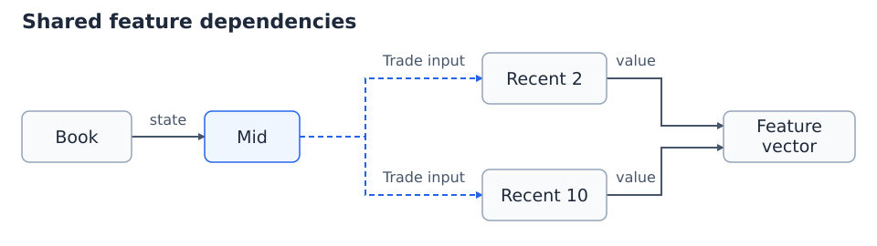

# HFT Engineering 从入门到入土（12）：高频交易中的低延迟特征计算实现

高频交易系统里的模型，不断读取反映市场状态的数值：当前中间价、买卖盘数量差、最近一段时间的成交均价……这些数值就是特征。一个特征可能只读当前盘口，也可能保存成交历史，还可能依赖其他特征的结果。

只有几个特征时，在行情回调里依次调用计算函数就够用了。特征多起来后，问题会逐渐变成：新增一个计算放在哪个回调里？它依赖的值更新了吗？多个特征都要用中间价，是分别计算，还是共用一次结果？如果某个市场只使用其中一部分，又该跳过哪些调用？

Jane Street 在 [Flex Model 原文](https://blog.janestreet.com/flex-model-an-event-driven-feature-engineering-system/) 中提到，旧系统添加一个简单的比例特征，曾经需要修改 19 个文件。这种维护成本来自计算逻辑与调用流程的纠缠。Flex Model 的做法，是让特征声明自己关心的事件和输入，再由框架安排执行顺序。

我也按这一思路写了一个 C++20 项目：[FlexModelPlanner](https://github.com/Obscurepawn/FlexModelPlanner)。理解下面的设计以后，可以结合这个实现看看，如何利用 C++ 的编译期计算生成执行计划。

## 1. 一个有历史状态的特征

先算一个最简单的特征——中间价，也就是买一价与卖一价的平均值：

```text
mid = (bid + ask) / 2
```

买一是 99，卖一是 101，中间价就是 100。以后盘口变了，重新读取买一卖一就能算出新的中间价。这个结果只由当前盘口决定。

再加一个稍复杂的特征：**最近两笔成交价，相对各自成交时刻中间价的平均偏差。** 每笔成交到来时，先计算 `成交价 − 当时的中间价`，放进一个最多保留两个样本的窗口；读取特征时，再对窗口求平均。窗口还没有装满时，就按已有样本求平均；空窗口返回 0。

用两笔大小的窗口，是为了让整个过程都能直接算出来：

| 顺序 | 收到的事件 | 当前中间价 | 新增偏差 | 保存的窗口 | 此时读取的结果 |
| --- | --- | --- | --- | --- | --- |
| 1 | 盘口更新：买一 99，卖一 101 | 100 | — | 空 | 0 |
| 2 | 成交价 101 | 100 | 1 | `[1]` | 1 |
| 3 | 盘口更新：买一 101，卖一 103 | 102 | — | `[1]` | 1 |
| 4 | 成交价 105 | 102 | 3 | `[1, 3]` | 2 |
| 5 | 又一笔成交，价格仍是 105 | 102 | 3 | `[3, 3]` | 3 |

这张表里有两个值得注意的地方。

第三行只有盘口变化，没有新成交，所以窗口仍然是 `[1]`。已经保存的偏差 1，记录的是上一笔成交相对**当时盘口**的位置。后来中间价变成 102，也不会回头改写这个样本。

最后两笔成交的价格相同，但第二笔 105 仍然把一个新样本放进了窗口，并挤掉最旧的 1。结果因此从 2 变成 3。若系统只看到“最新成交价还是 105”，就跳过这次更新，窗口便少收到一笔成交。

在只关心当前值的计算中，跳过相同值、把多次更新合并后再计算，都是合理的优化。前者常称为 **Cutoff**，后者称为 **Coalescing**。Jane Street 的 [Incremental](https://github.com/janestreet/incremental/blob/master/src/incremental_intf.ml) 就提供了相应机制。

对于这种逐笔维护历史的特征，两笔价格相同的成交仍是两次更新，不能因为价格相同就省略其中一次，也不能只保留一批成交中的最后一笔。

## 2. 特征节点的三个组成部分

把刚才的窗口做成一个独立组件，可以分别定义保存的数据、处理成交的操作和读取结果的操作。Flex Model 用 State、Handler 和 Eval 来表达它们：

| 部分 | 负责的事情 | 在窗口特征中的内容 |
| --- | --- | --- |
| State，状态 | 保存后续计算还要用的数据 | 最近两个偏差样本 |
| Handler，事件处理函数 | 收到指定事件时更新状态 | 新增一个偏差，移除超出窗口的旧样本 |
| Eval，求值函数 | 读取状态和输入，得到特征值 | 返回窗口平均值 |

先把实现写成伪代码：

```text
state:
    recent_diffs = empty queue

on_trade(trade, mid):
    recent_diffs.push_back(trade.price - mid)
    if recent_diffs.size > 2:
        recent_diffs.pop_front()

eval():
    if recent_diffs is empty:
        return 0
    return average(recent_diffs)
```

这个组件的历史维护独立于模型的采样频率。即使模型连续一百笔成交都没有读取结果，`on_trade` 也照常执行，窗口始终保留最近两笔的偏差。等模型读取时，`eval` 再返回平均值。

中间价和盘口也能按同样的方法组织，只是各自承担的操作不同：

| 节点 | 保存的状态 | 事件处理 | 求值 |
| --- | --- | --- | --- |
| Book，盘口 | 当前买一卖一 | 收到盘口更新，替换报价 | 本例由下游直接读取报价 |
| Mid，中间价 | 无历史状态 | 无 | 从 Book 计算中间价 |
| Recent，成交偏差窗口 | 最近两个偏差 | 收到 Trade，使用当时的 Mid 更新窗口 | 返回窗口平均值 |

每个节点实例持有自己的状态。盘口保存在 Book 中，成交历史保存在 Recent 中；同一种窗口逻辑可以创建多份实例，分别维护两笔、十笔或更多样本。

还要告诉框架，每个操作具体读取什么。Recent 的成交 handler 读取 Mid，用来计算 `trade.price - mid`；它的 eval 只读自己的窗口。把 Mid 这条依赖放到成交 handler 上，就不会在每次读取平均值时又计算一遍当前中间价。

这种拆分让新增特征的代码集中在自身定义里。开发者描述状态如何变化、结果如何计算，调用顺序由规划器确定。

## 3. Planner 怎样确定执行顺序

现在有了 Book、Mid 和 Recent 三个节点，还要确定哪些节点参与运行，以及它们的调用顺序。

系统先选定长期维护的节点，并把它们所有操作依赖的上游节点一并纳入启用范围。事件到来时，这些节点中匹配的 handler 都会执行；一次查询只决定本次求哪些结果，不会改变长期维护的范围。对只需要 Recent 的模型，Book 和 Mid 也会被纳入，因为 Recent 处理成交时要读取 Mid，而 Mid 又要读取 Book。

假设收到一笔成交。如果先调用 Recent 的 handler，再计算 Mid，Recent 就可能读到旧值；如果每次都把图里所有函数执行一遍，又会做很多与这笔成交无关的计算。执行顺序可以从已经声明的依赖中推导出来。

**先看盘口更新。** 只有 Book 关心这种事件，执行它的 handler，把新报价保存下来即可。此时没有人读取 Mid，也没有新成交进入窗口。

```text
BookUpdate → Book.handle
```

**再看成交。** Recent 要更新窗口，而它的成交 handler 需要 Mid。先从已经保存的盘口计算 Mid，再把成交和 Mid 一起交给 Recent：

```text
Trade → Mid.eval → Recent.handle
```

**最后看模型读取。** 窗口里的每个样本都已经在成交到达时算好，读取时只求平均值：

```text
ReadFeatures → Recent.eval
```

可以把第一节的第四行带进来走一遍。Book 里已经保存了 101/103 的盘口；收到成交 105 后，先算出 Mid=102，再把偏差 3 放入 Recent。窗口变为 `[1, 3]`。等模型读取时，才对这两个数求平均，得到 2。

Planner，也就是规划器，负责根据节点定义生成这些动作列表。它可以先找出当前事件要执行的 handler，再递归寻找它们需要的输入，把生产输入的动作排在使用者之前。这个过程就是对动作依赖做拓扑排序；如果同一份计划中的两个动作相互等待，就无法生成合法顺序。

这里排序的是 `Mid.eval`、`Recent.handle` 这样的具体动作。Eval 除了响应模型读取，还会为 handler 准备输入，因此“先执行所有 handler，再执行所有 eval”并不适合这个例子。

加入第二个窗口后，共享计算的价值就更明显了：



两个窗口的成交 handler 都读取 Mid，但各自维护自己的历史。一笔成交的计划可以是：

```text
Mid.eval → Recent2.handle → Recent10.handle
```

Mid 在这份计划里只计算一次，结果交给两个使用者。读取两项输出时，则分别执行 `Recent2.eval` 和 `Recent10.eval`。如果模型只读取其中一个窗口，另一个已启用窗口的成交 handler 仍然继续工作，因为它还要为将来的读取保留正确历史。

## 4. 执行计划与运行时

节点和依赖关系确定后，每种事件所需的动作也能提前确定。系统可以在启动时把这些动作排好，运行时只选择对应计划，依次调用。

用上面的窗口例子看，准备阶段要做的是：创建盘口与窗口状态，分配两个窗口的存储空间，安排中间结果的位置，生成盘口更新、成交和读取结果各自的计划。事件到来以后，执行器直接使用这些已经准备好的对象，不必重新查依赖、重新做拓扑排序。

“图固定”说的是计算关系固定。盘口报价和窗口内容仍然不断变化。它也解决了一个历史问题：若到中午才临时创建一个“最近十笔成交”节点，就得先补齐十笔样本，或者接受从空窗口开始的预热期。提前确定要维护的节点，就能让它们从同一个起点持续接收事件。[历史状态与动态图的讨论](https://blog.janestreet.com/breaking-down-frp/)

性能优化也可以沿着实际执行路径来做。窗口最初可以用队列解释，落地时则用预分配的环形缓冲区；额外维护一个累计和，新样本进入时加上它，旧样本移出时减掉它，求平均就变成累计和除以当前样本数。窗口更新和求值都可以控制在常数时间内。

Flex Model 还选择不在运行时根据值是否相等做 Cutoff。对于很小的计算，额外的比较、标记和条件分支本身就有成本，省掉几次加法未必能收回这些成本。按已选定的计划执行，也让“这一类事件会调用哪些函数”更容易检查。这个选择不意味着所有业务函数都没有分支，例如窗口是否已满仍然属于窗口自身的逻辑。

Jane Street 文章描述的执行器使用闭包数组，按顺序调用动作，每一步仍有一次间接调用。文中还提到，他们正在探索启动时生成并编译整段计划代码，以减少这层调用开销。[Flex Model 的性能设计](https://blog.janestreet.com/flex-model-an-event-driven-feature-engineering-system/#improving-performance)

同一条执行路径也可以用于历史回放。在线环境从行情适配层取得事件，回放环境从记录中取得事件，两者都调用同样的处理函数。第一节的事件序列无论在线处理还是从文件依次读取，窗口都应经历 `[1] → [1, 3] → [3, 3]`。

回放时要保留事件被处理的顺序。若把“盘口更新到 101/103”移到成交 105 之后，这笔成交就会按旧中间价 100 计算出偏差 5，而不是 3。记录内容相同，顺序改变，特征也会改变。

## 5. 用 C++ 把规划提前到编译期

当图结构在编译程序时已经确定，C++ 可以提前生成执行计划，并把动作展开为具体函数调用。盘口、成交窗口与特征值仍在运行时更新。

文首的 [FlexModelPlanner](https://github.com/Obscurepawn/FlexModelPlanner) 就是这条路线的 C++20 header-only 实现。沿用前面的例子，先假定 Book 和 Mid 的业务计算已经写好，看看应用层怎样声明中间价节点：

```cpp
namespace fm = flexmodel;
struct BookId {};
struct MidId {};

using MidNode = fm::node<MidId, Mid,
    fm::eval<fm::inputs<fm::state_of<BookId>>>>;
```

这条声明可以读成一句话：名为 `MidId` 的节点使用 `Mid` 类计算，求值时读取 `BookId` 节点的状态。`MidNode` 是这段节点描述的类型别名，稍后可以放进完整的图中。`state_of` 表示读取状态；如果下游要用计算好的中间价，就声明 `value_of<MidId>`，让规划器先安排 Mid 求值。

两个窗口都读取这个中间价时，规划器得到的仍是第三章的成交计划。把状态与输入写出来，执行过程可以用伪代码表示为：

```text
mid = Mid.eval(book_state)
Recent2.handle(recent2_state, trade, mid)
Recent10.handle(recent10_state, trade, mid)
```

从节点声明得到这串调用，框架分三步完成：

- **读出关系。** 模板从 `graph`、`node` 和 `inputs` 中读取类型信息，把节点 ID 对应到固定下标，并推导状态与结果的存储类型。`std::tuple` 在这里也用于保存类型列表，声明图时不会创建盘口或窗口对象。
- **排出顺序。** `consteval` 让规划器在编译期用普通数组、循环和深度优先搜索完成排序：Mid 求值排在窗口 handler 之前，同时检查缺失依赖、重复定义和动作环。[规划器源码](https://github.com/Obscurepawn/FlexModelPlanner/blob/main/include/flexmodel/planner.hpp)
- **展开调用。** 执行器通过 `std::index_sequence` 和折叠表达式逐项展开计划，利用 `if constexpr` 选择 handler 或 eval。函数与调用顺序在编译时确定，运行时执行具体调用，编译器也有机会继续内联。[执行器源码](https://github.com/Obscurepawn/FlexModelPlanner/blob/main/include/flexmodel/engine.hpp)

State 与 Value 的复用发生在两个地方。首先，每个 engine 实例按照节点保存一份 `states_`，并为有 eval 的节点保留结果槽 `values_`。多个下游读取同一个 `state_of<BookId>` 时，拿到的是同一份盘口的只读引用，不会各自维护一份 Book；每次盘口事件到来，Book 的 handler 也只执行一次。State 在这里是持续维护的数据，而不是每次读取都重新计算的表达式。

其次，规划器为每个动作记录访问状态：一个动作安排进计划以后，再次遇到它就直接跳过。因此，两个窗口虽然都依赖 `value_of<MidId>`，成交计划中仍然只有一次 `Mid.eval`。求值结果写入 Mid 的结果槽，再以只读引用传给两个窗口。去重针对同一节点 ID 的同一种动作，handler 和 eval 仍是两个独立动作。`Recent2Id` 和 `Recent10Id` 则是不同节点，各自保留状态、各自更新。

这个保证的范围是**一次执行计划**。分别调用两次查询，即使中间没有事件，也会分别求值；一次 `on(event)` 与随后的 `evaluate()` 同样各自执行计划。结果槽用于向下游传递计算结果，没有跨调用的有效性判断。

应用层先提供普通的业务计算类。类中的 `state_type` 告诉框架保存什么状态，有求值操作时再用 `value_type` 指定结果类型。静态函数 `handle` 接收可修改的自身状态、事件和只读依赖；`eval` 接收只读的自身状态与依赖，返回结果。两类函数都声明为 `noexcept`，框架会检查签名是否与依赖声明一致。

把盘口和两个窗口也放进图中，就得到下面的依赖声明。`Recent<N>` 表示保留最近 N 笔成交偏差的窗口类；这里省略业务类的定义，复用前面声明的 `MidNode`：

```cpp
struct Recent2Id {};
struct Recent10Id {};

using Graph = fm::graph<
    fm::node<BookId, Book, fm::on<BookUpdate>>,
    MidNode,
    fm::node<Recent2Id, Recent<2>,
        fm::on<Trade, fm::inputs<fm::value_of<MidId>>>, fm::eval<>>,
    fm::node<Recent10Id, Recent<10>,
        fm::on<Trade, fm::inputs<fm::value_of<MidId>>>, fm::eval<>>
>;
```

Book 的 `on<BookUpdate>` 声明它处理盘口更新。两个窗口的 `on<Trade, ...>` 声明成交 handler 读取 Mid 的结果，`eval<>` 则表示求值时没有其他节点输入，只读取自身窗口。

行情接入与模型采样使用两个入口：

```cpp
fm::engine<Graph, fm::roots<Recent2Id, Recent10Id>> model;

model.on(BookUpdate{99.0, 101.0});  // 维护盘口
model.on(Trade{101.0});            // 计算一次 Mid，更新两个窗口

using Outputs = fm::query<Recent2Id, Recent10Id>;
const auto [recent2, recent10] = model.evaluate<Outputs>();
```

`roots` 决定长期启用哪些节点及其上游依赖，`query` 决定这次取哪些输出。因此，即使某次只查询 Recent2，已经启用的 Recent10 仍会处理每笔成交。`evaluate` 返回结果槽的只读引用；需要保存独立快照时，可以用 `evaluate_into<Outputs>(output_tuple)` 把结果复制到应用自己的 tuple 中。

图结构随程序版本发布时，这种接口能把依赖检查和执行规划提前到编译阶段。修改计算关系后重新编译，业务运行时只保留状态、输入事件和执行调用所需的工作。

仓库中的[完整特征示例](https://github.com/Obscurepawn/FlexModelPlanner/blob/main/examples/composite_feature.cpp) 展示了同样的接口如何组合盘口特征与成交历史。

## 参考资料

1. [Stanislaw Maczka — Flex Model: an event-driven feature engineering system](https://blog.janestreet.com/flex-model-an-event-driven-feature-engineering-system/)：Jane Street 对设计动机、事件规划和执行器的介绍。
2. [Yaron Minsky — Breaking down FRP](https://blog.janestreet.com/breaking-down-frp/)：历史状态、动态图和计算效率之间的取舍。
3. [Jane Street Incremental — 接口与设计文档](https://github.com/janestreet/incremental/blob/master/src/incremental_intf.ml)：增量计算、stabilization 和 cutoff 的语义。
4. [OxCaml — Zero_alloc checker](https://oxcaml.org/documentation/miscellaneous-extensions/zero_alloc_check/)：函数分配行为的编译期检查。
5. [C++ 标准草案 — The constexpr and consteval specifiers](https://eel.is/c++draft/dcl.constexpr)：常量求值相关的语言规则。
6. [QuantML — 深度学习如何落地高频？详解 Jane Street内部框架Flex Model](https://zhuanlan.zhihu.com/p/2094845148895233990)：相关中文解读。
7. [愚夫一得 — Jane Street低延迟因子计算框架](https://zhuanlan.zhihu.com/p/2097593203327350406)：相关中文解读。
