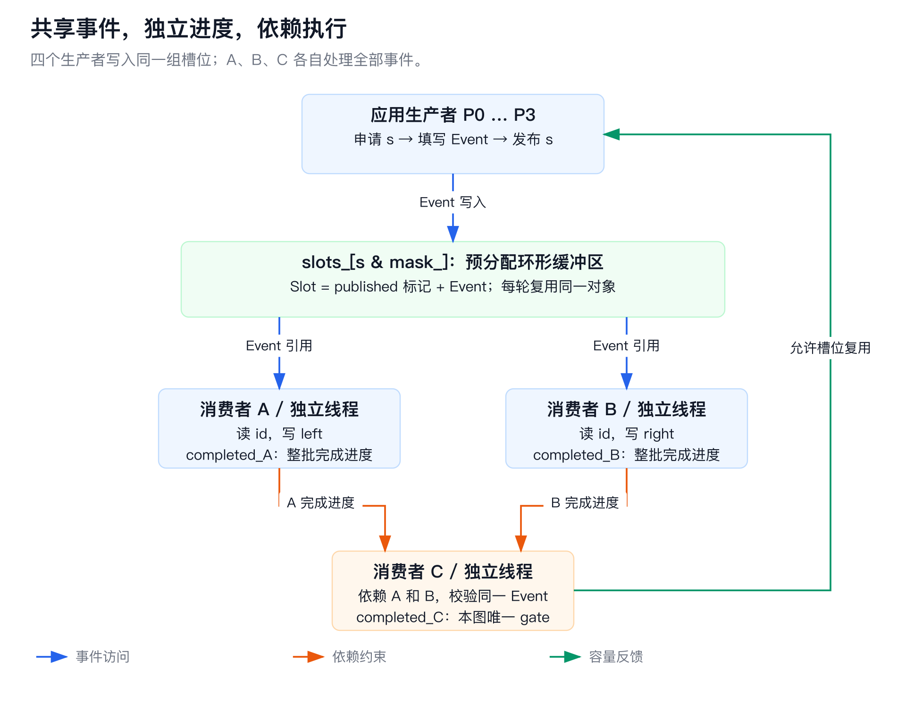
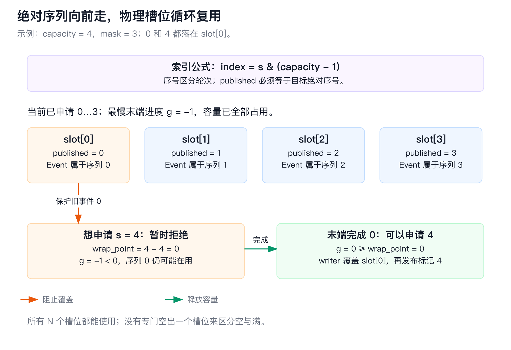
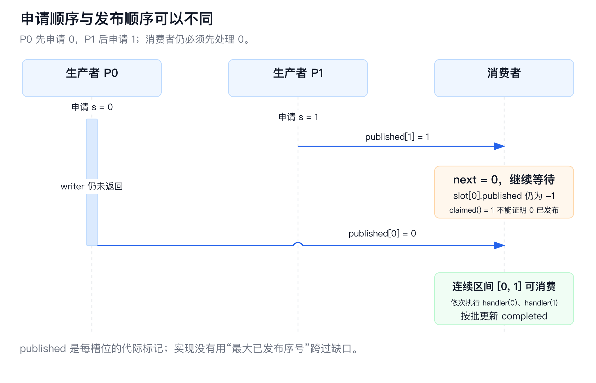
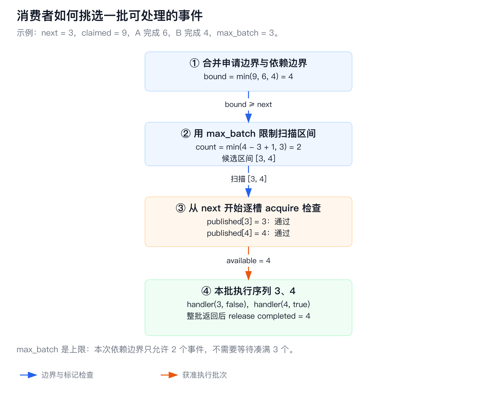
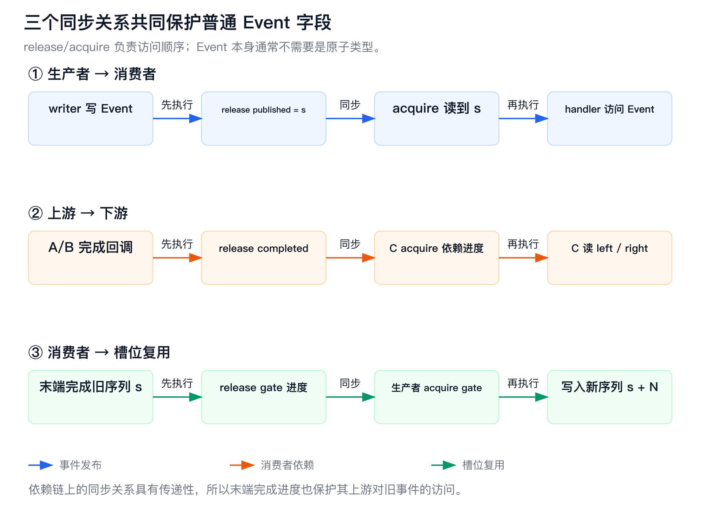
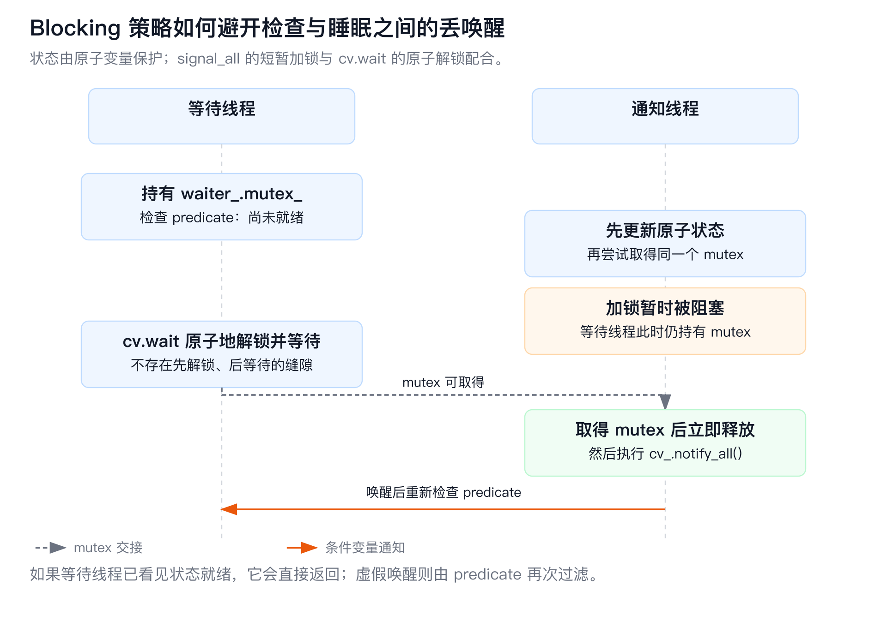
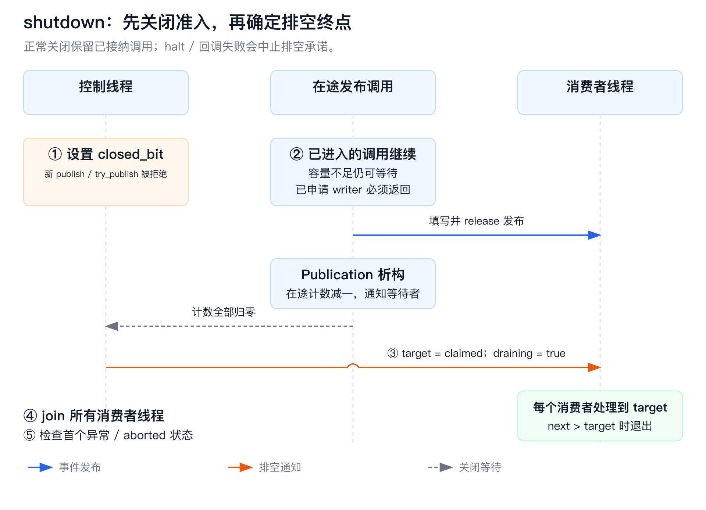

# C++20 Disruptor：固定拓扑的事件广播与依赖执行

这个组件在**同一进程的多个线程之间传递事件**：生产者把事件写进预分配的环形缓冲区，每个消费者按序处理全部事件，消费者之间可以设置先后依赖；只有旧事件的所有使用者都完成后，生产者才能复用它的槽位。

理解实现时，要始终分清四件事：**申请序号、填写事件、发布事件、完成消费**。它们有各自的状态，不能用一个“当前序号”混为一谈。本实现把序列协调、依赖屏障、消费者线程和生命周期管理放在一个单头文件 [include/disruptor.hpp](include/disruptor.hpp) 中。它是独立的 C++20 实现，支持单生产者或多生产者、静态消费者依赖图、批量消费及三种等待策略。

本文的流程、字段和伪代码均对应当前仓库源码；图中的小容量和序号用于推演。正确性说明是源码分析，不是形式化证明。代码没有经过生产环境验证，也没有附带延迟或吞吐量承诺。

建议第一次按下面的顺序读，第二次结合“源码阅读地图”跳到函数。所有图都提供本地 PNG 和 SVG，不依赖 Mermaid 渲染或在线服务。

- [执行结构：一个事件如何经过整个系统](#execution)
- [数据结构：哪些对象属于谁](#structures)
- [环形寻址：绝对序列和物理槽位](#ring)
- [生产者：从准入到发布](#publication)
- [消费者：依赖屏障和批量处理](#consumption)
- [背压：为什么只检查末端节点](#gating)
- [内存序与事件可见性](#memory-order)
- [等待策略与关闭](#waiting-and-close)
- [API 与使用契约](#api)
- [完整示例：逐段读 diamond.cpp](#diamond)
- [设计取舍与成本](#tradeoffs)
- [源码阅读地图与关键不变量](#source-map)
- [测试、推演和自测](#validation)
- [文件与构建](#build)
- [范围与参考](#references)

<a id="execution"></a>

## 执行结构

### 先看一个事件，而不是先看原子操作

示例的事件只有三个普通整数成员：

```cpp
struct Event {
    std::uint64_t id = 0;
    std::uint64_t left = 0;
    std::uint64_t right = 0;
};
```

假设某个生产者要发送业务编号 `id = 7` 的事件，框架给它分配内部序列 `s = 0`。这两者用途不同：`id` 是应用数据，`s` 是当前 Disruptor 实例内部的处理顺序。

1. 生产者确认还有可复用槽位，申请序列 0。
2. writer 在 `slots_[0].event` 中填写 `id = 7, left = 0, right = 0`。
3. writer 返回后，框架把这个槽位的 `published` 标记设为 0，表示序列 0 的事件完整可读。
4. 消费者 A 和 B 分别等待这个发布标记，然后在各自线程中处理**同一个 Event 对象**。A 写 `left = 7 * 3 + 1 = 22`，B 写 `right = 7 * 7 + 2 = 51`。
5. C 依赖 A 和 B，必须等到两者都公布完成序列 0，才读取并校验 22 和 51。
6. C 完成后，这个旧事件不再被任何消费者使用。生产者以后可以把同一个物理槽位用于序列 `0 + capacity`。



[查看架构图 SVG](docs/diagrams/architecture.svg)。蓝线表示事件访问，橙线表示完成进度约束，绿线表示槽位复用的容量反馈。C 的事件引用也来自共享槽位，A/B 到 C 的箭头表示依赖，不表示复制或发送一份新事件。

这张图对应示例中的 `A → C ← B`。这里的依赖图叫 DAG（Directed Acyclic Graph，有向无环图）：节点是消费者，边表示“下游处理某序列之前，上游必须已经完成该序列”。

### “广播”具体意味着什么

如果生产者发布 40000 个事件，A、B、C 正常结束时各处理 40000 个，回调总调用次数是 120000。三个消费者各自从序列 0 前进到 39999。它们不会共同领取并分摊这 40000 个任务。

| 问题 | 本实现的行为 |
| --- | --- |
| 是否每个消费者都看到每个事件？ | 正常运行和正常排空时，是；没有按消费者过滤或分片的接口 |
| 是否每个消费者有自己的事件副本？ | 否，回调收到同一个槽位中的 `Event&` |
| 一个事件是否被“弹出”后就消失？ | 否，它一直留在槽位里，直到满足复用条件后被新事件覆盖 |
| A 和 B 是否必须同步推进？ | 否，各有独立进度，能以不同批次和不同速度前进 |
| C 是否必须等 A/B 处理完所有事件？ | 否，只需它们完成 C 当前要处理的序列 |
| 生产者是否要等消费者完成才能返回？ | 否，`publish` 返回表示本事件已发布；消费可能已发生，也可能尚未开始 |

### 哪些代码在哪个线程执行

`publish` 的 writer 在**调用 publish 的应用线程**中同步执行。框架没有另外创建生产者线程。示例中的四个生产者是 `main` 自己创建的。

每个 `add_consumer` 注册的消费者，在 `start` 时对应一个 `std::thread`。同一个消费者的 handler 顺序调用，不会并发处理它自己的多个事件；不同消费者的 handler 可以并发执行，是否允许处理同一个序列由依赖关系决定。这个实现没有线程池，也没有协程调度器。

构图、启动和正常关闭属于控制操作，由应用串行执行。启动之后，稳定的拓扑、独立的消费者进度和原子发布标记才支撑并发数据路径。

<a id="structures"></a>

## 数据结构：存储、进度和线程各自负责什么

### 核心类型

下面是保留关键成员的结构示意，省略了方法和部分生命周期字段；完整定义见头文件的 `private` 部分。

```cpp
struct alignas(64) Sequence {
    std::atomic<std::int64_t> value;   // 默认 -1
};

struct alignas(64) Slot {
    std::atomic<std::int64_t> published{-1};
    Event event{};
};

struct Worker {
    std::string name;
    Sequence completed;
    std::vector<Worker*> dependencies;
    std::function<void(Event&, std::int64_t, bool)> handler;
    std::thread thread;
};
```

`Slot` 回答“这个位置放的事件属于哪个已发布序列”；`Worker.completed` 回答“这个消费者公布完成到了哪里”。前者随槽位复用跳到下一轮，后者沿事件顺序单调前进。

| 字段 | 初始值或内容 | 谁写 | 谁读，以及读它的目的 |
| --- | --- | --- | --- |
| `capacity_` / `mask_` | 容量 N / N - 1 | 构造函数 | 寻址与计算复用边界；之后不变 |
| `max_batch_` | 默认 64 | 构造函数 | 消费者限制本批最多处理多少个事件 |
| `slots_` | N 个 Slot，每个 `published = -1` | writer 写 Event，框架发布标记；handler 可按契约修改 Event | 消费者检查目标轮次并处理事件 |
| `next_claim_.value` | 0 | 成功申请序号的生产者 | 生产者取得候选序号，消费者确定扫描上界，控制线程确定排空终点 |
| `workers_` | 注册的 Worker 对象 | 启动前构建 | 每个消费者线程运行对应的 Worker |
| `worker.completed.value` | -1 | 该 Worker 的线程 | 下游检查依赖；生产者检查末端进度；应用查询 `progress` |
| `worker.dependencies` | 直接前置 Worker 指针 | `add_consumer` | 消费者计算自己的依赖边界 |
| `gates_` | 所有没有后继的 Worker 的 completed 指针 | `start` | 生产者判断旧事件是否可以覆盖 |
| `admission_` | 最高位为关闭位，低 63 位为在途发布计数；初始关闭 | 发布准入、退出、关闭流程 | 决定能否接纳新调用，以及关闭时是否还有在途调用 |
| `started_` / `aborted_` | false / false | 启动 / 中止流程 | 拒绝错误生命周期操作，终止等待与消费 |
| `draining_` / `drain_target_` | false / -1 | `shutdown` | 消费者判断正常排空是否已经结束 |
| `start_called_` / `shutdown_done_` | false / false | 串行控制线程 | 防止重复启动、避免重复 join；它们不是并发控制接口 |
| `failure_` / `failure_mutex_` | 空异常指针 / 互斥锁 | 失败记录流程 | 保存并观察首个消费者异常 |
| `waiter_` | 一个共享 Waiter | 运行期间各方使用 | 等事件、等依赖、等容量、等发布计数归零，以及通知状态变化 |

### 为什么用 unique_ptr，而不是直接把 Worker 放在 vector 里

`workers_` 的类型是 `vector<unique_ptr<Worker>>`。注册新消费者时，vector 可能扩容，但它移动的是指针；已经分配的 Worker 对象仍在原地址。因此，后续消费者保存的 `Worker*` 依赖，以及启动时保存的 `Sequence*` gate，能保持地址稳定。

`slots_` 是 `unique_ptr<Slot[]>`，构造时一次分配并默认构造所有 Event。正常发布只拿引用填写，框架不会逐事件分配、复制、移动或重建 Event。Event 内部若包含动态容器，用户修改它仍可能分配内存；handler 的 `std::function` 也可能在注册时分配。

`Disruptor` 禁止复制和移动。消费者句柄保存所属实例地址，线程执行函数也捕获 `this`，因此实例地址与内部对象生命周期必须稳定。句柄只是“实例地址 + 消费者下标”，不持有对象，也没有跨销毁重建的代际校验。

`alignas(64)` 给 Sequence 和 Slot 设置至少 64 字节对齐，用于减少相邻热点状态落在同一缓存行的机会。实际对象大小还受 Event 大小和对齐影响；不同硬件的缓存行大小也可能不同，不能由此断言完全消除了伪共享。伪共享指线程访问不同变量，但这些变量共用缓存行，导致额外缓存一致性流量。

<a id="ring"></a>

## 环形寻址：为什么既需要索引，又需要绝对序列

### 索引循环，序列不循环

容量 N 必须是二次幂，寻址方式是：

```text
mask = N - 1
index(s) = s & mask

N = 4，mask = 3：
绝对序列 s：  0  1  2  3  4  5  6  7  8 ...
物理索引：    0  1  2  3  0  1  2  3  0 ...
```

因为 N 是二次幂，对于这里的非负序列，`s & (N - 1)` 与 `s % N` 的结果相同。`std::has_single_bit(capacity)` 就是构造时检查这个条件的 C++20 接口。



[查看环形复用图 SVG](docs/diagrams/ring-reuse.svg)。图中 N = 4，序列 4 需要覆盖序列 0 的位置；末端完成进度从 -1 变成 0 之后，这次覆盖才被允许。

### published 为什么不能是 bool

消费者要读序列 4 时，slot[0] 可能还保留 `published = 0`。如果只保存 `ready = true`，旧一轮的“已写入”就可能被误认为新一轮已经就绪。

本实现检查的是严格相等：

```cpp
slot(sequence).published.load(std::memory_order_acquire) == sequence
```

因此，序列 4 只接受 `published == 4`，不会接受旧的 0。每次新 writer 返回后，框架才把标记更新为新绝对序列；没有必要先把标记清成 -1。未更新的旧标记自然无法满足下一轮的相等检查。

### Event 对象不会自动清空

复用 slot[0] 时，里面仍是上一轮 Event 的内容，可能还包含消费者后来写入的结果。只有构造时的 `event{}` 会做初始构造。writer 必须填写新逻辑事件需要的全部字段；示例每次都写 `id`，并把 `left`、`right` 清零。

这也是 Event 引用不能逃出回调的原因。回调返回后，旧对象的使用权会随着完成进度释放；即使对象物理地址仍然存在，它的逻辑内容也可能属于下一轮。若业务要异步保留数据，应在回调内把所需内容复制到业务自己拥有的存储。

容量 N 个槽位都能使用。这里用绝对序列与末端进度区分空和满，不需要像某些仅使用读写索引的环形队列那样保留一个空槽位。

<a id="publication"></a>

## 生产者：从一次函数调用到一个已发布事件

### 发布路径有四步

```text
publish(writer)
  ├─ check_writer：编译期检查 writer 的 noexcept 调用约束
  ├─ Publication：进入发布准入，增加在途计数
  ├─ try_claim：检查容量，取得唯一序列
  │    └─ 没容量：等待消费者推进，再重试
  ├─ write_and_publish：调用 writer，再 release 发布槽位标记
  └─ Publication 析构：减少在途计数，恢复线程局部上下文
```

“准入”只表示这次调用被系统接纳，并不表示已经申请了序列。一个 `publish` 可以已经被计入在途计数，却仍在等容量。

### 第一步：Publication 管理整个调用的生命周期

`Publication call(*this)` 是一个 RAII 对象：构造时 `enter()`，离开作用域时退出发布。RAII 是把资源获取与释放绑定到对象构造、析构的方式；这里管理的资源是一次发布准入，而不是 Event 内存。

`admission_` 用同一个 64 位原子数同时表示关闭状态和计数：

```text
bit 63                 bits 62 ... 0
+-------------------+-------------------------+
| closed_bit        | active publication count|
+-------------------+-------------------------+

启动前：关闭位 1，计数 0
运行中：关闭位 0，计数 k
关闭中：关闭位 1，计数 k；旧调用退出后逐步降为 0
```

`enter()` 先拒绝同实例回调重入和启动前发布，再读 `admission_`。如果入口开放，它用 CAS 将状态从 `state` 改为 `state + 1`。CAS（Compare-And-Swap，比较并交换）表示“值仍等于我刚读到的状态时才更新，否则返回新观察值并重试”。

把关闭位与计数放在同一个原子变量中，让“关闭”和“进入”拥有明确竞争结果：若进入 CAS 先成功，调用已接纳，关闭流程会等待它；若关闭置位先发生，进入 CAS 就会失败，重试时观察到关闭并拒绝。关闭不会漏掉一个已经接纳却还没来得及登记的调用。

`Publication` 析构执行 `fetch_sub(1)`，不会清掉最高关闭位。它同时通知 Waiter，因此正在等待计数归零的 `shutdown` 能继续。申请前遇到中止或序列耗尽等异常，也会沿析构路径减少计数。

### 第二步：capacity_for 判断候选序列是否安全

设候选序列为 s，容量为 N。序列 s 将覆盖上一轮的 `s - N`：

```text
wrap_point = s - N
可以申请 ⇔ 每个末端消费者的 completed >= wrap_point
```

对于第一轮 `s = 0 ... N - 1`，wrap_point 小于等于 -1，所有消费者的初始进度 -1 就能满足条件。对于 s = N，必须至少完成旧序列 0。

`capacity_for` 对 `gates_` 中每个进度做 acquire 读取。只要有一个末端还没完成旧事件，它就返回 false。它不会跳过慢消费者，也不会覆盖或丢弃未完成事件。

### 第三步：Single 与 Multi 如何申请唯一序列

`next_claim_` 表示“下一次成功申请将使用的序列”，所以 `claimed()` 返回 `next_claim_ - 1`。初始 `next_claim_ = 0`，因此初始 claimed = -1。

`ProducerMode::Single` 的申请部分是：

```text
读取 candidate
检查 capacity_for(candidate)
next_claim = candidate + 1
返回 candidate
```

它要求任意时刻最多有一个已经进入、尚未返回的发布调用。即使两个线程不会同时写 Event，只要它们的发布调用重叠，也不满足这个契约。应用可以用外部同步满足约束，但框架不会自动串行化它们。

`ProducerMode::Multi` 用 CAS 竞争序列：

```text
读取 candidate
循环：
  检查是否中止、是否耗尽序列空间
  检查 capacity_for(candidate)
  CAS(next_claim, candidate, candidate + 1)
    成功：返回 candidate
    失败：candidate 已变成新观察值，重新检查容量后再竞争
```

例如 P0、P1 同时观察到 candidate = 5，只有一个能把计数从 5 改成 6。另一个观察到 6，再检查序列 6 对应的容量。不能对 5 检查过容量后直接申请 6，因为它们可能覆盖不同旧事件。

这里的申请原子使用 relaxed 内存序：它负责原子地分配唯一编号，**不负责发布 Event 的内容**。Single 省去的是这个申请 CAS；发布准入仍使用原子 CAS，因此不能称 Single 模式完全没有 CAS。

### 第四步：writer 返回之后才发布

真正把事件交给消费者的是 `write_and_publish`：

```cpp
auto& entry = slot(sequence);
std::invoke(writer, entry.event, sequence);
entry.published.store(sequence, std::memory_order_release);
waiter_.signal_all();
```

writer 必须在类型层面满足 `noexcept(Event&, int64_t)` 调用约束，框架通过 `is_nothrow_invocable_r_v` 检查。如果先申请序号，再允许 writer 抛异常并放弃，消费者就会永远等着这个序号，后续事件无法按序继续。因此实现没有暴露“申请后交给调用者手动发布”的接口。

`noexcept` 不保证回调能完成：回调仍可能阻塞或无限循环。也不要让字符串扩容、容器分配等异常逃出 noexcept writer，否则程序会 `std::terminate`，而不是由框架修复缺口。发布函数自身仍可以因生命周期、重入或序列耗尽而抛异常。

### 为什么必须防止多生产者的发布缺口

申请顺序确定事件顺序，writer 的完成时间则由各线程调度和用户代码决定。可能出现：

| 时刻 | P0 | P1 | 消费者 |
| --- | --- | --- | --- |
| T1 | 申请 0，writer 还在执行 | 尚未申请 | 等待 0 |
| T2 | writer 尚未完成 | 申请并发布 1 | 看见 claimed = 1，但 0 尚未发布，仍等待 |
| T3 | 发布 0 | 已返回 | 0、1 成为连续可处理区间 |



[查看发布缺口图 SVG](docs/diagrams/publication-gap.svg)。图中箭头表示槽位标记发布后可被消费者观察，并不表示额外向消费者发送消息。

消费者检查每个序列对应槽位的 `published == sequence`，不会用“最大的已发布序号”推断前面全都完成了。如果序列 0 的 writer 永远不返回，即使 1、2、3 都已发布，所有消费者仍卡在 0。这个设计保留全局序列顺序，相应地也存在队头阻塞。

### try_publish 和 publish 的差别只有容量等待

`try_publish` 同样要准入、申请、执行 writer 并发布。容量不足时，它返回空 `optional`，不消耗序号，也不调用 writer。`publish` 则在容量不足时进入 Waiter，满足容量条件后重新尝试申请。

`try_publish` 的空值只表示当次没有容量。入口关闭或已记录消费者失败会抛异常，而不是返回空值。在 Multi 下它可能重试 CAS，在 Blocking 下通知还会短暂加互斥锁，因此它不是 wait-free，也不能把它理解为严格有界时长的操作。

<a id="consumption"></a>

## 消费者：依赖屏障与连续批次

### 注册顺序本身防止图中出现环

`add_consumer` 只接受当前实例已经注册的消费者句柄。新节点只能依赖旧节点，旧节点不能反向依赖尚未创建的新节点，所以沿任何依赖边都从较早注册节点走向较晚注册节点，无法绕回原处。

框架还拒绝重复消费者名称、重复依赖、默认无效句柄与其他实例句柄。没有依赖的消费者是根节点，可以在事件发布后独立前进。图可以有多个根、多条分支和多个末端，不局限于示例的菱形。调用 start 后拓扑冻结。

`start` 先找出所有没有后继的节点作为 gates，再给每个 Worker 创建线程。全部创建成功后才开放发布准入，并设置 started。若线程创建抛异常，它会 halt、回收已创建线程，然后把异常交还给调用方。发布必须等 start 成功返回后才开始。

### available_batch 是本实现的序列屏障

每个 `run(worker)` 内部都有局部变量 `next = 0`，表示该消费者下一次要处理的绝对序列。它调用 `available_batch(worker, next)` 寻找从 next 开始、此刻可以处理的连续区间。

先计算上界：

```text
claimed_bound = next_claim - 1
dependency_bound = 所有直接前置消费者 completed 的最小值

有依赖：bound = min(claimed_bound, dependency_bound)
无依赖：bound = claimed_bound

bound < next：当前没有可用事件，返回 next - 1
```

这个 bound 还不是最终的可消费终点。申请到了 bound，不等于每个 writer 都写完了。函数继续限制本批大小，并扫描发布标记：

```text
count = min(bound - next + 1, max_batch)
end = next + count - 1

按序扫描 sequence = next ... end：
  acquire 读取对应槽位 published
  如果 published != sequence：返回 sequence - 1
全部匹配：返回 end
```

如果第一个目标槽位还没发布，返回 next - 1，表示空批次。如果前三个就绪、第四个未发布，就返回第三个，而不是等整批填满。max_batch 是上限，框架不会为了凑足数量而故意等待。



[查看批次屏障图 SVG](docs/diagrams/batch-barrier.svg)。示例中 C 的依赖进度把扫描上界压到 4；槽位 3、4 均已发布，最终处理 [3, 4]，无需凑满 max_batch = 3。

即使下游已经看到前置节点完成，当前实现仍逐槽检查 published；没有为依赖消费者省略这一步。整个序列屏障是一个普通成员函数，没有独立的 SequenceBarrier 对象。

发布缺口主要发生在无依赖的根消费者等待生产者时。在合法运行中，若前置节点已经公布完成序列 s，它必然消费过 s；下游仍需要这个事件时，gate 又阻止了槽位覆盖。因此不能构造“前置节点已经完成 s，但 s 从未发布”的有效执行状态。

### run 如何调用回调并公布进度

保留核心逻辑的伪代码如下，真实函数还管理线程局部状态和异常：

```text
next = 0
当没有 aborted，且还没有完成 drain_target：
  available = available_batch(worker, next)
  如果 available < next：
    等待 aborted、排空结束，或 next 变得可处理
    回到循环

  按序执行 next ... available：
    如果 aborted，停止
    handler(slot(sequence).event, sequence, sequence == available)

  如果 aborted，退出，不公布这批进度
  release 写 completed = available
  next = available + 1
  通知等待者
```

handler 的第三个参数 `end_of_batch` 只在这个消费者本次选定批次的最后一个序列上为 true。A 和 B 的批次可能不同；它不是全局批次边界，也不表示所有生产者已经空闲。

假设当前选择了 `[0, 1, 2]`，回调参数与公布进度是：

| 操作 | end_of_batch | 外部可见 completed |
| --- | --- | --- |
| handler(0) | false | 仍为 -1 |
| handler(1) | false | 仍为 -1 |
| handler(2) | true | 回调执行期间仍为 -1 |
| 整批成功返回后的 release store | — | 变成 2 |

因此，`progress` 可能落后于某些已经执行完的回调，下游也可能晚一点才获准处理这些事件。批量公布减少进度写入和通知次数，但增加依赖推进与槽位释放的粒度。中途失败或 halt 时，即使批内已有业务副作用，也不会把整个批次标成完成；不能据此将副作用当成一笔可回滚事务。

### C 怎样等待 A 和 B

例如 A 完成到 10，B 完成到 7，生产者申请到 12，C 最多扫描到 `min(12, 10, 7) = 7`。A 可以继续处理 8、9、10，C 不会因为 A 更快就越过 B。

依赖限制的是**相同序列的处理先后**，而不是把整条分支完全串行化。A、B 可以处理较新的事件，同时 C 处理它们已经完成的旧事件，从而形成流水线。

<a id="gating"></a>

## 背压：为什么只检查末端消费者就够了

### completed 既是依赖进度，也是复用许可

背压是下游无法及时处理时，让上游等待或报告容量不足，避免继续覆盖仍在使用的数据。在本实现中，生产者没有“消费者太慢就覆盖”的路径：publish 等待，try_publish 返回空值。

对图中的每条边 `A → C`，C 每次公布的完成进度都不能超过 A。因为 C 选批次时被 A 的已公布进度限制，而 A 的进度只会继续增加：

```text
completed_C <= completed_A
completed_C <= completed_B
```

一个有限 DAG 中，每个节点都能沿后继走到至少一个末端。末端完成某个序列，意味着通向它的上游都已经完成该序列。因此只检查所有末端，就能保护所有消费者；不需要每次申请都读取全部节点。

示例只有 C 是末端，gates 只包含 C。若再添加一个无依赖消费者 D，D 没有后继，也必须成为 gate；生产者需要同时等 C 和 D。图中即使 D 与主业务无关，只要它仍订阅全部事件，它的速度就会限制槽位复用。

### 这个条件怎样避免覆盖

设最慢末端完成进度为 g，下一候选序列为 r，容量为 N：

```text
已申请但尚未由所有末端完成的数量 = r - (g + 1)
可以再申请一个 = 这个数量 < N
等价条件：g >= r - N
```

例如 N = 4，已经申请 0、1、2、3，r = 4，g = -1。未释放数量是 4，不能申请 4。g 推到 0 后，未释放数量变成 3，序列 4 才能复用 slot[0]。

这个数量包含“writer 还没发布”的序列，不只是消费者看得见的事件。未完成 writer 同样占据容量。批次处理中，已经返回的个别回调也可能尚未释放容量，因为 completed 在批末才公布。

消费者扫描出一批后，没有把每个槽位锁住。它们仍然安全，因为在整批回调完成前，该消费者不会推进 completed，其任何末端也不能越过它，生产者因而不能覆盖这批仍在使用的事件。

<a id="memory-order"></a>

## 内存序与事件可见性

### 普通 Event 字段为什么可以安全传递

原子序号不仅负责计数，还负责把普通内存访问排成正确顺序。这里的 release 表示在发布之前完成的访问进入同步关系；匹配的 acquire 读到该发布值后，后续访问获得相应顺序保证。这种“前者的访问先于后者”的关系叫 happens-before。其规则见 C++ 标准公开草案的 [atomics.order](https://eel.is/c++draft/atomics.order) 与 [intro.races](https://eel.is/c++draft/intro.races)。

关键是 acquire 必须观察到对应 release 的值或相应发布链；仅仅把一个任意 load 写成 acquire，并不能让没完成的 writer 自动完成。下面三条关系分别解决事件首次读取、消费者之间的数据传递和槽位复用。



[查看内存序图 SVG](docs/diagrams/memory-order.svg)。每一行都包含“先执行的普通访问 → release → 匹配的 acquire → 后执行的普通访问”。

**生产者 → 消费者。** writer 写普通 Event 字段，随后 release 写 `slot.published = s`。消费者 acquire 读到 s 之后才执行 handler，因此 writer 对事件的写入 happens-before 消费者对本事件的访问。

**上游 → 下游。** A/B 完成一批回调后，release 写各自 completed。C acquire 读取所有直接依赖，确认都完成目标序列后再调用 handler。因此，A 对 left、B 对 right 的写入 happens-before C 读取这些结果。一批对应的一次 release 覆盖该线程此前整批回调中的访问。

**消费者 → 生产者复用。** 末端消费者完成旧事件后 release 写 completed。生产者 acquire 确认它达到 wrap_point，才覆盖同一槽位。沿依赖路径形成的 happens-before 关系具有传递性，所以该末端的进度也覆盖其上游的消费访问。

### 哪些原子负责顺序，哪些只负责编号

| 原子状态 | 主要操作 | 保证的边界 |
| --- | --- | --- |
| `next_claim_` 的申请操作 | Single relaxed store；Multi relaxed CAS | 序列申请唯一性；不能替代 Event 发布 |
| `Slot.published` | producer release store / consumer acquire load | writer 完整写入后，消费者才访问事件 |
| `Worker.completed` | worker release store / downstream、producer acquire load | 前置处理完成后，下游读取；所有使用者完成后，生产者复用 |
| `admission_` | acq_rel CAS、fetch_or、fetch_sub；acquire load | 进入与关闭的竞争，以及等待在途发布退出 |
| `started_` | release store / acquire load | 发布前确认成功启动；应用仍须等 start 返回 |
| `aborted_` | release store / acquire load | 把停止请求传给发布和消费循环；不强行中断用户回调 |
| `drain_target_` / `draining_` | 先 relaxed 写 target，再 release 写 draining；消费者 acquire 读 draining 后 relaxed 读 target | 观察到排空标志后，使用已设置的终点 |

`claimed()` 虽然使用 acquire load，也不能据此读取相应 Event。申请计数的写入并没有发布 writer 后来的数据，事件发布由独立的槽位标记完成。`volatile` 也不能替换这些线程同步操作。

### A 和 B 并行修改 Event 的边界

示例安全是因为 A/B 都只读 id，且分别写独立普通标量成员 left、right；C 建立了对两者的依赖。框架没有对 Event 加一把“任意访问都安全”的锁。

| 访问方式 | 是否由当前依赖关系保证安全 |
| --- | --- |
| A/B 并行只读已经发布的 id | 是 |
| A 只写 left，B 只写 right，二者是独立普通标量成员 | 是，双方访问不同内存位置 |
| A/B 同时执行 `event.left++` | 否，存在同一内存位置的并发读写 |
| B 不依赖 A，却读取 A 正在写的 left | 否 |
| C 依赖 A/B 后读取 left、right | 是 |
| A/B 改同一个 string、容器，或不同位域 | 不能按“字段名不同”断言安全，需要分析实际内存位置与容器操作 |
| handler 启动异步任务持有 Event&，自己立即返回 | 否，框架只跟踪 handler 返回，不跟踪异步任务 |

`vector<bool>` 的不同元素可能共享同一存储单元，也不能简单套用不同标量字段的结论。如果需要修改同一份状态，应建立相应依赖，或由业务提供额外同步。回调捕获的外部变量同样遵守这些规则；例子里的计数器各有一个写线程，main 在 join 后才读。

<a id="waiting-and-close"></a>

## 等待策略与关闭

### 同一个 Waiter 服务四种等待

所有生产者和消费者共享一个 `detail::Waiter`。等待者用自己的 predicate 检查状态，所以一次唤醒只是“请再检查”，不是向某个线程发放唯一消费资格。

| 等待者 | 正常就绪条件 | 中止时的处理 |
| --- | --- | --- |
| 容量不足的 publish | 下一候选序列有容量 | 观察 aborted 后退出并抛异常 |
| 等事件的消费者 | next 已连续发布，且所有依赖达到 next | 观察 aborted 后退出 |
| 等依赖的消费者 | 上游进度推进到 next | 同上；正常排空已结束时也退出 |
| shutdown / 析构 | 在途发布计数为 0 | 仍需等待已进入的调用退出，不能直接跳过 |

发布标记更新、消费者 completed 更新、发布调用退出、关闭/排空/中止状态变化后，相关路径都会 `signal_all()`。BusySpin 和 Yielding 没有真正通知：它们持续重新读 predicate。Blocking 才使用条件变量通知所有等待者。

### 三种策略的实际代码

| 策略 | `wait` 如何执行 | 具体含义 |
| --- | --- | --- |
| `BusySpin` | 循环检查 predicate，并调用 `cpu_relax()` | 不主动让线程睡眠，持续消耗 CPU 时间 |
| `Yielding` | 循环检查，并 `std::this_thread::yield()` | 给调度器让出运行机会，不保证一定切换到某个线程或等待固定时长 |
| `Blocking` | 持有 mutex，执行 `cv.wait(lock, predicate)` | 不就绪时阻塞；唤醒后重新检查条件，依赖调度和互斥锁 |

`cpu_relax` 在 x86 上用 `_mm_pause()`，在 ARM 上用 `yield` 指令，其他平台使用 `atomic_signal_fence` 作为退路。CPU 的 relax 指令是自旋提示，不等同于操作系统的线程 yield，也不是 Event 发布屏障；真正的数据同步仍来自上述原子内存序。

等待策略构造时固定。示例选择 Blocking，适合演示在没有独占 CPU 核的环境中等待；这里没有性能测量能证明哪种策略在你的目标机器上延迟最好。

### Blocking 的 signal_all 为什么“空加锁”

实现先更新原子状态，通知时再短暂取得等待者用的同一个 mutex：

```cpp
{ std::lock_guard lock(mutex_); }
cv_.notify_all();
```

这不是用 mutex 保护 Event。它要协调“检查条件发现未就绪”和“真正开始等待”之间的时间窗口。如果通知者只更新状态并 notify，等待者可能刚检查到旧状态，还没正式进入等待；通知发生后它才睡下，而之后没有新的状态变化来唤醒它。

当前协议中，等待者持有 mutex 检查 predicate。不就绪时，`cv.wait` 原子地释放 mutex 并进入等待。通知者必须先取得这个 mutex：它要么在等待者检查之前完成协调，使等待者看到就绪状态；要么被等待者暂时挡住，直到等待者解锁并进入等待，再 notify。

条件变量等待中“原子地解锁并阻塞”的标准语义见 [thread.condition.condvar](https://eel.is/c++draft/thread.condition.condvar)。原子状态解决数据可见性，mutex 与条件变量的这个协议解决等待交接，两者承担不同职责。



[查看阻塞唤醒图 SVG](docs/diagrams/blocking-wakeup.svg)。这是原子状态与条件变量配合的协议，单看 notify_all 一行无法理解其正确性。predicate 同时过滤虚假唤醒，以及不属于当前线程的其他状态变化。

### 正常 shutdown 为什么分成两个阶段

运行时，入口开放；但关闭不等于立刻设置 aborted。`shutdown` 先关闭入口，保持已接纳调用与消费者继续工作，然后再公布排空终点：

```text
1. fetch_or(closed_bit)：拒绝新的发布准入
2. 等 admission 低 63 位归零：所有已接纳发布调用退出
3. drain_target = claimed()：现在申请边界不会再被旧调用推进
4. release 设置 draining = true，并通知消费者
5. 每个消费者继续处理，直到 next > drain_target
6. join 所有消费者线程，检查失败或中止状态
```



[查看正常关闭图 SVG](docs/diagrams/shutdown.svg)。图中的在途调用在关闭之前已经获准进入，可能还在等容量或运行 writer。新调用已经不能进入。

如果第 2 步尚未完成就记录 target，会有什么问题？一个已接纳、还在等容量的 publish 以后可能申请新的序列；或某个已申请 writer 还没有发布。过早确定终点就可能遗漏这些调用。因此关闭必须等整个发布调用退出，而不仅是看某个 writer 或某个序列标记。

正常关闭只设 closed_bit，不设 aborted。已接纳 publish 的重试循环检查 aborted 和容量，没有因为 closed_bit 被设置就放弃；消费者继续释放容量，它可以完成发布。没有事件时 target = -1，每个消费者 next = 0，直接满足 `next > target`，不会凭空调用 handler。

关闭会等待消费者全部达到终点，包括所有根节点与中间节点，并逐一 join。成功返回后，全部已接纳并发布的事件都经过全部消费者。`shutdown_done_` 让重复 shutdown 不再重复回收线程；它仍会检查并重抛已记录失败或报告中止。已关闭实例不能恢复准入或重新启动。

### halt、消费者失败和析构有什么区别

| 路径 | 是否拒绝新发布 | 是否承诺排空 | 是否回收消费者线程 | 结果如何观察 |
| --- | --- | --- | --- | --- |
| 正常 `shutdown()` | 是 | 所有回调最终返回且没有中止/失败时，是 | 是 | 正常返回 |
| `halt()` | 是 | 否 | 本次调用不 join | 后续 shutdown 回收后抛 Closed，若已记录回调失败则优先重抛原始异常 |
| handler 抛异常 | 是，失败记录后内部调用 halt | 否 | run 退出；外部 shutdown 或析构回收 | shutdown / rethrow_if_failed；后续被拒绝的发布也可能观察到原异常 |
| 析构 | 是，先 halt | 否 | 等在途调用退出，然后 join | 析构流程不调用 rethrow_if_failed |

`record_failure` 用 mutex 保存第一个进入记录流程的异常，再释放 failure_mutex 后调用 halt。这里的“首个”是并发记录竞争中首先保存的异常，不是对所有线程失败时间作全局排序。框架不会为 handler 自动重试、回滚或跳过错误事件。

halt 是停止请求，消费者会在循环和事件之间检查它。正在执行的 handler 不会被强行打断。已经取得序列的 writer 也会执行到返回并发布；尚未取得序列的发布调用在观察到 aborted 后退出。`shutdown` 即使已中止，也仍等在途调用退出并 join，随后报告失败或 Closed。

应用自己的生产者线程不在 `workers_` 中，框架不会替应用 join 它们。推荐正常路径是“停止产生新事件 → join 应用生产者 → shutdown”。若需要并发关闭，应用生产者须处理关闭异常，并仍在销毁 bus 前结束。不能从回调析构当前实例，也不能让外部线程在对象销毁之后继续访问它。

所有回调都必须自行返回。永久阻塞的 writer、handler 或业务层跨实例等待环，都可能让正常关闭或析构一直等待；框架没有回调超时、线程强制终止或自动故障恢复机制。

### 为什么禁止同实例回调重入

消费者 handler 里向同一实例 publish，可能等待自己完成消费后才能释放的容量。writer 里再次向同一实例 publish，可能被外层尚未发布的事件以及容量限制堵住。writer 里调用 shutdown，则会等待自己的在途计数归零。

实现用两个线程局部状态拒绝这些调用：

- `active_consumer_` 标记当前消费者所属实例；run 进入时设置，退出时恢复。
- `active_publication_` 指向当前 Publication，并用 `previous_` 形成链；`inside_publication()` 遍历整条链，检查当前实例是否已经在发布栈中。

writer 的链不是多余的。例如“bus A 的 writer 调 bus B，bus B 的 writer 又想调 bus A”，只检查最内层 B 就会漏掉仍在执行的 A。链式检查可以发现 A；B 返回后恢复外层 A 的上下文，外层也返回后才完全退出。

同实例的 publish、try_publish、shutdown 会抛 `logic_error`。writer 本身是 noexcept，若故意捕获这类重入拒绝，必须在 writer 内捕获，不能让异常逃出。回调需要请求停止时可以调用 halt，再由外部控制线程完成 shutdown 或对象回收。

不同实例之间允许调用，但这套检查不是跨线程、跨实例的通用死锁检测器。业务仍须避免相互等待的环。

<a id="api"></a>

## API 与使用契约

### 创建实例之前要满足的条件

| 项目 | 要求 |
| --- | --- |
| `Event` | 可默认构造；槽位构造时创建全部 Event，之后反复使用 |
| `capacity` | 至少为 2 的二次幂，不超过 `INT64_MAX / 2` |
| `max_batch` | 位于 `[1, INT64_MAX]`；默认 64 |
| `ProducerMode` | 模板参数 Single 或 Multi；默认 Multi |
| `WaitStrategy` | BusySpin、Yielding 或 Blocking；默认 BusySpin |
| handler | 可调用形式为 `(Event&, int64_t, bool)`；存入 std::function，须满足相应可复制要求；可抛异常 |
| writer | 可调用形式为 `(Event&, int64_t)`，类型层面满足 noexcept 调用检查 |
| 实例与句柄 | 实例不可复制、移动；句柄只在所属实例存活期间有效 |

容量和批次上限的范围检查用于避免序列相关算术越过有符号范围，并不保证这么大的分配能成功。序列不做代际重置；候选值到达 INT64_MAX 时抛 overflow_error，所以最后可申请的序列是 INT64_MAX - 1。空间耗尽后需创建新实例。

### 操作语义

| 操作 | 返回值与语义 |
| --- | --- |
| `add_consumer(name, dependencies, handler)` | 注册并返回句柄；必须在启动前，依赖只能指向本实例已注册节点 |
| `start()` | 至少一个消费者；创建线程、冻结拓扑、开放入口；发布从成功返回之后开始 |
| `publish(writer)` | 容量不足时等待；成功后返回已发布事件的序列，不表示消费完成 |
| `try_publish(writer)` | 无容量时返回 nullopt，不申请序列、不执行 writer；成功返回序列 |
| `progress(handle)` | acquire 读取该消费者整批公布的完成进度，初始 -1 |
| `claimed()` | 最后申请的序列，初始 -1；不是连续发布进度 |
| `capacity()` | 固定环形容量 |
| `rethrow_if_failed()` | 重抛已记录的首个消费者异常；没有记录则返回 |
| `shutdown()` | 关闭入口、等在途调用、正常排空、join；失败/中止时在回收后报告异常 |
| `halt()` | noexcept 的立即中止请求，拒绝新发布并唤醒；不 join、不承诺排空 |
| 析构 | halt → 等在途调用退出 → join；不承诺未完成事件全部处理 |

### 一个可以直接编译的最小菱形示例

这个例子只发布一条事件，避免线程创建和多生产者异常处理掩盖核心路径。完整的四生产者例子在后面逐段解读。

<!-- runnable-example:start -->
```cpp
#include "disruptor.hpp"
#include <cstdint>
#include <iostream>
#include <stdexcept>

struct Event {
    std::uint64_t id = 0;
    std::uint64_t left = 0;
    std::uint64_t right = 0;
};

int main() {
    disruptor::Disruptor<Event> bus(4, disruptor::WaitStrategy::Blocking, 2);
    std::uint64_t checked = 0;

    const auto a = bus.add_consumer("A", {},
        [](Event& event, std::int64_t, bool) {
            event.left = event.id * 3 + 1;
        });
    const auto b = bus.add_consumer("B", {},
        [](Event& event, std::int64_t, bool) {
            event.right = event.id * 7 + 2;
        });
    const auto c = bus.add_consumer("C", {a, b},
        [&](Event& event, std::int64_t sequence, bool) {
            if (sequence != 0 || event.id != 7 ||
                event.left != 22 || event.right != 51) {
                throw std::runtime_error("unexpected event");
            }
            ++checked;
        });

    bus.start();
    const auto sequence = bus.publish(
        [](Event& event, std::int64_t) noexcept {
            event.id = 7;
            event.left = 0;
            event.right = 0;
        });
    bus.shutdown();

    std::cout << "sequence=" << sequence
              << " checked=" << checked
              << " C.progress=" << bus.progress(c) << '\n';
}
```
<!-- runnable-example:end -->

预期输出：`sequence=0 checked=1 C.progress=0`。C 是 checked 的唯一写线程；shutdown 已 join 消费者，main 此后读取它不需要另外加原子。

### 调用方需要维持的契约

构图、start、shutdown 从控制线程串行调用，不能并发修改拓扑或让多个控制线程同时 shutdown。halt 可由其他线程或消费者回调请求，但不能借此跳过对象存活、外部线程回收和回调最终返回的要求。

Single 必须至多一个在途发布调用；Multi 才支持并发生产者。Event 引用及其内部指针不得在回调之外继续使用。图中没有建立的消费者访问顺序，需要业务自己提供同步。消费者回调与 writer 都不能重入同一实例的 publish、try_publish 或 shutdown。

消费者句柄不拥有 bus。实例销毁后不能把旧句柄用于重建实例，即使新实例恰好占用同一地址。多个 `progress()` 调用也不是同一时刻的全局快照；它们只是各自的原子读取。应用若需要一致观测，应定义额外的采样或停止协议。

<a id="diamond"></a>

## 完整示例：逐段读 diamond.cpp

完整源码见 [examples/diamond.cpp](examples/diamond.cpp)。它同时演示多生产者唯一序列、广播、依赖可见性、容量复用和关闭后验证。

| 源码位置 | 动作 | 理解重点 |
| --- | --- | --- |
| 20–22 行 | 4 个生产者，每个发送 10000 条 | 总事件数为 40000 |
| 24–34 行 | 准备计数器、seen、错误记录和外部线程容器 | 每个业务变量有明确写线程；主线程在回收后检查 |
| 36–37 行 | `Multi, capacity = 1024, Blocking, max_batch = 64` | 1024 个事件对象被复用；64 是消费者批次上限 |
| 40–49 行 | 注册无依赖 A、B | 各自读 id，分别写不同成员；两者处理同序列时可以并行 |
| 50–61 行 | 注册依赖 A/B 的 C | 必须看到两分支处理后的结果；校验全局 sequence 和业务 id |
| 63 行 | start | 三个消费者线程开始等待事件 |
| 65–87 行 | 应用创建四个生产者并 publish | writer 填写全部字段，框架分配全局序号 |
| 89–95 行 | 应用线程创建失败时 halt 并 join 已有生产者 | 不让仍访问 bus 的外部线程逃出对象生命周期 |
| 98–113 行 | join 应用生产者，再 shutdown | 所有应用发布结束后排空消费者；保留应用侧错误 |
| 115–129 行 | 验证计数与最终进度，再打印 | 检查正确性，不是性能计时 |

业务 id 按 `producer * 10000 + i` 分配，各生产者区间不重叠。全局 sequence 则按成功申请顺序分配，取决于线程竞争，因此 id 不必按 0、1、2 顺序到达。C 校验的是 sequence 连续、id 在范围内且不重复、两路计算结果正确。

`count_a`、`count_b`、`count_c` 和 `next_sequence` 都各有唯一写线程。`seen` 只由 C 修改；`published[producer]` 的每个普通整数元素只由对应生产者修改。main 等生产者 join 和 bus.shutdown 后再读这些值。相邻计数器可能存在伪共享，但不同普通标量对象的并发写入不因此变成数据竞争。

消费者错误由框架记录。应用生产者的异常则由生产者线程自行捕获，通过 error_mutex 保存首个 producer_error，并调用 halt 请求停止。这是两条错误通道。shutdown 若因显式 halt 抛 Closed，main 优先还原应用保存的 producer_error；已有消费者失败则由 shutdown 直接重抛。

成功结束时 `claimed = 39999`，A/B/C 的 progress 都是 39999，输出：

```text
published=40000 A=40000 B=40000 C=40000 verified=40000
```

“verified=40000”是 C 的校验计数，没有测量每事件延迟、吞吐率或调度抖动。

<a id="tradeoffs"></a>

## 设计取舍与成本

这份实现把核心语义放在 519 行头文件里，选择了便于推演的固定拓扑和显式发布标记。下列成本可以从源码看出；它们不是已测得的性能数字。

| 选择 | 带来的行为 | 成本或限制 |
| --- | --- | --- |
| 预分配共享 Slot | 框架不逐事件创建或复制 Event | 容量固定；旧内容保留；异步保留需要业务另存 |
| 每槽位绝对发布序列 | 正确识别轮次与多生产者缺口 | 每槽位原子标记；消费者逐个扫描 |
| 单个全局申请序列 | 所有消费者按统一顺序前进 | Multi 生产者竞争同一个申请原子；慢 writer 可形成队头阻塞 |
| 只用末端进度做 gate | 生产者不必检查所有消费者 | 所有末端仍须读取；最慢分支约束全部生产者 |
| 批末公布 completed | 一批只写一次完成进度和通知 | 下游与槽位复用可能等待批末；批内副作用不是事务 |
| 每消费者一个线程 | 单个消费者的回调天然串行 | 消费者数越多，线程与调度资源需求越大 |
| 一个共享 Blocking Waiter | 用同一通知机制服务容量、事件、依赖和关闭 | notify_all 会唤醒条件尚未满足的其他线程，产生额外检查和互斥锁竞争 |
| handler 使用 std::function | 注册接口统一，业务不必继承框架类 | 存储的可调用对象须满足 std::function 要求；注册可能分配，调用有类型擦除间接路径 |
| writer 必须 noexcept | 普通异常不会留下已申请但未发布的永久缺口 | 业务须在申请前完成可能失败的准备，或在 writer 内处理异常 |
| 中止时保留首个异常 | 控制线程能知道原始回调失败原因 | 不自动恢复；其他并发回调可能已经产生副作用 |

设末端数为 G，当前消费者直接依赖数为 D，一批扫描数为 B：单次容量检查需要 O(G) 个进度读取；一次 available_batch 需要 O(D + B) 个读取，其中 B 不超过 max_batch。真正执行回调的业务成本另计。Multi 的 CAS 失败重试次数、等待循环次数与 Blocking 唤醒次数不受这些单次成本约束。

start 找末端时，对每条依赖边扫描 workers；按当前代码结构是 O(E × V)，V 为节点数、E 为边数。这发生在启动阶段，不在逐事件发布路径。源码没有缓存最慢 gate、按消费者分组通知、CPU 绑核、NUMA 放置或跨进程共享内存接口。

增加 capacity 只能增加可吸收的在途事件数量，不能解决持续超过最慢消费者处理速度的负载。增大 max_batch 可能减少进度发布频率，也会推迟下游可见进度；实际效果必须结合业务回调、线程布局、CPU 和等待策略测量。不能把吞吐量倒数当作事件端到端延迟。

<a id="source-map"></a>

## 源码阅读地图与关键不变量

### 推荐阅读顺序

行号对应当前 [include/disruptor.hpp](include/disruptor.hpp)，后续改代码时以函数名为准。

| 次序 | 类型或函数 | 行号 | 阅读时要回答的问题 |
| --- | --- | --- | --- |
| 1 | `Sequence`、`Slot`、`Worker` 与实例字段 | 285–299、501–517 | 存储和进度分别是什么？谁有写权限？ |
| 2 | 构造函数、`slot` | 109–118、428–430 | Event 什么时候构造？绝对序号怎么寻址？ |
| 3 | `add_consumer`、`start` | 135–201 | 怎么建立 DAG？哪些节点成为 gates？线程什么时候开始？ |
| 4 | `capacity_for`、`try_claim` | 392–426 | 新序号是否允许覆盖旧事件？Single/Multi 如何分配它？ |
| 5 | `write_and_publish` | 431–439 | 普通字段写完后，谁发布可见性？ |
| 6 | `available_batch` | 448–465 | 依赖、批次上限和发布缺口怎样共同确定终点？ |
| 7 | `run` | 472–499 | 回调在哪执行？什么时候更新 completed？失败时怎么样？ |
| 8 | `publish`、`try_publish` | 206–233 | 无容量时谁等待？成功、空值和异常各表示什么？ |
| 9 | `Publication`、`enter`、`inside_publication` | 301–331、360–385 | 关闭怎样跟踪在途调用？怎么拒绝重入？ |
| 10 | `Waiter`、`cpu_relax` | 40–90 | predicate 检查与 Blocking 通知如何配合？ |
| 11 | `shutdown`、`halt`、`drained`、析构 | 239–267、441–444、125–131 | 关闭终点什么时候确定？什么情况不承诺排空？ |
| 12 | `record_failure`、`rethrow_if_failed`、查询函数 | 467–471、269–282 | 首个异常怎样被记录和观察？哪些进度不能当作发布前沿？ |

### 可以用来核对代码的六条不变量

1. **唯一申请。** Multi 的成功 CAS，或满足 Single 契约的顺序 store，使每个成功发布调用拥有不同序列。
2. **先填写，后发布。** published = s 只在该序列 writer 返回后 release 写入，消费者必须 acquire 观察到 s。
3. **连续消费。** 每个 Worker 从 next = 0 开始，只处理从 next 起连续且满足全部依赖的区间；不会跳过缺口。
4. **完成进度不越过前置节点。** 对每条依赖边，下游已公布 completed 不大于上游已公布 completed。
5. **先完成旧事件，后复用槽位。** 申请 s 前所有 gate 都达到 s - N，且 acquire 建立旧访问到新写入的顺序。
6. **先结束在途发布，后冻结排空目标。** shutdown 关闭准入，等计数归零，才设置 target 并让消费者排空到它。

这些是基于调用契约的源码推导。违反 Single、Event 引用生命周期、消费者数据访问或对象存活要求，不能指望不变量仍成立；已有测试通过也不等同于穷尽所有并发交错。

<a id="validation"></a>

## 测试、推演和自测

### 已有测试分别验证哪些机制

测试源码见 [tests/test_disruptor.cpp](tests/test_disruptor.cpp)，既有验证记录与复现命令见 [VALIDATION.md](VALIDATION.md)。测试集是 4 个全局用例，加上 3 种策略各 8 个用例，共 28 个。验证记录中的 Linux/GCC 和 sanitizer 结果属于其中注明的环境，不能自动推广为本机或所有平台都已验证。

| 用例函数 | 对应机制 | 它刻意制造的条件 |
| --- | --- | --- |
| `test_single_producer_wrap` | 槽位复用与有序消费 | 容量 8，4097 个事件，反复绕环，批次上限 3 |
| `test_multi_producer_broadcast` | 唯一序号与广播 | 4 个生产者、两个独立消费者，分别校验全部 4000 个事件 |
| `test_diamond_dependencies` | 依赖可见性 | A/B 写不同字段，C 读取并验证，反复复用槽位 |
| `test_try_publish_backpressure` | 满环不覆盖、不占号 | 暂停慢消费者，填满容量 2，再 try_publish |
| `test_publication_gap` | 不越过未发布缺口 | 暂停 writer(0)，让 writer(1) 先发布 |
| `test_shutdown_waits_for_admitted_writer` | 关闭准入与排空 | writer 尚未返回时并发 shutdown，新调用被拒绝 |
| `test_idle_waiters` | 没有事件时能结束等待 | 无事件 shutdown 或 halt |
| `test_handler_failure_and_waiter_wakeup` | 失败传播与中止唤醒 | 上游失败，下游等依赖，生产者等容量 |
| 三个重入相关测试 | 同实例重入拒绝、Publication 链恢复 | 消费者重入、writer 重入、A writer → B writer → A |
| `test_invalid_configuration_and_lifecycle` | 输入与生命周期拒绝 | 非法容量、启动前调用、重复启动、启动后构图 |

当前测试中一些时序通过 latch、条件变量和 Gate 主动控制，而不是仅靠睡眠碰巧触发。它们能检查具体机制，但没有覆盖全部输入组合、平台或业务回调，也没有提供性能测量。

本次文档整理在 macOS / Apple Clang 17 上，用 C++20、`-Wall -Wextra -Wpedantic -Werror` 编译并运行了上面的最小示例和四生产者 diamond 示例，输出均与文档一致。七张 SVG 已检查 XML 与标记引用、导出为 1920 像素宽 PNG，并逐图检查文字与箭头布局；这些检查不增加并发算法的证明强度。

### 自测：能回答这些，就能沿着源码走完整条路径

1. N = 8 时，序列 19 在哪个槽位？该槽位的 published 必须是多少才能读？
2. N = 4，下一候选序列为 7，两个末端进度分别为 3、2，能申请 7 吗？
3. claimed = 8，但序列 5 尚未发布，消费者 next = 5，能先处理 6 吗？
4. A.completed = 12，B.completed = 9，C.next = 8，claimed = 15，max_batch = 4；假设槽位都已发布，C 选哪一批？
5. 一批是 [8, 9]，handler(8) 已返回而 handler(9) 尚未返回，C.progress 已经是 8 吗？
6. 如果新增独立末端 D，为什么生产者不能只看 C？
7. writer 已被接纳但还没申请序号时，shutdown 关闭入口，它是否被自动丢弃？
8. 在 handler 里提交一个持有 Event& 的异步任务，再返回，为什么不安全？
9. Single 模式省去了哪个 CAS？还有哪些原子竞争？
10. halt 后，正在执行的 writer 是否立刻终止？shutdown 能否承诺排空？

<details>
<summary>展开答案与推导</summary>

1. `19 & 7 = 3`，必须 `published == 19`；旧轮次 3 或 11 都不行。
2. wrap_point = 7 - 4 = 3，最慢进度 2 < 3，不能；序列 3 还没被全部末端公布完成。
3. 不能。available_batch 在第一个未发布目标 5 停止，返回 4，进入等待。
4. bound = min(15, 12, 9) = 9，count = min(9 - 8 + 1, 4) = 2，本批 [8, 9]。
5. 不会因 handler(8) 返回就变成 8；完成进度仍为上一个成功批次的终点，当前批结束后才更新到 9。
6. D 也是旧事件的使用者；C 完成不能证明 D 已结束，复用必须同时等待 D。
7. 正常 shutdown 不设 aborted，已接纳调用继续等容量并完成，控制线程等其退出后才确定 target。
8. 框架只把回调返回当成完成。异步任务尚在访问旧 Event 时，槽位可能已被下一轮覆盖。
9. 省去 next_claim 的申请 CAS；enter 仍通过 admission CAS 准入，进度和发布标记也仍是原子访问。
10. 不会强行终止已申请 writer，它仍需返回并发布。halt 后不承诺排空；shutdown 负责等待、回收并报告 Closed 或原始失败。

</details>

<a id="build"></a>

## 文件与构建

| 文件 | 用途 |
| --- | --- |
| `include/disruptor.hpp` | 序列协调、事件存储、消费者执行与生命周期 |
| `examples/diamond.cpp` | 四生产者、A/B 并行、C 汇合的完整示例 |
| `tests/test_disruptor.cpp` | 并发正确性与生命周期测试 |
| `CMakeLists.txt` | C++20、Threads、CTest 与 sanitizer 构建选项 |
| `.clangd` | 编译数据库位置、C++20 与头文件搜索路径 |
| `docs/diagrams/` | 本文七张图的 PNG 和可编辑 SVG |
| `VALIDATION.md` | 既有检查环境、结果与复现命令 |

需要支持 C++20 的编译器、CMake 3.20 或以上版本，以及平台线程库。在本目录执行：

```bash
cmake -S . -B build -DCMAKE_BUILD_TYPE=Release
cmake --build build -j
ctest --test-dir build --output-on-failure
./build/diamond
```

CMake 默认导出 `build/compile_commands.json`，执行配置命令 `cmake -S . -B build` 即可生成，无需先编译。项目级 `.clangd` 配置从该目录读取编译参数，并添加 `-std=c++20` 和头文件搜索路径。因此即使尚未生成编译数据库，clangd 也能识别现有头文件、示例和测试中的 C++20 接口及 `disruptor.hpp`。若使用其他构建目录，请同步修改 `.clangd` 中的 `CompilationDatabase`。已有编辑器诊断未刷新时，重启 clangd。

示例的成功输出为：

```text
published=40000 A=40000 B=40000 C=40000 verified=40000
```

使用 GCC 或 Clang 时可分别构建检查版本。ASan/UBSan 与 TSan 必须使用不同构建目录，不能同时启用：

```bash
cmake -S . -B build-asan -DCMAKE_BUILD_TYPE=Debug -DENABLE_ASAN_UBSAN=ON
cmake --build build-asan -j
ctest --test-dir build-asan --output-on-failure
./build-asan/diamond

cmake -S . -B build-tsan -DCMAKE_BUILD_TYPE=Debug -DENABLE_TSAN=ON
cmake --build build-tsan -j
ctest --test-dir build-tsan --output-on-failure
./build-tsan/diamond
```

Sanitizer 的可用性取决于编译器、操作系统及运行环境；成功编译不等于该检查已经成功运行。Sanitizer 无法替代对并发算法的证明，也不能证明不存在所有竞态。

其他 CMake 项目可以通过 `add_subdirectory` 加入本目录，然后链接 `disruptor::disruptor`。若不使用 CMake，只需包含头文件，启用 C++20，并链接平台线程库（例如 GCC/Clang 的 `-pthread`）。

无需 CMake 的 GCC 构建与运行命令如下，同样在本目录执行：

```bash
mkdir -p build-manual
g++ -std=c++20 -O2 -Wall -Wextra -Wpedantic -pthread -Iinclude examples/diamond.cpp -o build-manual/diamond
g++ -std=c++20 -O2 -Wall -Wextra -Wpedantic -pthread -Iinclude tests/test_disruptor.cpp -o build-manual/test_disruptor
./build-manual/test_disruptor
./build-manual/diamond
```

本次交付的检查环境未安装 CMake，因此使用直接调用编译器的路径验证；上述 CMake 配置未在该环境实际运行。

<a id="references"></a>

## 范围与参考

本实现提供进程内事件广播与依赖执行，不提供运行时拓扑变更、事件过滤分片、事件重放、持久化、进程故障恢复，或外部副作用的 exactly-once 保证。正常处理时一个消费者按序调用每个事件一次，也不等于数据库提交、网络发送等外部动作具备事务或故障恢复语义。

整个系统没有 lock-free 或 wait-free 保证：容量背压、用户回调、共享 Blocking Waiter、失败记录互斥锁以及平台原子实现都影响进展。绝对序列不会自动回绕；空间耗尽时需新实例。

设计概念可参照 [LMAX Disruptor 官方 User Guide](https://lmax-exchange.github.io/disruptor/user-guide/) 中的 Core Concepts、Multicast Events、Consumer Dependency Graph 和 Event Pre-allocation。本仓库把这些概念对应到自己的 Slot、Worker、try_claim、available_batch 和 gates，并非官方 Java 实现的完整移植。官方 API 与能力以 [官方源码](https://github.com/LMAX-Exchange/disruptor) 为准；本文的生命周期、noexcept writer、逐槽发布标记和 C++ 内存序分析只针对本仓库。

阅读标准内存模型可参考 [C++ 公开草案 atomics.order](https://eel.is/c++draft/atomics.order) 与 [intro.races](https://eel.is/c++draft/intro.races)。这些外部资料解释原理；当前行为仍需回到本仓库源码及其调用契约核对。
