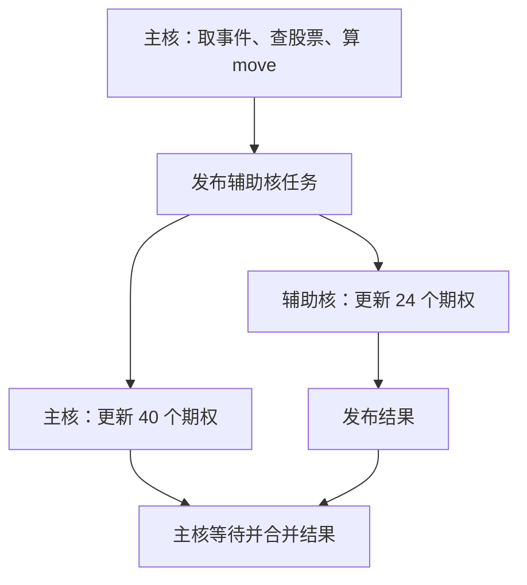

# The Latency Slippage 详细解读：高频交易热路径中的缓存、并行访存与跨核交接

这份笔记解读 Sanchit Gupta 的 **The Latency Slippage: Understanding the Hidden Costs of Caching for Low Latency C++**。作者来自 Graviton Research Capital，讲义共 63 页，封面标注 CppCon 2026，会议日期为 9 月 12—18 日。

原始材料：[本地 PDF：The_Latency_Slippage.pdf](The_Latency_Slippage.pdf)。下文页码均指 PDF 页码，与讲义页脚一致。作者在第 63 页提供了[实验代码仓库 CacheLatency](https://github.com/0xsanchit/CacheLatency)。本文于 2026 年 10 月 19 日补充核对了该仓库的计时、性能计数和统计代码，结果见[第 15 节](#measurement)。这次只读源码，没有编译运行实验，也未进行全仓库正确性审查。

这场分享围绕一个简化的期权重估程序，逐步把单事件处理时间的 p50 从 **510 ns 降到 329 ns**。计算目标保持不变，变化集中在数据什么时候取、一次取多少、哪些数据值得留在缓存，以及两个 CPU 核心怎样交接结果。这里讨论的是进程内计算延迟；讲义没有建立成交价格滑点模型，也没有证明这些改进能带来多少实际交易收益。

为便于判断结论的来源，本文区分四种内容：**讲义结果**是作者报告的实验和数字；**源码核对**是指定提交中可直接观察到的实现；**解释**是围绕这些证据建立的分析；**进一步实验**是尚未执行的验证方案。当前源码不自动证明讲义数字来自同一提交或同一次运行。文中的简化伪代码用于说明结构，不是可直接部署的交易代码。

## 目录

- [1. 先问程序在等什么](#1-先问程序在等什么)
- [2. 实验机器与时间单位](#2-实验机器与时间单位)
- [3. 一个行情事件如何变成一串内存依赖](#3-一个行情事件如何变成一串内存依赖)
- [4. 建立基线：缓存命中不等于没有等待](#4-建立基线缓存命中不等于没有等待)
- [5. 第一轮：用批处理释放内存级并行](#5-第一轮用批处理释放内存级并行)
- [6. 第二轮：为下一批数据安排预取](#6-第二轮为下一批数据安排预取)
- [7. 第三轮：读完一次的数据是否应该主动淘汰](#7-第三轮读完一次的数据是否应该主动淘汰)
- [8. 第四轮：把一次事件拆到两个核心](#8-第四轮把一次事件拆到两个核心)
- [9. 第五轮：消除共享缓冲区上的一次读回](#9-第五轮消除共享缓冲区上的一次读回)
- [10. 第六轮：理解 CLWB 的收益与保证边界](#10-第六轮理解-clwb-的收益与保证边界)
- [11. 把所有改动放回同一张结果表](#11-把所有改动放回同一张结果表)
- [12. 这些数字还没有回答什么](#12-这些数字还没有回答什么)
- [13. 如何复现与继续研究](#13-如何复现与继续研究)
- [14. 与 Gross 演讲怎样配合学习](#14-与-gross-演讲怎样配合学习)
- [15. 纳秒级延迟如何测量：计时、PMU 与统计边界](#measurement)

## 1. 先问程序在等什么

**讲义定位，见第 2—3 页。**作者日常优化生产交易进程的运行时间和抖动。这份材料关注三个问题：硬件预测接下来会访问哪条缓存行；谁持有这条缓存行，它处于什么状态；缓存空间不足时，应该留下谁、淘汰谁。讲义用 Prediction、Ownership、Retention 概括这三个方向。

一段代码即使已经没有动态分配、没有互斥锁、数据结构也连续存放，仍然可能花大量时间等待。原因是“连续存放”只描述地址布局，没有说明实际访问顺序、访问依赖和跨核状态。

例如，程序先读股票记录，才能知道应更新哪些期权。期权之间的计算可能相互独立，但如果每次都先等一个期权的数据、算完，再访问下一个，硬件能够提前执行的工作仍然有限。换成多线程以后，两个核心虽然能同时计算，却要通过一致性协议交换刚写出的数据。

**解释。**这里的优化对象可以看成一张依赖图：哪些步骤必须先完成，哪些请求可以同时在路上，哪些等待最终落在结果返回的关键路径上。指令数只是其中一个维度。只要减少的等待大于新增工作，即使多执行一些指令，事件也可能更早完成。

## 2. 实验机器与时间单位

**讲义结果，见第 4 页。**全部具体延迟都应放在以下环境中理解。

| 项目 | 讲义设置 |
|---|---|
| CPU | Intel Core i9-14900KS，Raptor Cove |
| 核心状态 | 4 个 P 核在线，SMT 关闭，使用隔离核心 |
| 核心频率 | 5.90 GHz |
| TSC 频率 | 3.1872 GHz |
| L1 数据缓存 | 每核 48 KiB |
| L2 缓存 | 每核 2 MiB |
| L3 缓存 | 36 MiB，共享 |
| 内存 | 64 GB DDR5，2 × 32 GB，4,800 MT/s |
| 计时方式 | 讲义写明 Fenced RDTSC；图中相应 cyc 为 TSC ticks，具体源码差异见第 15 节 |

作者首先测量各层访问成本：

| 数据来源 | 延迟 / ns | TSC ticks | 相对 L1 |
|---|---:|---:|---:|
| L1 | 0.85 | 2.70 | 1 |
| L2 | 2.71 | 8.64 | 3.2 |
| L3 | 12.29 | 39.2 | 14.5 |
| DRAM | 87.63 | 279 | 103 |

这些数字首先说明层次间的成本差异。一个从 DRAM 返回的数据，与一个已经在本核 L1 中的数据，可能相差两个数量级。但不能把表中数字乘以 miss 数，就得到整个事件的耗时：多个请求可能重叠，计算也可能覆盖一部分等待；后面还会看到，即使没有容量 miss，一致性交互也能产生明显延迟。

TSC 频率和核心频率必须分开。将 TSC 差值转换为纳秒，应使用 TSC 的换算关系；第 19 页的 IPC 则按核心周期解释。把“2.70 TSC ticks”写成“2.70 个执行核心周期”，会混淆两个时钟域。本文沿用作者的纳秒结果，不把这些数值推广为其他处理器的固定常数。

**源码核对补充。**仓库中的计时方式并不完全一致：单独的初版应用 `10a_options_basic.cpp` 使用裸 `__rdtsc()`；最终统一阶梯 `10g_options_clwb.cpp` 使用 `LFENCE + RDTSC`；单次 load 微基准还有更完整的前后屏障和空窗口扣除。不能仅凭第 4 页的一句说明，就认为每个实验文件都采用同一个计时封装。文件定位、具体边界与统计限制集中说明于[第 15 节](#measurement)。

## 3. 一个行情事件如何变成一串内存依赖

### 3.1 从业务动作到访存动作

**讲义场景，见第 8—12 页。**系统每 5 μs 接收一个 192 B 的事件，事件从 8 MiB 环形缓冲区读取。事件指出某只股票的新价格；消费者找到股票记录，计算价格变化，再更新这只股票对应的 64 个期权。

每个股票记录保存前次价格，以及 64 个持仓条目的期权 ID 和 delta。每个期权记录占 128 B，跨两条 64 B 缓存行。计算后，alpha 超过阈值的期权 ID 被收集起来，成为该事件的结果。


图中最关键的依赖在 C 之前：**股票记录尚未到达，就还不知道应请求哪些期权地址。**这类依赖无法靠单纯增加执行单元消除。到达 C 之后，64 个期权的更新才有机会并行展开。

下面是根据第 11 页改写的结构示意：

```text
等待事件发布
stock = 股票表[event.stock_id]
move  = event.price - stock.last_price
stock.last_price = event.price

for holding in stock.holdings:
    option = 期权表[holding.option_id]
    option.price += move × holding.delta
    option.alpha = evaluate(option.price, option.market_price, option.state)
    if option.alpha > threshold:
        输出 option.id
```

这里的 delta 更新和 alpha 函数提供一个有业务外形的计算负载。讲义没有公开一个经过金融验证的盈利策略，因此学习重点是数据依赖和执行结构，而不是把示例公式视为可交易信号。

### 3.2 为什么缓存容量会成为问题

**讲义统计，见第 9—10 页。**股票表有 8,192 条记录，其中 90% 的行情命中 1,024 只股票；期权表有 524,288 条记录。一次运行测量 200,000 个事件，实际访问约 42.7 MiB 的表数据，加上不断流过的 8 MiB ring，达到约 50.7 MiB，超过 36 MiB L3。

| 一次事件访问的数据 | 大小 | 缓存行数 |
|---|---:|---:|
| 行情事件 | 192 B | 3 |
| 股票记录 | 576 B | 9 |
| 64 个期权 | 8,192 B | 128 |
| 合计 | 8,960 B | 140 |

这张表给出一个优化优先级：绝大多数数据来自期权遍历。与此同时，读过即不再需要的事件数据也会进入缓存，与下一次可能复用的股票、期权记录争夺空间。由此自然引出两种不同工作：让必要的读取尽早开始；减少无价值数据对缓存的占用。

## 4. 建立基线：缓存命中不等于没有等待

**讲义结果，见第 13 页。**初版每事件 p50 为 510 ns，p90 为 1,012 ns，约退休 8,142 条指令。计数器统计的每事件读取落点为 L1 222.2、L2 19.2、L3 103.7、DRAM 6.6。

这些读取计数不能和前面的 140 条缓存行直接相加比较：前者描述动态访问，后者描述一次事件涉及的数据行，重复读取同一条行也可能产生多个命中。当前源码使用 `MEM_LOAD_RETIRED.L1_HIT` 等事件，并排除轮询；但 PMU 窗口比业务 TSC 区间更宽，不能把所有计数都解释成该计时区间内的业务访存。具体区别见[15.6 节](#measurement-windows)。

**解释。**基线说明，相当多的数据没有落到 DRAM，却依然有优化空间。L3 命中比 L1 慢，而且 CPU 只有在拿到依赖数据后才能继续某些计算。若一次事件不断遇到“请求—等待—计算—再请求”，总时间就会被这些串行等待拉长。

因此，第一步并不一定要降低 miss 数。也可以保留相同的 miss，让它们尽可能同时发生。后面的 MLP 实验正是用“miss 数几乎不变，但时间下降”来检验这个解释。

## 5. 第一轮：用批处理释放内存级并行

### 5.1 瓶颈在循环展开到哪里

**讲义分析，见第 15—17 页。**原循环每获取一个期权的数据，就执行约 25 个有依赖的浮点运算，再处理下一个。虽然期权之间相互独立，乱序执行窗口仍可能被这些指令占住，来不及向前看到足够多的独立访存。

作者把循环改成两遍：第一遍收集一小批期权需要的价格和状态，第二遍对这批数据计算 alpha 并写回。收集阶段仍可能有简单算术，但把较长的计算链从逐条取数之间移开了。

```text
for 每批 D 个期权:
    for 这批中的每个期权:
        暂存 ID、新价格、市场价格、状态

    for 暂存的数据:
        计算 alpha
        写回价格和 alpha
        按阈值收集结果
```

这里的“批处理”发生在**一个事件内部的 64 个期权之间**，不需要等多个行情攒齐。这一点对低延迟系统很重要：吞吐优化中常见的跨消息攒批，会引入等待消息的时间；本例重新排列的是已经可用的工作。

### 5.2 为什么批次不能无限扩大

**讲义实验，见第 5—7 页。**缺失请求需要占用 fill buffer，直到对应缓存行返回；后续访问同一条未返回的行可以合并，而不一定新占一个槽位。作者用多条独立的指针追逐链测量并行能力，并结合计数器判断该核心至少有 16 个 fill buffers：至少 16 个请求未完成的周期占比为 29.7%，至少 17 个为零。

这提供了一个资源上限，而不是“批次固定等于 16”的调参答案。一个期权跨两条行，还有其他需求读取和预取要竞争资源；能同时发出的有效请求还受地址依赖、乱序窗口等约束。

第 18 页显示，D=64 时因 fill buffers 满而停顿的周期达到 1,001。把整个事件的数据一次全取出来，可能制造过大的瞬时请求压力。D 太小又没有足够的独立工作，两端都可能输给中间值。

### 5.3 测量怎样支持“重叠等待”的解释

**讲义结果，见第 19—20 页。**最终采用 D=4，p50 从 510 降至 469 ns，p90 从 1,012 降至 776 ns；指令数从 8,142 增至 9,191，L3 命中从 103.7 到 104.0，几乎不变。作者报告指令数增加约 12.9%，IPC 增加约 24.6%，中位周期下降约 7.9%。

这组证据比较完整：数据没有神奇地变小，miss 也没有消失；程序多做了收集和第二遍循环，却减少了等待的串行程度。对 HFT 热路径而言，应优化结果完成时间，而不是单独追求最少指令。

**适用边界。**这种重排要求期权之间确实独立。如果前一个更新会影响后一个计算，或者写回顺序本身是业务语义的一部分，就必须重新证明等价性。临时数组、寄存器压力和代码体积也可能抵消收益，需要随目标函数一起测量。

## 6. 第二轮：为下一批数据安排预取

### 6.1 把计算时间变成取数的提前量

**讲义方案，见第 22—25 页。**批处理已经让当前批次的读取重叠，但执行到它时仍可能等待。作者于是利用已经读到的股票记录，提前知道下一批期权的地址，在计算当前批次前发出下一批的 `_mm_prefetch`。

一个期权跨两条缓存行，alpha 会用到两条行中的字段，所以两条都预取。当前批次的 alpha 计算为下一批取数提供时间；第一批依靠自己的 gather 发起并行读取，预取收益从后面的批次开始出现。

软件预取不把结果放入普通目标寄存器，不会像需求 load 那样形成必须等待数据的直接依赖。但它仍然消耗资源。作者指出，L1 未命中的预取也会占用 fill buffer，与真正需要完成的需求读取竞争。

### 6.2 距离要足够，也要有用

**解释。**可以用一个定性关系理解调参：

```text
预取提前量 ≈ 预取发出后、真正使用前的可执行工作时间
```

提前量太小，使用数据时请求还在路上；太大，则可能占据资源太久，或在使用前又被挤出去。这个关系只是分析工具，真实执行中的重叠和缓存状态仍需测量。

第 28 页的参数扫描中，D=4 给出最好的 p50 394 ns，D=16 给出最好的 p90 645 ns。D=2 时每事件有 172 次读取撞上仍未完成的预取，D=4 为 17 次。D=64 覆盖整个事件，没有下一批可提前请求。

这里已经出现一个重要选择：**最优中位数与最优 p90 不一定在同一个参数上。**如果目标是控制较慢事件，应按相应分位数选择，而不能只看平均值或 p50。

### 6.3 为什么 T0 好，NTA 反而差

**讲义对照，见第 26 页。**在 D=16 的同一批处理结构上，作者比较三种提前访问方法：

| 方法 | p50 / ns | p90 / ns |
|---|---:|---:|
| 仅批处理 | 520 | 776 |
| 加 T0 预取 | 505 | 655 |
| 用真实 load 提前读取 | 550 | 831 |
| 加 NTA 预取 | 856 | 1,012 |

真实读取会带来额外指令、寄存器及依赖成本；NTA 的非临时局部性提示，则不适合本例中可能在后续事件继续复用的期权数据。讲义将它概括为过早丢掉了还会再用的数据。

这里应把**提示的意图、具体 CPU 的实现和测得的结果**分开。不能推导出“NTA 总是无效”，也不能把某种提示理解为数据必然按指定路径留在指定缓存层。对一次性大规模流数据与反复访问的期权表，应分别选择策略。

第 61 页统一汇总的预取阶段为 414 ns / 710 ns，与参数扫描中的 394 ns / 645 ns 不同。本文保留各自实验语境；不拿扫描中的最小值替换最终阶梯中的结果。

## 7. 第三轮：读完一次的数据是否应该主动淘汰

### 7.1 从“尽早取到”转向“值得留下”

**讲义问题，见第 30—32 页。**每个事件的三条缓存行读过之后，本轮处理就不再需要。但它们已进入缓存，可能挤掉未来还要访问的期权记录。作者在处理结束后，对事件的三条行调用 `CLFLUSHOPT`，尝试释放缓存空间。

`CLFLUSHOPT` 会使目标行在一致性域内的缓存层次中失效；若存在脏数据，还涉及写回。它的排序约束比传统 `CLFLUSH` 更宽松，因而多个操作有更多机会重叠。精确的排序规则应按目标平台指令手册理解，不能把“opt”理解成免费操作。参见 [Intel SDM 的 CLFLUSHOPT 说明](https://cdrdv2-public.intel.com/868137/325462-089-sdm-vol-1-2abcd-3abcd-4.pdf)。

### 7.2 主示例中的收益其实很小

**讲义结果，见第 33 页。**加入清除后，p50 从 414 降到 409 ns，p90 从 710 降到 705 ns。作者还观察到等待 L1D miss 的停顿周期下降约 21.9%。后一个指标下降明显，并不代表整个事件也会同比变快，因为其他部分仍然占时间。

这种只改善约 1% 的结果，尤其需要重复测量和检查噪声。不能因为指令名称听起来适合缓存管理，就把它加到所有消息消费路径里。

这里的改善指讲义报告的计时指标。当前统一阶梯源码在截取结束时间戳后才执行事件上的 CLFLUSHOPT 和 MFENCE，未把这部分收尾开销计入该区间；是否改善完整事件周期或持续吞吐，还要单独测量，见[15.3 节](#measurement-boundaries)。

### 7.3 反例揭示了成立条件

**讲义独立实验，见第 34—35 页。**作者设置“读一次的流数据 + 反复查询的热表”，改变热表大小，比较有无缓存压力：

| 条件 | 保留流数据 | 使用 CLFLUSHOPT | 变化 |
|---|---:|---:|---:|
| 缓存有压力 | 106.4 ns | 92.6 ns | 降低约 12.9% |
| 缓存无压力 | 83.2 ns | 86.4 ns | 增加约 3.8% |

没有值得保护的热数据时，清除只是额外开销；有压力时，释放空间才可能偿还成本。传统 `CLFLUSH` 在该独立实验里表现更差，作者报告约 807 个周期，强调其更严格排序带来的影响。

**解释与边界。**使用前要确认“谁还会读取这条行”。如果下游线程还要读事件，或者几个对象共享一条缓存行，清除可能直接伤害另一条路径。ring 的槽位未来还会复用，也不能把“本次消费后不再读”扩大解释成物理地址永远不再使用。

## 8. 第四轮：把一次事件拆到两个核心

### 8.1 并行计算并不等于平均分配

**讲义方案，见第 36—39 页。**64 个期权之间独立，因此作者把其中 24 个交给辅助核心，主核心保留 40 个。主核心仍负责轮询事件、读取股票记录、计算价格变化；请求携带辅助核心需要的 ID、delta 和 move，避免它重新走一遍股票查找依赖。



请求与结果分别通过发布和获取操作交接。本文只用图说明顺序，不把讲义中的缓存行示意图当成结构体布局证明；若复现，仍需查看真实类型的大小、对齐与字段位置。

为什么辅助核只拿 24 个？作者希望它在主核完成自身计算前返回，使其计算时间被主核工作覆盖。平均分成 32/32 未必最好，因为辅助核还有收到请求后的启动时间和结果交接成本。

### 8.2 看最后结束的是谁

**解释。**忽略部分细节，可以把事件时间写成：

```text
串行准备时间
+ max(主核计算时间, 请求交接 + 辅助核计算 + 结果交接)
+ 合并结果时间
```

这个表达式不是讲义拟合出的公式，而是帮助识别关键路径的近似模型。只优化较早结束的一支，未必能缩短整个事件；多加一个核心也无法消除前面的串行准备。

**讲义结果，见第 40 页。**双核使 p50 从 409 降至 364 ns，p90 从 705 降至 575 ns。作者报告主核跨度约 365 ns，辅助核跨度约 298 ns，主核仍然最后完成。它们不等于两个核心各自的纯计算时间。当前源码的主核和辅助核跨度都使用主核事件开始时刻作为起点，因此辅助核指标还包含串行准备和请求交接。不能把这些数值直接相减当成同步开销；边界见[15.3 节](#measurement-boundaries)。

收益约为中位数的 11%，说明并行化确实有效，也说明这段程序的总时间远不只是 64 次可以任意均分的算术。

## 9. 第五轮：消除共享缓冲区上的一次读回

### 9.1 看起来等价的两个参数

**讲义改动，见第 41—44 页。**主核把 `move` 写进共享请求，通知辅助核后，又从请求里取回它，用于计算自己的 40 个期权。作者把该参数替换为主核已经持有的局部 `move`。

```text
发布之前：shared_request.move = local_move

原来：计算主核部分(shared_request.move)
改后：计算主核部分(local_move)
```

业务值相同，但取值路径不同。辅助核正轮询和读取这条共享行，导致它参与跨核一致性交互；“我刚写过”不能保证下一次读取仍是本核 L1 命中。

**讲义结果。**去掉这次读回后，p50 从 364 降至 344 ns，p90 从 575 降至 555 ns。主核自身区间从 365 降至 359 ns，snoop forwards 从每事件 0.96 降至 0.82。各统计量来自不同观察维度，不应把 20 ns 的事件改善机械等同于那条 load 的独立成本。

### 9.2 一致性成本不需要容量 miss 才能出现

**讲义微基准，见第 46—49 页。**作者先让某核心持有一条已知状态的数据，再让另一核心读取，最后测量原核心的再次访问。

| 场景 | 原核心的操作耗时 |
|---|---:|
| 自己持有脏行，另一核心未读，再读 | 0.81 ns |
| 自己持有脏行，另一核心读过，再读 | 27.70 ns |
| 自己持有干净行，另一核心读过，再读 | 0.97 ns |
| 无其他核心副本时写入 | 2.80 ns |
| 另一核心有副本时写入 | 53.82 ns |

实验报告 L3 misses 为零，说明差异来自一致性过程，而非工作集放不下。写入共享行时，需要获得写权限并处理其他副本；读回脏行也可能需要从对端取得数据。

第 48 页用 M、E、S、I 状态解释观察到的行为，其中脏行被对端读取后原持有者失效，是作者在该平台上的观察。学习时应记住“脏行交接可能改变本核后续访问成本”，不要把这张实测图当作所有 MESI 实现的完整状态转移规范。

## 10. 第六轮：理解 CLWB 的收益与保证边界

### 10.1 数据离开 L2 后，未必按想象留在 L3

**讲义实验，见第 50—55 页。**作者通过让持有者扫描不同大小的数组，把目标行从私有缓存逐步挤出，然后测量另一核心的一次读取。每轮用双向握手建立条件，避免依赖猜测的线程时序。

干净行由另一核心持有时，读取约需 25—29 ns；当两个对端共享干净行时，作者观察到 L3 可直接响应，约为 12.7 ns。对脏行而言，留在对端 L1/L2 时也约为 28—30 ns，但被挤出 L2 后达到 94.8 ns，伴随接近每次一次的 L3 miss。

作者的解释是：该客户端 CPU 的 L3 既不严格 inclusive，也不严格 exclusive。L2 中存在某条行，并不决定 L3 必然有或没有副本；L2 淘汰时是否在 L3 分配，也受到启发式影响。这次实验中的干净行被保留，脏行却写向了内存。

讲义第 55 页明确指出，相关启发式未公开、可以改变。这是整场分享最重要的边界之一：测量能帮助我们理解当前机器，但不自动产生跨架构保证。

### 10.2 CLWB 与 CLFLUSHOPT 解决不同问题

**讲义方案，见第 57—60 页。**对于已经读完的 ring 数据，作者希望把它移走；对于辅助核刚生成、主核马上要读的结果，希望减少主核去辅助核取数据的成本。因此后者尝试 `CLWB`，写回脏数据，并在该实验中形成可由 L3 响应的状态。

第 58 页微基准报告：对脏行使用 CLWB 后，读取从 29.9 降至 12.1 ns，snoop 转发消失，L3 命中增加；对干净行只从 28.4 到 26.2 ns，因为没有脏内容需要写回，状态变化不同。

应用中，作者只在辅助核向主核的结果路径加入该操作。讲义将一个指标称为主核等待时间，报告其从 111 降至 97 ns，snoop forwards 从每事件 0.87 降至 0.34。最终 p50 从 344 降至 329 ns，p90 从 555 降至 550 ns，辅助核并没有少算期权。需要收紧“等待”的解释：当前源码的 `wait_tk` 是主核合并完成时刻减去辅助核结果时间戳，包含结果发布、传播、主核观察和读取合并等阶段，不能直接当成主核自旋等待耗时。详见[15.3 节](#measurement-boundaries)。

### 10.3 “推到 L3”是实验解释，不是指令承诺

**架构边界。**Intel 对 CLWB 的说明是写回脏缓存行，硬件可以把它以非修改状态保留在缓存层次中；保留属于性能提示，硬件可选择层级，也可能使其失效。因此，CLWB 不保证“指定保留在 L3”，也不保证调用方随后一定 L1 命中。参见 [Intel 对 CLWB 留存行为的说明](https://edc.intel.com/content/www/us/en/design/platforms/core-processor-series-3-datasheet-volume-1-of-2/001/cache-line-write-back-clwb/)。

讲义第 59 页还有一个容易被标题掩盖的细节：代码先写结果并发布 `res.seq`，随后遍历结果行执行 CLWB，最后执行 `MFENCE`。也就是说，不能仅凭这段代码就声称“主核看见完成标志前，所有行已写回完成”。结果可见性的发布协议与缓存写回的性能效果，需要分开分析。

这里的收益依赖主核何时读取、辅助核何时写回，以及缓存实际如何响应。复现时应保留原顺序进行对照，再单独研究顺序变化。也不能用 CLWB 或 flush 替代 C++ 的原子发布协议；缓存指令的成本优化不替代对象生命周期、数据竞争和内存可见性的正确性证明。

## 11. 把所有改动放回同一张结果表

**以下全部数字来自第 61 页最终汇总图，单位为每事件纳秒。**每一行在上一行基础上增加一项改动。

| 累积版本 | p50 | p90 | 本轮主要解决的问题 |
|---|---:|---:|---|
| 初始逐个处理 | 510 | 1,012 | 基线 |
| 批处理 D=4 | 469 | 776 | 独立缺失请求重叠不足 |
| 增加 T0 预取，D=4 | 414 | 710 | 下一批取数开始太晚 |
| 对事件三条行使用 CLFLUSHOPT | 409 | 705 | 一次性数据占用缓存 |
| 双核，辅助核处理 24/64 | 364 | 575 | 独立期权计算可并行 |
| 去掉共享缓冲区的一次读回 | 344 | 555 | 不必要的一致性交互 |
| 结果路径增加 CLWB | 329 | 550 | 辅助核结果交接等待 |

按这张表计算，p50 降低约 **35.5%**，p90 降低约 **45.7%**。这表明改动对分布不同位置的收益不同；尤其批处理对 p90 的改善比对 p50 更明显。

第 18、26、28 页包含参数扫描或单独对照，其数值与最终阶梯并非完全一致。第 32—33 页对退休指令增量的展示也有差别。学习时应保留每组实验的上下文，不把不同页面的最好数字拼成一条从未完整测量过的结果链。

第 62 页的总结是计算目标相同、缓存行为改变。它表达的是优化方向，不意味着所有机器指令保持不变：批处理、预取、清除和写回都添加了工作，报告的计时区间出现了改善；完整消费者循环的净收益还取决于区间外工作，不能只靠这一张表判断。

**计时口径补充。**当前最终阶梯源码在主核处理并合并结果后截取结束时间戳，随后才执行事件上的 `CLFLUSHOPT`、`MFENCE` 和直方图更新。这些后续操作不包含在该事件 TSC 区间内，因此应把表格理解为讲义报告的指定处理区间，不能扩展为整个消费者循环的全部成本。源码证据见[15.3 节](#measurement-boundaries)；本次没有重跑代码来确认其与讲义结果逐项对应。

## 12. 这些数字还没有回答什么

首先，这是一个受控的示例工作负载。它说明缓存和一致性足以影响几百纳秒的处理路径，但不覆盖完整的行情接收、协议解码、风控、订单编码、NIC 发送与交易所响应。不能将 329 ns 写成端到端 tick-to-trade，更不能解释成订单成交耗时。

其次，p90 还不足以描述最慢的事件。讲义没有给出完整的 p99、p99.9、最大值、跨运行置信区间或长时间漂移结果。当前源码会计算 p99，但使用有限范围的直方图，超范围样本会合并到最后一桶，不能据此恢复完整长尾。200,000 个事件中的 p99.9 以上只涉及约 200 个样本；即使另行报告这个分位数，也需要审视样本规模和重复性。桶宽和范围见[15.7 节](#measurement-histogram)。

第三，实验以每 5 μs 一个事件驱动。高频交易中，突发行情可能让事件排队；批处理和预取改善服务时间，不等于排队后的响应时间也按相同比例变化。若压测由消费者完成上一事件后才发送下一事件，甚至会避开过载时最重要的等待。

第四，处理器、微码、编译器、核心拓扑、内存配置和工作集分布都可能改变最佳参数。这里的 16 个 fill buffers、D=4、40/24 分工和 CLWB 效果，是需要迁移验证的实验发现。

最后，程序正确性是所有性能结论的前提。重排独立更新、共享请求的生命周期、输出列表合并以及 ring 槽位复用，都应在真实实现里核对；仅有纳秒分布不能证明计算结果与并发协议正确。

## 13. 如何复现与继续研究

以下是**尚未执行的复现方案**，不表示本文已编译作者代码或复现任何数值。

### 13.1 先固定可比较的基线

记录 CPU 型号、微码、缓存大小、核心拓扑、SMT、频率策略、内存、操作系统和编译器。选择具体物理核心并确认计时线程不会迁移；确认目标 CPU 支持所需指令。保留作者版本和编译选项，再记录本机为运行它所作的任何改动。

检查计时区间是否只覆盖事件处理，起止点是否包含等待、合并和屏障；分别记录空计时区间开销。TSC 换算使用确认过的频率，跨核时间戳要验证可比较性。先检查每个版本输出一致，再进入性能比较。

### 13.2 每轮只改变一个可解释因素

| 实验组 | 改变的变量 | 主要检查 |
|---|---|---|
| MLP | D=1、2、4、8、16、32、64 | miss 数是否稳定，停顿与 IPC 如何变化 |
| 预取 | 距离、提示、预取一条或两条行 | 请求是否来得及，资源是否被挤占 |
| 缓存淘汰 | 热表大小、流数据量、是否清除 | 有压力才获益的条件能否重现 |
| 双核 | 分工比例和核心位置 | 哪条分支最后结束，等待在哪里 |
| 共享读回 | 局部值与共享值 | 是否产生预期 load 和一致性流量 |
| CLWB | 脏/干净行、写回时机、核心拓扑 | L3 响应、snoop 和事件时间是否一起变化 |

计数器事件名与含义需要按目标微架构核对，不能直接复制另一代 CPU 的事件编码。检查反汇编，确认编译器确实生成预期的读取、预取或写回，也确认循环没有被消除。若性能计数器需要复用，应记录测量方法对可信度的影响。

### 13.3 把噪声、分布和负载变化纳入比较

每种版本运行多轮，交错版本顺序，避免把温度、频率或后台活动随时间变化误认成优化收益。保留原始事件样本及异常事件，不只打印一个 p50。对 414→409 ns 这种小差别，尤其应检查跨轮波动。

进一步加入不同热点分布、不同期权数量和大于缓存的工作集。使用按预定时刻到达的事件流，记录到达时间与完成时间，在稳定流量和突发流量下分别观察服务时间、队列等待、吞吐与丢弃情况。

扩展到 p99/p99.9 时增加样本和重复轮次，检查慢事件是否与缺页、调度、频率变化或其他共享资源相关。若最佳 p50 与最佳尾部分位数冲突，按交易路径的目标选择，并记录资源代价。

### 13.4 把“支持解释”与“证明机制”分开

例如，“加 CLWB 后更快”只证明该版本在该次测量中更快。若同时观察到 snoop 减少、L3 命中增加，并在干净行对照里收益较小，才更有理由支持作者提出的机制解释。

还可以在另一代 CPU 上重复微基准，看看结果是普遍趋势还是平台特征。若机制没有复现，应保留负结果：它能帮助建立适用边界，比强行寻找一个更快数字更有学习价值。

## 14. 与 Gross 演讲怎样配合学习

本笔记可以和 [When Nanoseconds Matter 详细解读](When_Nanoseconds_Matter_详细解读.md) 配合阅读。Gross 的分享提供更广的低延迟工程视角；本讲义则沿一个具体事件，把缓存访问、请求重叠和跨核状态拆到可测量的层次。

阅读时可以不断追问：地址何时才知道？下一条独立请求为什么还没有发出？当前缓存里哪些数据以后还会用？这条共享行刚被谁读写过？最后一个结果在等哪一步？这些问题把源代码的形状、CPU 的实际工作和交易事件的完成时间联系起来，也为后续实验给出清晰方向。

<a id="measurement"></a>

## 15. 纳秒级延迟如何测量：计时、PMU 与统计边界

本节补充回答两个问题：几百纳秒的事件处理时间是怎样量出来的？判断缓存、并行访存和一致性瓶颈时，profiling 应该观察什么？

**来源范围。**讲义第 4、46—47、50—52 页给出了计时设置和微基准方法；更完整的实现来自作者仓库。源码核对固定在提交 [`5ea23c07d524a057179e6db52b8038131927ffd1`](https://github.com/0xsanchit/CacheLatency/tree/5ea23c07d524a057179e6db52b8038131927ffd1)，不是本地 TradingSystemLearning 项目的交易代码。以下没有复现原作者的性能数字，也不假定该提交就是生成讲义所有图表的版本。

### 15.1 先区分三种观察尺度

| 要回答的问题 | 观察对象 | 合适的结果 |
|---|---|---|
| 一次行情计算多久完成？ | 消费者中的指定业务区间 | 逐事件时间戳差值与分位数 |
| 这一次内存访问为什么慢？ | 已准备好缓存状态的一次 load 或 store | 受控微基准的访问时间及对照 |
| 一段工作为什么浪费周期？ | 指定线程、指定阶段的硬件事件 | 指令、周期、miss、停顿和一致性计数 |

第一种描述业务延迟，第二种隔离机制，第三种帮助归因。它们可以互相支持，却不能互相替代。整个进程的墙钟时间除以消息数，可能把等待、准备和收尾也算进去；硬件计数器除以消息数，则得到平均计数，并不能告诉你是哪一次消息出现了 p99 延迟。

作者的框架也有用 `steady_clock` 测量整个 case 的外层区间。对于自行打点的应用和单次访存实验，真正对应问题的是实验自己的指标，不能把外层 case 的平均时间当成内部目标操作的延迟。[测量框架][measurement-harness]

### 15.2 TSC 的单位与三种实际打点方式

讲义第 4 页报告 TSC 频率为 3.1872 GHz，核心频率为 5.90 GHz。对 TSC 差值，换算关系是：

```text
时间 / ns = TSC 计数差 / TSC 频率（GHz）
例如：1496 / 3.1872 ≈ 469 ns
```

计算 IPC 时使用的核心周期与 TSC ticks 不是同一种计数。源码的 `tsc_hz()` 尝试读取 CPUID 的频率信息；其中也有针对平台的回退假设，迁移时仍须核实，不能把讲义频率硬编码到另一台机器。[TSC 频率读取][measurement-tsc]

更容易混淆的是，仓库并非只有一个计时封装：

| 实验文件 | 当前源码中的做法 | 说明 |
|---|---|---|
| `10a_options_basic.cpp` | 业务计算前后直接读 `__rdtsc()` | 单独的初始应用实验 |
| `10g_options_clwb.cpp` | `stamp()` 内执行 `LFENCE`，随后 `RDTSC` | 在同一套模板中比较多个优化阶段 |
| `06_dirty_line_level.cpp` | 目标 load 两侧均使用 `LFENCE → RDTSC → LFENCE` | 单次访问微基准，并扣除空窗口开销 |

`10g` 的注释明确讨论了未加屏障时读钟可能提前的问题，统一使用 `stamp()`。因此不能从 `10a` 推断最终阶梯也使用裸 RDTSC，也不能从讲义的一句 Fenced RDTSC 推断所有文件采用完全相同的封装。[初始应用打点][measurement-basic]、[最终阶梯的 stamp][measurement-stamp]、[单次 load 打点][measurement-load]

**解释。**计时读数需要真正夹住被测工作。CPU 执行顺序与编译器变换都可能改变这件事；声明一个变量为 `volatile`，或让编译器保留结果，并不自动建立所有需要的硬件顺序。表中记录的是作者的实际写法，不是对任意 load、store、跨核发布都适用的通用计时模板。复现时应结合目标操作的完成语义与生成汇编检查边界。

<a id="measurement-boundaries"></a>

### 15.3 最终应用到底从哪里量到哪里

`10g_options_clwb.cpp` 的主核流程可以按时间顺序写成：

```text
关闭 PMU 计数
轮询：等待目标行情事件
开启 PMU 计数，确认事件未被覆盖

pub = stamp()                         ← 事件 TSC 起点
    查询股票、计算 move
    双核模式下发布辅助核任务
    主核处理自己的期权
t_own = stamp()                       ← 主核分支完成
    双核模式下等待结果、读取并合并
curr = stamp()                        ← 双核事件 TSC 终点

可选的事件 CLFLUSHOPT
MFENCE
累计耗时、更新直方图
下一轮再关闭 PMU
```

单核模式也在计算完成后另取结束时间戳。由此可见，**行情尚未到达的轮询不属于事件处理延迟；清除事件缓存行和统计记录也不属于该 TSC 区间。**它们仍然影响完整循环的资源消耗和下一事件的开始时间。

这使得 `+CLFLUSHOPT` 的比较有了更准确的含义：它可能改善后续事件的缓存条件，而当前实现没有将本次清除及其后的屏障计入当前处理时间。要判断整个服务是否更有效率，还应测量完整周期、持续吞吐，以及有排队时的到达至完成延迟。[最终应用计时边界][measurement-consumer]

双核版本还有三个名称相近、含义不同的跨度：

| 指标 | 当前代码的计算方式 | 实际覆盖 |
|---|---|---|
| 主核跨度 | `t_own - pub` | 主核从事件起点到自己一支完成，包括准备与任务发布 |
| 辅助核跨度 | `g_res.tsc - pub` | 从主核事件起点到辅助核记录结果时间戳，包括启动前的串行准备与交接 |
| `wait_tk` | `curr - g_res.tsc` | 从辅助核结果打点到主核读取并合并结束，不是纯自旋等待 |

辅助核记录时间戳后才发布结果标志，再根据版本执行 CLWB 与 MFENCE。`g_res.tsc` 因此也不能解释为“所有写回已经完成”。如果要测纯粹的主核等待循环，需要另外记录进入等待的位置。跨核相减还依赖两核 TSC 的可比较性；本次只核查代码，没有实测它们的偏差。[主核跨度与等待统计][measurement-consumer]、[辅助核完成路径][measurement-aux]

### 15.4 一次 load 怎么测：控制状态，避免把后续命中当成首次访问

PDF 第 46、51 页的技巧是每轮先准备缓存状态，再让读者进行一次目标访问。准备动作包括另一核心读或写目标行，以及扫描不同大小的数组，让容量压力改变目标行所在层级。双方使用握手确认轮次，而不是靠 sleep 猜对方已经准备完。

如果先做一次跨核读取，再对同一地址连续读一百万次求平均，后面的访问很可能已经命中本核缓存。这个平均值无法代表最初那一次跨核访问。因此微基准的循环不仅要重复计时，还要重新建立要研究的状态。

`06_dirty_line_level.cpp` 的结构是：

```text
等待本轮准备完成                     ← 不在目标 TSC 区间
开启计数
LFENCE → RDTSC → LFENCE
    一次目标 load，保留读出的结果
LFENCE → RDTSC → LFENCE
关闭计数
在区间外使用结果，并完成本轮握手
```

空窗口在初始化时测量一次，逐次访问时间再减去它。PDF 第 46 页也直接展示了 `timed_touch(...) - overhead`；第 47 页给出 4,096 轮以及 empty window 对照。这里不能把扣除或对照后的亚纳秒数值，当成两次 RDTSC 加屏障的原始开销。[空窗口校准][measurement-empty]、[逐轮访问和扣除][measurement-rounds]

**进一步实验。**一次空窗口样本可能受偶发扰动影响。更稳妥的复现应同时保留原始与校正结果，重复测量空窗口分布，并检查扣除是否使结论过度依赖某个校准值。计时器本身也会改变被测代码布局和执行状态，扣除一个常数不能消除全部扰动。

### 15.5 Profiling 的核心是用计数器检验机制

这些实验的主要归因手段是 PMU 硬件事件计数。它与 `perf record` 式调用栈采样回答不同的问题：后者帮助定位持续执行的热点，前者检查特定区间发生了多少次硬件事件。稀疏、极短的函数未必能获得足够采样，业务逐次延迟仍需单独打点。

| 指标 | 希望验证的假设 | 对应讲义位置 |
|---|---|---|
| L1/L2/L3 命中与 L3 miss | 数据来自哪一层，布局或容量压力是否变化 | 第 13 页 |
| 未完成的 miss 数与 fill-buffer-full 停顿 | 请求是否重叠，批次是否超过硬件资源容量 | 第 7、18 页 |
| 指令数、核心周期、IPC | 新增工作是否换来了更少等待 | 第 19 页 |
| 等待 L1D miss 的停顿 | 预取或缓存清除是否减少等待 | 第 26、33 页 |
| snoop forwards | 读取是否需要从其他核心取得数据 | 第 43、53—54、60 页 |

例如，批处理后 miss 数几乎不变、指令数增加，但周期减少，支持“访存等待更多地重叠”的解释；CLWB 后 snoop 减少并伴随 L3 命中增加，则为交接路径变化提供证据。只有耗时降低，不足以确认究竟是哪种机制生效。

当前实验框架的实现链路是：

```text
libpfm 将事件名称编码
    → perf_event_open 创建计数器组
    → ioctl 启停计数
    → read 一次读取组结果
    → 按事件数或同一轮核心周期归一化
```

每轮放入最多四个目标事件，并带上 cycles 和 instructions；需要更多指标时分多轮重跑。组 leader 设置 `pinned=1`，读取时要求 `time_running` 非零且等于 `time_enabled`。不满足时直接失败，而不是输出经过缩放的估计值。[PMU 组实现][measurement-pmu]、[分组与归一化][measurement-harness]

这是值得学习的检查：硬件计数器槽位有限，事件被时间复用后，perf 可以按实际运行时间缩放总数；这些值是估计，尤其在负载分阶段变化时不能无条件当成精确计数。[Linux perf 对 multiplexing 的说明](https://man7.org/linux/man-pages/man2/perf_event_open.2.html)

`pmu.h` 注释还提到另一条 RDPMC 路径，但本节核对的 `src/exp/harness.h` 调用的是上述事件组实现，不能仅凭注释就说这些实验在每条消息中使用 RDPMC。

<a id="measurement-windows"></a>

### 15.6 降低 profiling 干扰，同时核对计数与计时的窗口

框架先运行计时轮，再运行 PMU 计数轮。在未打开 PMU 组的计时轮中，`counters_on/off` 不执行系统调用；计数轮则使用开关排除轮询、握手或准备阶段。[计数开关][measurement-gating]

把测量拆开能降低干扰，但计数轮本身仍会改变负载。`10a` 的注释直接说明，逐事件开关计数的 ioctl 开销会使消费者落后于每 5 μs 的输入节奏，严重时生产者绕环覆盖消息；代码因此会跳过并统计已丢失的事件。[初始应用中的落后处理][measurement-basic]

还有两个读表时必须保留的区别：

- **PMU 窗口不等于 TSC 区间。**最终消费者在开始时间戳前打开 PMU，到下一轮才关闭；收尾清除、屏障、直方图以及部分驱动工作仍可能计入。即使配置了 `exclude_kernel`，用户态调用、变量访问与统计代码也不会自动消失。把总计数除以事件数之后，仍不能称其为纯业务区间的逐事件计数。
- **运行分开，不代表最终输出完全分开。**`take_metrics()` 在计时轮和计数轮后都会调用，按首个业务指标较小者保留整组指标；在 `10g` 中首个指标是 mean。因此不能保证展示出的延迟指标必定取自无 PMU 的那一轮，也不能把不同轮收集的所有数值视为同一次执行的完整画像。[指标选择逻辑][measurement-harness]

**进一步实验。**复现时最好明确标记每组结果来自计时轮还是计数轮，保留各轮原始结果，而不是只保留较小值。若计数轮发生丢事件，还要确认归一化使用的是实际完成事件数还是计划事件数；否则 per-event 指标也可能被稀释。这里提出的是后续测量改进，本次没有修改作者代码。

<a id="measurement-histogram"></a>

### 15.7 纳秒单位不等于纳秒精度：直方图有桶宽和上限

`10g` 使用预分配的 512 桶直方图，每桶 16 TSC ticks。事件结束后根据 `t >> 4` 选择桶；计算分位数时返回命中桶的中点。均值则用时间总和除以样本数，不受同样的桶中点量化影响。[桶定义][measurement-buckets]、[分位数计算][measurement-percentiles]

按讲义的 3.1872 GHz TSC 频率计算：

| 项目 | 计算 | 含义 |
|---|---|---|
| 桶宽 | `16 / 3.1872 ≈ 5.02 ns` | 分位数只有约 5 ns 的分桶粒度 |
| 名义覆盖范围 | `512 × 16 / 3.1872 ≈ 2570 ns` | 约 2.57 μs |
| 超范围样本 | 合并到最后一桶 | 无法从该桶判断实际慢了多少 |

因此，即使输出中出现一个整数纳秒值，也不能据此声称分位数有 1 ns 的测量精度。最后一桶还混合了正常落入该桶和超范围的样本：某次实际花 3 μs 还是 30 μs，现有直方图无法区分。

源码会计算 p99，但这不等于它已经提供可靠的生产长尾统计。研究 p99.9 时，需要足够样本、更合适的范围和溢出记录，同时保留多次运行的波动。原讲义的 p50/p90 图仍按原值引用，本节的源码分析不构成对那些数字的复现证明。

### 15.8 可迁移的测量流程

下面是根据讲义与源码整理的实践顺序，其中增强统计的步骤属于本文建议：

1. **写清目标区间。**分别定义业务计算、结果可用、完整消费者周期，以及到达至完成延迟。把等待、收尾与异步写回列在时间线上。
2. **固定可比较条件。**绑核并记录隔离、SMT、频率、缓存与输入分布；跨核打点先确认 TSC 可比较。所有版本使用一致的测量方法。
3. **核对测量器。**检查生成汇编、读钟顺序和结果是否被优化掉；测量空窗口及插桩开启/关闭的影响。需要保留缓存状态的实验，每轮重新构造状态。
4. **分别保存延迟和归因结果。**计时轮尽量只保留必要记录；计数轮先验证事件可用、没有未察觉的复用，并明确哪些准备或统计动作仍被计入。
5. **交错运行版本并保留分布。**框架采用 round-robin 避免某次频率变化只落在一个版本上；同时要独立重复运行，不能把多次最小值当成平均表现或置信区间。
6. **回到完整工作负载复查。**局部 load 更快、计算区间更短，都还需要在完整循环、突发输入与共置环境下检查。特别关注计时区间外工作、丢事件和直方图溢出。

这套流程的价值在于让三个问题分别有证据：目标延迟是否下降，哪种机制能够解释下降，以及测量方式是否影响了结论。

[measurement-tsc]: https://github.com/0xsanchit/CacheLatency/blob/5ea23c07d524a057179e6db52b8038131927ffd1/src/exp/harness.h#L95-L107
[measurement-basic]: https://github.com/0xsanchit/CacheLatency/blob/5ea23c07d524a057179e6db52b8038131927ffd1/src/exp/10a_options_basic.cpp#L150-L198
[measurement-stamp]: https://github.com/0xsanchit/CacheLatency/blob/5ea23c07d524a057179e6db52b8038131927ffd1/src/exp/10g_options_clwb.cpp#L225-L235
[measurement-load]: https://github.com/0xsanchit/CacheLatency/blob/5ea23c07d524a057179e6db52b8038131927ffd1/src/exp/06_dirty_line_level.cpp#L139-L151
[measurement-empty]: https://github.com/0xsanchit/CacheLatency/blob/5ea23c07d524a057179e6db52b8038131927ffd1/src/exp/06_dirty_line_level.cpp#L386-L392
[measurement-rounds]: https://github.com/0xsanchit/CacheLatency/blob/5ea23c07d524a057179e6db52b8038131927ffd1/src/exp/06_dirty_line_level.cpp#L299-L320
[measurement-consumer]: https://github.com/0xsanchit/CacheLatency/blob/5ea23c07d524a057179e6db52b8038131927ffd1/src/exp/10g_options_clwb.cpp#L327-L398
[measurement-aux]: https://github.com/0xsanchit/CacheLatency/blob/5ea23c07d524a057179e6db52b8038131927ffd1/src/exp/10g_options_clwb.cpp#L422-L432
[measurement-pmu]: https://github.com/0xsanchit/CacheLatency/blob/5ea23c07d524a057179e6db52b8038131927ffd1/src/exp/pmu.h#L72-L160
[measurement-gating]: https://github.com/0xsanchit/CacheLatency/blob/5ea23c07d524a057179e6db52b8038131927ffd1/src/exp/harness.h#L54-L66
[measurement-harness]: https://github.com/0xsanchit/CacheLatency/blob/5ea23c07d524a057179e6db52b8038131927ffd1/src/exp/harness.h#L202-L287
[measurement-buckets]: https://github.com/0xsanchit/CacheLatency/blob/5ea23c07d524a057179e6db52b8038131927ffd1/src/exp/10g_options_clwb.cpp#L146-L151
[measurement-percentiles]: https://github.com/0xsanchit/CacheLatency/blob/5ea23c07d524a057179e6db52b8038131927ffd1/src/exp/10g_options_clwb.cpp#L460-L476
