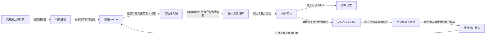

# Tickwire 的组件边界与订单主链路

2026-11-04。分析基线为 Tickwire `4f840fc`。三位研究者分别走读 NautilusTrader、Barter 和 HftBacktest，另用 Hummingbot 对照多步执行策略。带行号的 Tickwire 源码链接固定在重构前的提交。[本轮实现](https://github.com/Obscurepawn/Tickwire/commit/616bbdd89a50415c7030502092b8ec5ae2a333d5)

Tickwire 最值得先收口的是**策略交出意图，到账户接受意图**这一段。两条入口对同一条过期订单已经给出不同结果。这个问题有可重放的输入，也有一个明确的归口位置。相比之下，多进程、账户单写和首次发送前的授权检查各自解决独立问题，保留这些边界仍然可以缩短主链路。

## 一笔现货限价单经过哪些组件

图中是 Binance 独立行情与托管策略的正常链路。策略持有自己可见的盘口和算法状态。账户侧拥有预留、订单和成交事实。账户运行循环先处理私有输入、REST 结果和账户历史，再取下一条策略意图。它核对命令摘要与恢复依赖，将依赖暂存，然后重新采时并提交。网关确认同一键和同一命令的重试，完成准入与持久化，在向 TLS 交付首字节前再次验证授权。默认每笔订单依赖本地持久化，Raft 管低频配置和执行权。[策略意图发布](https://github.com/Obscurepawn/Tickwire/blob/4f840fcf885ff28fe51036ae2bf4f12111a82357/crates/tickwire-strategy-sdk/src/outbound.rs#L100-L136) · [运行循环](https://github.com/Obscurepawn/Tickwire/blob/4f840fcf885ff28fe51036ae2bf4f12111a82357/crates/tickwire-runtime/src/node.rs#L964-L1039) · [账户网关](https://github.com/Obscurepawn/Tickwire/blob/4f840fcf885ff28fe51036ae2bf4f12111a82357/crates/tickwire-account-gateway/src/lib.rs#L387-L482) · [首次发送](https://github.com/Obscurepawn/Tickwire/blob/4f840fcf885ff28fe51036ae2bf4f12111a82357/crates/tickwire-account-gateway/src/lib.rs#L571-L588)

## 四个开源系统能回答哪些设计问题

| 问题 | 上游实现与适用边界 | 对 Tickwire 的启发 |
| --- | --- | --- |
| 策略作者需要看到什么？ | Barter 在一个事件处理器内更新状态，再用只读状态生成撤单与新单，风控和投递由引擎执行。底层允许注入实盘客户端，所查版本的顶层执行配置只有 Mock。[事件处理](https://github.com/barter-rs/barter-rs/blob/9770b27a83f844472b93b593b08063affc974b0d/barter/src/engine/mod.rs#L144-L184) · [下单分工](https://github.com/barter-rs/barter-rs/blob/9770b27a83f844472b93b593b08063affc974b0d/barter/src/engine/action/generate_algo_orders.rs#L46-L66) · [配置](https://github.com/barter-rs/barter-rs/blob/9770b27a83f844472b93b593b08063affc974b0d/barter/src/system/config.rs#L58-L67) | 策略作者关心当时可见的行情、账户回报和要表达的交易意图。首次发送授权留在账户进程。 |
| 谁能把“没收到响应”判成订单失败？ | NautilusTrader 的 OKX 撤单处理区分可识别的场所拒绝与不确定的传输结果。前者产生撤单拒绝事件，订单模型恢复撤单前的状态。后者等对账取得证据。[OKX 错误分类](https://github.com/nautechsystems/nautilus_trader/blob/27a8e54e7ac3c57d6cbf8891f0283dfbaee97317/crates/adapters/okx/src/execution.rs#L636-L674) · [订单测试](https://github.com/nautechsystems/nautilus_trader/blob/27a8e54e7ac3c57d6cbf8891f0283dfbaee97317/crates/model/src/orders/mod.rs#L3020-L3044) | 交易所适配器解释错误码、数量和标识，账户根据证据决定是否释放预留。对账得到的累计成交量和带成交 ID 的逐笔事实有不同的入账语义。 |
| 怎么知道策略只看到了当时能看到的行情？ | HftBacktest 对每个标的分别调度场内行情、策略可见行情、订单到达与回报到达。测试可让本地和场内游标指向不同记录。历史盘口对模拟订单的市场冲击采用模型假设。[调度](https://github.com/nkaz001/hftbacktest/blob/5f3ec40b2afb764e0fea112f941ed85523ef4e88/hftbacktest/src/backtest/evs.rs#L17-L62) · [可见性测试](https://github.com/nkaz001/hftbacktest/blob/5f3ec40b2afb764e0fea112f941ed85523ef4e88/hftbacktest/src/backtest/mod.rs#L1190-L1237) · [成交假设](https://github.com/nkaz001/hftbacktest/blob/5f3ec40b2afb764e0fea112f941ed85523ef4e88/docs/order_fill.rst#L7-L18) | 测试可设定同一虚拟时钟下场内在 100 变盘、订单在 105 到达、策略在 110 收到行情、在 125 收到回报。恢复仍以实收记录为准。 |
| 什么时候值得引入独立执行算法？ | Hummingbot 的做市控制器按价位生成创建或停止执行器的动作。编排器按配置创建长期运行的执行器，再将执行器状态反馈给控制器。[做市动作](https://github.com/hummingbot/hummingbot/blob/9af100d6822da7d2d0291a906c730ef172284ee2/hummingbot/strategy_v2/controllers/market_making_controller_base.py#L223-L252) · [动作消费](https://github.com/hummingbot/hummingbot/blob/9af100d6822da7d2d0291a906c730ef172284ee2/hummingbot/strategy/strategy_v2_base.py#L707-L719) · [执行器注册](https://github.com/hummingbot/hummingbot/blob/9af100d6822da7d2d0291a906c730ef172284ee2/hummingbot/strategy_v2/executors/executor_orchestrator.py#L529-L566) | TWAP、持续挂单、跨场所对冲等需要拥有跨事件的执行状态。普通限价单交给当前账户网关就够了。多个策略可共享账户准入，各自保有算法状态。 |

**命令何时可以交给账户。** 令账户冻结、时钟已校准、发送器健康，给文件队列和 SDK 各放一份已经到期的普通新单。SDK 先检查账户健康，保留命令等待。文件队列先换算截止时间，到期即将自身标记为失败。两者都没有向交易所发单，后续能否继续从该来源接单却不同。把命令类别、健康状态和截止时间的判断收在 runtime 的一个纯函数里，可以用同一张表测两种来源。文件读写、IPC 消费、恢复依赖解析以及适配器如何处理一条坏输入，仍各有其主。[SDK 输入](https://github.com/Obscurepawn/Tickwire/blob/4f840fcf885ff28fe51036ae2bf4f12111a82357/crates/tickwire-strategy-sdk/src/runtime.rs#L159-L228) · [文件输入](https://github.com/Obscurepawn/Tickwire/blob/4f840fcf885ff28fe51036ae2bf4f12111a82357/crates/tickwire-app/src/strategy.rs#L266-L327)

**谁在运行策略。** `strategy_sdk::Strategy` 面向写策略的人，只有 `on_market` 必须实现，记录回放、检查点和迁移另有可选钩子。名称相近的 `runtime::node::Strategy` 面向账户运行循环，它负责取意图、投递账户历史，也暴露发布预检、暂停、安装和激活。托管实现的 `next` 在启动期间还会观察子进程资源，失败时清理子进程。读者跟到这里，已经从“一笔新单”走进“一个策略如何上线”。可以给运行循环一个只含取命令与通知结果的借用接口，由同一宿主实现独立发布接口。启动状态必须在同一轮取意图前可见，影子实例继续只观察。[作者接口](https://github.com/Obscurepawn/Tickwire/blob/4f840fcf885ff28fe51036ae2bf4f12111a82357/crates/tickwire-strategy-sdk/src/lib.rs#L98-L179) · [运行时接口](https://github.com/Obscurepawn/Tickwire/blob/4f840fcf885ff28fe51036ae2bf4f12111a82357/crates/tickwire-runtime/src/node.rs#L276-L395) · [启动和取意图](https://github.com/Obscurepawn/Tickwire/blob/4f840fcf885ff28fe51036ae2bf4f12111a82357/crates/tickwire-app/src/hosted.rs#L265-L315)

多交易所最先验证同一个经济动作。拿一个有价格步长和数量步长的现货限价单，分别验证 Binance、Bybit、OKX 的标的、客户端订单 ID、签名、撤单回执和逐笔成交去重。行情先约定策略消费的是最优买卖还是深度快照，再按交易所选择公开频道。协议解码和序号状态属于各连接，wire 上的场所身份应一路保留到策略和账户。多策略则用一个共享风险域、两个独立实例竞争同一笔可用余额，验证最多一次成功预留。

| 改动 | 定性成本 | 验收 |
| --- | --- | --- |
| 两个入口共用命令判定 | 固定数量的枚举匹配、布尔判断和整数时间比较。沿用现有记录，热路径无需分配或增加队列。 | 覆盖冻结、发送暂停、截止前一刻、恰好到期，以及新单、撤单、查询。另测拒绝首字节时零输出、部分输出后继续保留资金。 |
| 按交易所和账户域在启动时绑定适配器，策略各用一个有界输入 | 连接、签名资料、标的映射预先装配。逐条更新只访问本场所状态。多策略争用同一账户时，还需计入公平调度与慢消费者的成本。 | 两个场所允许相同本地标的 ID；两种策略速率下检查各自游标、下单身份和共享额度。 |
| 把故障接管与单机恢复分别部署 | 本地 WAL、复核执行权、重启后对账直接保护资金。跨机选主和镜像引入另一个故障域及运维成本，可以延后投入。 | 杀死单机发送进程，恢复未决意图，确认没有二次发单。分别量行情接收到策略回调、策略意图到账户接收、账户接收到首次发送的 p99/p99.9。 |

本次在基线上实跑 Tickwire 策略示例 7 项测试、执行生命周期 18 项、账户网关提交 4 项，以及 Spot mock 往返。示例记录一次提交并以冻结状态恢复。HftBacktest 的 Rust backtest 库另跑了 22 项测试。以上结果用于比较行为；目标主机延迟、多交易所生产成交和跨机接管各有独立的验收环境。[Tickwire 网关测试](https://github.com/Obscurepawn/Tickwire/blob/4f840fcf885ff28fe51036ae2bf4f12111a82357/crates/tickwire-account-gateway/tests/submission.rs) · [策略跨版本回放](https://github.com/Obscurepawn/Tickwire/blob/4f840fcf885ff28fe51036ae2bf4f12111a82357/crates/tickwire-strategy-example/src/chain_tests.rs)

## 这些项目的文档怎么写

Barter 的 README 让读者跟着一个可运行例子走进系统。NautilusTrader 的适配器指南从协议语义入手，解释一次撤单请求怎样成为策略可见的事件，再按场所列出可参考的实现。HftBacktest 的成交模型直接列出价格、盘口和排队条件，读者可以据此判断自己的回测会发生什么。Tickwire 的 README 因此从一笔订单和两个策略写起，SPECS 说明谁接收什么输入、怎样改变状态、调用者会看到什么结果，crate 的 AGENTS.md 则留下改代码时需要守住的不变量与对应测试。[Barter README](https://github.com/barter-rs/barter-rs/blob/9770b27a83f844472b93b593b08063affc974b0d/README.md) · [NautilusTrader 适配器指南](https://github.com/nautechsystems/nautilus_trader/blob/27a8e54e7ac3c57d6cbf8891f0283dfbaee97317/docs/developer_guide/adapters.md) · [HftBacktest 成交模型](https://github.com/nkaz001/hftbacktest/blob/5f3ec40b2afb764e0fea112f941ed85523ef4e88/docs/order_fill.rst)

这次重构里，L1 行情给出了一个具体的性能边界。Bybit 和 OKX 都在建立订阅时绑定标的和步长。给两者各一条完整的原生 BBO 文本，测试测得从解码、换算为整数 tick/lot，到生成并写入共享内存记录，这一段都是零次堆分配。网络线程向发布线程移交报价仍需一次有界队列交接，之后每个策略还要推进自己的副本。账户侧的签名、WAL 同步和首次写入属于另一段成本。[单机架构与 API](https://github.com/Obscurepawn/Tickwire/blob/616bbdd89a50415c7030502092b8ec5ae2a333d5/specs/implementation/single-host-trading.md) · [报价分配计数](https://github.com/Obscurepawn/Tickwire/blob/616bbdd89a50415c7030502092b8ec5ae2a333d5/crates/tickwire-md/tests/spot_quotes.rs)

两进程验收还暴露了一个接口语义问题。两个策略的检查点都保存了正确 BBO，实际的回调计数却都为零。旧 SDK 用「有连续且完整的深度」作为所有行情回调的前提，L1 订阅永远达不到这个条件。修复后，完整而新鲜的一笔报价让每个 worker 恰好收到一次回调，失效和首次 JOIN 快照都不触发决策。策略若要求盘口深度，仍须检查覆盖范围。把“收到了字节”“策略看到了报价”“账户允许新增风险”写成三个可独立断言的结果，比笼统地检查一条链路绿灯更能发现问题。[双策略进程回归](https://github.com/Obscurepawn/Tickwire/blob/616bbdd89a50415c7030502092b8ec5ae2a333d5/crates/tickwire-app/tests/parameters_process/spot.rs) · [L1 行情契约](https://github.com/Obscurepawn/Tickwire/blob/616bbdd89a50415c7030502092b8ec5ae2a333d5/specs/implementation/spot-quote-input.md)
