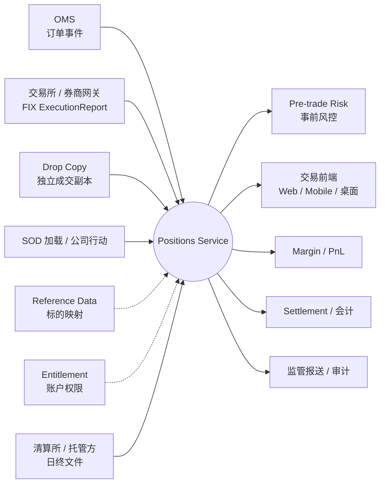
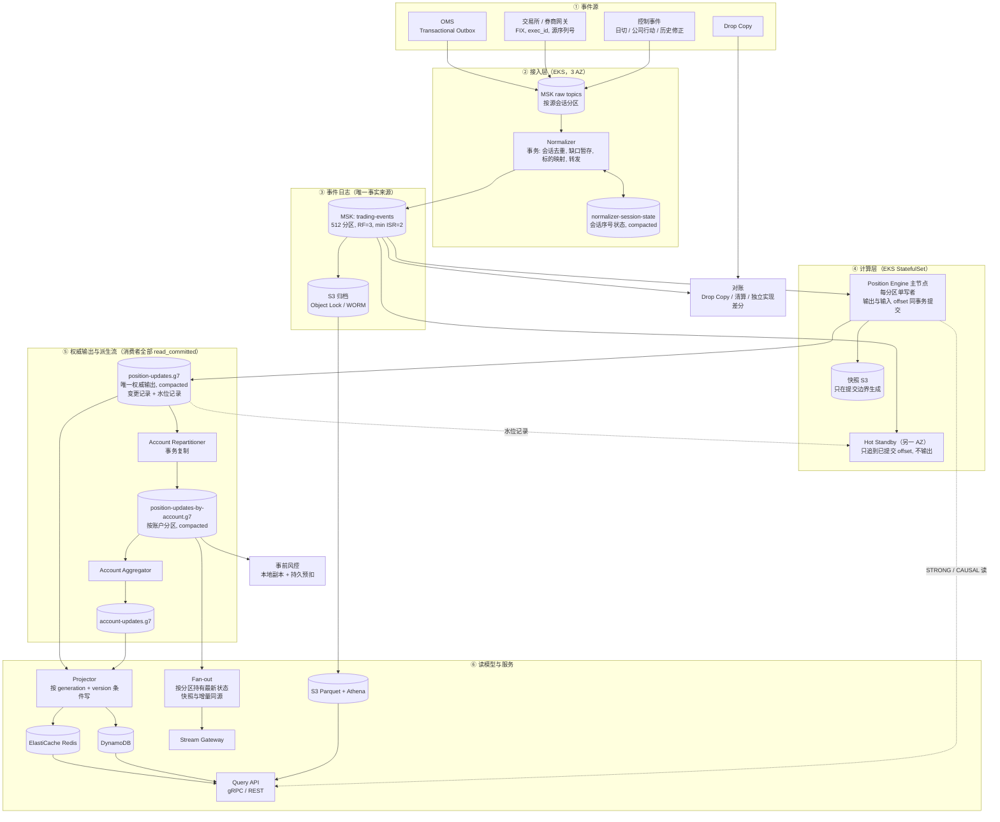
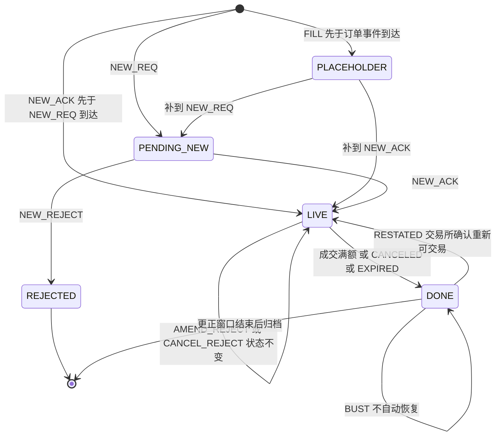
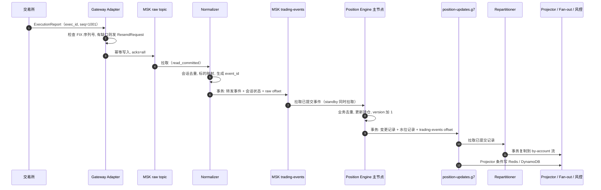
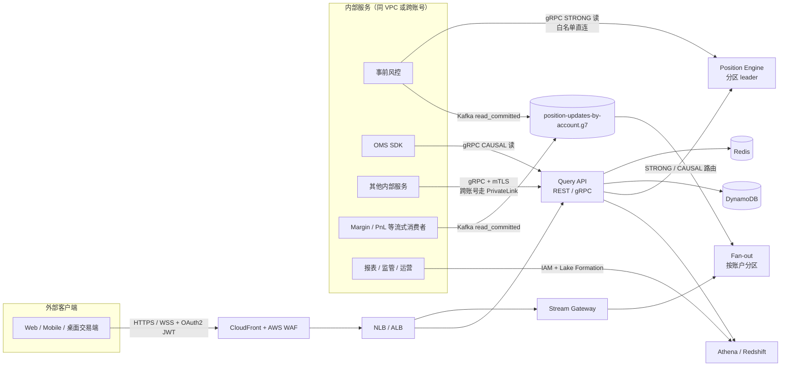
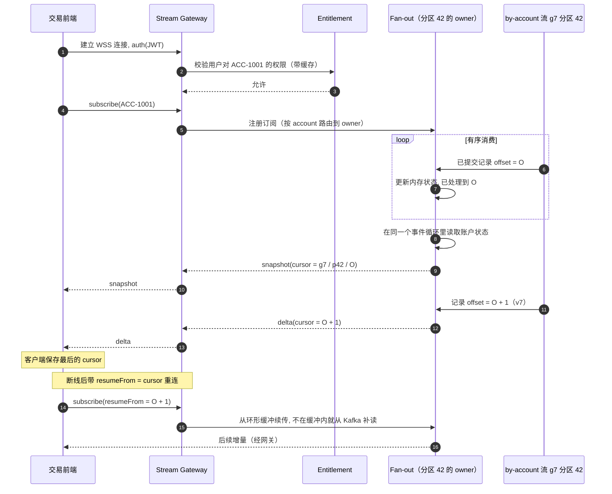
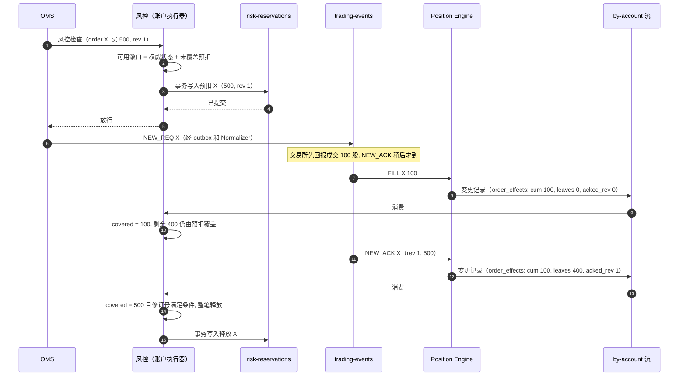
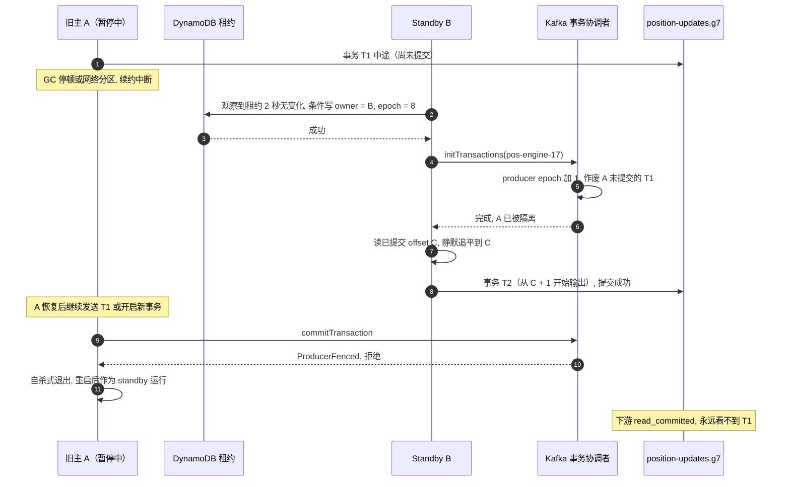
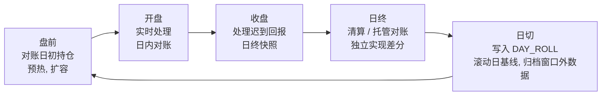

# 分布式持仓服务（Positions Service）系统设计

> **题目**：在 AWS 上为交易平台设计一个分布式持仓服务。它是业务关键服务，要处理每一笔订单事件和每一笔成交，保证全系统看到的持仓一致、实时。设计目标有三个：容错；在故障和重放下仍然准确一致；规模大时性能好、延迟低。

部署假设：AWS，主 Region 跨 3 个 AZ，另有 1 个 DR Region。文中的规模、延迟和容量数字都是设计假设或估算（第 3 节），落地前要和业务方确认，并用真实流量压测。

阅读建议：只有几分钟的话，看第 0 节和第 5 节的架构图；准备深挖的话，重点看第 7 节（写路径）和 9.8 节（风控怎么用持仓），这两块协议细节最多，也最容易被追问；第 19 节是常见追问和答案，可以拿来自测。

---

## 目录

- [0. 先说结论](#0-先说结论)
- [1. 背景：持仓服务难在哪](#1-背景持仓服务难在哪)
- [2. 职责与边界](#2-职责与边界)
- [3. 需求与容量估算](#3-需求与容量估算)
- [4. 设计原则与正确性前提](#4-设计原则与正确性前提)
- [5. 总体架构](#5-总体架构)
- [6. 事件、持仓与订单模型](#6-事件持仓与订单模型)
- [7. 写路径](#7-写路径)
- [8. 存储设计](#8-存储设计)
- [9. 客户端怎么访问](#9-客户端怎么访问)
- [10. 一致性模型汇总](#10-一致性模型汇总)
- [11. 容错与高可用](#11-容错与高可用)
- [12. 性能与扩展](#12-性能与扩展)
- [13. 对账、审计与合规](#13-对账审计与合规)
- [14. 可观测性与 SLO](#14-可观测性与-slo)
- [15. 安全](#15-安全)
- [16. 部署与运维](#16-部署与运维)
- [17. 取舍与备选方案](#17-取舍与备选方案)
- [18. 风险与待确认问题](#18-风险与待确认问题)
- [19. 面试常见追问](#19-面试常见追问)
- [附录：术语表](#附录术语表)

---

## 0. 先说结论

面试时可以先用 30 秒讲清楚整体思路：

> “我把持仓看成成交日志算出来的状态。MSK 是唯一事实来源，按 (account, instrument) 分区，每个分区一个确定性的内存引擎。最要紧的是提交协议：每批输出、水位和输入 offset 放在同一个 Kafka 事务里提交，快照只在提交边界生成，所以崩溃后不丢也不重。每个分区用固定的 transactional.id，接管者一初始化，旧主就被隔离；下游全部 read_committed。租约只负责选主，不负责安全。业务上用 venue 加 exec_id 和订单修订号去重，覆盖整个更正窗口；撤销和更正从受影响日期的基线原位重算。所有输出带 generation 加 version，Region 切换或全量重算时提升世代，客户端据此重建。客户端这边，订阅的快照带 Kafka 位置，断线可以续传；风控先持久化预扣再放行，按已被权威状态覆盖的数量逐步释放。这些保证都有前提，比如上游能补发、exec_id 唯一。前提不成立的情况，靠 Drop Copy 全字段对账和独立实现差分来发现。”

按设计目标拆开：

- **正确性**：在 §4.2 的前提下，进入 `trading-events` 的每个事件，效果恰好一次提交到权威输出流。靠三件事：Normalizer 和引擎都用事务做“消费、处理、输出”；引擎内用业务键（`(venue, exec_id)`、订单修订号）去重，覆盖整个更正窗口；计算是确定性的。
- **容错**：MSK 跨 3 AZ（RF=3、min ISR=2）。主备切换时，租约只决定谁来接管，影响的是恢复时间；写入隔离靠 Kafka 事务的 producer fencing，不依赖时钟。Region 级做主备。跨 Region 复制不能保证日志逐条一致，所以切换时提升 `generation`，客户端重建。
- **低延迟**：热路径全在内存。算上事务提交，从 Normalizer 收到事件到可查询 p99 < 25ms，到推送和风控事件流 p99 < 30ms（目标值，拆分见 §12.1）。风控本地检查 < 1ms，含预扣持久化的放行 < 5ms。
- **客户端访问**：同步查询（gRPC/REST）、实时订阅（快照带流位置，可续传）、Kafka 事件流、历史与批量（S3/Athena）。读一致性分四档：`EVENTUAL`、`AT_LEAST_VERSION`、`CAUSAL`、`STRONG`。
- **发现错误**：Drop Copy 全字段日内对账、清算/托管日终对账、独立实现差分重算、主备状态 checksum 持续比对。这些手段能发现问题，但证明不了没有问题。

---

## 1. 背景：持仓服务难在哪

交易平台里，订单管理系统（OMS）发出订单，交易所或券商回报成交。几乎所有关键系统都要问同一个问题：某个账户在某个标的上，现在持有多少、成本多少、还有多少挂单没成交。

- 事前风控：下单前检查持仓上限、购买力、卖空限制。
- 交易前端：实时展示持仓和盈亏。
- 保证金、清算、会计：算保证金、核对交收、出日终报表。
- 监管与审计：任何时点的持仓都要能追溯到具体成交。

难点有四个：

1. **不能丢，也不能重。** 网络重试、producer 重试、consumer 重启、上游重发都会带来重复；漏掉一笔成交，风险敞口就算错了。
2. **乱序。** 成交可能比订单确认先到；撤单和成交可能同时发生；多个来源之间没有全局顺序。
3. **更正。** 交易所可能撤销（Bust）或更正（Correct）已经回报过的成交。
4. **规模和突发。** 开盘、收盘、重大新闻时流量会突然涨几倍；少数做市商账户会形成热点。

---

## 2. 职责与边界

### 2.1 持仓服务负责什么

| # | 职责 | 说明 |
|---|---|---|
| R1 | 处理所有订单事件和成交事件 | 不丢、不重复计算；能发现并补齐上游序列缺口 |
| R2 | 维护权威持仓 | 粒度为 `(account, instrument, book)`，包括净数量、成本基础 / 均价、已实现盈亏、当日买卖量、日初数量、版本号 |
| R3 | 维护在途挂单敞口 | 只保留计算 open buy / open sell（`leaves` 数量）需要的轻量订单状态；持仓服务不是 OMS |
| R4 | 账户级汇总 | 按账户汇总多空数量、按成本计的名义敞口、在途挂单名义金额、已实现盈亏 |
| R5 | 查询 | 单 key、批量、按账户列出、按时间点（as-of）、历史查询；支持多档一致性 |
| R6 | 实时推送 | 向 UI、风控、保证金等系统推送持仓变化（快照 + 增量） |
| R7 | 交易日生命周期 | 加载日初持仓（SOD）、应用公司行动（拆股、合股、代码变更等）、做日终快照、处理日切 |
| R8 | 对账与差异告警 | 日内和 Drop Copy 核对；日终和清算所 / 托管方核对；内部影子重算 |
| R9 | 审计追溯 | 任何持仓版本都能追溯到产生它的事件链（lineage） |
| R10 | 数据质量自检 | 发现序列缺口、未知标的、无法处理的事件时，隔离受影响的 key，标为 `STALE`，不静默给出错误数字 |

### 2.2 不负责什么

| 不负责 | 归属系统 | 和持仓服务的关系 |
|---|---|---|
| 下单、路由、撮合 | OMS / EMS | 持仓服务消费 OMS 的订单事件 |
| 风控决策（是否放行某个订单） | Pre-trade Risk | 风控是持仓服务的客户端；持仓服务提供数据、读屏障和事件因果标识（§9.8） |
| 行情、估值、浮动盈亏的定价 | Market Data / PnL Service | 持仓状态里不放行情，以保证确定性；查询层可以用最新标记价补充浮动盈亏，并标明标记时间 |
| 现金余额、资金台账、交收 | Cash Ledger / Settlement | 持仓服务消费交收确认，用于对账 |
| 保证金计算 | Margin Service | 订阅持仓变更 |
| 账户主数据、用户权限 | Account / Entitlement Service | 持仓服务调用它做鉴权（结果会缓存） |
| 标的参考数据 | Reference Data | 规范化阶段用它把交易所代码映射成内部 `instrument_id` |
| 监管报送 | Regulatory Reporting | 消费日终快照和审计数据 |

边界按这一条来划：持仓服务只保存能从事件日志确定性推导出来的状态。行情这类高频、非确定的输入不进持仓状态机，否则“重放结果完全一致”就不成立了。

### 2.3 上下游



### 2.4 对客户端的承诺

下面的承诺都以 §4.2 的前提成立为条件。

| 承诺 | 内容 |
|---|---|
| 单 key 有序 | 同一 `(account, instrument, book)` 的变更按日志顺序生效；同一世代内 `version` 单调递增，跨世代按 `(generation, version)` 比较 |
| 不丢更新 | 每个进入 `trading-events` 的事件，效果最终都会提交到权威输出流。做不到时（事件无法处理、标的映射失败、来源有缺口），相关 key 或账户标为 `STALE` 并告警，不静默给出数字 |
| 不重复计算 | 同一 `(venue, exec_id)` 在更正窗口内只计入一次；窗口外的重发进入历史修正流程，不进实时持仓 |
| 只暴露已提交数据 | 所有读模型、推送和事件流只包含已提交事务的输出 |
| 陈旧度可见 | 每个响应带 `generation`、`version`、`complete_through` 和 `staleness_ms`；陈旧度由沿日志流动的水位决定（§9.4） |
| 世代变化可感知 | 世代变化时，查询返回新世代数据，订阅收到 `resync_required`，SDK 自动清空本地缓存 |
| 时效 | 交易时段内，从 Normalizer 收到事件起：p99 < 25ms 可查询（`EVENTUAL`），p99 < 30ms 进入推送和风控事件流（目标值，待压测） |
| 可用性 | 查询和订阅 99.99%；`STRONG` 读在分区切换期间（约 2~3 秒）可能返回 `UNAVAILABLE` |
| 可追溯 | 任意 `(generation, version)` 都能查到事件链；原始事件按监管要求保留（例如 7 年，WORM） |

---

## 3. 需求与容量估算

### 3.1 功能需求

1. 订单事件：OMS 侧的请求 `NEW_REQ / AMEND_REQ / CANCEL_REQ`；交易所侧的确认 `NEW_ACK / NEW_REJECT / AMEND_ACK / AMEND_REJECT / CANCEL_REJECT / CANCELED / EXPIRED`（和 FIX 的映射见 §6.3）。
2. 成交事件：`FILL / BUST / CORRECT`。
3. 控制事件：`DAY_ROLL`（日切）、`CORP_ACTION`（公司行动）、`SOURCE_WATERMARK`（来源水位）、`RESTATEMENT`（审批后的历史修正）、`RELEASE_KEY`（解除隔离）、`SOD_POSITION`（只用于初始迁移）、`MANUAL_ADJUSTMENT`（人工调账，需审批）。
4. 计算持仓、在途挂单敞口、账户汇总；处理更正窗口内的跨日重发和更正。
5. 低延迟查询、实时推送、按时间点查询、事件链查询。
6. 日内对账、日终对账、日终快照。

### 3.2 非功能需求（假设，待业务确认）

| 维度 | 目标 |
|---|---|
| 规模 | 500 万账户、约 2,000 万活跃持仓、高峰时约 1,000 万在途订单 |
| 吞吐 | 高峰 20 万事件/秒；日均约 10 亿事件（订单事件约 7 亿 + 成交约 3 亿） |
| 写入到可读延迟 | 从 Normalizer 收到事件起：查询 p99 < 25ms，推送和风控事件流 p99 < 30ms；引擎内处理单事件 < 0.1ms（不含事务提交） |
| 事前风控 | 本地检查 p99 < 1ms；含预扣持久化的放行 p99 < 5ms；兜底的同步 `STRONG` 读 p99 < 10ms |
| 正确性 | 在 §4.2 的前提下，事件效果恰好一次提交；同一世代内重放结果按位一致 |
| 更正窗口 | 当日加前 N 个交易日（默认 N=2，待业务确认）内的重发和更正进入实时持仓 |
| 可用性 | 99.99%；单 AZ 故障时 RPO=0、RTO 约 2~3 秒；Region 故障时 RTO 在分钟级，RPO 由上游补发补齐 |
| 审计 | 事件不可篡改、可完整重放、长期保留 |

### 3.3 容量估算

| 项目 | 计算 | 结果 |
|---|---|---|
| 交易时段平均吞吐 | 10 亿 ÷ (6.5h × 3600s) | ≈ 4.3 万事件/秒（高峰约为平均的 4.7 倍） |
| 每个分区的高峰吞吐 | 20 万 ÷ 512 分区 | ≈ 390 事件/秒/分区 |
| 写入带宽 | 20 万 × 约 1KB | ≈ 200 MB/s（3 副本后约 600 MB/s 磁盘写） |
| 每日数据量 | 10 亿 × 1KB | ≈ 1 TB/天（原始），冷数据下沉到 S3 |
| 持仓状态内存 | 2,000 万 × 约 300B | ≈ 6 GB |
| 订单状态内存 | 1,000 万 × 约 300B | ≈ 3 GB |
| 更正窗口内成交（3 个交易日，兼作业务去重索引） | 3 亿/天 × 约 48B × 3 天 | ≈ 43.2 GB |
| 引擎总内存 / 每个 Pod | (6 + 3 + 43.2) GB ÷ 32 个主 Pod | ≈ 1.63 GB/Pod（另有同样数量的 Standby） |
| Redis 读模型 | 2,000 万 × 约 500B | ≈ 10 GB（Cluster 模式多分片） |
| Fan-out 内存中的最新状态 | 2,000 万 × 约 500B | ≈ 10 GB（分布在 Fan-out 节点上） |
| 来源水位 / 引擎水位记录 | 各 512 分区 × 每 100ms 一条 | 各 ≈ 5,120 条/秒 |
| WebSocket 连接 | 假设 50 万并发 ÷ 每节点 5 万 | ≈ 10 个网关节点（按 2 倍冗余部署） |

---

## 4. 设计原则与正确性前提

### 4.1 设计原则

| # | 原则 | 换来什么 |
|---|---|---|
| P1 | 日志是唯一事实来源：所有状态变化先进 MSK，持仓只是对日志的计算结果 | 任何派生数据都能重建；审计记录完整 |
| P2 | 按分区单写者：每个分区同一时刻只有一个引擎实例能提交输出 | 不需要锁，延迟可预测 |
| P3 | 确定性计算：处理事件时不读墙钟、不访问外部可变数据；和时间有关的逻辑通过控制事件进日志；全部用定点数 | 快照加重放能精确恢复；主备结果按位一致，可以用 checksum 持续比对 |
| P4 | 事务提交：输入进度、输出记录和快照边界绑在同一个提交点 | 崩溃恢复既不重复输出，也不漏输出 |
| P5 | 在存储层隔离写者：Kafka 事务的 producer fencing 拒绝旧写者提交，下游只读已提交数据；租约只负责选主 | 隔离不依赖时钟、进程调度和网络时延 |
| P6 | 业务幂等：用 `(venue, exec_id)` 和订单修订号去重，覆盖整个更正窗口 | 上游重发、Drop Copy 重复都不会重复计入 |
| P7 | 版本带世代：所有输出带 `(generation, version)` | 做不到逐条一致的重建（Region 切换、全量重算），客户端能识别出来 |
| P8 | 读写分离（CQRS）：写路径只管正确，读路径按访问方式优化 | 读模型坏了，可以从权威输出流重建 |
| P9 | 宁可说不知道，也不给错误数字：异常 key 或来源缺口标为 `STALE` | 风控可以按 fail-closed 处理 |

### 4.2 正确性前提与保证范围

文中所有“不丢、不重”的结论都有前提，列在下面。任何一条不成立，系统就不再保证结果正确，而是靠对账发现差异，再进入修正流程。

| # | 前提 | 不成立时的后果与处理 |
|---|---|---|
| A1 | 上游能在补发窗口内按序列号补发（FIX ResendRequest、OMS outbox 重放） | 缺口无法自动补齐：来源标为不完整，靠 Drop Copy 补入 |
| A2 | `(venue, exec_id)` 唯一，撤销和更正事件引用原成交 | 业务去重失效，由对账发现 |
| A3 | 交易所的订单状态语义能无歧义地映射为 §6.3 的内部事件 | 映射表按交易所维护，并有回归测试 |
| A4 | 单个 MSK 集群内 Kafka 事务的语义成立（原子提交、producer fencing、`read_committed`） | 依赖 Kafka 本身的正确性，用混沌演练验证（§16.4） |
| A5 | 主备运行同一版本的计算代码 | 版本不同时由 checksum 比对发现，发布流程负责保证（§16.2） |
| A6 | 重发和更正发生在更正窗口内 | 超出窗口的进入历史修正流程，实时持仓标为 `RECONCILING` |
| A7 | 跨 Region 复制不保证逐条一致，也不保证事务原子性 | 所以 Region 切换时一定要提升 `generation`（§11.3） |

保证覆盖的范围：

- “恰好一次”只指从 `trading-events` 到权威输出流 `position-updates` 这一段。上游到 `trading-events` 这一段，由 Normalizer 的事务和会话序号保证；读模型（Redis、DynamoDB）是至少一次投影，加上按版本幂等写入。
- 和外部系统（交易所、清算所）之间的一致性只能靠对账检测，本服务单方面保证不了。

---

## 5. 总体架构

### 5.1 架构图

图里的 `g7` 表示当前数据世代（§7.12）。



### 5.2 组件清单

| 组件 | AWS 实现 | 作用 | 状态 | 部署 |
|---|---|---|---|---|
| Gateway Adapter | EKS | FIX 会话、ResendRequest、写入 raw topic | FIX 会话状态 | 主备，跨 AZ |
| Normalizer | EKS StatefulSet | 会话去重、缺口暂存、标的映射、按持仓键转发 | 会话序号状态，存于 compacted topic，与转发同事务提交 | 按 raw 分区分片，3 AZ |
| 水位聚合器 | EKS Deployment（单活加备） | 汇总各会话的连续水位，写入 `SOURCE_WATERMARK` | 无（可从会话状态重建） | 主备，跨 AZ |
| 事件日志 | Amazon MSK（Provisioned，Tiered Storage） | 唯一事实来源 | 有状态 | 3 AZ，RF=3 |
| Position Engine | EKS StatefulSet | 持仓计算、事务输出、强一致读 | 内存状态 + 快照 | 32 主 + 32 备，跨 AZ |
| Account Repartitioner | EKS Deployment | 把权威输出按账户重新分区（事务复制） | 无（进度随事务提交） | 3 AZ |
| Account Aggregator | EKS StatefulSet | 账户汇总 | 内存状态，可从 compacted topic 重建 | 跨 AZ |
| Projector | EKS Deployment | 写 Redis / DynamoDB | 无 | 3 AZ |
| Fan-out | EKS StatefulSet | 按 by-account 分区持有最新状态，服务订阅 | 内存状态（可重建）+ 约 60 秒增量缓冲 | 按分区分片，带租约 |
| Query API | EKS + NLB / ALB | 查询入口、路由、鉴权 | 无 | 3 AZ |
| Stream Gateway | EKS + NLB | 长连接、鉴权、按账户路由到 Fan-out | 连接状态 | 3 AZ |
| 热读模型 | ElastiCache Redis（Cluster 模式） | 亚毫秒读 | 可重建 | 每分片 1 主 2 从，跨 AZ |
| 持久读模型 | DynamoDB | 当前持仓、日终快照 | 有状态 | 区域级，PITR |
| 租约 / 快照指针 / 世代记录 | DynamoDB + Route 53 ARC | 选主、快照位置、当前世代和活跃 Region | 有状态 | 区域级；活跃 Region 由 ARC 决定 |
| 归档与数据湖 | S3（Object Lock）+ Glue + Athena / Redshift | 审计、历史查询、全量重算 | 有状态 | 跨区复制 |
| 对账服务 | EKS CronJob / 流式任务 | 差异检测、独立实现差分 | — | — |
| 风控预扣台账（归风控服务所有） | MSK `risk-reservations` | 持久化预扣 | 有状态 | 随风控分片 |

### 5.3 两条主路径

- 写路径：事件源 → raw topic → Normalizer（事务）→ `trading-events` → Position Engine（事务）→ `position-updates.g{n}`。之后分两路：Projector 写 Redis / DynamoDB；Repartitioner 写 by-account 流，供 Fan-out、风控和账户汇总使用。
- 读路径有四种：客户端经 Query API，按一致性等级读 Redis / DynamoDB / 引擎；客户端经 Stream Gateway 订阅 Fan-out；直接消费 Kafka topic；查 Athena。

---

## 6. 事件、持仓与订单模型

### 6.1 统一事件结构（Protobuf，注册到 Glue Schema Registry）

```protobuf
syntax = "proto3";
package positions.events.v2;

message TradingEvent {
  string    event_id        = 1;   // 确定性 ID：hash(source, source_session, source_seq)，用于追踪和审计
  string    source          = 2;   // OMS / GW-NYSE-01 / DROPCOPY / CTRL / OPS
  string    source_session  = 3;   // 会话 ID（包含交易日）
  uint64    source_seq      = 4;   // 会话内单调连续序号
  EventType type            = 5;
  string    account_id      = 6;
  string    instrument_id   = 7;   // 内部标的 ID（Normalizer 映射后）
  string    book_id         = 8;   // 子账户 / 策略簿，默认 "default"
  string    venue           = 9;   // 交易所 / 券商；exec_id 只在同一 venue 内唯一
  string    order_id        = 10;  // 订单身份（OMS 分配，跨修订不变）
  uint32    order_rev       = 11;  // 修订号：NEW 为 1，每次改单请求加 1
  string    exec_id         = 12;  // 成交唯一 ID（BUST / CORRECT 事件自身也有唯一 exec_id）
  string    ref_exec_id     = 13;  // BUST / CORRECT 指向的原成交
  Side      side            = 14;
  Fixed     qty             = 15;  // FILL / CORRECT：成交量
  Fixed     price           = 16;  // FILL / CORRECT：成交价；订单事件：限价
  Fixed     order_qty       = 17;  // 订单事件：该修订的订单总量
  Fixed     venue_cum_qty   = 18;  // 交易所回报的累计成交量（可选，用于交叉校验）
  string    trade_date      = 19;  // 成交所属交易日 YYYY-MM-DD
  int64     ts_exchange_ns  = 20;
  int64     ts_ingest_ns    = 21;
  map<string,string> attrs  = 22;  // 扩展字段（费用、流动性标记等）
}

message Fixed { int64 hi = 1; uint64 lo = 2; int32 scale = 3; } // int128 定点数

enum Side { SIDE_UNSPECIFIED = 0; BUY = 1; SELL = 2; SELL_SHORT = 3; }

enum EventType {
  EVENT_TYPE_UNSPECIFIED = 0;
  // OMS 侧请求
  ORDER_NEW_REQ = 1; ORDER_AMEND_REQ = 2; ORDER_CANCEL_REQ = 3;
  // 交易所侧确认
  ORDER_NEW_ACK = 10; ORDER_NEW_REJECT = 11;
  ORDER_AMEND_ACK = 12; ORDER_AMEND_REJECT = 13;
  ORDER_CANCEL_REJECT = 14; ORDER_CANCELED = 15; ORDER_EXPIRED = 16;
  ORDER_RESTATED = 17;             // 交易所主动重述订单量或状态（例如撤销成交后重新可交易）
  // 成交
  EXEC_FILL = 20; EXEC_BUST = 21; EXEC_CORRECT = 22;
  // 控制
  DAY_ROLL = 30; CORP_ACTION = 31; SOURCE_WATERMARK = 32;
  RESTATEMENT = 33; RELEASE_KEY = 34; SOD_POSITION = 35; MANUAL_ADJUSTMENT = 36;
}
```

### 6.2 持仓数据模型

| 字段 | 类型 | 含义 |
|---|---|---|
| `account_id / instrument_id / book_id` | string | 持仓键 |
| `trade_date` | date | 当前交易日 |
| `sod_qty / sod_cost_basis` | Fixed | 日初数量和日初成本（由上一交易日收盘状态滚动得到） |
| `net_qty` | Fixed | 当前净持仓（正为多，负为空） |
| `cost_basis` | Fixed | 当前持仓的总成本；均价 = `cost_basis / |net_qty|`，读取时计算 |
| `realized_pnl` | Fixed | 当日已实现盈亏（毛额） |
| `fees` | Fixed | 当日费用（来自回报，可选） |
| `bought_qty / sold_qty` | Fixed | 当日累计买入 / 卖出量 |
| `open_buy_qty / open_sell_qty` | Fixed | 在途挂单剩余量（由订单状态增量维护，§7.4） |
| `open_buy_notional / open_sell_notional` | Fixed | 在途挂单名义金额（限价单按限价，市价单按参考价） |
| `generation` | uint32 | 数据世代（§7.12） |
| `version` | uint64 | 该 key 在本世代内的状态版本，单调递增 |
| `epoch` | uint64 | 产生该版本的写者任期（只用于诊断，隔离由事务保证） |
| `src_offset` | uint64 | 产生该版本的 `trading-events` offset |
| `cause` | struct | 触发事件：`{type, order_id, order_rev, exec_id, event_id}` |
| `order_effects` | list | 本次变更涉及的订单状态：`[{order_id, order_rev_acked, leaves, cum_qty, is_terminal}]`，供风控释放预扣（§9.8） |
| `status` | enum | `OK / STALE / RECONCILING` |
| `last_event_ts / updated_at` | timestamp | 最后事件的交易所时间 / 处理时间 |

### 6.3 订单模型与状态机（只用来算在途敞口）

订单身份 `order_id` 跨修订不变。修订号 `order_rev` 由 OMS 分配，NEW 为 1，每次改单请求加 1。

```text
Order {
  order_id, account, instrument, book, side, venue
  acked_rev, acked_qty, acked_px              # 交易所已确认的最新修订（在途敞口按它计算）
  max_req_rev, pending_amend: {rev, qty, px}  # 尚未确认的改单（风控侧仍按预扣覆盖）
  status: PENDING_NEW | LIVE | DONE | REJECTED
  done_reason: FILLED | CANCELED | EXPIRED | null
  fills: 引用该 key 有效成交表中属于本订单的记录
}
cum_qty = Σ 本订单有效成交的数量          # 和持仓使用同一份成交表，不单独计数
leaves  = 0                               当 status ∈ {PENDING_NEW, DONE, REJECTED}
        = max(0, acked_qty − cum_qty)     当 status = LIVE
```

状态转移规则如下，每条都要检查修订号：

| 事件 | 条件 | 效果 |
|---|---|---|
| `NEW_REQ(rev=1)` | 订单不存在 | 建立订单，`status = PENDING_NEW`，`leaves = 0`（风控仍由预扣覆盖） |
| `NEW_ACK(rev=1)` | 订单不是 `REJECTED` | `acked_rev = 1`，记下 `acked_qty`；如果尚未结束，`status = LIVE` |
| `NEW_REJECT(rev=1)` | 订单为 `PENDING_NEW` | `status = REJECTED`。只有新单被拒才会结束订单 |
| `AMEND_REQ(rev=k)` | `k > max_req_rev` | 记为 `pending_amend`，不改变 `acked_qty` |
| `AMEND_ACK(rev=k)` | `k > acked_rev` | `acked_rev = k`，`acked_qty`、`acked_px` 更新为该修订；`leaves` 重新计算 |
| `AMEND_REJECT(rev=k)` | 有对应的 `pending_amend` | 清掉 `pending_amend`；原订单保持有效，状态不变 |
| `CANCEL_REQ` | — | 只记录，不改变状态 |
| `CANCEL_REJECT` | — | 只记录，订单保持有效，状态不变 |
| `CANCELED / EXPIRED` | 订单尚未结束 | `status = DONE`，`done_reason` 记下原因，`leaves = 0` |
| `FILL` | `(venue, exec_id)` 未见过 | 写入有效成交表；如果 `cum_qty ≥ acked_qty` 且订单为 `LIVE`，`status = DONE(FILLED)`。订单已经结束或尚未建立时，成交照样计入持仓（订单不存在就建占位订单） |
| `BUST` | 原成交存在且有效 | 原成交标记为无效，`cum_qty` 自动变小。如果订单是因为全部成交而结束的，状态保持 `DONE`，是否重新可交易以交易所后续的 `RESTATED` 为准 |
| `CORRECT` | 原成交存在 | 原位替换原成交的数量或价格（§7.9） |
| `RESTATED` | 版本较新 | 按交易所给出的订单量和状态重述 |

有三条规则容易写错，单独说一下：

- 只有新单被拒（`NEW_REJECT`）才会结束订单。改单被拒、撤单被拒时，原订单仍然有效。
- 订单已经结束、甚至还没建立时到达的成交，照样计入持仓；订单不存在就先建一个占位订单。
- 成交被撤销（`BUST`）后，因全部成交而结束的订单不会自动恢复成可交易，要等交易所后续的 `RESTATED`。



交易所消息映射以 FIX 4.4 为例，按 venue 分别维护：

| FIX 消息 | 内部事件 |
|---|---|
| `ExecType=0 (New)` | `NEW_ACK` |
| `ExecType=8 (Rejected)` | `NEW_REJECT` |
| `ExecType=5 (Replaced)` | `AMEND_ACK` |
| `OrderCancelReject (35=9)`，`CxlRejResponseTo(434)=1`（撤单） | `CANCEL_REJECT` |
| `OrderCancelReject (35=9)`，`CxlRejResponseTo(434)=2`（改单） | `AMEND_REJECT` |
| `ExecType=4 (Canceled)` | `CANCELED` |
| `ExecType=C (Expired)` | `EXPIRED` |
| `ExecType=F (Trade)` | `FILL` |
| `ExecType=H (Trade Cancel)` | `BUST` |
| `ExecType=G (Trade Correct)` | `CORRECT` |
| `ExecType=D (Restated)` | `RESTATED` |

修订号来自 `ClOrdID → (order_id, order_rev)` 的映射，由 OMS 在每个请求事件里带上。

交叉校验：交易所回报带 `venue_cum_qty` 时，和引擎内的 `cum_qty` 比对。不一致就把该 key 标为 `STALE` 并告警，不静默修正。

### 6.4 持仓计算规则（加权平均成本法）

所有金额和数量都用 int128 定点数（scale = 1e-8），舍入统一用 banker's rounding。这样跨语言、跨节点、重放后的结果都能按位一致。

```text
apply_fill(pos, side, q, px):            # q > 0；买为 +q，卖为 -q
  s = +1 if side == BUY else -1
  if pos.net_qty == 0 or sign(pos.net_qty) == s:          # 开仓或加仓
      pos.cost_basis += q * px
      pos.net_qty    += s * q
  else:                                                    # 减仓、平仓或翻仓
      close = min(|pos.net_qty|, q)
      removed_cost = round(pos.cost_basis * close / |pos.net_qty|)
      pos.realized_pnl += sign(pos.net_qty) * (close * px - removed_cost)
      pos.cost_basis -= removed_cost
      pos.net_qty    += s * close
      remain = q - close
      if remain > 0:                                       # 翻仓：剩余部分按成交价开新仓
          pos.cost_basis = remain * px
          pos.net_qty    = s * remain
  (side == BUY ? pos.bought_qty : pos.sold_qty) += q
```

期货、期权要乘合约乘数（`notional = qty × px × multiplier`）。如果业务需要 FIFO 或税批次（tax lot），就把 `cost_basis` 扩展成批次队列，内存会相应增加（见 §18）。

有效成交表：每个 key 一份，按 `trade_date` 分组，每条记录是 `{venue, exec_id, trade_date, src_offset, side, qty, px, valid}`。持仓按 `src_offset` 顺序依次 apply 有效记录得到，订单的 `cum_qty` 也从这张表求和。持仓和订单用的是同一份数据，所以不会出现持仓已经撤销、订单累计成交却没回滚的情况。

示例（只演示成交事件，单位：股、美元）：

| 版本 | 事件 | 净数量 | 均价 | 本笔已实现 | 累计已实现 |
|---|---|---|---|---|---|
| v1 | E1 买 1000 @185 | 1000 | 185.00 | 0 | 0 |
| v2 | E2 买 500 @191 | 1500 | 187.00 | 0 | 0 |
| v3 | E3 卖 600 @190 | 900 | 187.00 | +1,800 | 1,800 |
| v4 | E4 卖 1200 @186（平 900，翻空 300） | -300 | 186.00 | -900 | 900 |
| v5 | E5 买 300 @184（平空） | 0 | — | +600 | 1,500 |
| v6 | E3 被 BUST → 从日初基线按 E1、E2、E4、E5 重算 | 600 | 185.50 | — | -1,200 |

v6 是这样算出来的：E1、E2 之后为 1500 股、均价 187；E4 卖 1200 股，已实现 (186-187)×1200 = -1,200，剩 300 股、均价 187；E5 买 300 @184，变成 600 股，均价 (300×187 + 300×184)/600 = 185.5。

这个例子说明，在加权平均成本法下，撤销或更正一笔历史成交不能简单地反向抵消，因为后续成交的均价路径已经变了。引擎的做法是从受影响交易日的日初基线开始，按原 `src_offset` 顺序重算有效成交（跨日情况见 §7.9）。重算产生的是新版本，版本号继续递增，不回退。

---

## 7. 写路径

### 7.1 写入时序



### 7.2 接入与规范化（Normalizer）

Normalizer 要解决三件事：上游重发造成的重复、来源序列缺口、标的映射失败。

上游怎么可靠地发出事件：OMS 用 Transactional Outbox，订单写库和出站事件在同一个数据库事务里提交，再由 relay 进程投递到 raw topic。这样可能产生重复，交给 Normalizer 去重。

每个 `(source, session)` 维护一份会话状态：

```text
SessionState {
  contiguous_seq   # 连续水位：≤ 该序号的事件都已转发（或已登记为永久缺口）
  parked: map seq → event          # 被暂存、尚未转发的事件（数量有上限）
  forwarded_above: set of seq      # 高于连续水位、已经转发的序号（只在有暂存时存在，数量有上限）
}
```

处理规则如下。Normalizer 一次只处理一个 raw 分区内的事件，所以同一会话的事件按顺序到达。

```text
on_raw(e):
  st = state[(e.source, e.session)]
  if e.seq <= st.contiguous_seq or e.seq in st.forwarded_above or e.seq in st.parked:
      return                                         # 重复：outbox 重发、Gateway 重发、Normalizer 重启
  if e.seq > st.contiguous_seq + 1 + |st.forwarded_above| + |st.parked|:
      gap_detected(e)                                # 来源缺口：触发补发，见下文
  if map_instrument(e) fails:
      st.parked[e.seq] = e; mark_account_stale(e.account, PENDING_REFDATA); return
  forward(e)                                         # 写入 trading-events
  st.forwarded_above.add(e.seq); advance(st)         # 把连续的序号并入 contiguous_seq

on_refdata_fixed(instrument):                        # 参考数据修复后，补转发暂存事件
  for each parked e of this instrument (按 seq 顺序):
      forward(e); st.parked.remove(e.seq); st.forwarded_above.add(e.seq); advance(st)
```

几个要点：

1. **同一个序号只转发一次。** 被暂存的事件有确切记录，补回时放行；已转发的序号也有确切记录，重发时丢弃。如果只按“见过的最大序号”去重，暂存事件补回时序号已经低于水位，会被当成重复丢掉。
2. **标的映射失败不阻塞整个会话。** 只暂存相关事件，后续事件照常转发。暂存数量超过上限（例如 1 万条），或者超过 30 秒还没修复，就把整个会话标为不完整，之后的事件全部暂存，避免状态无限增长。
3. **来源缺口。** Gateway Adapter 按 FIX 协议发 `ResendRequest`。超过阈值（例如 500ms）仍未补齐，就给受影响账户发 `STALE(SOURCE_GAP)`。如果确认缺口永远补不回来（例如上游发了 `SequenceReset`），就在会话状态里把这一段登记为永久缺口，并写一条审计事件。丢失的成交由 Drop Copy 对账发现，以 `DROPCOPY` 来源补入，最后靠 `(venue, exec_id)` 去重。
4. **事务提交。** 每个 raw 分区对应一个固定的 `transactional.id = normalizer-{raw_partition}`。每批的转发记录、会话状态更新（写入 compacted topic `normalizer-session-state`）、raw topic 的消费 offset，在同一个 Kafka 事务里提交。Normalizer 崩溃重启或分片迁移后，新实例调用 `initTransactions` 隔离旧实例。状态和转发结果总是一致的，不会出现“已转发但状态没记下”，也不会反过来。
5. **来源水位。** Normalizer 在会话状态里记录每个会话的 `contiguous_seq`、对应的交易所时间（FIX 心跳也会推进这个时间），以及有没有未补齐的缺口。另有一个水位聚合器，以 `read_committed` 读取 `normalizer-session-state`，每 100ms 向每个 `trading-events` 分区写一条 `SOURCE_WATERMARK` 控制事件（512 × 10 ≈ 5,120 条/秒）。
   这个水位为什么可信：会话状态和转发在同一个事务里提交，所以聚合器读到 `contiguous_seq = X` 时，序号不超过 X 的事件一定已经提交到 `trading-events`。聚合器在这之后才写水位，所以水位在每个分区日志里一定排在这些事件后面。引擎据此计算数据完整到哪个时间点（§9.4）。

`event_id = hash(source, session, source_seq)` 是确定性的，只用于追踪、审计和链路追踪，不负责去重。

### 7.3 分区策略

| 选项 | 优点 | 缺点 | 结论 |
|---|---|---|---|
| 按 `account` | 账户级视图强一致 | 做市商等热点账户会压垮单个分区 | 不采用 |
| 按 `instrument` | 标的维度聚合方便 | 热门标的（如 SPY、TSLA）形成热点；账户视图分散 | 不采用 |
| 按 `(account, instrument)` | 订单和持仓在同一分区（一个订单只属于一个账户和一个标的）；热点被分散 | 账户级汇总需要第二阶段 | 采用 |

- 分区函数由共享库实现：`partition = murmur3_64(account_id + "|" + instrument_id) mod 512`。producer 显式指定分区，避免各语言 Kafka 客户端默认分区器不一致。
- 一开始就预留 512 个分区。Kafka 扩分区会改变 key 到分区的映射，破坏单 key 有序。扩容时迁移的是分区和引擎的对应关系，分区数量不变。
- 同一 `(account, instrument)` 下的多个 `book_id` 落在同一个分区。`position-updates.g{n}` 和 `trading-events` 用相同的分区数和分区函数，分区一一对应。

### 7.4 Position Engine

线程模型：一个 Pod 负责若干分区，每个分区一个单线程事件循环，状态全部在内存里。

```text
on_event(e, offset):                       # 只处理已提交的事件，按 offset 顺序
  if offset <= applied_offset[p]: return   # 重放保护
  outs = []
  switch e.type:
    SOURCE_WATERMARK: update_completeness(e)                  # 不改变持仓，只更新水位
    DAY_ROLL:         outs = day_roll(p, e)                   # 作用于分区内全部 key，§7.9
    RELEASE_KEY:      outs = release_quarantine(e.key)        # §7.10
    RESTATEMENT:      outs = apply_restatement(e)             # 审批后的历史修正，§7.9
    default:
      key = (e.account, e.instrument, e.book)
      if quarantined(key): park(key, e); break                # 隔离中的 key 只排队不处理
      if not trade_date_in_window(e): to_restatement_queue(e); outs = [mark(key, RECONCILING)]; break
      outs = process_business_event(key, e)                   # 订单状态机 + 成交表，§6.3 / §6.4
  for out in outs:                                            # 每个受影响的 key 一条变更记录
      out.generation = G; out.version = ++version[out.key]
      out.cause = identity(e); out.src_offset = offset
      batch.append(out)
  applied_offset[p] = offset
  # 提交由批循环负责：§7.7
```

`process_business_event` 的几个要点：

- **业务去重。** 成交按 `(venue, exec_id)` 查有效成交表；BUST / CORRECT 按自身的 `exec_id` 去重，再通过 `ref_exec_id` 找到原成交。订单事件按 `(order_id, order_rev, type)` 去重。重复事件不产生输出，也不递增版本。
- **在途敞口增量维护。** 每个 key 维护 `open_buy_qty` 等汇总值。订单的 `leaves` 变化时，只把差值加到汇总上（`agg += new_leaves − old_leaves`），每个事件 O(1)，不用每次扫描这个 key 下的全部订单。
- **记录订单效果。** 事件如果改变了某个订单的 `acked_rev`、`leaves`、`cum_qty` 或是否结束，就把 `{order_id, acked_rev, leaves, cum_qty, is_terminal}` 写进本次变更记录的 `order_effects`，风控用它释放预扣。
- **撤销或更正后的重算。** 只重算受影响的 key，从受影响交易日的基线开始（§7.9）。重算在该分区的事件循环里同步完成，单个 key 最多涉及几千笔成交，耗时在毫秒级。超过阈值（例如一个 key 单日成交超过 10 万笔）就改成增量批次重算，期间该 key 标为 `RECONCILING`，不阻塞分区里的其他 key。

### 7.5 去重与幂等（分层）

| 层次 | 机制 | 防的是什么 | 覆盖范围 |
|---|---|---|---|
| Producer | Kafka 幂等 producer（PID + 序列号） | 网络重试导致同一批消息重复写入 | 单个 producer 会话 |
| Normalizer | 会话状态：连续水位 + 暂存集合 + 已转发集合，与转发在同一事务提交 | outbox 重发、Gateway 重发、Normalizer 重启 | 会话生命周期 |
| 引擎输入 | 消费 offset 与输出在同一事务提交 | 引擎重启、主备切换后的重复处理 | 永久 |
| 引擎业务 | `(venue, exec_id)` 有效成交表；`(order_id, order_rev, type)` | 交易所重发、Drop Copy 与主回报重复、跨来源的同一成交 | 整个更正窗口（默认 3 个交易日）；窗口外见 §7.9 |
| 下游投影 | `(generation, version)` 条件写 | Projector 重启后的重复写入 | 永久 |

### 7.6 输出：只有一条权威输出流

如果引擎同时写变更流和最新状态流两个 topic，可能只有一个写成功。所以只保留一条权威输出流 `position-updates.g{n}`：

- **compacted，`min.compaction.lag.ms = 7 天`。** 每个 key 的最新记录永久保留，可以直接用来初始化，不需要再单独维护一个 latest topic；7 天内写入的记录不会被压缩，历史版本完整保留，用于增量消费和续传。
- **两类记录：**
  - 变更记录：key 是持仓键，value 是完整的持仓状态，加上 `generation`、`version`、`cause`、`order_effects`、`src_offset`。
  - 水位记录：key 为 `__wm__/{partition}`，value 为 `{generation, input_offset, source_completeness, epoch, ts}`。引擎每次提交都附带一条（至少每 100ms 一条，空闲时当心跳）。它记录该分区已经处理到 `trading-events` 的哪个位置、数据完整到哪个时间点。
- **只有引擎的事务 producer 能写。** 其他主体都没有写权限（ACL）。
- **compaction 不会留下旧状态。** 所有写入都来自同一个分区写者，在已提交的事务里按版本顺序追加。旧写者被隔离后，它没提交的记录对 `read_committed` 消费者不可见，也不会变成“最后一条”。所以每个 key 在日志里位置最靠后的已提交记录，就是版本最大的那条。

### 7.7 事务提交、快照与恢复

引擎崩溃时最怕两种情况：输入进度推进了，输出却没发出去（漏）；输出发了，进度没记下（重）。解决办法是把两者放进同一个 Kafka 事务。

批循环如下。每个分区一个事务 producer，`transactional.id = pos-engine-{partition}`，在所有引擎实例之间固定不变。

```text
loop:
  events = poll(trading-events[p], read_committed, max = 500 条或 1ms)
  for e in events: on_event(e, e.offset)              # 输出进入 batch
  batch.append(watermark_record(p, applied_offset[p], completeness))
  producer.beginTransaction()
  producer.send(batch)                                 # 写 position-updates.g{n}[p]
  producer.sendOffsetsToTransaction({trading-events[p]: applied_offset[p] + 1}, group = "pos-engine")
  producer.commitTransaction()                         # 原子：输出可见 + 输入进度推进
  committed_offset[p] = applied_offset[p]
  if 需要快照: snapshot_async(p, at = committed_offset[p])
```

- 输出和输入进度一起提交，或者一起作废。崩溃发生在提交前，这批输出对 `read_committed` 消费者不可见，输入进度也没推进，恢复后会重新处理、重新输出。崩溃发生在提交后，这批数据已经完整可见。不会出现进度推进了、输出却丢了的情况。
- 快照只在提交边界生成。快照记录 `committed_offset`，以及这个位置对应的全部状态：持仓、订单、更正窗口内的成交表、版本计数器、隔离队列。快照在提交之后异步序列化，事件循环里只需要打一个写时复制标记。

恢复流程：

```text
recover(p):
  producer.initTransactions()                       # 隔离旧 producer，作废它尚未提交的事务
  C = committed_offset_from_kafka(group = "pos-engine", partition = p)
  S = latest_snapshot(p) with S.offset <= C          # 快照不会超前于已提交位置
  load(S)
  replay(trading-events[p], from = S.offset + 1, to = C, emit = false)   # 静默重放：这些输出已经提交过
  verify(version[k] == last committed record of k in position-updates)   # 抽查校验，不一致就告警并停止
  resume normal loop from C + 1
```

静默重放之所以安全，是因为计算是确定性的：`S.offset + 1` 到 `C` 之间的输出已经提交过，重放只用来恢复内存状态，不再输出。

- 频率和耗时：快照每 60 秒或每 100 万事件生成一次，先到为准。高峰时每分区约 390 事件/秒，60 秒约 2.3 万事件，静默重放不到 1 秒。
- 提交开销：每次事务提交会带来几毫秒延迟，取决于跨 AZ 往返。批大小按时间和条数限制，延迟预算见 §12.1。

### 7.8 下游消费与投影

所有下游统一用 `isolation.level = read_committed`，包括 Projector、Repartitioner、Fan-out、风控、Account Aggregator，以及外部的流式消费者。

Projector（Redis / DynamoDB）按 `(generation, version)` 条件写。读模型不需要事务，至少一次写入加上按版本幂等就够了。

```lua
-- KEYS[1] = pos:{ACC-1001}:AAPL:default    ARGV[1] = generation    ARGV[2] = version    ARGV[3] = 持仓
local g = tonumber(redis.call('HGET', KEYS[1], 'g') or '0')
local v = tonumber(redis.call('HGET', KEYS[1], 'v') or '0')
local ng, nv = tonumber(ARGV[1]), tonumber(ARGV[2])
if ng < g or (ng == g and nv <= v) then return 0 end
redis.call('HSET', KEYS[1], 'g', ng, 'v', nv, 'p', ARGV[3])
return 1
```

DynamoDB 的条件是：`attribute_not_exists(pk) OR #g < :g OR (#g = :g AND #v < :v)`。

- Projector 的水位：Projector 处理完一条引擎水位记录后，在 Redis 里记下 `proj_wm:{partition} = {generation, input_offset, completeness}`，Query API 用它计算陈旧度（§9.4）。
- 按 key 合并：高峰期 Projector 对 DynamoDB 每个 key 每 50ms 只写最新版本；Redis 每个版本都写。
- Projector 不检查 epoch：写者隔离已经由事务完成，下游不需要判断 epoch。`epoch` 字段只用于诊断。

### 7.9 日切、跨日重发与更正

**日切（`DAY_ROLL`）。** 调度器向每个 `trading-events` 分区写一条 `DAY_ROLL(new_date)`。引擎处理到日志里的这个位置时，对分区内全部 key 做以下操作：

1. 把旧交易日的收盘状态存为该 key 的日基线：`baseline[old_date] = {net_qty, cost_basis}`，作为新交易日的 `sod`。
2. 已实现盈亏按交易日归档，当日计数器清零。
3. 交易日早于更正窗口的成交表分组、基线和已结束订单，归档到 S3，从内存里删除。
4. 每个 key 产生一条新版本记录。key 很多时分批输出，每批一个事务；`DAY_ROLL` 处理完之后才处理下一个事件。
5. 迟到事件：`DAY_ROLL` 之后才到、但 `trade_date` 属于前一个交易日的成交，按下面的跨日更正处理，不算作新交易日的成交。

**更正窗口。** 默认是当日加前 2 个交易日。窗口内的成交表和每日基线都留在内存里（容量见 §3.3），处理方式如下：

| 情况 | 处理 |
|---|---|
| 窗口内的重复投递（例如 Drop Copy 重发昨天的成交） | 有效成交表中查得到，直接丢弃 |
| 窗口内的跨日撤销或更正（撤销或更正 D−1 的成交） | 从 D−1 的日基线开始，重算 D−1 的有效成交，得到新的 D−1 收盘；用它作为 D 的新基线，继续重算 D，直到今天。中间每一天的已实现盈亏都会变化，单独输出一条 `restated_day` 记录，通知会计和清算系统 |
| 窗口外的事件（重发、撤销或更正） | 不进入实时持仓。事件进入 `restatement-queue`，相关 key 标为 `RECONCILING`，告警并生成工单。运营在数据湖中离线重算后，审批生成一条 `RESTATEMENT` 控制事件，内容是该 key 新的当日基线和差异说明。引擎在日志中的确定位置应用它，然后恢复为 `OK` |

**更正是原位替换。** `CORRECT` 替换有效成交表里原成交的数量或价格，位置（原 `src_offset`）不变，然后从受影响交易日的基线开始，按原顺序重算。不能把更正后的成交追加到序列末尾，那样会改变加权平均成本的计算路径。

**`SOD_POSITION` 只用于初次上线迁移。** 日初持仓由上一交易日的收盘状态滚动得到。日常收到的外部日初文件只用于对账（§13），差异需要调整时走 `MANUAL_ADJUSTMENT` 审批流程。

### 7.10 隔离无法处理的事件

事件无法处理时，比如 schema 错误，或者违反不变量（交叉校验时 `cum_qty` 和 `venue_cum_qty` 不一致）：

1. 只隔离这个 key。该 key 标为 `STALE` 并输出一条状态记录；该事件和这个 key 之后的事件，按日志顺序写进引擎状态里的隔离队列。隔离队列随快照保存，并在 `position-quarantine` topic 留一份副本供排查。
2. 同分区的其他 key 照常处理，不阻塞整个分区。
3. 立即告警并通知风控。风控对 `STALE` 的 key 按 fail-closed 处理。
4. 解除隔离也要在日志里有确定的位置。修复后（修代码并按 §16.2 发布，或者补齐数据），运营往 `trading-events` 写一条 `RELEASE_KEY(key)` 控制事件。引擎处理到这条事件时，按顺序处理隔离队列，然后恢复为 `OK`。解除动作本身在日志里，所以主备和重放的结果一致。

### 7.11 账户汇总（第二阶段）

- Repartitioner 用事务（读已提交、写入并提交 offset）把 `position-updates.g{n}` 的变更记录按 `account_id` 重新分区，写到 `position-updates-by-account.g{n}`（compacted）。同一个输入事件产生的多条记录（例如跨 book 调拨同时改两个 key）在同一个事务里提交，下游要么全看到，要么全看不到。
- Account Aggregator 为每个账户维护 `(instrument, book) → 最新持仓` 的映射，只接受 `(generation, version)` 更大的记录，然后重算汇总。映射键里要带 book，只按 instrument 建会漏掉同一标的下的其他 book。
- 输出 `AccountSummary{account, generation, gross_long_notional, gross_short_notional, open_order_notional, realized_pnl, position_count, components_through}` 到 `account-updates.g{n}`。`components_through` 记录汇总已经包含 by-account 流的哪个 offset。
- 一致性：汇总是收敛一致的，不是某个时刻的快照。跨分区的 key 之间没有全局顺序，汇总可能短暂处于“一部分已更新、一部分还没更新”的状态，例如分属两个分区的组合交易。同一个输入事件产生的多条变更是原子可见的。
- 严格的账户级风控不依赖这个汇总。它由风控服务按账户串行做检查和预扣（§9.8），持仓服务提供每个 key 的权威状态和订单效果。

### 7.12 数据世代（generation）

`generation` 是一个单调递增的整数，记在 DynamoDB 的世代表和每条输出记录里，用来标识“这一份派生历史”。以下情况要提升世代：

| 触发 | 原因 |
|---|---|
| Region 切换 | 异步复制会丢失末尾的一段日志，上游补发后跨来源的交错顺序可能改变，同一个 version 在两个 Region 可能对应不同内容 |
| 全量重算（修复 bug 或修改计算口径） | 新代码对同样的输入产生不同的结果 |
| 不可逐条复原的人工修复 | 同上 |

规则：

- 每个世代有自己的输出 topic（如 `position-updates.g8`）、读模型命名空间和版本计数器（版本从 1 重新计数）。
- 先比较 `generation`，再比较 `version`。读模型条件写、客户端缓存、风控副本都按这个顺序。
- 切换世代是一个原子的路由动作：新世代验证通过后，更新世代表里的 `current_generation`，Query API、Stream Gateway 和 SDK 切到新世代。已连接的订阅收到 `resync_required(GENERATION_CHANGED)`，风控按新世代重新初始化（§9.8）。
- 旧世代 topic 保留一段时间（例如 7 天），用于审计和回滚。

---

## 8. 存储设计

### 8.1 Kafka Topic

| Topic | Key | 分区 | 保留 | 写入方 | 用途 |
|---|---|---|---|---|---|
| `oms-order-events-raw` | 源会话 | 64 | 7 天 | OMS relay | OMS 原始订单事件 |
| `exec-reports-raw` | 网关会话 | 64 | 7 天 | Gateway Adapter | 交易所原始回报 |
| `normalizer-session-state` | 源会话 | 64 | compacted | Normalizer（事务） | 会话序号状态 |
| `trading-events` | account + instrument | 512 | 本地 1 天 + Tiered 90 天；S3 归档 7 年 | Normalizer（事务） | 唯一事实来源 |
| `position-updates.g{n}` | 持仓键；水位记录的 key 为 `__wm__/{p}` | 512 | compacted，`min.compaction.lag.ms` = 7 天 | 只有引擎（事务） | 唯一权威输出：变更记录和水位记录 |
| `position-updates-by-account.g{n}` | account | 128 | compacted，`min.compaction.lag.ms` = 7 天 | Repartitioner（事务） | 按账户分区的变更流，供 Fan-out、风控、聚合使用 |
| `account-updates.g{n}` | account | 128 | compacted | Aggregator（事务） | 账户汇总 |
| `position-quarantine` | 持仓键 | 32 | 30 天 | 引擎 | 隔离事件副本，供排查 |
| `restatement-queue` | 持仓键 | 32 | 90 天 | 引擎 | 超出更正窗口的事件 |
| `risk-reservations` | account | 128 | compacted | 风控服务（事务） | 风控预扣台账（归风控服务所有） |

MSK 关键配置：

- 副本：`replication.factor=3`、`min.insync.replicas=2`、`unclean.leader.election.enable=false`。
- Producer：`acks=all`、`enable.idempotence=true`。
- 消费者：统一 `isolation.level=read_committed`。
- 事务日志：`transaction.state.log.replication.factor=3`、`transaction.state.log.min.isr=2`。
- 权限：IAM 认证加 topic 级 ACL，每个 topic 只有表里列出的写入方有写权限。

### 8.2 DynamoDB

| 表 | PK | SK | 主要属性 | 用途 |
|---|---|---|---|---|
| `positions_current` | `G#{generation}#ACC#{account_id}` | `INS#{instrument_id}#BOOK#{book_id}` | 持仓字段、`g`、`v`、`status`、`updated_at` | 当前持仓持久读模型；按账户列出持仓 = 一次 Query |
| `account_summary` | `G#{generation}#ACC#{account_id}` | `SUMMARY` | 汇总字段、`g`、`v` | 账户汇总 |
| `positions_eod` | `ACC#{account_id}#D#{trade_date}` | `INS#{instrument_id}#BOOK#{book_id}` | 日终持仓、`g` | 近 90 天日终快照，更早的查 S3 |
| `engine_leases` | `P#{partition}` | — | `owner`、`epoch`、`renew_counter`、`snapshot_ptr` | 选主和快照指针（条件写）。只决定由谁接管，不承担写入隔离 |
| `generations` | `CURRENT` | — | `generation`、`region`、`activated_at` | 当前世代和活跃 Region |

- 都是区域级表。持仓读模型不用 Global Tables，原因见 §11.3。开启 PITR 和 KMS 加密。
- 读模型按世代分命名空间。世代切换后，旧命名空间保留 7 天，再通过 TTL 清理。
- 开盘前预置容量，或者用 on-demand 并提前预热。

### 8.3 ElastiCache Redis

| Key | 类型 | 说明 |
|---|---|---|
| `g{n}:pos:{ACC-1001}:AAPL:default` | Hash（`g`、`v`、`p`） | 单个持仓；`{account}` 作为 hash tag，保证同一账户的 key 在同一个 slot |
| `g{n}:acct:{ACC-1001}:keys` | Set | 账户下的全部持仓 key，用于列出持仓 |
| `g{n}:acctsum:{ACC-1001}` | Hash | 账户汇总 |
| `g{n}:proj_wm:{partition}` | Hash | Projector 已投影到的引擎水位（`input_offset`、`completeness`） |

Redis 只当查询缓存，不用 Pub/Sub 做推送（推送基于 Kafka 位置，见 §9.7）。Redis 数据丢了，可以从 `position-updates.g{n}` 的 compacted 数据全量重建，不影响正确性。

### 8.4 S3 布局

```text
s3://positions-archive/trading-events/date=2026-10-15/partition=017/00000001234000-00000001240000.avro   # Object Lock
s3://positions-snapshots/engine/g=7/partition=017/offset=1239876/state.bin.zst + manifest.json           # 只在提交边界生成，含 checksum
s3://positions-eod/trade_date=2026-10-15/account_bucket=042/part-0000.parquet                              # Athena / Redshift Spectrum
s3://positions-lineage/g=7/trade_date=2026-10-15/partition=017/part-0000.parquet                          # (generation, version) → 事件映射
```

---

## 9. 客户端怎么访问

### 9.1 客户端类型与访问方式

| 客户端 | 典型需求 | 访问方式 | 默认一致性 | 延迟目标 |
|---|---|---|---|---|
| 事前风控（P0） | 每个订单前检查持仓和敞口 | 消费 by-account 流维护本地副本，预扣持久化；必要时同步 `STRONG` 读 | 本地副本 + 持久预扣 + 读屏障 | 检查 < 1ms，放行 < 5ms |
| OMS（P0） | 下单、改单后确认持仓已反映 | gRPC `CAUSAL` 读 | 读己之写 | < 10ms（加上事件到达的时间） |
| 交易前端（P1） | 实时展示持仓和盈亏 | 订阅：快照带流位置，可续传 | `EVENTUAL`，不漏更新 | 推送 < 100ms（含合并） |
| 保证金 / PnL（P1） | 持续计算 | 消费 `position-updates-by-account.g{n}` / `account-updates.g{n}`，`read_committed` | 单 key 有序的事件流 | 毫秒级 |
| 内部服务（P1） | 偶尔查询 | gRPC / REST `EVENTUAL` | `EVENTUAL` | < 5ms |
| 运营 / 客服（P2） | 查历史、看事件链 | REST + Lineage API | 按快照 | 秒级 |
| 报表 / 监管（P2） | 日终、按时间点、批量 | S3 Parquet / Athena / Redshift | 日终快照 | 分钟级 |
| 写入方（OMS、网关等） | 发布事件 | 写 MSK raw topic | — | — |

### 9.2 接入拓扑



服务发现：

- 内部域名走 Route 53 私有托管区，例如 `positions-query.prod.internal`、`positions-stream.prod.internal`。
- gRPC 用客户端负载均衡（xDS / 服务网格）。跨 VPC 或跨账号通过 PrivateLink Endpoint Service（NLB 前置）访问。
- `STRONG` 直连模式下，SDK 通过 `GetRoutingTable` 拿到 `partition → leader endpoint` 路由表并缓存，收到 `NOT_LEADER` 时刷新。

### 9.3 认证与鉴权

| 客户端 | 认证 | 鉴权 |
|---|---|---|
| 外部用户 | OIDC / OAuth2（Cognito 或企业 IdP），短期 JWT（如 15 分钟）；WebSocket 在连接时认证，过期前通过消息刷新 token | ABAC：从 Entitlement Service 获取“用户 → 可访问账户”映射（缓存 30 秒，变更事件主动失效），每个请求和每次订阅都要检查 |
| 内部服务 | 服务网格 mTLS（SPIFFE 身份）；跨账号用 IAM SigV4 | 服务级授权策略：哪些服务能读哪些账户范围、能否用 `STRONG` 直连 |
| Kafka 消费者 | MSK IAM 认证 | topic 级 ACL，只读；强制 `read_committed`（SDK 默认值，并由审计检查） |
| 数据湖 | IAM | Lake Formation 行列级权限 |

所有读取都记审计日志：谁、在什么时候、看了哪个账户，满足合规要求。

### 9.4 一致性等级与陈旧度

| 等级 | 读哪里 | 保证 | 典型延迟 | 适用 |
|---|---|---|---|---|
| `EVENTUAL`（默认） | Redis，未命中查 DynamoDB | 只返回已提交数据；同一世代内单 key 版本单调；响应带 `complete_through` 和 `staleness_ms`；可设 `max_staleness_ms`，超过时回源引擎 | < 1ms（服务端） | UI、普通查询 |
| `AT_LEAST_VERSION` | Redis；版本不够则等待 `max_wait_ms` 或回源引擎 | 返回的 `(generation, version)` 不低于请求值；SDK 自动带上见过的最大值，实现单调读 / 会话一致 | 1~5ms | 防止切换节点后数据回退 |
| `CAUSAL` | 引擎 leader | 等到指定事件（`(venue, exec_id)`、`(order_id, order_rev)` 或 `event_id`）的输出已提交才返回，实现读己之写 | 事件到达引擎的时间 + 一次提交 | OMS 下单后确认 |
| `STRONG` | 引擎 leader，带读屏障 | 请求到达时已经写入 `trading-events` 的事件，都已反映在结果中，并且结果已提交（单 key 线性一致） | 5~10ms | 风控兜底、关键决策 |

`STRONG` 读的实现如下。它顺带解决了“旧主还以为自己是 leader”的问题。

```text
strong_read(key):
  H = ListOffsets(trading-events[p], latest)            # 读屏障：请求到达时日志的末尾位置
  wait until applied_offset[p] >= H - 1                  # 引擎追到该位置（不算已提交）
  wait until committed_offset[p] >= H - 1               # 等包含该位置的事务提交成功
  return state(key) with (generation, version)
```

- 保证的含义：返回的状态等于 `trading-events[p]` 前缀 `[0, H)` 的已提交计算结果。计算是确定性的，同一个日志前缀只对应一个状态，所以结果和由哪个实例计算无关。
- 旧主为什么不会返回过时数据：如果新主接管后处理了新事件，`H` 会包含这些事件。旧主要返回结果，就得提交包含这些事件的事务，而被隔离的 producer 提交一定失败（`ProducerFenced`），所以它只能报错。如果接管后日志里没有新事件，旧主的状态和新主完全一样，返回的也是对的。整个论证不依赖租约时间。
- 旧主收到 `ProducerFenced` 后立即停止服务全部读写请求，以 standby 身份重启。
- 读屏障只覆盖已经进入 `trading-events` 的事件，还在上游或 Normalizer 里的事件看不到。要确认“自己的订单已经生效”，应该用 `CAUSAL`。

陈旧度怎么定义：如果用“最后处理事件的时间”，交易少的时候会误报落后，积压的时候刚处理过一条又显得很新。所以这里改用沿日志流动的水位：

| 字段 | 含义 | 计算方式 |
|---|---|---|
| `complete_through` | 本分区的数据在交易所时间上完整到哪一刻 | 引擎根据 Normalizer 写入的 `SOURCE_WATERMARK` 计算：所有活跃会话中，没有未补齐缺口的最小交易所时间 |
| `projection_lag_ms` | 读模型落后引擎多少 | Projector 已投影的水位与引擎最新水位的时间差 |
| `staleness_ms` | 返回给客户端的总陈旧度 | `now − complete_through`（已经包含投影延迟） |
| `source_gaps` | 有没有未补齐的来源缺口 | 有缺口的会话列表；此时 `status` 至少为 `STALE` |

没有交易不代表数据落后：只要来源水位在正常推进，`complete_through` 就跟着推进。反过来，积压时即使刚处理过一条事件，`complete_through` 也停在积压的位置。

### 9.5 同步查询 API（gRPC）

```protobuf
syntax = "proto3";
package positions.api.v2;

import "google/protobuf/timestamp.proto";

service PositionQuery {
  rpc GetPosition(GetPositionRequest)                   returns (PositionResponse);
  rpc BatchGetPositions(BatchGetPositionsRequest)       returns (BatchGetPositionsResponse);
  rpc ListAccountPositions(ListAccountPositionsRequest) returns (ListAccountPositionsResponse);
  rpc GetAccountSummary(GetAccountSummaryRequest)       returns (AccountSummaryResponse);
  rpc GetPositionAsOf(GetPositionAsOfRequest)           returns (PositionResponse);    // 按时间点
  rpc GetPositionLineage(GetLineageRequest)             returns (stream LineageEntry); // 事件链
  rpc GetRoutingTable(GetRoutingTableRequest)           returns (RoutingTable);        // 仅白名单直连客户端
}

service PositionStream {
  rpc Subscribe(SubscribeRequest) returns (stream StreamMessage);
}

enum Consistency { CONSISTENCY_UNSPECIFIED = 0; EVENTUAL = 1; AT_LEAST_VERSION = 2; CAUSAL = 3; STRONG = 4; }
enum PositionStatus { STATUS_UNSPECIFIED = 0; OK = 1; STALE = 2; RECONCILING = 3; }

message PositionKey { string account_id = 1; string instrument_id = 2; string book_id = 3; }

message StateVersion { uint32 generation = 1; uint64 version = 2; }   // 先比较 generation，再比较 version

message CausalToken {                     // CAUSAL 等待的事件，三选一
  oneof target {
    ExecRef  exec     = 1;
    OrderRef order    = 2;
    string   event_id = 3;
  }
}
message ExecRef  { string venue = 1; string exec_id = 2; }
message OrderRef { string order_id = 1; uint32 min_order_rev = 2; }

message ReadOptions {
  Consistency  consistency      = 1;
  StateVersion min_version      = 2;   // AT_LEAST_VERSION
  CausalToken  causal           = 3;   // CAUSAL
  uint32       max_wait_ms      = 4;   // AT_LEAST_VERSION / CAUSAL 最长等待
  uint32       max_staleness_ms = 5;   // EVENTUAL 可接受的最大陈旧度
  bool         include_mark     = 6;   // 是否用标记价补充浮动盈亏
}

message Decimal { string value = 1; }  // 对外用十进制字符串，避免浮点误差

message Position {
  PositionKey key = 1;
  string  trade_date = 2;
  Decimal sod_qty = 3;
  Decimal net_qty = 4;
  Decimal avg_cost = 5;
  Decimal cost_basis = 6;
  Decimal realized_pnl = 7;
  Decimal bought_qty = 8;
  Decimal sold_qty = 9;
  Decimal open_buy_qty = 10;
  Decimal open_sell_qty = 11;
  Decimal open_buy_notional = 12;
  Decimal open_sell_notional = 13;
  StateVersion state_version = 14;
  PositionStatus status = 15;
  google.protobuf.Timestamp last_event_ts = 16;
  Mark    mark = 17;                 // include_mark=true 时返回
}
message Mark { Decimal price = 1; Decimal unrealized_pnl = 2; google.protobuf.Timestamp mark_ts = 3; }

message ReadMeta {
  StateVersion state_version = 1;
  google.protobuf.Timestamp complete_through = 2;   // 数据在交易所时间上完整到哪一刻（§9.4）
  uint32 staleness_ms = 3;
  repeated string source_gaps = 4;                  // 未补齐缺口的来源会话
  Consistency served_consistency = 5;               // 实际满足的一致性等级
  bool   causal_satisfied = 6;                      // CAUSAL：等待的事件是否已提交
  string served_by = 7;                             // REDIS / DYNAMODB / ENGINE
}

message GetPositionRequest { PositionKey key = 1; ReadOptions options = 2; }
message PositionResponse   { Position position = 1; ReadMeta meta = 2; }
// 其余请求和响应定义省略
```

约定：

- 没有持仓不算错误。已知账户在某标的上没有持仓时，返回数量为 0、`version = 0` 的空持仓。只有账户不存在或者无权访问时才返回错误。
- 对外数值统一用十进制字符串，内部定点数转换时不丢精度。

### 9.6 REST API（面向前端和运营）

| 方法 | 路径 | 说明 |
|---|---|---|
| GET | `/v2/accounts/{accountId}/positions` | 列出账户持仓，支持 `consistency`、`max_staleness_ms`、分页 |
| GET | `/v2/accounts/{accountId}/positions/{instrumentId}` | 单个持仓，支持 `book`、`min_version`（格式 `g7.v42`）、`wait_exec`（格式 `venue:exec_id`）、`max_wait_ms` |
| GET | `/v2/accounts/{accountId}/summary` | 账户汇总 |
| GET | `/v2/accounts/{accountId}/positions:asOf?ts=2026-10-15T14:30:00Z` | 按时间点查询 |
| GET | `/v2/accounts/{accountId}/positions/{instrumentId}/lineage?trade_date=2026-10-15` | 事件链 |

响应头：`ETag: "g7.v42"`、`X-Complete-Through`、`X-Staleness-Ms`、`X-Served-By`。客户端轮询时带 `If-None-Match`，没有变化就返回 `304`。

示例响应：

```json
{
  "position": {
    "key": { "accountId": "ACC-1001", "instrumentId": "AAPL.US", "bookId": "default" },
    "tradeDate": "2026-10-15",
    "sodQty": "0",
    "netQty": "600",
    "avgCost": "185.50000000",
    "realizedPnl": "-1200.00000000",
    "openBuyQty": "200",
    "openSellQty": "0",
    "stateVersion": { "generation": 7, "version": 6 },
    "status": "OK",
    "lastEventTs": "2026-10-15T14:30:01.123456Z"
  },
  "meta": {
    "stateVersion": { "generation": 7, "version": 6 },
    "completeThrough": "2026-10-15T14:30:01.128Z",
    "stalenessMs": 6,
    "sourceGaps": [],
    "servedBy": "REDIS",
    "servedConsistency": "EVENTUAL"
  }
}
```

### 9.7 实时订阅协议（WebSocket / gRPC Stream）

常见的做法是“先订阅、再读快照”：Projector 写 Redis，Fan-out 负责推送，两条链路各走各的，Redis Pub/Sub 又是至多一次投递，所以两者衔接处可能漏掉某个版本，网关自己编的连续 `seq` 也发现不了。这里的做法是让快照和增量来自同一个有序消费循环。

- Fan-out 按 `position-updates-by-account.g{n}` 的分区分片，每个分区一个 owner，带租约。owner 以 `read_committed` 顺序消费，在内存里维护该分区每个 key 的最新状态，记下自己已处理到的 offset `O`，并保留最近约 60 秒的增量环形缓冲（按 offset 索引）。
- 快照是 owner 处理完 offset `O` 之后，在同一个事件循环里读出的账户状态，所以快照对应的流位置正好是 `O`。之后推送的增量就是 offset 大于 `O` 的记录，中间没有缺口。
- 游标 `cursor = {generation, partition, offset}`。客户端断线重连时带上最后的游标：offset 还在环形缓冲里，就从那里接着推；已经不在了（缓冲 60 秒，by-account 流本身保留 7 天历史），就从 Kafka 补读；世代变了，返回 `resync_required(GENERATION_CHANGED)`。
- Fan-out 故障切换：Fan-out 定期把内存状态连同 offset 写成快照存到 S3。新 owner 加载快照，再从快照的 offset 补读到最新，秒级恢复。旧 owner 只是推送通道，不写任何权威数据；切换期间连接会断开，客户端带游标重连，由新 owner 补读。

连接与消息（WebSocket，`wss://positions-stream.example.com/v2/stream`）：

```jsonc
// 客户端 → 服务端
{"op":"auth","token":"<jwt>"}
{"op":"subscribe","subId":"s1","accounts":["ACC-1001"],"instruments":["*"],"conflateMs":100}
{"op":"subscribe","subId":"s1","accounts":["ACC-1001"],"resumeFrom":{"generation":7,"partition":42,"offset":918273}}
{"op":"unsubscribe","subId":"s1"}

// 服务端 → 客户端
{"type":"snapshot","subId":"s1","cursor":{"generation":7,"partition":42,"offset":918273},"positions":[{"key":{"accountId":"ACC-1001","instrumentId":"AAPL.US","bookId":"default"},"stateVersion":{"generation":7,"version":6},"netQty":"600","avgCost":"185.5","openBuyQty":"200","status":"OK"}]}
// v7：在途的 200 股买单以 187 成交，均价 = (600×185.5 + 200×187) / 800 = 185.875
{"type":"delta","subId":"s1","cursor":{"generation":7,"partition":42,"offset":918311},"key":{"accountId":"ACC-1001","instrumentId":"AAPL.US","bookId":"default"},"stateVersion":{"generation":7,"version":7},"position":{"netQty":"800","avgCost":"185.875","openBuyQty":"0","status":"OK"}}
{"type":"status","subId":"s1","cursor":{"generation":7,"partition":42,"offset":918390},"key":{"accountId":"ACC-1001","instrumentId":"AAPL.US","bookId":"default"},"status":"STALE","reason":"SOURCE_GAP"}
{"type":"heartbeat","cursor":{"generation":7,"partition":42,"offset":918402},"completeThrough":"2026-10-15T14:30:02.000Z","stalenessMs":6}
{"type":"resync_required","subId":"s1","reason":"GENERATION_CHANGED","newGeneration":8}
```



客户端处理规则：

1. 每个 key 只应用 `(generation, version)` 更大的增量。增量可能被合并过，版本号跳跃是正常的。
2. 保存最后收到的 `cursor`，重连时带上，不用每次重新拿快照。
3. 收到 `resync_required` 时清空本地状态，重新订阅。
4. 收到 `status = STALE` 或 `RECONCILING` 时，界面上明确标注“数据待确认”，不要当成正常数字展示。
5. 用心跳里的 `stalenessMs` 显示数据延迟，超过阈值（例如 2 秒）时提示用户。

服务端保护：

- 每个连接一个有上限的发送队列，队列里每个 key 只保留最新版本。合并不影响续传，游标记的是已发送的最后一个 offset。合并后仍然超过上限，就断开这个连接并告知原因，客户端带游标重连。这样服务端内存不会无限增长。
- 每个用户的订阅数和账户数有上限，连接数按节点限流。

### 9.8 事前风控怎么用持仓

风控对延迟和正确性的要求都最高。推荐的模式是：本地副本 + 持久预扣 + 按覆盖量释放。预扣是风控服务自己的状态，持久化到风控服务名下的 `risk-reservations` topic；持仓服务提供的是 by-account 流里每个 key 的权威状态和 `order_effects`。

**1. 初始化按 Kafka 位置来，不靠回看时间窗。**

- 风控按账户分片，每个分片对应 `position-updates-by-account.g{n}` 的若干分区。
- 初始化时，从分区 compacted 数据的起点开始，以 `read_committed` 顺序读到当前末尾。读完后，本地状态就等于这个位置上每个 key 的最新状态，然后从这里继续消费。本地副本的位置就是 Kafka offset，不需要和别的 topic 对齐，也不用去猜“回看多久才够”。
- 同时从 `risk-reservations` 恢复本分片还没结的预扣。
- 规模估算：每个 by-account 分区约 2,000 万 ÷ 128 ≈ 15.6 万个 key，但分区里还有 7 天内没压缩的历史版本（每天约 10 亿 ÷ 128 ≈ 780 万条，7 天约 5,500 万条）。按每秒约 100 万条读取，冷启动约 1 分钟，这期间该分片 fail-closed。日常重启和分片迁移从风控自己的本地快照（附带 offset，至少每分钟一次）开始，只补读增量，秒级完成。

**2. 预扣台账：先持久化，再放行。**

```text
Reservation {
  order_id, account, side, instrument, book
  reserved_rev            # 该预扣对应的订单修订号
  reserved_qty, reserved_notional
  covered_qty             # 已被权威状态覆盖的数量
  status: OPEN | RELEASED | EXPIRED_PENDING_CHECK
}
```

- 同一账户的“检查 + 预扣”串行执行。风控按账户分片，每个账户由一个单线程执行器处理，同一账户的两个订单不会同时通过检查。
- 放行前，先把预扣写进 `risk-reservations` 并提交（同一账户的多个预扣可以批量提交）。风控重启或分片迁移后，从这个 topic 恢复所有 `OPEN` 预扣，已经放行、但持仓服务还没看到的订单不会丢。
- 改单：加量的改单按差额追加预扣，修订号为 `rev = k`；减量的改单不提前释放，等交易所确认后再按覆盖量释放。

**3. 按覆盖量释放，不是看到第一条更新就整笔释放。**

```text
on_position_update(u):                          # u 来自 by-account 流，read_committed
  apply_to_local_replica(u)                     # 按 (generation, version) 更新本地持仓
  for eff in u.order_effects:
      r = reservations[eff.order_id]
      if r == null: continue
      covered = eff.cum_qty + eff.leaves        # 权威状态已经覆盖的数量：成交 + 已确认的剩余挂单
      if eff.order_rev_acked >= r.reserved_rev and (eff.is_terminal or covered >= r.reserved_qty):
          release(r)                            # 整笔释放：已确认的修订覆盖了全部预扣，或者订单已结束
      else:
          r.covered_qty = min(covered, r.reserved_qty)   # 只释放已覆盖的部分

available_exposure(account) =
    Σ 本地持仓与已确认在途敞口（来自权威状态）
  + Σ over OPEN reservations of (reserved_qty − covered_qty)    # 尚未被覆盖的预扣
```

举个例子：放行了一笔买入 500 股的订单，交易所先回报 100 股成交，NEW_ACK 还没到。如果看到第一条相关更新就整笔释放，剩下 400 股的敞口就从风控视野里消失了。按覆盖量释放的处理是：成交事件的 `order_effects` 为 `{cum_qty = 100, leaves = 0, acked_rev = 0}`，`covered = 100`，风控把 `covered_qty` 记为 100，剩下 400 股仍由预扣覆盖。NEW_ACK 到达后，`leaves = 400`，`covered = 500`，修订号也满足条件，这时才整笔释放。任何时刻，“权威状态 + 未覆盖预扣”都不小于订单的真实敞口。

**4. 预扣超时。** 超过 5 秒仍未完全覆盖的预扣进入 `EXPIRED_PENDING_CHECK`，额度继续占用，同时向 OMS 查询订单状态，确认订单从没发出或已被拒绝后才释放。

**5. 兜底。** 出现以下任一情况，改用同步 `STRONG` 读，或者直接 fail-closed 拒单（按账户类型配置）：

- 本地副本的 `staleness_ms` 超过阈值；
- 对应 key 是 `STALE` 或 `RECONCILING`；
- 收到 `GENERATION_CHANGED`，新世代重新初始化完成前全部 fail-closed。



### 9.9 OMS 的读己之写

OMS 收到成交后要马上展示或推送最新持仓时，用 `CAUSAL`：

```text
GetPosition(key, options = { consistency: CAUSAL, causal: { exec: { venue: "XNAS", exec_id: "E-8812" } }, max_wait_ms: 50 })
```

- Query API 把请求路由到该分区的 leader。leader 检查这笔成交的输出是否已提交（在有效成交表里，并且 `src_offset ≤ committed_offset`）：已提交就立即返回，没有就等待，最多 `max_wait_ms`。
- 超时就返回当前已提交的持仓，并设置 `causal_satisfied = false`，由调用方决定重试还是提示用户。

### 9.10 客户端 SDK

提供 Java / Go / Python / TypeScript 官方 SDK，统一实现下面这些能力：

| 能力 | 说明 |
|---|---|
| 超时传递 | 每次调用都必须带 deadline（默认 50ms；`CAUSAL` 默认 100ms） |
| 重试 | 只重试幂等读；指数退避加抖动（5ms 起，最多 3 次）；`UNAVAILABLE` 和 `NOT_LEADER` 可以重试，`PERMISSION_DENIED` 不重试 |
| 对冲请求 | `EVENTUAL` 读在 p95 时间仍未返回时，向另一个副本再发一次，取先返回的结果 |
| 熔断 | 错误率或延迟超过阈值时熔断，半开后再探测 |
| 单调读 | 自动记录每个 key 见过的最大 `(generation, version)`，后续请求自动带上 `min_version` |
| 世代处理 | 收到更高世代的数据或 `GENERATION_CHANGED` 时，清空本地缓存和单调读记录 |
| 订阅续传 | 自动保存游标，断线后带游标重连 |
| Kafka 消费 | 封装消费者，强制 `read_committed`，按 `(generation, version)` 合并 |
| 路由缓存 | 仅白名单直连模式：缓存路由表，收到 `NOT_LEADER` 时按 hint 重试并刷新 |
| 降级 | 可配置 fail-open（返回 `EVENTUAL` 数据并标记陈旧）或 fail-closed（直接报错）。风控必须 fail-closed |
| 可观测 | 内置 OpenTelemetry trace 和指标（延迟、重试次数、陈旧度） |

示例（Java）：

```java
PositionsClient client = PositionsClient.builder()
    .endpoint("positions-query.prod.internal:443")
    .credentials(MtlsCredentials.fromSpiffe())
    .defaultDeadline(Duration.ofMillis(50))
    .retryPolicy(RetryPolicy.idempotentReads(3, Backoff.expJitter(Duration.ofMillis(5), Duration.ofMillis(100))))
    .monotonicReads(true)
    .build();

PositionKey key = PositionKey.of("ACC-1001", "AAPL.US", "default");

// 1. 普通查询：最终一致，最多接受 200ms 陈旧
PositionResponse p1 = client.getPosition(key, ReadOptions.eventual().maxStaleness(Duration.ofMillis(200)));

// 2. 读己之写：等成交 XNAS/E-8812 的输出提交
PositionResponse p2 = client.getPosition(key,
    ReadOptions.causal(CausalToken.exec("XNAS", "E-8812")).maxWait(Duration.ofMillis(50)));
if (!p2.getMeta().getCausalSatisfied()) { /* 提示“成交处理中”或稍后重试 */ }

// 3. 订阅：SDK 自动保存游标并续传
client.subscribe(SubscribeRequest.accounts("ACC-1001"), new PositionListener() {
    public void onSnapshot(List<Position> ps, Cursor c)  { view.reset(ps); }
    public void onDelta(Position p, Cursor c)            { view.applyIfNewer(p); }   // 按 (generation, version) 比较
    public void onStale(PositionKey k, String reason)    { view.markStale(k, reason); }
    public void onResyncRequired(String reason)          { view.clear(); }            // SDK 随后自动重新订阅
});
```

### 9.11 错误码与重试语义

| gRPC 状态 | 业务原因（ErrorInfo.reason） | 含义 | 客户端处理 |
|---|---|---|---|
| `OK` + `status=STALE` | — | 返回了数据，但该 key 被隔离或来源有缺口，数据可能不完整 | 风控按 fail-closed；UI 标注“待确认” |
| `OK` + `status=RECONCILING` | — | 该 key 正在进行跨日或历史修正 | 同上 |
| `NOT_FOUND` | `ACCOUNT_NOT_FOUND` | 账户不存在 | 不重试 |
| `PERMISSION_DENIED` | `NOT_ENTITLED` | 无权访问该账户 | 不重试 |
| `INVALID_ARGUMENT` | `BAD_REQUEST` | 参数错误 | 不重试，修正参数 |
| `FAILED_PRECONDITION` | `NOT_LEADER` | 直连到了非 leader（带 leader hint） | 按 hint 立即重试并刷新路由表 |
| `FAILED_PRECONDITION` | `GENERATION_CHANGED` | 请求中的世代已经过期 | 清空缓存后重试 |
| `UNAVAILABLE` | `PARTITION_FAILOVER` | 分区正在切换（通常 2~3 秒） | 退避重试；`EVENTUAL` 读不受影响 |
| `DEADLINE_EXCEEDED` | `CAUSAL_WAIT_TIMEOUT` | 等待的事件没在时限内提交 | 视业务重试或提示 |
| `RESOURCE_EXHAUSTED` | `RATE_LIMITED` | 超过配额 | 按 `retry-after` 退避 |
| `INTERNAL` | — | 服务内部错误 | 有限重试并上报 |

### 9.12 限流、优先级与隔离

- 按优先级隔离资源：P0（风控、OMS）、P1（UI、内部服务）、P2（报表、运营）分别部署在不同的 Query API 节点池，各自有连接池和配额，批量查询拖不慢热路径。
- 按客户端配额：网关层令牌桶，按服务身份或用户限流。
- 重查询分流：按时间点查询、历史查询、大批量导出全部走 Athena / Redshift，不碰引擎和 Redis。
- 直连引擎只对白名单开放：只有风控等 P0 服务能直连引擎，而且有单独的并发上限。

### 9.13 写入方（生产者）接入规范

| 要求 | 说明 |
|---|---|
| 写入通道 | 写入对应的 raw topic（MSK IAM 认证），或者通过 Ingest gRPC API（由服务代写） |
| Schema | 使用 Schema Registry 中注册的 Protobuf，只允许向后兼容的变更 |
| 必填字段 | `source`、`source_session`、`source_seq`、`type`、`account_id`、交易所代码或 `instrument_id`；成交必须带 `venue` 和 `exec_id`；订单事件必须带 `order_id` 和 `order_rev` |
| 序列号 | 每个会话内 `source_seq` 严格单调连续，用于缺口检测和去重 |
| 修订号 | OMS 为每个改单请求分配递增的 `order_rev`，并在请求事件中带上 `ClOrdID → (order_id, order_rev)` 的映射 |
| 可靠性 | `acks=all`、开启幂等；OMS 必须使用 Transactional Outbox |
| 补发 | 必须支持按序列号或时间段补发（FIX ResendRequest / outbox 重放），用于缺口修复和 Region 切换 |
| 人工调账 | `MANUAL_ADJUSTMENT` 和 `RESTATEMENT` 只能通过运营后台发出，需双人审批，带工单号 |

---

## 10. 一致性模型汇总

| 范围 | 保证 | 前提 |
|---|---|---|
| 单个 key（写） | 单写者、日志顺序、确定性；每个事件的效果恰好一次提交到权威输出流 | §4.2 的 A1~A6 |
| 单个 key（读） | 由客户端选择：`EVENTUAL`（只读已提交数据）、单调读、读己之写（`CAUSAL`）、线性一致（`STRONG`） | 读模型和客户端都按 `(generation, version)` 比较 |
| 同一个输入事件影响的多个 key | 在权威输出流和 by-account 流中原子可见 | 同一事务提交 |
| 跨分区的 key、账户汇总 | 收敛一致：一段时间没有新事件后，汇总等于各 key 最新状态之和；不保证某一时刻的快照一致 | — |
| 严格的账户级风控 | 由风控服务按账户串行执行检查与持久预扣（§9.8），持仓服务提供权威状态和订单效果 | 风控按账户分片 |
| 跨系统（交易所、清算所） | 只能检测：日内与 Drop Copy 全字段对账，日终与清算、托管对账 | — |
| 重放 | 同一世代内，同样的日志前缀一定得到同样的状态和同样的版本号 | 确定性计算、代码版本一致（A5） |
| 世代之间 | 不保证同一个 version 对应同样的内容；世代变化时客户端必须重建 | §7.12 |

用 CAP 的话说：单个 key 的写路径选 CP，分区切换期间不可写，但只有一个写者能提交；读路径的 `EVENTUAL` 选 AP，切换期间仍然可读，并带上陈旧度标记。

---

## 11. 容错与高可用

### 11.1 故障模式与处理

| 故障 | 影响 | 处理 | RPO / RTO |
|---|---|---|---|
| 某个 broker 故障 | 部分分区 leader 切换 | MSK 自动切换；`min ISR=2` 保证已确认数据不丢；事务协调者状态同样是 3 副本 | 0 / 秒级 |
| 引擎 Pod 崩溃 | 相关分区暂停输出 | Standby 接管（§11.2）；没有 standby 时，用快照加静默重放恢复（§7.7） | 0 / 约 2~3 秒（standby），约 30 秒（重建） |
| 整个 AZ 故障 | 1/3 的计算和存储 | MSK、Redis、DynamoDB、EKS 都跨 3 AZ；standby 在其他 AZ | 0 / 秒级 |
| 旧主暂停后恢复（GC、网络延迟、僵尸进程） | 旧主试图继续输出 | `initTransactions` 已经隔离了旧 producer，旧主的提交被拒绝，未提交的数据对下游不可见（§11.2） | 0 / — |
| Normalizer 重启 | 可能重复转发 | 会话状态与转发在同一事务提交；重复事件按会话状态丢弃 | 0 |
| Fan-out 节点故障 | 部分订阅断开 | 新 owner 从快照加增量恢复（§9.7）；客户端带游标重连续传 | 0 / 秒级 |
| Redis 故障 | 热读变慢 | 读回退到 DynamoDB；从 `position-updates.g{n}` 重建 Redis | 0 / 分钟级（重建期间读延迟变高） |
| DynamoDB 限流 | 持久读模型写入变慢 | Projector 合并写、退避；热路径不依赖 DynamoDB | 0 |
| 上游序列缺口 | 可能漏掉成交 | ResendRequest；超时后账户标为 `STALE(SOURCE_GAP)`；Drop Copy 补入 | 补发后为 0 |
| 标的映射失败 | 相关事件无法处理 | 暂存并标为 `STALE(PENDING_REFDATA)`；修复后按会话状态补转发（§7.2） | 0 / 取决于修复时间 |
| 超出更正窗口的事件 | 实时持仓无法自动修正 | `RECONCILING`、工单、审批后发 `RESTATEMENT`（§7.9） | 0 / 取决于审批 |
| 代码 bug 导致持仓算错 | 持仓错误 | 隔离、修复、全量重算到新世代（§16.3） | 0 / 取决于修复时间 |
| Region 故障 | 全部服务 | 切换到 DR Region，提升世代（§11.3） | 秒级（补发后为 0）/ 分钟级 |

### 11.2 AZ 内主备切换：租约负责选主，事务负责隔离

只靠租约超时防双写者是不够的。比如约定“旧主续约失败 1.5 秒后自停，一定早于备节点接管”，这个前提在进程暂停（GC）、线程检查完租约后被挂起、网络请求延迟到达等情况下都会失效。下游按“见过的最大 epoch”过滤也挡不住旧主：新主还没输出任何东西时，下游见过的最大 epoch 仍然是旧主的。

所以把职责拆开：

| 机制 | 负责什么 | 失效时的后果 |
|---|---|---|
| 租约（DynamoDB，每 500ms 续约，2 秒没有变化视为过期） | 决定由谁接管、什么时候接管 | 判断错误只会导致不必要的切换或切换变慢（影响可用性），不会造成两个写者 |
| Kafka 事务（固定的 `transactional.id = pos-engine-{p}`） | 只有一个写者能提交 | 依赖 Kafka 本身的正确性（A4） |
| 下游 `read_committed` | 下游只看到已提交的数据 | 消费者配置错误：SDK 强制并审计 |

接管流程：



- Standby 的状态：standby 只消费 `trading-events` 中不超过已提交 offset 的部分（已提交 offset 从 `position-updates.g{n}` 的水位记录得到）。所以 standby 最多落后一个提交周期，接管时追平到已提交 offset，从下一条开始输出就行，不用补发自己缓冲的输出。
- 强一致读的领导权：`STRONG` 读必须等包含读屏障位置的事务提交成功才返回（§9.4）。被隔离的旧主提交不了，也就没法为 `STRONG` 读返回结果。
- RTO：约 2 秒判定租约过期，加上不到 1 秒的 `initTransactions` 和追平，合计约 2~3 秒。

### 11.3 Region 级容灾（主备）

复制：MSK Replicator 把 `trading-events` 等 topic 异步复制到 DR Region；S3 快照和归档做跨区复制。跨 Region 复制既不保证逐条一致，也不保证事务原子性（A7），所以 DR 不能接着主 Region 的世代往下写。

切换流程：

1. 隔离旧 Region。用 Route 53 ARC 的路由控制，把所有客户端和上游的写入流量切到 DR，同时翻转 `generations` 表里的活跃 Region。旧 Region 的组件每次提交前都检查本地缓存的活跃 Region（缓存有效期 1 秒），发现自己不再是活跃 Region 就停下。即使旧 Region 还在跑，它的输出也只会写进旧世代的 topic；客户端已经切到新世代，读不到这些数据。
2. 提升世代。DR 以 `generation = n + 1` 启动，用 DR 已复制到的 `trading-events` 加上上游补发，算出新世代的输出（`position-updates.g{n+1}`）。
3. 补齐缺口。OMS outbox 从“故障时间减去安全窗口”开始重新发布；FIX 会话在 DR 重建，从 DR 收到的最后一个序列号发 ResendRequest。重复事件由 Normalizer 的会话状态和引擎的 `(venue, exec_id)` 去重。
4. 对账后恢复。所有账户先标为 `RECONCILING`，和 Drop Copy 全量对账、确认没有遗漏后，才恢复为 `OK`。
5. 客户端重建。订阅收到 `resync_required(GENERATION_CHANGED)`；SDK 清空缓存；风控按新世代重新初始化，期间 fail-closed。

两个常被问到的选择：

- 为什么不用 DynamoDB Global Tables 复制持仓读模型：Global Tables 跨区冲突按“最后写入者胜”处理，条件写只在本区生效，和 `(generation, version)` 单调递增的语义冲突。所以每个 Region 由自己的 Projector 生成读模型。
- 为什么跨 Region 不做双活：同一个 key 必须只有一个写者、严格有序。双活要么得做冲突合并，要么每次写都跨区同步（多几十毫秒），代价太大。

### 11.4 背压

- 引擎变慢时，Kafka 先把事件缓冲住，不丢数据。按 consumer lag（条数和毫秒数）告警并扩容。
- 容量按高峰的 2~3 倍预留；开盘前预热 JIT、缓存和连接池。
- 推送链路有上限（§9.7）；Projector 对 DynamoDB 的写入做合并。

---

## 12. 性能与扩展

### 12.1 端到端延迟预算（估算值，待压测）

Normalizer 和引擎各有一次事务提交，下面的预算已经算进去了。

| 环节 | p99 估算 |
|---|---|
| 网关接收 + 写入 raw topic（acks=all，跨 AZ） | 2~5 ms（不计入下表合计） |
| Normalizer 批处理（≤1ms）+ 事务提交 | 3~6 ms |
| 引擎读到已提交事件（read_committed） | ≤1 ms |
| 引擎批处理（≤1ms）+ 事务提交 | 3~6 ms |
| Projector 读到已提交记录并写 Redis | 1~3 ms |
| **小计：从 Normalizer 收到事件到可查询** | **约 8~16 ms，目标 p99 < 25 ms** |
| Repartitioner 事务复制 | 3~6 ms |
| Fan-out 推送或风控收到（从 by-account 流） | 1~3 ms |
| **小计：从 Normalizer 收到事件到推送或风控** | **约 11~25 ms，目标 p99 < 30 ms** |

还能再压缩的地方：

- 把 Gateway Adapter 和 Normalizer 合并，少一次 Kafka 往返。
- 风控直接消费 `position-updates.g{n}`，省掉 Repartitioner 这一跳。代价是风控要按持仓分区、而不是按账户分区来管本地状态，同一账户的串行检查需要额外协调。

### 12.2 扩展方式

| 维度 | 方式 |
|---|---|
| 写入吞吐 | 512 个分区预留余量；一个引擎 Pod 负责多个分区，扩容时迁移分区（租约交接 + 快照 + `initTransactions`） |
| 热点 key | 在途敞口增量维护（每个事件 O(1)）；成交撤销或更正只重算受影响的 key，超过阈值切换为增量批次重算（§7.4）。单个 key 的吞吐上限由单线程处理能力（每秒几万到几十万事件）和每批事务提交频率共同决定，需要压测确认 |
| 热点账户 | `(account, instrument)` 分区已经把单个账户的写入分散到多个分区；账户级的风控串行由风控服务按账户分片处理 |
| 查询 | Query API 无状态水平扩展；Redis 增加分片或只读副本 |
| 推送 | Stream Gateway 按连接数水平扩展；Fan-out 按 by-account 分区扩展 |
| 存储 | Tiered Storage 自动下沉；S3 无上限 |

### 12.3 调优要点

- Kafka：`linger.ms=0~1`、`fetch.min.bytes=1`、调小 `fetch.max.wait.ms`、压缩用 lz4 或 zstd。事务批按“每 1ms 或每 500 条”提交，在延迟和提交开销之间取平衡。broker 选 Graviton 实例并配足网络带宽。
- 引擎：绑核、关闭 CPU 节能、用 off-heap 数据结构和对象池（JVM 可以用 ZGC / Generational ZGC），或者直接用 Rust / C++ 实现。
- 网络：优先同 AZ 读（Kafka rack awareness / follower fetching），减少跨 AZ 往返和流量费。

---

## 13. 对账、审计与合规

对账只能发现差异，证明不了结果正确。正确性来自 §4.2 的前提和第 7 节的协议；对账负责抓出前提不成立或者实现有 bug 的情况。

### 13.1 不变量（每次处理和每次快照时校验）

- `net_qty = sod_qty + bought_qty − sold_qty`（加上公司行动调整）。
- 每个订单 `cum_qty = Σ 有效成交`，`cum_qty ≤ acked_qty`（交易所主动超额成交时告警，不静默修正），`leaves ≥ 0`。
- 交易所回报带 `venue_cum_qty` 时，必须和 `cum_qty` 一致。
- 每个 key 的 `open_buy_qty` 等增量维护的汇总值，在快照时和全量重算结果比对。
- 每个分区维护滚动 checksum（对所有持仓状态做哈希），写进快照 manifest，主备持续比对。

### 13.2 对账层次

| 层级 | 频率 | 对象 | 能发现什么 | 处理 |
|---|---|---|---|---|
| 日内 | 分钟级 | 交易所 Drop Copy 与引擎有效成交表，按 `(venue, exec_id)` 逐字段比对：数量、价格、方向、账户、标的、撤销和更正链 | 漏成交、重复、价格或数量错误、更正链没有应用 | 发现缺失就触发补发；字段不一致就标为 `STALE` 并告警；超时未解决则通知风控 |
| 日终 | 每日 | 清算所 / 托管方的持仓和成交文件 | 持仓数量、成本与外部权威数据不一致 | 差异进入工单，必要时审批后发 `MANUAL_ADJUSTMENT` 或 `RESTATEMENT` |
| 内部：可重复性 | 每日 | 用同一份代码，从 S3 归档日志重算，和生产快照比对 checksum | 非确定性（读墙钟、并发问题等） | 必须排查到根因 |
| 内部：独立实现差分 | 每日 | 由另一个团队用不同语言写的独立实现（例如 Python + 数据湖 SQL），对同一份日志计算持仓，逐字段比对 | 实现 bug（同一份代码重算会得到同样的错误结果，checksum 发现不了） | 差异进入工单 |
| 主备一致性 | 持续 | 主备的分区 checksum | 主备代码版本不同或内存损坏 | 告警，必要时重建 standby |

### 13.3 审计

- 原始事件、输出事件、快照都存进 S3，开启 Object Lock（合规模式），满足 SEC 17a-4 这类不可篡改保留要求（具体保留期按适用法规确认）。
- 事件链查询：任意 `(generation, version)` 都能查到 `src_offset` 和 `cause`，进而追溯到原始回报。
- 人工调账和历史修正全程留痕：发起人、审批人、工单号、调账前后的版本。

---

## 14. 可观测性与 SLO

### 14.1 关键指标

| 类别 | 指标 |
|---|---|
| 时效 | 端到端延迟直方图（从 `ts_ingest` 到可读、到推送）、每分区 consumer lag（条数和毫秒数）、`complete_through` 落后时间、事务提交耗时 |
| 正确性 | 各层去重命中数、来源缺口数和补齐耗时、暂存事件数、隔离 key 数、`RECONCILING` key 数、对账差异数（按字段）、独立实现差分的差异数、主备 checksum 不一致次数 |
| 事务 | 每秒事务数、事务中止次数、`ProducerFenced` 次数（大于 0 说明发生过旧主隔离）、事务超时次数 |
| 可用性 | 查询成功率、`STRONG` 读失败率、主备切换次数、快照年龄、世代切换次数 |
| 风控相关 | 未结预扣数量和金额、预扣超时次数、部分覆盖的预扣数 |
| 容量 | 每分区事件速率、引擎 CPU 和内存、Redis 内存、DynamoDB 限流次数、WebSocket 连接数、被断开的慢消费者数 |

链路追踪用 OpenTelemetry，以 `event_id` 作为贯穿 ID，从网关一直追到推送。

### 14.2 SLO 与告警

| SLO | 目标 | 告警 |
|---|---|---|
| 端到端时效 | 交易时段 99.9% 的分钟内，可查询 p99 < 25ms，推送 p99 < 30ms | 任一分区 lag > 500ms 持续 10 秒，P1 |
| 数据完整性 | `complete_through` 落后 < 1 秒 | 任一来源缺口超过 500ms 未补齐，P1 |
| 正确性 | 没有未解释的对账差异或差分差异 | 出现任何隔离 key、对账差异或差分差异，P1，同时通知风控 |
| 查询可用性 | 99.99% | 错误率 > 0.1% 持续 1 分钟，P1 |
| 快照新鲜度 | 快照年龄 < 5 分钟 | 超过 5 分钟，P2 |

---

## 15. 安全

- 加密：MSK、DynamoDB、S3、ElastiCache 都开静态加密（KMS CMK）和传输加密（TLS）。
- 身份与权限：EKS 用 IRSA / Pod Identity，按组件授予最小权限；MSK 用 IAM 认证和 topic 级 ACL，每个 topic 只有指定的写入方能写（§8.1）。
- 网络：组件部署在私有子网；外部流量只能经过 CloudFront + WAF + NLB / ALB；跨账号走 PrivateLink。
- 数据访问：每次查询都做账户级 ABAC 鉴权；读取操作写审计日志；数据湖用 Lake Formation 控制行列权限。
- 变更控制：人工调账和历史修正需要双人审批；生产配置变更走审批流程；快照和归档不可删除（Object Lock）。

---

## 16. 部署与运维

### 16.1 交易日生命周期



- 日切靠控制事件完成：调度器向每个分区写一条 `DAY_ROLL`，引擎在日志里的确定位置对分区内全部 key 做日切（§7.9）。不依赖墙钟，所以重放结果不变。
- 7×24 交易的品种（例如加密货币）按 UTC 固定时间写入 `DAY_ROLL`。

### 16.2 发布策略

- 影子验证：新版本引擎先以 standby 身份运行，和当前版本比对每个分区的状态 checksum；连续 N 分钟一致后，按分区逐个切换 leader，切换过程和 §11.2 相同。
- 计算逻辑有变化的发布：如果新代码对同样的输入会算出不同结果（修 bug 或改口径），不能直接切 leader，必须走 §16.3 的全量重算，生成新世代。
- 交易时段冻结发布，紧急修复除外。
- Schema 只允许向后兼容的变更；新增事件类型时，先上线消费端，再上线生产端。

### 16.3 全量重算到新世代（蓝绿）

发现计算 bug 或者要改计算口径时：

1. 用新代码以 `generation = n + 1` 启动一套引擎集群，从 S3 归档或 Tiered Storage 重算，写入 `position-updates.g{n+1}`；Projector 写入新世代的读模型命名空间。
2. 追平后新旧世代并行运行，在相同的 `trading-events` offset 处逐字段比对，列出差异，由业务确认。
3. 原子切换世代（更新 `generations` 表）：Query API 改读新命名空间；订阅收到 `resync_required(GENERATION_CHANGED)`；风控按新世代重新初始化（期间 fail-closed）；流式消费者切到新世代的 topic。
4. 旧世代保留一段时间用于回滚。回滚也是一次世代切换（切到 `n + 2`，内容来自旧代码），世代号不能往回调。

为什么一定要提升世代：客户端可能已经缓存了旧代码算出的 `v100`。新代码重算后的 `v100` 内容不同，如果世代不变，客户端按“只接受更大版本”的规则会拒收这次修正。

### 16.4 演练

- 定期在预发环境做混沌演练：杀引擎 Pod；用 AWS FIS 模拟 AZ 故障；冻结旧主进程再恢复，验证 producer fencing；注入重复和乱序事件；模拟序列缺口和标的映射失败；在事务提交前后的各个时刻杀进程，验证不丢不重。
- 基于模型的测试：随机生成订单和成交序列（包括乱序、重复、撤销、更正、跨日），和一个简单的参考模型比对持仓与在途敞口。
- 每季度做一次 Region 切换演练，验证世代切换、补发和对账流程。

---

## 17. 取舍与备选方案

| 决策 | 选择 | 备选与理由 |
|---|---|---|
| 输出提交方式 | Kafka 事务（输出、水位与输入 offset 原子提交） | “至少一次 + 版本号幂等”能去掉重复，但补不回没发出去的输出：快照进度一旦跑到输出前面，恢复后这段输出就永远丢了。事务提交每批多几毫秒，已计入 §12.1 |
| 流处理实现 | 自研单写者引擎（或 Kafka Streams，EOS v2） | Flink 也可以。它的恰好一次靠 checkpoint 加两阶段提交，下游 `read_committed` 时，可见延迟会被拉到 checkpoint 间隔（通常是秒级）。自研引擎每 1ms 提交一次事务，延迟更低，代价是快照和恢复要自己实现 |
| 写者隔离 | Kafka producer fencing + `read_committed` | 只用 epoch 或租约：依赖时钟和调度，覆盖不了进程暂停和延迟到达的请求 |
| 输出 topic | 一条权威 compacted 流 | 两个 topic（变更流 + 最新状态流）可能只写成功一个；compaction 按位置保留最后一条，不比较业务版本 |
| 推送一致性 | 基于 Kafka 位置的快照 + 游标续传 | Redis Pub/Sub 是至多一次投递，而且和 Redis 写入不同源，衔接处会漏更新 |
| 风控预扣 | 风控服务持久化预扣，按覆盖量释放 | 预扣只放内存：重启就丢；按订单号整笔释放：先到的部分成交会让剩余敞口消失 |
| 消息总线 | MSK | Kinesis 运维更省事，但没有事务语义，单分片吞吐和分片管理也不如 Kafka |
| 事实来源 | Kafka 日志 | Aurora 当台账：每笔成交更新一行，热点行有锁竞争，跨 AZ 落盘延迟高 |
| 热读模型 | Redis（可重建） | 把 Redis 当事实来源：主从异步复制，切换时可能丢写 |
| 分区键 | (account, instrument) | 按 account 分区，账户视图强一致，但热点账户会压垮单个分区 |
| 持仓读模型的跨区复制 | 每个 Region 独立生成，Region 切换时提升世代 | DynamoDB Global Tables 的“最后写入者胜”和版本号语义冲突 |
| 多 Region | 主备 | 双活需要冲突合并或跨区同步写，代价太大 |

---

## 18. 风险与待确认问题

| 问题 | 影响 | 建议 |
|---|---|---|
| 更正窗口长度 | 窗口越长，内存越大（每增加一个交易日约 14.4GB），可自动处理的跨日更正越多 | 和业务、清算确认实际的撤销和更正时效分布；默认当日加前 2 个交易日 |
| 资产类别范围（股票 / 期货 / 期权 / 加密货币 / 外汇） | 持仓规则差异：合约乘数、行权与交割、保证金、7×24 日切 | 第一期确定资产类别，持仓规则做成按资产类别可插拔 |
| 成本计算方法（加权平均 / FIFO / 税批次） | FIFO 和税批次需要批次队列，内存和重算成本上升 | 和财务、税务确认；如需批次，按 key 存批次并设上限 |
| 交易所订单语义的映射 | 各 venue 的改单、撤单、重述语义有差异（A3） | 按 venue 维护映射表和回归测试用例 |
| 事务提交带来的延迟 | 实际 p99 取决于跨 AZ 往返和批大小 | 用真实流量回放压测，调整批大小 |
| 多币种 | 已实现盈亏的币种、汇率来源 | 持仓按交易币种存储；折算放在查询层或 PnL 服务 |
| 实际规模和延迟目标 | 本文数字是假设 | 用真实流量回放压测，调整分区数和 Pod 数 |
| 上游补发能力 | Region 切换和缺口修复依赖 OMS 和网关能补发（A1） | 写进生产者接入规范（§9.13），并定期演练 |
| 风控 fail-closed 的业务影响 | 持仓不可用、世代切换期间会拒单 | 和业务确认按账户类型的降级策略 |
| 风控预扣台账的所有权 | 预扣属于风控服务，本文只定义接口约定 | 和风控团队确认台账的存储和恢复方案 |
| 监管保留期限和数据驻留要求 | 存储成本和部署区域 | 合规团队确认 |

---

## 19. 面试常见追问

下面这些问题，单看架构图很容易答不完整。每个问题后面是简短答案和详细说明所在的位置。

| # | 追问 | 简答 | 详见 |
|---|---|---|---|
| 1 | 快照之后、下一次输出之前崩溃，会不会漏发？ | 不会。输出记录、水位记录和输入 offset 在同一个 Kafka 事务里提交；快照只在提交边界生成；恢复时先读已提交 offset，静默重放到这个位置，再开始输出 | §7.7 |
| 2 | 只靠 epoch 或租约，能防住“复活”的旧主吗？ | 不能。每个分区用固定的 `transactional.id`，接管者调用 `initTransactions` 隔离旧 producer；下游统一 `read_committed`；只保留一条权威输出流。强一致读要求一次成功的提交，以此证明自己还是 leader | §7.6、§7.7、§9.4、§11.2 |
| 3 | 风控什么时候释放预扣？ | 按“已被权威状态覆盖的数量”逐步释放，不是看到第一条相关更新就整笔释放。预扣先持久化再放行；同一账户的检查和预扣串行执行 | §9.8 |
| 4 | 改单乱序、改单被拒、成交被撤销，订单状态怎么变？ | 区分请求和交易所确认、订单身份和修订号、新单被拒和改单/撤单被拒。订单累计成交和持仓从同一份成交记录推导。成交被撤销不会自动恢复订单 | §6.3、§7.4 |
| 5 | 日切清理之后，跨日重发和更正怎么处理？ | 定义更正窗口。窗口内保留成交索引和每日基线，跨日更正从受影响日期的基线往后重算，更正原位替换；窗口外的进入历史修正流程 | §7.9 |
| 6 | “先订阅、再读快照”为什么还会漏更新？ | 快照和增量来自两条不同的链路。改成基于 Kafka 位置：快照和增量由同一个有序消费循环产生，快照带流位置，可以续传。风控初始化也基于这条流，不靠回看固定时间窗 | §9.7、§9.8 |
| 7 | 标的映射失败被暂存的事件，补回时会不会被去重丢掉？ | 如果按“最大序号”去重就会。事件身份去重放在 Normalizer，用“连续水位 + 暂存集合”，暂存事件补回时只放行一次；会话状态和转发在同一个事务里提交 | §7.2 |
| 8 | Region 切换或全量重算后，同一个 version 内容不一样怎么办？ | 引入数据世代 `generation`，比较 `(generation, version)`。世代变化时客户端必须重建；旧 Region 通过路由控制和世代检查停止服务 | §7.12、§11.3、§16.3 |
| 9 | 账户汇总能当某一时刻的快照用吗？ | 不能。聚合键是 `(instrument, book)`，同一个输入事件产生的多条记录在汇总里原子可见，但整体只是收敛一致。严格的账户级风控由风控服务负责 | §7.11、§10 |
| 10 | 陈旧度怎么算？没有交易时会不会误报？ | 由沿日志流动的水位决定，不看最后处理事件的时间。来源水位正常推进，`complete_through` 就跟着推进 | §9.4 |
| 11 | 热点 key 怎么办？ | 在途敞口增量维护，每个事件 O(1)；撤销或更正只重算受影响的 key，超过阈值切到增量批次重算 | §7.4、§12.2 |
| 12 | “不丢不重”有前提吗？对账能证明正确吗？ | 有前提，列在 §4.2，比如上游能补发、`exec_id` 唯一。对账只能发现差异；除了 Drop Copy 全字段比对，还要有独立实现差分，才能抓到同一份代码重算发现不了的 bug | §4.2、§13 |

---

## 附录：术语表

| 术语 | 含义 |
|---|---|
| Position（持仓） | 某账户在某标的上的数量、成本和盈亏 |
| Order Event（订单事件） | OMS 发出的请求，以及交易所对它的确认或拒绝 |
| Execution / Fill（成交） | 交易所回报的成交，在同一 venue 内有唯一 `exec_id` |
| Bust / Correct | 交易所撤销 / 更正已回报的成交 |
| Order Revision（订单修订号） | 同一订单每次改单请求递增的编号 |
| Leaves | 订单剩余未成交量 = 已确认订单量 − 累计有效成交量 |
| SOD / EOD | 日初（Start of Day）/ 日终（End of Day） |
| Drop Copy | 交易所或券商提供的独立成交副本，用于对账 |
| Single Writer（单写者） | 每个分区同一时刻只有一个实例能提交输出 |
| Producer Fencing | Kafka 事务机制：新 producer 以相同的 `transactional.id` 初始化后，旧 producer 的提交会被拒绝 |
| `read_committed` | Kafka 消费者隔离级别：只读取已提交事务中的消息 |
| Epoch | 写者任期编号，只用于诊断；隔离由事务机制保证 |
| Generation（数据世代） | 一份派生历史的编号；Region 切换或全量重算时递增 |
| Version（版本号） | 每个持仓 key 在一个世代内的状态版本，单调递增 |
| Cause（因果标识） | 触发某个持仓版本的事件身份 |
| Order Effects | 一次持仓变更涉及的订单状态（已确认修订、剩余量、累计成交、是否结束），供风控释放预扣 |
| Correction Window（更正窗口） | 可以自动进入实时持仓的重发和更正的时间范围 |
| Watermark（水位） | 沿日志流动的进度标记：Normalizer 的来源水位、引擎的处理水位 |
| Read Barrier（读屏障） | 强一致读时，等引擎追上并提交请求到达时的日志位置再返回 |
| Transactional Outbox | 业务数据和出站事件在同一事务提交，由 relay 进程投递的模式 |
| CQRS | 读写分离：写模型保证正确，读模型按访问方式优化 |
| STALE / RECONCILING | 数据可能不完整 / 正在修正中 |
