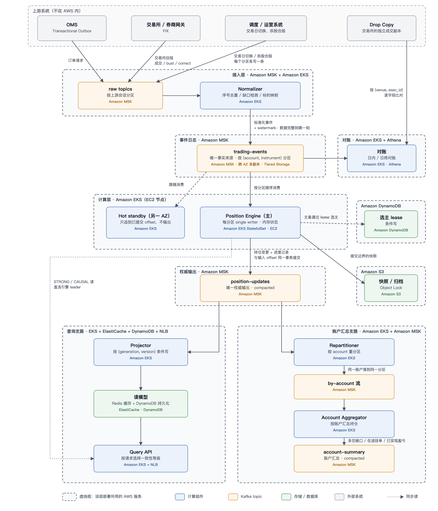
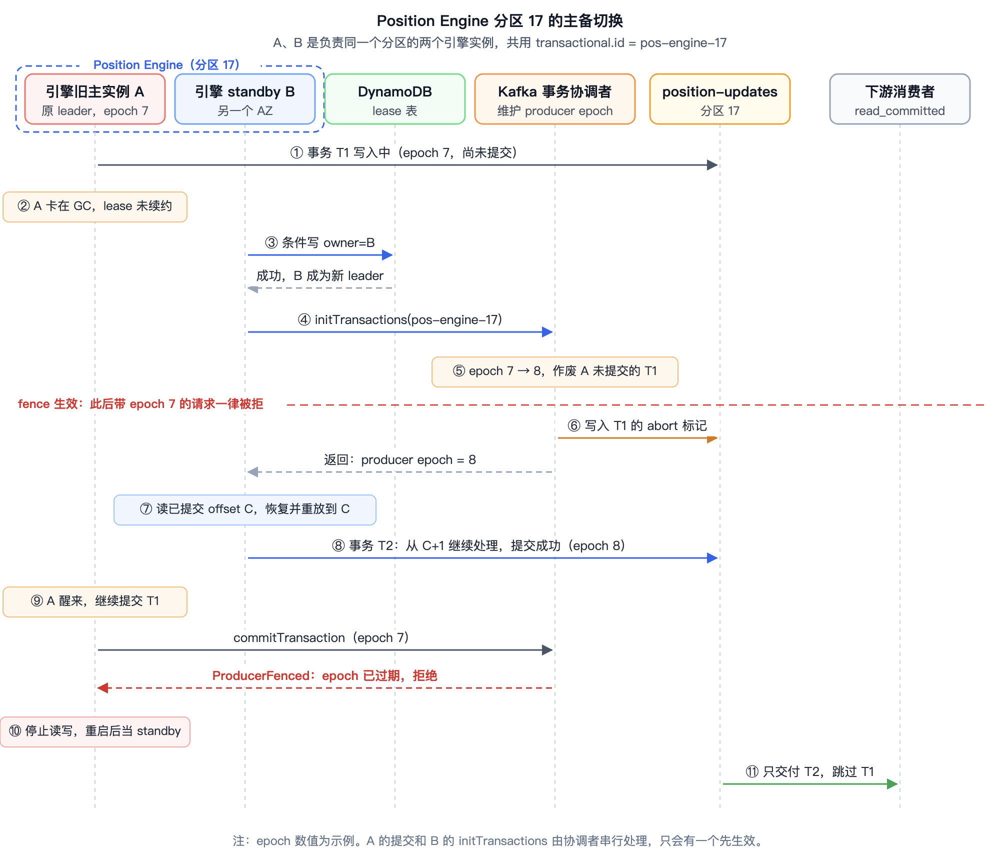

# 分布式持仓服务（Positions Service）系统设计

> **需求**
> ：在 AWS 上为交易平台设计一个分布式持仓服务。该服务是业务关键服务，需要处理每一笔订单事件和每一笔成交，保证全系统看到的持仓一致、实时。设计目标有三个：容错；在故障和重放下仍然准确一致；在规模增长时保持高性能、低延迟。

***

## 1. 系统目标

持仓服务解决的问题是：某个账户在某个标的上，现在持有多少、成本多少、还有多少挂单没成交。它是区别于交易核心链路的旁路系统，不在下单的Hot Path上。服务只负责产出权威的持仓和账户汇总。系统需要解决以下问题：

* 重复和丢失：上游重发、producer 重试、consumer 重启都会带来重复。每笔成交只能计入一次，也不能漏掉。

* 乱序：成交可能比订单确认先到，多个来源之间没有全局顺序，持仓和挂单敞口仍然要算对。

* 事后更正：交易所会撤销（bust）或更正（correct）已经回报的成交，有时跨日，持仓要能准确修正。

* 突发和热点：开盘、收盘时流量翻几倍，做市商账户集中在少数 key 上，延迟仍要稳定。

* 容错：节点、AZ 甚至整个 Region 故障时不丢数据，不出现两个写者，并能快速恢复。

***

## 2. 总体架构

| 层级 | AWS 服务 | 说明 |
|---|---|---|
| 事件日志、权威输出、账户汇总 | Amazon MSK | 所有 topic 都放在同一个 MSK 集群，跨 AZ 多副本；`trading-events` 开 Tiered Storage，旧数据自动下沉 |
| 计算组件 | Amazon EKS（EC2 节点） | Normalizer、Position Engine、Projector、Repartitioner、Aggregator、Query API 都跑在 EKS 上；引擎用 StatefulSet，主备分在不同 AZ |
| 选主 lease | Amazon DynamoDB | 条件写实现 lease，只决定由谁接管 |
| 快照与归档 | Amazon S3 | 引擎快照和原始事件归档，开 Object Lock 满足不可篡改的审计要求 |
| 读模型 | ElastiCache Redis + DynamoDB | Redis 做热缓存，DynamoDB 做持久化读模型 |
| 查询入口 | NLB | Query API 前面挂 NLB |
| 对账与历史查询 | Amazon EKS + Athena | 对账任务跑在 EKS 上，历史数据用 Athena 直接查 S3 |

上游事件先写入 raw topic，Normalizer 做序号去重、缺口检测和标的映射，然后写入 `trading-events`。这个 topic 是唯一事实来源。每个分区由一个 Position Engine 实例在内存里串行计算，结果写到唯一的权威输出流 `position-updates`。下游全部从这条流派生，分两条支路：Projector 写 Redis / DynamoDB，经 Query API 提供单个持仓的查询；Repartitioner 按账户重新分区，交给 Account Aggregator 算出账户级汇总，写入 `account-summary`。

对外的出口就是这两条支路的终点：Query API 和 `account-summary`。消费方可以调用 Query API 查询，也可以直接订阅 Kafka 流，历史数据从 S3 归档查。

***

## 3. 数据分区

每一层按 "谁来消费、需要保证什么顺序" 来选分区键：

| 数据                               | 分区键                          | 原因                                              |
| -------------------------------- | ---------------------------- | ----------------------------------------------- |
| raw topics                       | 上游会话（FIX session、OMS outbox） | 会话内序号保持有序，Normalizer 才能按序号去重、发现缺口               |
| `trading-events`                 | `(account, instrument)`      | 订单和持仓落在同一分区；热点账户和热门标的都被打散分区数上线后不再变，不然路由拓扑关系会被打乱 |
| Position Engine                  | 一个分区对应一个单线程事件循环              | 分区内 single writer，不需要锁；一个 Pod 承载多个分区            |
| `position-updates`               | 持仓键，与 `trading-events` 一一对应  | 每个引擎事务只读写自己被分配到的分区                              |
| by-account 流 / `account-summary` | `account`                    | 账户汇总要拿到同一账户的全部持仓，所以按账户分区                        |
| Redis / DynamoDB                 | 按 account 聚合                 | 列出一个账户的持仓只访问一个分片                                |

### 3.1 主分区键选 (account, instrument)

按 account 分区，账户视图天然一致，但一个做市商账户高频交易记录就能压垮单个分区。

按 instrument 分区，SPY、TSLA 这样的热门标的又会成为热点。`(account, instrument)` 把两类热点都打散了。另外，一个订单只属于一个账户和一个标的，订单状态和对应的持仓落在同一个分区，处理订单事件时不需要跨分区协调。

同一 `(account, instrument)` 下的多个 book（同一账户内的子账户或策略簿）也落在同一分区。book 之间划转持仓时，要同时改两个 key，比如把策略 1 的 300 股 AAPL 划给策略 2：一边减 300，一边加 300。两条变更在同一个事务里提交，下游不会看到一边减了、另一边还没加的中间状态。这个保证只覆盖同一账户、同一标的下的 book 之间；跨账户转仓的两个 key 落在不同分区，只能保证最终收敛。

按 `(account, instrument)` 分区的代价是账户级视图要多一个账户维度聚合阶段。跨分区的 key 之间没有全局顺序，所以账户汇总只能最终收敛，不是某一时刻的一致快照。需要严格一致的账户级风控由交易系统在下单路径上自己做，不依赖这个汇总。

### 3.2 分区数一开始就定死

分区数在上线时按高峰流量一次定好，并留足余量。每个分区分到的流量远低于单线程的处理能力，日后增长有空间，负载也能摊到足够多的 Pod 上。

之后不再加分区。Kafka 扩分区会改变 key 到分区的映射，同一个 key 的新旧事件落在不同分区，单 key 有序就保证不了了。

扩容时迁移的是分区和引擎 Pod 的对应关系（lease 交接 + 快照恢复 + fencing），分区数不变。

### 3.3 作用于整个分区的事件，每个分区各写一条

有些事件不针对某一个持仓，而是会影响分区里的很多甚至全部 key：

* 交易日切换（day roll）：把每个持仓的收盘状态记为下一交易日的期初持仓，并把当日盈亏、买卖量清零。

* 拆股合股（corporate action）：按比例调整持有该标的的所有持仓的数量和成本。持有同一标的的账户分散在各个分区里，所以每个分区都要收到。

这类事件会向每个分区各写一条。

### 3.4 下游分区和上游对齐

`position-updates` 和 `trading-events` 用相同的分区数和分区函数，引擎第 p 个分区的输入 offset 和输出在同一个事务里提交；standby 只需读对应分区输出里的进度记录（引擎已提交到哪个输入 offset），就知道自己该追到哪里。

第二阶段由 Repartitioner 把权威输出按 account 重新分区，同一个输入事件产生的多条记录在一个事务里提交。Account Aggregator 按 by-account 流的分区分片，每个实例只消费自己负责的分区，就能拿到所负责账户的全部持仓。读模型同样按账户聚合：Redis 用 account 做 hash tag，同一账户的持仓在同一个 slot；DynamoDB 以 generation + account 为 partition key，列出一个账户的持仓是一次 Query。

### 3.5 分区解决不了的热点

单个 `(account, instrument)` 的事件只能由一个线程串行处理，不能再拆。如果单账户的单个标的交易频率过高，可能会有单点瓶颈，但是概率不大（因为会被交易所的交易性能所限制）

***

## 4. 关键设计决策

### 4.1 持仓是事件日志的派生状态

所有状态变化先进 MSK，持仓只是对日志的计算结果。最大的好处是什么都能重建：读模型丢了，从输出流重建；引擎崩了，用快照加日志恢复；发现计算 bug，从归档日志全量重算。审计时，任何一个持仓版本都能追到产生它的具体成交。

另一种做法是用 Aurora 这类数据库当台账，每笔成交更新一行。这种方案的问题是RDBMS的性能天然要比只暴露简单AppendOnly语义的MSK要差很多。

### 4.3 每个层级都需要有自己的去重逻辑

重复来自不同层次，每层用自己的手段处理：

* Producer：Kafka 幂等 producer，处理网络重试。

* Normalizer：按上游会话的序号去重，按照序号Buffer住（直到有一段连续的完整数据才往下发），处理 outbox 重发、网关重发和 Normalizer 自身重启。出现序号长期缺口时触发补发（FIX ResendRequest）

* Position Engine ：按 `(venue, exec_id)` 和订单修订号做业务去重，覆盖整个更正窗口。这一层处理交易所重发、Drop Copy 与主回报重复这类情况。它们的源序号不同，前两层识别不出来。

* 下游数据库：按 `(generation, version)` 条件写，所以读模型只需要 at-least-once。

### 4.4 Position Engine算Inflight 敞口所需的订单状态

持仓服务不是 OMS，订单状态只保留到能算出剩余挂单量（leaves）为止。订单的累计成交直接从持仓用的同一份有效成交表求和，所以不会出现持仓已经撤销、订单累计成交却没回滚的情况。

有几条语义必须以交易所确认为准：只有新单被拒才结束订单，改单被拒、撤单被拒时原订单仍然有效；比订单确认先到的成交照样计入持仓；成交被 bust 后，已经全部成交的订单不会自动恢复可交易，要等交易所后续的 restated 消息。

### 4.5 一条权威输出流，读写分离

如果引擎同时写变更流和最新状态流两个 topic，可能只有一个写成功。因此只保留一条 compacted 的 `position-updates`：每个 key 的最新记录永久保留，用于初始化；最近几天的历史版本不压缩，供下游增量消费。由于每个分区只有一个写者，而且按事务提交，日志里位置最靠后的已提交记录一定是版本最大的那条，compaction 不会留下旧状态。

Redis、DynamoDB 和账户汇总都是从这条流派生的读模型（CQRS）。写路径只负责正确，读模型按访问方式优化，坏了可以随时重建。所以 Redis 只当缓存，不当事实来源。

### 4.6 Generation：有些重建做不到逐条一致

每条输出都带 `version`，下游按版本单调递增做幂等。但有两种情况，同一个 version 在重建前后会对应不同的内容：

* Region 切换：跨 Region 异步复制会丢掉末尾一段日志，上游补发之后，跨来源事件的交错顺序可能和原来不同。

* 全量重算：修复 bug 或修改计算口径后，新代码对同样的输入会算出不同的结果。

如果版本号沿用，客户端缓存着旧的 v100，按 "只接受更大版本" 的规则会拒收修正后的 v100。所以引入 `generation`：每次发生这类重建就提升 generation，输出 topic、读模型命名空间和版本计数器都按 generation 隔离，所有比较先比 generation、再比 version。切换 generation 是一次原子的路由动作；消费方看到 generation 变化，就丢弃本地缓存，按新 generation 重建。

***

## 5. Position Engine 的主备切换与 fencing

这一章讲的对象是 Position Engine。它负责 `trading-events` → `position-updates` 这一段，每个分区有一个主实例在写，另有一个 hot standby 在另一个 AZ 待命。主实例故障时由 standby 接管，这一章讲接管过程中怎么保证旧的主实例不会继续往 `position-updates` 写。下文的 A、B 分别指同一个分区的旧主实例和 standby 实例。

Normalizer、Repartitioner、Account Aggregator 也用 Kafka 事务做 consume-process-produce，各自按输入分区固定 `transactional.id`，fencing 机制相同。这里以 Position Engine 为例，因为它写的是唯一的权威输出，还要直接响应 `STRONG` / `CAUSAL` 读，旧实例继续工作的后果最严重。

### 5.1 复活的旧引擎实例可能没有真正的挂掉

"引擎实例挂了"没法被准确判断。GC 停顿、线程被挂起、网络短暂分区时，旧的引擎实例在别人看来已经死了，其实还活着，内存里可能还有一批算好、还没写完的持仓变更。

常见的写法是引擎写 `position-updates` 之前先确认自己还持有这个分区的 lease。问题出在确认和写入之间的空档：A 刚确认 lease 有效，就进入一次 10 秒的 GC；这期间 lease 过期，B 接管并开始写；A 醒来后不会再确认一次，直接把手里那批数据写出去。这时两个引擎实例在同时写 `position-updates` 的同一个分区，下游看到的持仓会重复或错乱。

只要是"先检查、再写"，这个空档就一定存在，把 lease 调短只能让它变小。

要做到确保旧实例一定无法写入，就需要用到MKS的fencing能力：每次 producer 启动并调用 initTransactions()，kafka 协调者就把 epoch 加 1。这样同一个 transactional.id 的旧 producer 手里的 epoch 就过期了，它之后的写和提交都会收到 ProducerFencedException

### 5.2 选主和隔离分开

| 机制 | 负责什么 | 判断错了会怎样 |
|---|---|---|
| Lease（DynamoDB 条件写，定期续约） | 决定哪个引擎实例接管这个分区、什么时候接管 | 多切一次或者切换变慢，只影响可用性 |
| Producer fencing（Kafka 事务） | 保证同一分区只有一个引擎实例能向 `position-updates` 提交 | 依赖 Kafka 事务本身的正确性 |
| 下游 `read_committed` | 下游只读到已提交的数据 | 配成 `read_uncommitted` 会读到被作废的数据 |

Lease 判断错了，比如 A 只是慢了一点就被接管，结果是多切一次，A 被 fence 后重启；接管晚了，这个分区的持仓更新停一会儿。两种情况都不会出现两个引擎实例同时提交。正确性由后两行保证，不依赖时钟。

### 5.3 Fencing 的过程

Position Engine 每一批输出（持仓变更、进度记录）和 `trading-events` 的消费 offset 在同一个 Kafka 事务里提交，fencing 建立在这个事务上：

1. 身份固定。引擎的每个分区用一个固定的 `transactional.id`，分区 17 不管由 A 还是 B 来写，都是 `pos-engine-17`。Kafka 的事务协调者为每个 transactional.id 维护一个 producer epoch。
2. 接管时 epoch 加 1。B 拿到 lease 后调用 `initTransactions()`，协调者把 epoch 从 7 改成 8，同时作废 A 还没提交的事务 T1，在 T1 写过的分区里写入 abort 标记。
3. 旧 epoch 一律拒绝。之后的写入和提交请求都带着 epoch。A 醒来后用 epoch 7 提交 T1，收到 `ProducerFenced`，随即停止所有读写，重启后当 standby。
4. 下游跳过作废的数据。T1 的数据可能已经写进了分区，但 `read_committed` 的消费者会跳过它，只看到 B 的 T2。
5. B 从已提交位置接着做。B 读出已提交的 offset C，这个位置在 T1 之前。它加载不超过 C 的最新快照，重放快照到 C 之间的日志来恢复内存状态；这段输出之前已经提交过，重放时不再发出。然后从 C+1 继续处理。T1 里的消费 offset 和输出一起被作废，所以 T1 对应的输入会被重新处理一遍，不会丢。

这里的 epoch 就是分布式锁里说的 fencing token：单调递增，存储端只接受最新的那个。区别是它由 Kafka 协调者维护，引擎代码不需要自己传。

### 5.4 几个细节

- **transactional.id 要按分区固定，不能按实例命名。** 如果 A 用 `engine-host-a`、B 用 `engine-host-b`，协调者会把它们当成两个无关的 producer，各有各的 epoch，谁也 fence 不掉谁。负责同一个分区的引擎实例必须共用同一个身份。
- **A 的提交和 B 的初始化同时到达。** 协调者对同一个 transactional.id 的请求串行处理。A 的提交先到，T1 正常提交，B 读到的已提交 offset 就包含 T1，接着往后处理；B 的初始化先到，T1 被作废，A 的提交被拒绝。不会两边都成功，这是MSK的底层机制保证的。
- **Hot standby 只追到已提交位置。** Standby 引擎实例部署在另一个 AZ，跟着消费 `trading-events`，但只追到 `position-updates` 进度记录里的已提交 offset，自己不输出。接管时只需要追平，切换时间主要花在判定 lease 过期上。
- **扩容迁移走同一套流程。** 把一个分区从旧的引擎 Pod 挪到新 Pod，就是一次主动交接：旧 Pod 释放 lease，新 Pod 拿到 lease、调用 `initTransactions()`、恢复状态后接管。
- **快照写 S3 不受 fencing 保护，但不影响正确性。** 旧主实例在被 fence 之前也可能写出引擎快照。快照只在已提交的边界生成、按 offset 命名，计算又是确定性的，所以内容一定正确；恢复时也只选 offset 不超过已提交位置的快照。

### 5.5 epoch、generation、version 是三个不同的版本号

时序图里出现了 epoch，引擎的每条持仓变更里还带 generation 和 version。这三个数都单调递增，但粒度和用途完全不同，放在一起对比：

| | 粒度 | 什么时候变 | 谁维护 | 用途 |
|---|---|---|---|---|
| producer epoch | 一个分区的写者 | 每次 `initTransactions`，主备切换时 | Kafka 事务协调者 | 存储端 fence 旧写者；业务代码不拿它判断数据新旧 |
| generation | 整份交易历史（所有 key） | Region 切换、全量重算 | 持仓服务，记在 generations 表里 | 区分两份不能逐条对应的历史 |
| version | 单个持仓 key | 这个 key 每提交一次变更 | Position Engine，按 key 各自计数 | 同一 generation 内判断状态先后、幂等 |

先看 generation 和 version。

- **version 是单个持仓 key 的状态版本。** 粒度是 `(account, instrument, book)`。这个 key 每提交一次变更，它的 version 加 1，在同一个 generation 内单调递增、不回退。Projector、读模型和其他消费方按 `(generation, version)` 判断先后，重复的或更旧的变更直接丢弃，所以下游可以用 at-least-once 投递。每个分区的Position Engine每个持仓 key 维护一个计数器。事件处理到这个 key 时先自增，再把新值写进这条变更。
- **generation 是"这一份派生历史"的编号。** 粒度是整个系统的输出，不是某个 key。正常运行时 generation 固定不变，所有 key 在同一个 generation 里各自递增 version。当一次重建无法逐条复现原来的日志前缀时，generation 加 1，新 generation 里所有 key 的 version 都从 1 重新计数。

为什么要分两层：同一个 generation 内，日志前缀唯一决定状态，同一个 version 一定对应同一份内容，version 更大就是更新。全量重算之后，新代码算出的 v100 和旧代码算出的 v100 内容可能不一样。
如果 generation 不变，缓存了旧 v100 的消费方按"只接受更大 version"会把这次修正拒掉。先比 generation 就没有这个问题：generation 更大的整份输出都算新，和 version 的具体数值无关。比较顺序固定为先 generation、后 version。
和这一章的 fencing 串起来：AZ 内主备切换只换了写者，epoch 加 1，但输入日志和派生历史都没变，所以 generation 不变，version 接着已提交位置继续递增。新主 B 写出的下一条变更是同一个 key 的下一个 version，下游正常接受。
另外，epoch 只存在于引擎和 Kafka 之间，不会写进持仓变更。下游拿到的记录里只有 generation 和 version，没有 epoch，也不需要关心写者换了几次。

### 5.6 前提

这套机制有两个前提：Kafka 事务的语义本身正确；所有下游都配置成 `read_committed`。

另外，fencing 只保护引擎写 Kafka 的这一路。引擎的所有输出都先进 `position-updates`，读模型由 Projector 按 `(generation, version)` 条件写，没有绕过 Kafka 直接写外部系统的路径。如果以后引擎要直接写别的存储，那条写入需要另外做 fencing，比如写入时带上 epoch 做条件检查。

***

## 6. 容错与容灾

AZ 级故障：MSK 跨 AZ 多副本部署，已确认的数据不会丢；引擎的 hot standby 在另一个 AZ（切换过程见第 5 节）,Redis、DynamoDB 和账户汇总都能从 Kafka 重建，故障只影响读延迟。

Region 级做主备，不做跨Region的双活，因为异地多活带来的系统复杂度代价会非常大。用 AWS ARC（亚马逊云的路由系统） 把写流量和读流量切换到容灾Region，容灾Region根据复制过来的日志加上游补发（OMS outbox 重放、FIX ResendRequest）重新计算.

***
