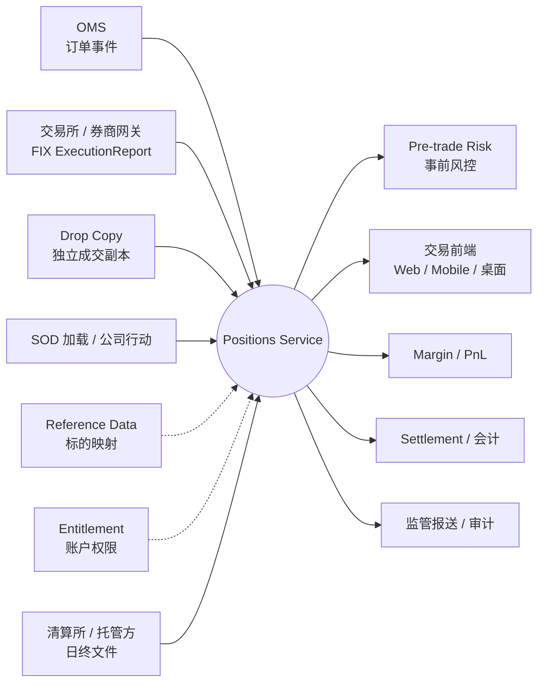
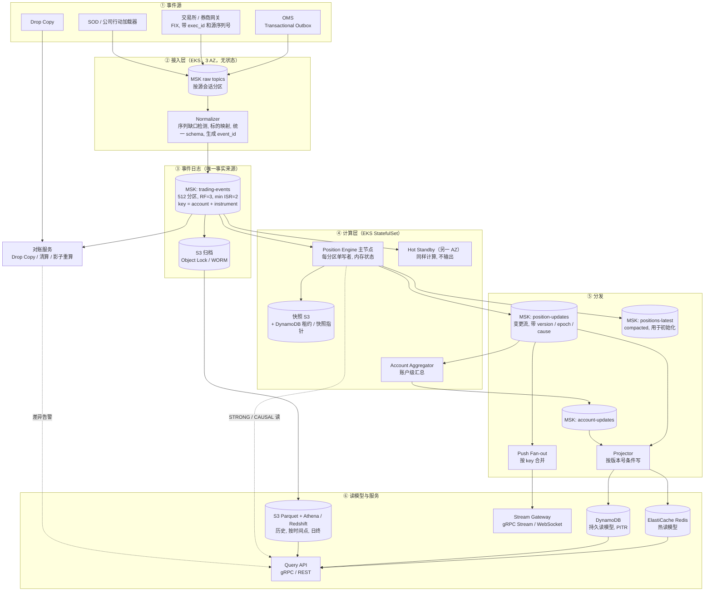
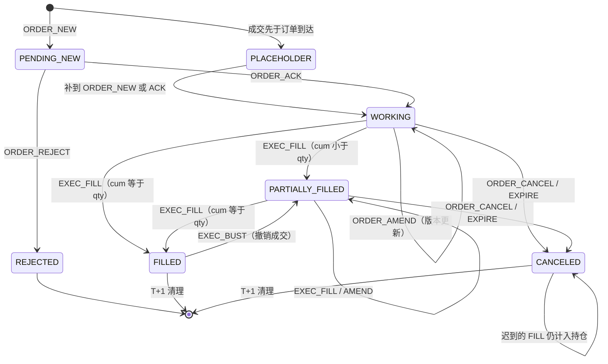
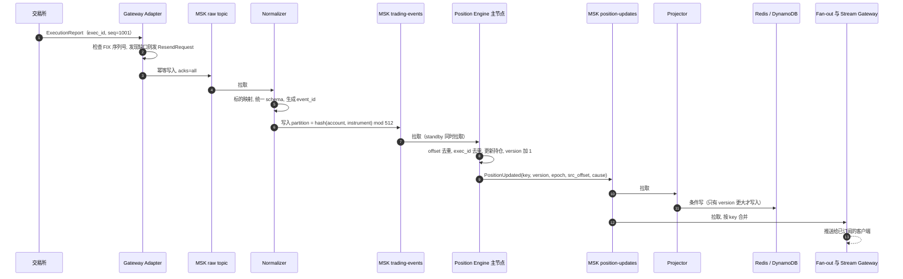
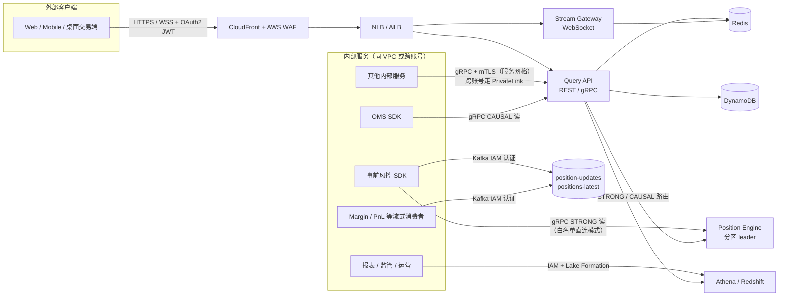
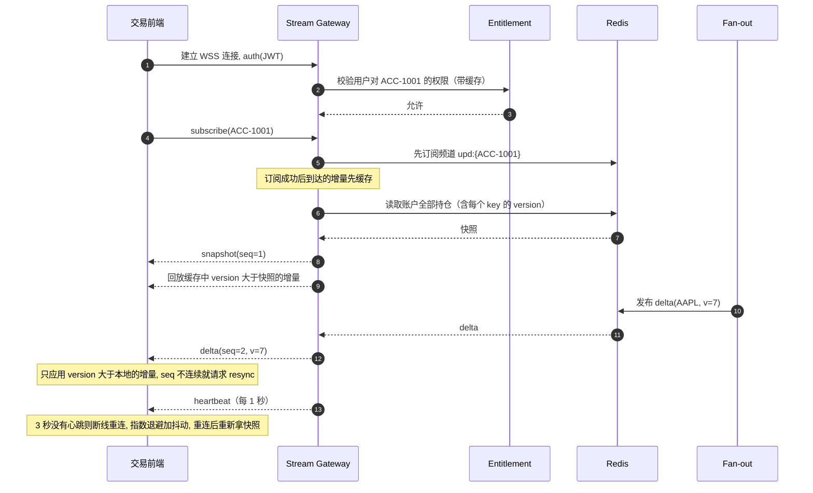
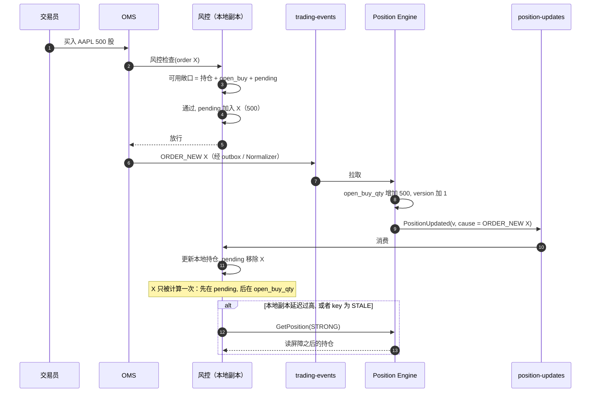
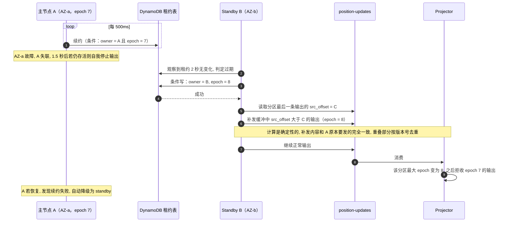
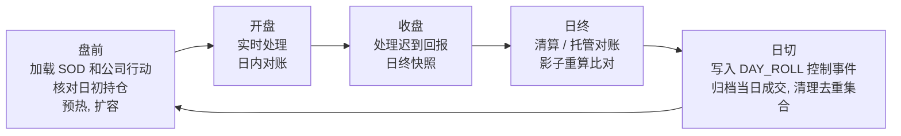

# 分布式持仓服务（Positions Service）系统设计

> 场景：云上（AWS）交易平台的分布式持仓服务。它是业务关键服务，必须处理**每一笔订单事件和每一笔成交**，保证全系统的持仓一致且实时。
> 设计目标：**容错**、**在故障和重放下仍然准确一致**、**大规模下高性能、低延迟**。

| 项目 | 内容 |
|---|---|
| 文档类型 | System Design（架构设计） |
| 覆盖范围 | 服务职责与边界、需求与容量、总体架构、写路径、存储、**客户端访问方式**、一致性、容错、性能、对账审计、可观测性、安全、运维、取舍 |
| 运行环境 | AWS，主 Region 3 个 AZ，另有 1 个 DR Region |
| 数字口径 | 文中的规模、延迟、容量数字都是**设计假设或估算**（见 §3），实际落地前需要和业务方确认并压测 |

---

## 目录

- [0. 摘要](#0-摘要)
- [1. 背景与问题定义](#1-背景与问题定义)
- [2. 服务职责与边界](#2-服务职责与边界)
- [3. 需求与容量估算](#3-需求与容量估算)
- [4. 核心设计原则](#4-核心设计原则)
- [5. 总体架构](#5-总体架构)
- [6. 领域模型与事件模型](#6-领域模型与事件模型)
- [7. 写路径详细设计](#7-写路径详细设计)
- [8. 存储设计](#8-存储设计)
- [9. 客户端如何访问持仓服务](#9-客户端如何访问持仓服务)
- [10. 一致性模型总结](#10-一致性模型总结)
- [11. 容错与高可用](#11-容错与高可用)
- [12. 性能与扩展](#12-性能与扩展)
- [13. 对账、审计与合规](#13-对账审计与合规)
- [14. 可观测性与 SLO](#14-可观测性与-slo)
- [15. 安全](#15-安全)
- [16. 部署与运维](#16-部署与运维)
- [17. 取舍与备选方案](#17-取舍与备选方案)
- [18. 风险与待确认问题](#18-风险与待确认问题)
- [附录 A：术语表](#附录-a术语表)
- [附录 B：面试用 30 秒总结](#附录-b面试用-30-秒总结)

---

## 0. 摘要

**一句话方案**：持仓是成交日志计算出来的状态。以 **MSK（Kafka）事件日志作为唯一事实来源**，按 `(account, instrument)` 分区，每个分区由**唯一写者**的确定性内存引擎计算持仓。所有输出都带 `version` 和 `epoch`，下游**按版本号幂等写入**，所以任何重放都是安全的。

核心要点：

1. **正确性**：至少一次投递 + 两层去重（Kafka offset + 业务键 `exec_id` / 订单版本号）+ 确定性计算 = 效果上的恰好一次。
2. **容错**：MSK 3 AZ 复制（RF=3、min ISR=2）；引擎主节点和 Hot Standby 分属不同 AZ，靠 lease + epoch 在秒级切换；也可以用“快照 + 重放”恢复。Region 级做主备（Pilot Light / Warm Standby），切换后由上游补发和对账补齐缺口。
3. **低延迟**：热路径全在内存，端到端 p99 约 10~20ms（估算）；事前风控直接读引擎，或者在本地维护持仓副本。
4. **客户端访问**：提供四种访问方式，即同步查询（gRPC/REST）、实时订阅（gRPC Stream/WebSocket）、事件流消费（Kafka topic）、历史与批量（S3/Athena）。读取时可以选三档一致性：`EVENTUAL`、`AT_LEAST_VERSION / CAUSAL`、`STRONG`。
5. **可证明的正确**：Drop Copy 日内对账、清算/托管日终对账、每天用日志做一次影子重算并比对 checksum。

---

## 1. 背景与问题定义

交易平台里，订单管理系统（OMS）发出订单，交易所或券商回报成交。几乎所有关键系统都依赖“某账户在某标的上现在持有多少、成本多少、还有多少在途挂单”：

- **事前风控**：下单前检查持仓上限、购买力、卖空限制。
- **交易前端**：实时展示持仓和盈亏。
- **保证金/清算/会计**：计算保证金、核对交收、出日终报表。
- **监管与审计**：任何时点的持仓都要能追溯到具体成交。

难点主要有四个：

| 难点 | 具体表现 |
|---|---|
| 不能丢、不能重 | 网络重试、producer 重试、consumer 重启、上游重发都会产生重复；漏掉一笔成交就意味着风险敞口算错 |
| 乱序 | 成交可能比订单确认先到；撤单和成交可能同时发生；多个来源之间没有全局顺序 |
| 更正 | 交易所可能撤销（Bust）或更正（Correct）已经回报过的成交 |
| 规模和突发 | 开盘、收盘、重大新闻时流量会突增几倍；少数做市商账户会形成热点 |

---

## 2. 服务职责与边界

### 2.1 核心职责（Positions Service 负责）

| # | 职责 | 说明 |
|---|---|---|
| R1 | **完整处理所有订单事件和成交事件** | 不丢、不重复计算；能检测并补齐上游序列缺口 |
| R2 | **维护权威持仓** | 粒度为 `(account, instrument, book)`，包括净数量、成本基础 / 均价、已实现盈亏、当日买卖量、日初数量、版本号 |
| R3 | **维护在途挂单敞口** | 只维护轻量订单状态，用来算 open buy / open sell（`leaves` 数量）；**不是** OMS |
| R4 | **账户级聚合** | 按账户汇总多空数量、按成本计的名义敞口、在途挂单名义金额、已实现盈亏 |
| R5 | **查询服务** | 单 key / 批量 / 按账户列表 / 按时间点（as-of）/ 历史查询；支持多档一致性 |
| R6 | **实时变更推送** | 向 UI、风控、保证金等系统推送持仓变化（快照 + 增量） |
| R7 | **交易日生命周期** | 加载日初持仓（SOD）、应用公司行动（拆股、合股、代码变更等）、做日终快照、处理日切 |
| R8 | **对账与差异告警** | 日内和 Drop Copy 核对；日终和清算所 / 托管方核对；内部影子重算 |
| R9 | **审计追溯** | 任何持仓版本都能追溯到产生它的事件链（lineage） |
| R10 | **数据质量自检** | 发现序列缺口、未知标的、无法处理的事件时，隔离受影响的 key，并**明确标记为 `STALE`**，绝不静默给出错误数字 |

### 2.2 不负责的内容

| 不负责 | 归属系统 | 与持仓服务的关系 |
|---|---|---|
| 下单、路由、撮合 | OMS / EMS | 持仓服务消费 OMS 的订单事件 |
| 风控决策（是否放行某个订单） | Pre-trade Risk | Risk 是持仓服务的**客户端**；持仓服务提供数据、读屏障和事件因果标识（§9.8） |
| 行情、估值、浮动盈亏的定价 | Market Data / PnL Service | 持仓状态里**不放行情**，以保证确定性；查询层可以用最新标记价补充浮动盈亏，并标明标记时间 |
| 现金余额、资金台账、交收 | Cash Ledger / Settlement | 持仓服务消费交收确认用于对账 |
| 保证金计算 | Margin Service | 订阅持仓变更 |
| 账户主数据、用户权限 | Account / Entitlement Service | 持仓服务调用它做鉴权（结果会缓存） |
| 标的参考数据 | Reference Data | 规范化阶段用它把交易所代码映射成内部 `instrument_id` |
| 监管报送 | Regulatory Reporting | 消费日终快照和审计数据 |

> 边界原则：**持仓服务只保存可以从事件日志确定性推导出来的状态。** 行情这类高频、非确定性输入不进入持仓状态机，这样“重放结果完全一致”的保证才成立。

### 2.3 上下游关系（Context）



### 2.4 对客户端的服务承诺（Service Contract）

| 承诺 | 内容 |
|---|---|
| 单 key 有序 | 同一 `(account, instrument, book)` 的变更严格按日志顺序生效，`version` 单调递增，不会回退 |
| 不丢更新 | 每个被接受的事件最终一定会反映到持仓里；如果做不到（例如事件格式坏了），该 key 会被标为 `STALE` 并告警 |
| 不重复计算 | 同一 `exec_id` 只计入一次，与重试或重放次数无关 |
| 陈旧度可见 | 每个响应都带 `version`、`as_of`（数据截至时间）和 `staleness_ms`，客户端可以自己判断是否可用 |
| 时效 | 交易时段内，事件写入后 p99 < 20ms 可以在 `EVENTUAL` 读和订阅中看到（目标值） |
| 可用性 | 查询和订阅 99.99%；`STRONG` 读在分区切换期间（约 2~3 秒）可能短暂返回 `UNAVAILABLE` |
| 可追溯 | 任意版本都能查询其事件链；原始事件按监管要求保留（例如 7 年，WORM） |

---

## 3. 需求与容量估算

### 3.1 功能需求

1. 消费订单事件：`NEW / ACK / AMEND（含 Replace）/ CANCEL / REJECT / EXPIRE`。
2. 消费成交事件：`FILL / PARTIAL_FILL / BUST / CORRECT`。
3. 消费控制事件：`SOD_POSITION`（日初基线）、`CORP_ACTION`（公司行动）、`DAY_ROLL`（日切）、`MANUAL_ADJUSTMENT`（人工调账，需要审批）。
4. 计算并维护持仓、在途挂单敞口、账户汇总。
5. 低延迟查询、实时推送、按时间点查询、事件链查询。
6. 日内对账、日终对账、日终快照。

### 3.2 非功能需求（假设，需要和业务确认）

| 维度 | 目标 |
|---|---|
| 规模 | 500 万账户、约 2,000 万活跃持仓、高峰时约 1,000 万在途订单 |
| 吞吐 | 高峰 20 万事件/秒；日均约 10 亿事件（订单事件约 7 亿 + 成交约 3 亿） |
| 写入到可读延迟 | p99 < 20ms（`EVENTUAL` 读和推送）；引擎内处理单事件 < 0.1ms |
| 事前风控读延迟 | p99 < 1ms（本地副本）或 < 5ms（同步 `STRONG` 读） |
| 正确性 | 效果上恰好一次；重放结果按位一致 |
| 可用性 | 99.99%；单 AZ 故障时 RPO=0、RTO 约 2~3 秒；Region 故障时 RTO 在分钟级，RPO 由上游补发补齐 |
| 审计 | 事件不可篡改、可完整重放、长期保留 |

### 3.3 容量估算（估算值）

| 项目 | 计算 | 结果 |
|---|---|---|
| 交易时段平均吞吐 | 10 亿 ÷ (6.5h × 3600s) | ≈ 4.3 万事件/秒（高峰约为平均的 4.7 倍） |
| 每个分区的高峰吞吐 | 20 万 ÷ 512 分区 | ≈ 390 事件/秒/分区 |
| 写入带宽 | 20 万 × 约 1KB | ≈ 200 MB/s（3 副本后约 600 MB/s 磁盘写） |
| 每日数据量 | 10 亿 × 1KB | ≈ 1 TB/天（原始），冷数据下沉到 S3 |
| 持仓状态内存 | 2,000 万 × 约 300B | ≈ 6 GB |
| 订单状态内存 | 1,000 万 × 约 300B | ≈ 3 GB |
| 当日成交日志（用于更正时重算） | 3 亿 × 约 48B | ≈ 14.4 GB |
| 引擎总内存 / 每个 Pod | (6 + 3 + 14.4) GB ÷ 32 个主 Pod | ≈ 0.73 GB/Pod（另有同样数量的 Standby） |
| Redis 读模型 | 2,000 万 × 约 500B | ≈ 10 GB（Cluster 模式多分片） |
| WebSocket 连接 | 假设 50 万并发 ÷ 每节点 5 万 | ≈ 10 个网关节点（按 2 倍冗余部署） |

---

## 4. 核心设计原则

| # | 原则 | 带来的好处 |
|---|---|---|
| P1 | **以日志为唯一事实来源**：所有状态变化先进入 MSK，持仓只是对日志的计算结果 | 任何派生数据都能重建；审计天然完整 |
| P2 | **按分区单写者**：每个分区同一时刻只有一个线程写 | 不需要分布式锁和事务，延迟可预测 |
| P3 | **确定性计算**：不读墙钟、不读外部可变数据；时间相关逻辑通过控制事件（如 `DAY_ROLL`）进入日志；全部使用定点数 | 快照 + 重放 = 精确恢复；主备计算结果按位一致 |
| P4 | **至少一次投递 + 幂等处理**：两层去重，输出带版本号，下游条件写 | 不依赖昂贵的分布式事务，也能达到效果上的恰好一次 |
| P5 | **防止多个写者**：lease + 单调递增 epoch，下游拒收旧 epoch | 防止僵尸实例和脑裂造成数据分叉 |
| P6 | **读写分离（CQRS）**：写路径只关心正确性，读路径按访问方式各自优化 | 写路径保持最简；读模型挂了也能从日志重建 |
| P7 | **宁可明确说不知道，也不给错误数字**：异常 key 隔离并标记 `STALE` | 风控可以按 fail-closed 原则处理 |

---

## 5. 总体架构

### 5.1 架构图



### 5.2 组件清单

| 组件 | AWS 实现 | 作用 | 有无状态 | 部署 |
|---|---|---|---|---|
| Gateway Adapter | EKS | 接收 FIX 回报，写入 raw topic | 有会话状态（FIX 序列号） | 主备，跨 AZ |
| Normalizer | EKS Deployment | 缺口检测、标的映射、统一 schema、重新分区 | 无状态 | 3 AZ，水平扩展 |
| 事件日志 | Amazon MSK（Provisioned，Tiered Storage） | 唯一事实来源 | 有状态 | 3 AZ，RF=3 |
| Position Engine | EKS StatefulSet | 持仓计算、强一致读 | 内存状态 + 快照 | 32 主 + 32 备，跨 AZ |
| Account Aggregator | EKS StatefulSet | 账户汇总 | 内存状态（可重建） | 同上 |
| Projector | EKS Deployment | 写 Redis / DynamoDB | 无状态 | 3 AZ |
| Push Fan-out | EKS Deployment | 合并后推给 Stream Gateway | 无状态 | 3 AZ |
| Query API | EKS + NLB / ALB | 查询入口、路由、鉴权 | 无状态 | 3 AZ |
| Stream Gateway | EKS + NLB | 长连接推送 | 连接状态 | 3 AZ |
| 热读模型 | ElastiCache Redis（Cluster 模式） | 亚毫秒读 | 可重建 | 每分片 1 主 2 从跨 AZ |
| 持久读模型 | DynamoDB | 持久化当前持仓、日终快照 | 有状态 | 区域级，PITR |
| 租约 / 快照指针 | DynamoDB | 分区 leader 选举、快照位置 | 有状态 | 区域级 |
| 归档与数据湖 | S3（Object Lock）+ Glue + Athena / Redshift | 审计、历史查询、全量重放 | 有状态 | 跨区复制 |
| 对账服务 | EKS CronJob / 流式任务 | 差异检测 | — | — |

### 5.3 两条主路径

- **写路径**：事件源 → raw topic → Normalizer → `trading-events` → Position Engine → `position-updates` → Projector / Fan-out → Redis / DynamoDB / 推送。
- **读路径**：客户端 → Query API → 按一致性等级读 Redis / DynamoDB / 引擎；或者客户端 → Stream Gateway 订阅；或者直接消费 Kafka topic；或者查 Athena。

---

## 6. 领域模型与事件模型

### 6.1 统一事件结构（Protobuf，注册到 Glue Schema Registry）

```protobuf
syntax = "proto3";
package positions.events.v1;

message TradingEvent {
  string   event_id        = 1;   // 确定性 ID：hash(source, source_session, source_seq) 或业务键
  string   source          = 2;   // OMS / GW-NYSE-01 / DROPCOPY / SOD / OPS
  string   source_session  = 3;
  uint64   source_seq      = 4;   // 源内单调序列号，用于缺口检测
  EventType type           = 5;
  string   account_id      = 6;
  string   instrument_id   = 7;   // 内部标的 ID（Normalizer 映射后）
  string   book_id         = 8;   // 子账户 / 策略簿，默认 "default"
  string   order_id        = 9;
  uint32   order_version   = 10;  // 改单递增
  string   exec_id         = 11;  // 成交唯一 ID（交易所提供）
  string   ref_exec_id     = 12;  // BUST / CORRECT 指向的原成交
  Side     side            = 13;
  Fixed    qty             = 14;  // 定点数
  Fixed    price           = 15;
  Fixed    order_qty       = 16;  // 订单事件：订单总量
  string   trade_date      = 17;  // YYYY-MM-DD
  int64    ts_exchange_ns  = 18;
  int64    ts_ingest_ns    = 19;
  map<string,string> attrs = 20;  // 扩展字段（费用、流动性标记等）
}

message Fixed { int64 hi = 1; uint64 lo = 2; int32 scale = 3; } // int128 定点数

enum Side { SIDE_UNSPECIFIED = 0; BUY = 1; SELL = 2; SELL_SHORT = 3; }

enum EventType {
  EVENT_TYPE_UNSPECIFIED = 0;
  ORDER_NEW = 1; ORDER_ACK = 2; ORDER_AMEND = 3; ORDER_CANCEL = 4;
  ORDER_REJECT = 5; ORDER_EXPIRE = 6;
  EXEC_FILL = 10; EXEC_BUST = 11; EXEC_CORRECT = 12;
  SOD_POSITION = 20; CORP_ACTION = 21; DAY_ROLL = 22; MANUAL_ADJUSTMENT = 23;
}
```

### 6.2 持仓数据模型

| 字段 | 类型 | 含义 |
|---|---|---|
| `account_id / instrument_id / book_id` | string | 持仓键 |
| `trade_date` | date | 当前交易日 |
| `sod_qty` | Fixed | 日初数量 |
| `net_qty` | Fixed | 当前净持仓（正为多，负为空） |
| `cost_basis` | Fixed | 当前持仓的总成本（精确值）；均价 = `cost_basis / |net_qty|`，读取时计算 |
| `realized_pnl` | Fixed | 当日已实现盈亏（毛额） |
| `fees` | Fixed | 当日费用（来自回报，可选） |
| `bought_qty / sold_qty` | Fixed | 当日累计买入 / 卖出量 |
| `open_buy_qty / open_sell_qty` | Fixed | 在途挂单剩余量（由订单状态推导） |
| `open_buy_notional / open_sell_notional` | Fixed | 在途挂单名义金额（限价单按限价，市价单按参考价） |
| `version` | uint64 | 该 key 的状态版本，从日志确定性推导，单调递增 |
| `epoch` | uint64 | 产生该版本的写者 epoch |
| `src_offset` | uint64 | 产生该版本的 `trading-events` offset |
| `cause` | struct | 触发该版本的事件身份：`{type, order_id, order_version, exec_id, event_id}` |
| `status` | enum | `OK / STALE / RECONCILING` |
| `last_event_ts / updated_at` | timestamp | 最后事件的交易所时间 / 处理时间 |

### 6.3 订单状态机（只用于计算在途敞口）



关键规则：
- **在途剩余量由状态推导**：`leaves = max(0, order_qty - cum_qty)`，终态订单 `leaves = 0`。持仓上的 `open_buy_qty` 是同 key 下所有活跃买单 `leaves` 之和。这样即使事件乱序（成交先于确认、撤单和成交同时发生），最终结果也是对的。
- **迟到成交照样计入持仓**：订单已撤销后又到达的成交（撤单和成交同时发生）必须计入持仓。
- **过期的改单丢弃**：`order_version` 不大于当前版本的 AMEND 直接忽略。

### 6.4 持仓计算规则（加权平均成本法）

所有金额和数量都使用 **int128 定点数（scale = 1e-8）**，舍入统一采用 banker's rounding，保证跨语言、跨节点、重放后结果按位一致。

```text
apply_fill(pos, side, q, px):            # q > 0；买为 +q，卖为 -q
  s = +1 if side == BUY else -1
  if pos.net_qty == 0 or sign(pos.net_qty) == s:          # 开仓或加仓
      pos.cost_basis += q * px
      pos.net_qty    += s * q
  else:                                                    # 减仓、平仓或翻仓
      close = min(|pos.net_qty|, q)
      removed_cost = round(pos.cost_basis * close / |pos.net_qty|)
      pos.realized_pnl += sign(pos.net_qty) * (close * px - removed_cost)
      pos.cost_basis -= removed_cost
      pos.net_qty    += s * close
      remain = q - close
      if remain > 0:                                       # 翻仓：剩余部分按成交价开新仓
          pos.cost_basis = remain * px
          pos.net_qty    = s * remain
  (side == BUY ? pos.bought_qty : pos.sold_qty) += q
```

期货、期权需要乘合约乘数（`notional = qty × px × multiplier`）。如果业务需要 FIFO / 税批次（tax lot），就把 `cost_basis` 扩展成批次队列，内存会相应增加（见 §18）。

**示例**（只演示成交事件，单位：股、美元）：

| 版本 | 事件 | 净数量 | 均价 | 本笔已实现 | 累计已实现 |
|---|---|---|---|---|---|
| v1 | E1 买 1000 @185 | 1000 | 185.00 | 0 | 0 |
| v2 | E2 买 500 @191 | 1500 | 187.00 | 0 | 0 |
| v3 | E3 卖 600 @190 | 900 | 187.00 | +1,800 | 1,800 |
| v4 | E4 卖 1200 @186（平 900，翻空 300） | -300 | 186.00 | -900 | 900 |
| v5 | E5 买 300 @184（平空） | 0 | — | +600 | 1,500 |
| v6 | **E3 被 BUST** → 按 SOD + E1、E2、E4、E5 重算 | 600 | 185.50 | — | -1,200 |

v6 的重算过程：E1、E2 之后为 1500 股、均价 187；E4 卖 1200 股，已实现 (186-187)×1200 = -1,200，剩 300 股、均价 187；E5 买 300 @184，变成 600 股，均价 (300×187 + 300×184)/600 = 185.5。

> 在加权平均成本法下，撤销一笔历史成交**不能简单反向抵消**，因为后续成交的均价路径已经变了。所以引擎为每个 key 保留当日成交序列，发生 BUST / CORRECT 时**按日志顺序确定性重算该 key**。版本号继续递增，不回退。

---

## 7. 写路径详细设计

### 7.1 写入时序



### 7.2 接入与规范化

- **上游可靠发出**：OMS 用 **Transactional Outbox** 模式：订单写库和出站事件在同一个数据库事务里提交，由 relay 进程投递到 MSK，保证订单事件一定发出（可能重复，下游去重）。
- **序列缺口检测**：每个源会话都有单调递增的 `source_seq`。Gateway Adapter 按 FIX 协议发 `ResendRequest` 补发；Normalizer 再按 `(source, session)` 检查一遍。**每个会话严格按序转发，不越过缺口**：有缺口时，该会话后面的事件先暂存，等缺口补齐再转发（这也是 FIX 引擎的标准行为），因为引擎的事件身份去重依赖会话内序号单调（§7.4）。缺口超过阈值（例如 500ms）未补齐时，告警并把受影响账户标记为可能不完整。如果确认缺口永久丢失（例如上游 SequenceReset），就写入一条缺口标记事件后继续转发；丢失的成交由 Drop Copy 对账发现，以 `DROPCOPY` 来源（另一个会话）补入，最终仍靠 `exec_id` 去重。
- **raw topic 按源会话分区**：这样同一会话的事件严格有序，便于缺口检测。Normalizer 再按持仓键重新分区写入 `trading-events`。
- **确定性 event_id**：`event_id = hash(source, session, source_seq)`。Normalizer 崩溃重启后，重复写入的事件 event_id 相同，引擎可以识别。
- **标的映射失败**：交易所代码映射不到内部 `instrument_id` 时，事件进入 `pending-refdata` 队列并告警，对应账户标记 `STALE`，**不能丢弃**。

### 7.3 分区策略

| 选项 | 优点 | 缺点 | 结论 |
|---|---|---|---|
| 按 `account` | 账户级视图强一致 | 做市商等热点账户会压垮单个分区 | 不采用 |
| 按 `instrument` | 标的维度聚合方便 | 热门标的（如 SPY、TSLA）形成热点；账户视图分散 | 不采用 |
| **按 `(account, instrument)`** | 订单和持仓在同一分区（一个订单只属于一个账户和一个标的）；热点被分散 | 账户级汇总需要第二阶段 | **采用** |

- 分区函数由共享库实现：`partition = murmur3_64(account_id + "|" + instrument_id) mod 512`。producer 显式指定分区，不依赖各语言 Kafka 客户端默认分区器的差异。
- **一开始就预留 512 个分区**。Kafka 扩分区会改变 key 到分区的映射，破坏单 key 有序；扩容时迁移的是分区和引擎的对应关系，不是分区数量。
- 同一 `(account, instrument)` 下的多个 `book_id` 落在同一个分区。

### 7.4 Position Engine

**线程模型**：一个 Pod 负责若干分区，**每个分区一个单线程事件循环**。状态全部在内存。

```text
on_event(e, offset):
  if offset <= applied_offset[p]: return                       # 第一层去重：offset（重放 / 重复拉取）
  sk = (e.source, e.source_session)                            # session 含交易日，序号每日重置也不冲突
  if e.source_seq <= max_seq[p][sk]:                           # 事件身份去重：Normalizer 重启 / outbox 重发
      applied_offset[p] = offset; return
  max_seq[p][sk] = e.source_seq
  key = (e.account, e.instrument, e.book)
  ord = orders.get_or_create(e.order_id)                       # 成交先到时建占位订单
  pos = positions.get_or_create(key)
  changed = false

  switch e.type:
    ORDER_NEW / ORDER_ACK / ORDER_AMEND:
        if e.order_version < ord.version: break                # 过期改单
        ord.order_qty, ord.limit_px, ord.version = e.order_qty, e.price, e.order_version
        ord.status = transition(ord.status, e.type); changed = true
    ORDER_CANCEL / ORDER_REJECT / ORDER_EXPIRE:
        if ord.status != TERMINAL: ord.status = TERMINAL; changed = true
    EXEC_FILL:
        if e.exec_id in ord.exec_ids: break                    # 第二层去重：业务键
        ord.exec_ids.add(e.exec_id); ord.cum_qty += e.qty
        fills[key].append(e); apply_fill(pos, e.side, e.qty, e.price); changed = true
    EXEC_BUST / EXEC_CORRECT:
        if e.exec_id in ord.exec_ids: break                    # 更正事件本身也要去重
        ord.exec_ids.add(e.exec_id)
        mark_busted(fills[key], e.ref_exec_id); maybe_append_corrected(e)
        recompute(pos, sod[key], fills[key]); changed = true   # 按日志顺序确定性重算
    SOD_POSITION:   reset_baseline(pos, e); changed = true
    CORP_ACTION:    apply_ratio(pos, e);    changed = true     # 例如 2:1 拆股：数量 ×2，成本不变
    DAY_ROLL:       roll(pos, e.trade_date); changed = true    # 已实现盈亏归档，sod = net

  if changed:                                                  # 重复事件不递增版本、不输出
      pos.open_buy_qty, pos.open_sell_qty = sum_leaves(orders_of(key))   # 由状态推导
      pos.version += 1; pos.cause = identity(e); pos.src_offset = offset
      emit(PositionUpdated(pos, epoch))
  applied_offset[p] = offset
```

**事件身份去重为什么能用“最大序号”**：raw topic 按源会话分区，FIX 引擎补齐缺口后才按序交付，所以每个会话写进 raw topic 时有序且连续。Normalizer 对单个会话按序转发，幂等 producer 保证同一分区内的顺序不变。因此在 `trading-events` 的任一分区里，同一会话的事件序号单调递增；Normalizer 重启或 OMS outbox 重发产生的重复，序号一定不大于已见过的最大值。这一层的内存只和会话数有关，不随事件量增长。业务层面的最终保证仍然是 `exec_id` 和 `order_version`。

**输出批量发送**：`linger.ms = 0~1`，一次 poll 的结果批量发送；不需要 Kafka 事务（可选，见 §17）。

**内存上限**：`exec_ids` 和终态订单在 T+1 日切后清理；当日成交序列在日切时归档到 S3；`max_seq` 中已结束的会话在日切时清理。

### 7.5 去重与幂等

| 层次 | 去重键 | 防的是什么 |
|---|---|---|
| Producer | Kafka 幂等 producer（PID + 序列号） | 网络重试导致同一批消息重复写入 |
| 日志位置 | `applied_offset` | 引擎重启后重复拉取、从快照重放 |
| 事件身份 | 每个分区内 `(source, session)` 的最大 `source_seq`（`event_id` 用于追踪和审计） | Normalizer 重启、OMS outbox 重发 |
| 业务身份 | `exec_id`；`(order_id, order_version)` | 交易所重发、Drop Copy 和主回报重复、多来源同一成交 |
| 下游 | `version`（条件写）+ `epoch` | 引擎重放后重复输出、主备切换期间的重叠输出 |

### 7.6 隔离无法处理的事件

某个事件无法处理（schema 错误、违反不变量、例如 `cum_qty > order_qty`）时：

1. **只隔离该 key**：把事件写入 `position-quarantine` topic，该 key 标记 `STALE`，后续该 key 的事件先缓冲（同样写入隔离队列，保持顺序）。
2. **同分区其他 key 继续处理**，不阻塞整个分区。
3. 立即告警并通知风控（风控对 `STALE` 的 key 按 fail-closed 处理）。
4. 修复后（修代码或补数据），引擎按顺序重放该 key 的隔离事件，恢复 `OK`。

### 7.7 快照与恢复

- **触发时机**：每 60 秒或每 100 万事件（先到为准），每个分区独立做。
- **内容**：分区内全部持仓、订单、去重集合、当日成交序列，加上 `applied_offset`、`epoch`、代码版本、状态 checksum。
- **方法**：用写时复制或分段版本化的数据结构，在后台线程序列化，事件循环只停顿微秒级；压缩后写 S3，并在 DynamoDB 里用条件写更新快照指针。
- **恢复**：加载最新快照，从 `applied_offset + 1` 开始重放。高峰时每分区约 390 事件/秒，60 秒内大约积累 2.3 万事件，**重放不到 1 秒**。
- **全量重建**：一天约 10 亿事件，每分区约 195 万。按单线程每秒 10~20 万事件重放，约 10~20 秒，加上读取 S3 / Tiered Storage 的 I/O，总体在分钟级以内。

### 7.8 Projector 与条件写

- **DynamoDB**：`ConditionExpression: attribute_not_exists(pk) OR #v < :v`。条件不满足说明已有更新的版本，直接跳过（这是正常情况，会计数但不告警）。
- **Redis**：用 Lua 脚本做“比较后写入”：

```lua
-- KEYS[1] = pos:{ACC-1001}:AAPL:default    ARGV[1] = version    ARGV[2] = 序列化后的持仓
local cur = tonumber(redis.call('HGET', KEYS[1], 'v') or '0')
if cur >= tonumber(ARGV[1]) then return 0 end
redis.call('HSET', KEYS[1], 'v', ARGV[1], 'p', ARGV[2])
return 1
```

- **按 key 合并**：高峰期 Projector 对 DynamoDB 每个 key 每 50ms 只写最新版本，减少写入成本；Redis 和 `position-updates` 仍然收到每一个版本。
- **epoch 检查**：Projector 记录每个分区见过的最大 epoch，丢弃来自更小 epoch 的输出。

### 7.9 账户聚合（第二阶段）

- 一个 repartitioner 把 `position-updates` 按 `account_id` 重新分区写到 `position-updates-by-account`。
- Account Aggregator 为每个账户维护“instrument → 最新版本持仓”的映射，只接受更大的版本，然后重新计算汇总。**因为取的是每个 key 的最大版本，跨 key 的到达顺序不影响结果**，汇总同样是确定性的。
- 输出 `AccountSummary{account, gross_long_qty_notional, gross_short_notional, open_order_notional, realized_pnl, position_count, version}` 到 `account-updates`。
- 代价：账户汇总比单个持仓晚几毫秒。需要严格账户级风控的场景，见 §9.8 的风控本地副本加预扣方案。

---

## 8. 存储设计

### 8.1 Kafka Topic

| Topic | Key | 分区 | 保留 | 用途 |
|---|---|---|---|---|
| `oms-order-events-raw` | 源会话 | 64 | 7 天 | OMS 原始订单事件 |
| `exec-reports-raw` | 网关会话 | 64 | 7 天 | 交易所原始回报 |
| `trading-events` | account + instrument | 512 | 本地 1 天 + Tiered 90 天；S3 归档 7 年 | **唯一事实来源** |
| `position-updates` | account + instrument | 512 | 7 天 | 持仓变更流（每个版本都有） |
| `positions-latest` | account + instrument + book | 512 | compacted | 最新持仓，新消费者用它初始化 |
| `position-updates-by-account` | account | 128 | 1 天 | 聚合用的重分区 topic |
| `account-updates` | account | 128 | compact + 7 天 | 账户汇总 |
| `position-quarantine` | account + instrument | 32 | 30 天 | 隔离事件 |
| `pending-refdata` | 源会话 | 16 | 30 天 | 标的映射失败的事件 |

MSK 关键配置：`replication.factor=3`、`min.insync.replicas=2`、`unclean.leader.election.enable=false`、producer `acks=all` 和 `enable.idempotence=true`，使用 IAM 认证和 topic 级 ACL。

### 8.2 DynamoDB

| 表 | PK | SK | 主要属性 | 用途 |
|---|---|---|---|---|
| `positions_current` | `ACC#{account_id}` | `INS#{instrument_id}#BOOK#{book_id}` | 持仓字段、`v`、`epoch`、`status`、`updated_at` | 当前持仓持久读模型；按账户列出持仓 = 一次 Query |
| `account_summary` | `ACC#{account_id}` | `SUMMARY` | 汇总字段、`v` | 账户汇总 |
| `positions_eod` | `ACC#{account_id}#D#{trade_date}` | `INS#{instrument_id}#BOOK#{book_id}` | 日终持仓 | 近 90 天日终快照，更早的查 S3 |
| `engine_leases` | `P#{partition}` | — | `owner`、`epoch`、`lease_expiry`、`snapshot_ptr` | leader 选举和快照指针（条件写） |

- 区域级表（**不使用 Global Tables 作为持仓读模型**，原因见 §11.3），开启 PITR 和 KMS 加密。
- 开盘前预置容量，或者使用 on-demand 并提前预热。

### 8.3 ElastiCache Redis

| Key | 类型 | 说明 |
|---|---|---|
| `pos:{ACC-1001}:AAPL:default` | Hash（`v`、`p`） | 单个持仓；`{account}` 作为 hash tag，保证同一账户的 key 在同一个 slot |
| `acct:{ACC-1001}:keys` | Set | 账户下的全部持仓 key，用于列出持仓 |
| `acctsum:{ACC-1001}` | Hash | 账户汇总 |
| `upd:{ACC-1001}` | Sharded Pub/Sub 频道 | Fan-out 向 Stream Gateway 推送增量 |

Redis 只做缓存，**丢失后可以通过 `positions-latest` 全量重建**，不承担正确性。

### 8.4 S3 布局

```text
s3://positions-archive/trading-events/date=2026-10-15/partition=017/00000001234000-00000001240000.avro   # Object Lock
s3://positions-snapshots/engine/partition=017/epoch=8/offset=1239876/state.bin.zst + manifest.json        # 含 checksum
s3://positions-eod/trade_date=2026-10-15/account_bucket=042/part-0000.parquet                              # Athena / Redshift Spectrum
s3://positions-lineage/trade_date=2026-10-15/partition=017/part-0000.parquet                               # 版本 → 事件映射
```

---

## 9. 客户端如何访问持仓服务

### 9.1 客户端类型与访问方式

| 客户端 | 典型需求 | 访问方式 | 默认一致性 | 延迟目标 |
|---|---|---|---|---|
| **事前风控（P0）** | 每个订单前检查持仓和敞口 | 订阅 Kafka 维护本地副本；必要时同步 `STRONG` / `CAUSAL` 读 | 本地副本 + 读屏障 | < 1ms / < 5ms |
| **OMS（P0）** | 下单、改单后确认持仓已反映 | gRPC `CAUSAL` 读 | 读己之写 | < 10ms |
| **交易前端（P1）** | 实时展示持仓和盈亏 | 先拿快照，再通过 WebSocket 订阅增量 | `EVENTUAL` | 推送 < 100ms（含合并） |
| **保证金 / PnL（P1）** | 持续计算 | 消费 `position-updates` / `account-updates` | 单 key 有序的事件流 | 毫秒级 |
| **内部服务（P1）** | 偶尔查询 | gRPC / REST `EVENTUAL` | `EVENTUAL` | < 5ms |
| **运营 / 客服（P2）** | 查历史、看事件链 | REST + Lineage API | 按快照 | 秒级 |
| **报表 / 监管（P2）** | 日终、按时间点、批量 | S3 Parquet / Athena / Redshift | 日终快照 | 分钟级 |
| **写入方（OMS、网关等）** | 发布事件 | 写 MSK raw topic | — | — |

### 9.2 接入拓扑



服务发现：
- 内部域名走 Route 53 私有托管区，例如 `positions-query.prod.internal`、`positions-stream.prod.internal`。
- gRPC 使用客户端负载均衡（xDS / 服务网格）。跨 VPC 或跨账号通过 **PrivateLink Endpoint Service**（NLB 前置）访问。
- `STRONG` 直连模式下，SDK 通过 `GetRoutingTable` 拿到 `partition → leader endpoint + epoch` 路由表并缓存；收到 `NOT_LEADER` 时刷新。

### 9.3 认证与鉴权

| 客户端 | 认证 | 鉴权 |
|---|---|---|
| 外部用户 | OIDC / OAuth2（Cognito 或企业 IdP），短期 JWT（如 15 分钟）；WebSocket 在连接时认证，过期前通过消息刷新 token | **ABAC**：从 Entitlement Service 获取“用户 → 可访问账户”映射（缓存 30 秒，变更事件主动失效），每个请求和每次订阅都要检查 |
| 内部服务 | 服务网格 mTLS（SPIFFE 身份）；跨账号用 IAM SigV4 | 服务级授权策略：哪些服务能读哪些账户范围、能否用 `STRONG` 直连 |
| Kafka 消费者 | MSK IAM 认证 | topic 级 ACL，只读 |
| 数据湖 | IAM | Lake Formation 行列级权限 |

所有读取都记录审计日志：谁在什么时候看了哪个账户（满足合规要求）。

### 9.4 一致性等级（客户端可选择）

| 等级 | 读哪里 | 保证 | 典型延迟 | 适用 |
|---|---|---|---|---|
| `EVENTUAL`（默认） | Redis，未命中查 DynamoDB | 单 key 版本单调；陈旧度通常为毫秒级，响应里带 `staleness_ms`；可设置 `max_staleness_ms`，超过时回源到引擎 | < 1ms（服务端） | UI、普通查询 |
| `AT_LEAST_VERSION` | Redis；版本不够则等待 `max_wait_ms` 或回源引擎 | 读到的版本不低于 `min_version`；SDK 自动带上见过的最大版本，实现**单调读 / 会话一致** | 1~5ms | 防止切换节点后数据回退 |
| `CAUSAL` | 引擎 leader | 等到指定事件（`exec_id` 或 `order_id + order_version` 或 `event_id`）已经生效再返回，实现**读己之写** | 事件到达引擎的时间 + 1ms | OMS 下单后确认 |
| `STRONG` | 引擎 leader，带读屏障 | 请求到达时，已经写入 `trading-events` 的所有事件都会反映在结果里（单 key 线性一致） | 2~5ms | 风控兜底、关键决策 |

`STRONG` 读屏障的实现：leader 收到请求时，调用 ListOffsets 取该分区当前的 high watermark `H`，等 `applied_offset ≥ H - 1` 再返回。注意它只覆盖已经进入 `trading-events` 的事件；**还在上游或 Normalizer 里的事件看不到**。所以“确认我自己的订单已经生效”应该用 `CAUSAL`，不是 `STRONG`。

### 9.5 同步查询 API（gRPC）

```protobuf
syntax = "proto3";
package positions.api.v1;

import "google/protobuf/timestamp.proto";

service PositionQuery {
  rpc GetPosition(GetPositionRequest)               returns (PositionResponse);
  rpc BatchGetPositions(BatchGetPositionsRequest)   returns (BatchGetPositionsResponse);
  rpc ListAccountPositions(ListAccountPositionsRequest) returns (ListAccountPositionsResponse);
  rpc GetAccountSummary(GetAccountSummaryRequest)   returns (AccountSummaryResponse);
  rpc GetPositionAsOf(GetPositionAsOfRequest)       returns (PositionResponse);   // 按时间点
  rpc GetPositionLineage(GetLineageRequest)         returns (stream LineageEntry); // 事件链
  rpc GetRoutingTable(GetRoutingTableRequest)       returns (RoutingTable);       // 仅白名单直连客户端
}

service PositionStream {
  rpc Subscribe(SubscribeRequest) returns (stream StreamMessage);
}

enum Consistency { CONSISTENCY_UNSPECIFIED = 0; EVENTUAL = 1; AT_LEAST_VERSION = 2; CAUSAL = 3; STRONG = 4; }
enum PositionStatus { STATUS_UNSPECIFIED = 0; OK = 1; STALE = 2; RECONCILING = 3; }

message PositionKey { string account_id = 1; string instrument_id = 2; string book_id = 3; }

message CausalToken {                     // CAUSAL 等待的事件，三选一
  oneof target {
    string exec_id = 1;
    OrderRef order = 2;
    string event_id = 3;
  }
}
message OrderRef { string order_id = 1; uint32 min_order_version = 2; }

message ReadOptions {
  Consistency consistency    = 1;
  uint64      min_version    = 2;   // AT_LEAST_VERSION
  CausalToken causal         = 3;   // CAUSAL
  uint32      max_wait_ms    = 4;   // AT_LEAST_VERSION / CAUSAL 最长等待
  uint32      max_staleness_ms = 5; // EVENTUAL 可接受的最大陈旧度
  bool        include_mark   = 6;   // 是否用标记价补充浮动盈亏
}

message Decimal { string value = 1; }  // 对外用十进制字符串，避免浮点误差

message Position {
  PositionKey key = 1;
  string  trade_date = 2;
  Decimal sod_qty = 3;
  Decimal net_qty = 4;
  Decimal avg_cost = 5;
  Decimal cost_basis = 6;
  Decimal realized_pnl = 7;
  Decimal bought_qty = 8;
  Decimal sold_qty = 9;
  Decimal open_buy_qty = 10;
  Decimal open_sell_qty = 11;
  Decimal open_buy_notional = 12;
  Decimal open_sell_notional = 13;
  uint64  version = 14;
  PositionStatus status = 15;
  google.protobuf.Timestamp last_event_ts = 16;
  Mark    mark = 17;                 // include_mark=true 时返回
}
message Mark { Decimal price = 1; Decimal unrealized_pnl = 2; google.protobuf.Timestamp mark_ts = 3; }

message ReadMeta {
  uint64 version = 1;
  google.protobuf.Timestamp as_of = 2;   // 数据截至时间（最后应用事件的处理时间）
  uint32 staleness_ms = 3;
  Consistency served_consistency = 4;    // 实际满足的一致性等级
  bool   causal_satisfied = 5;           // CAUSAL：等待的事件是否已生效
  string served_by = 6;                  // REDIS / DYNAMODB / ENGINE
}

message GetPositionRequest { PositionKey key = 1; ReadOptions options = 2; }
message PositionResponse   { Position position = 1; ReadMeta meta = 2; }
// 其余请求和响应定义省略
```

约定：
- **没有持仓不是错误**：已知账户在某标的上没有持仓时，返回数量为 0、`version = 0` 的空持仓。只有账户不存在或者无权访问时才返回错误。
- 对外数值统一用**十进制字符串**，内部定点数转换时不丢精度。

### 9.6 REST API（面向前端和运营）

| 方法 | 路径 | 说明 |
|---|---|---|
| GET | `/v1/accounts/{accountId}/positions` | 列出账户持仓，支持 `consistency`、`max_staleness_ms`、分页 |
| GET | `/v1/accounts/{accountId}/positions/{instrumentId}` | 单个持仓，支持 `book`、`min_version`、`wait_exec_id`、`max_wait_ms` |
| GET | `/v1/accounts/{accountId}/summary` | 账户汇总 |
| GET | `/v1/accounts/{accountId}/positions:asOf?ts=2026-10-15T14:30:00Z` | 按时间点查询 |
| GET | `/v1/accounts/{accountId}/positions/{instrumentId}/lineage?trade_date=2026-10-15` | 事件链 |

响应头：`ETag: "v42"`（版本号）、`X-Data-As-Of`、`X-Staleness-Ms`、`X-Served-By`。客户端轮询时带 `If-None-Match`，没有变化就返回 `304`。

示例响应：

```json
{
  "position": {
    "key": { "accountId": "ACC-1001", "instrumentId": "AAPL.US", "bookId": "default" },
    "tradeDate": "2026-10-15",
    "sodQty": "0",
    "netQty": "600",
    "avgCost": "185.50000000",
    "realizedPnl": "-1200.00000000",
    "openBuyQty": "200",
    "openSellQty": "0",
    "version": 6,
    "status": "OK",
    "lastEventTs": "2026-10-15T14:30:01.123456Z"
  },
  "meta": { "version": 6, "asOf": "2026-10-15T14:30:01.131Z", "stalenessMs": 3, "servedBy": "REDIS", "servedConsistency": "EVENTUAL" }
}
```

### 9.7 实时订阅协议（WebSocket / gRPC Stream）

**连接与消息**（WebSocket，`wss://positions-stream.example.com/v1/stream`）：

```jsonc
// 客户端 → 服务端
{"op":"auth","token":"<jwt>"}
{"op":"subscribe","subId":"s1","accounts":["ACC-1001"],"instruments":["*"],"conflateMs":100}
{"op":"resync","subId":"s1"}
{"op":"unsubscribe","subId":"s1"}

// 服务端 → 客户端
{"type":"snapshot","subId":"s1","seq":1,"positions":[{"key":{"accountId":"ACC-1001","instrumentId":"AAPL.US","bookId":"default"},"version":6,"netQty":"600","avgCost":"185.5","openBuyQty":"200","status":"OK"}]}
// v7：在途的 200 股买单以 187 成交，均价 = (600×185.5 + 200×187) / 800 = 185.875
{"type":"delta","subId":"s1","seq":2,"key":{"accountId":"ACC-1001","instrumentId":"AAPL.US","bookId":"default"},"version":7,"position":{"netQty":"800","avgCost":"185.875","openBuyQty":"0","status":"OK"}}
{"type":"status","subId":"s1","seq":3,"key":{"accountId":"ACC-1001","instrumentId":"AAPL.US","bookId":"default"},"status":"STALE","reason":"QUARANTINED"}
{"type":"heartbeat","seq":4,"watermarkTs":"2026-10-15T14:30:02.000Z","lagMs":4}
{"type":"resync_required","subId":"s1","reason":"SLOW_CONSUMER"}
```

**快照和增量的衔接**（避免快照与增量之间漏数据）：



**客户端处理规则**：
1. 每个 key 只应用 `version` 大于本地的增量（增量是合并过的，版本号可能跳跃，这是正常的）。
2. `seq` 是每个订阅内的连续序号，**不连续就发 `resync`** 重新拿快照。
3. 收到 `status = STALE` 时，界面上明确标注“数据待确认”，不要展示成正常数字。
4. 用心跳里的 `lagMs` 显示数据延迟；超过阈值（例如 2 秒）时提示用户。

**服务端保护**：
- 每个连接一个有上限的发送队列，**队列里按 key 只保留最新版本**。合并后仍然超过上限，说明客户端太慢：发 `resync_required` 并清空队列，让客户端重新拿快照，服务端内存始终有上限。
- 每个用户的订阅数和账户数有上限；连接数按节点限流。

### 9.8 事前风控如何访问（重点）

风控对延迟和正确性的要求都最高，推荐 **“本地副本 + 预扣 + 因果标识”** 模式：

1. **初始化**：风控按账户分片，只消费自己负责的账户。先从 `positions-latest`（compacted）加载全量；再用 `offsetsForTimes` 从“加载开始前一段时间”（例如 1 分钟前）消费按账户重分区的 `position-updates-by-account`，**只应用版本更大的记录**。两个 topic 的 offset 不能直接对应，靠版本号合并才不会出现缺口或回退。注意要消费**未合并**的变更流，每个版本都要看到。
2. **本地检查**：下单检查直接查本地内存，p99 < 1ms，不需要网络调用。
3. **预扣在途订单**：风控放行一个订单时，先把它记入本地 `pending[order_id]`（数量、方向、金额）。
4. **因果标识消除重复计算**：每条 `PositionUpdated` 都带 `cause`（触发它的事件身份）。风控看到第一条 `cause.order_id = X` 的更新时（通常是 `ORDER_NEW`；如果 ACK 或成交先到，就是那一条），说明这个订单已经反映在 `open_buy_qty` 或持仓里，于是从 `pending` 中移除 X。**这样既不会漏算（还没进持仓的订单由预扣覆盖），也不会重复计算。**
5. **预扣超时**：`pending` 条目带超时（例如 5 秒）。超时还没看到对应的 `ORDER_NEW`，说明订单可能没发出去，或者链路有延迟。这时先向 OMS 核实订单状态，再决定清理还是保留，不能直接删除。
6. **兜底**：如果本地副本落后超过阈值（心跳 `lagMs` 或消费 lag 超限），或者对应 key 是 `STALE`，就改用同步 `STRONG` 读；如果仍然失败，**按 fail-closed 拒单**（策略可按账户类型配置）。



### 9.9 OMS 的读己之写

OMS 收到成交后要立刻展示或推送最新持仓时，使用 `CAUSAL`：

```text
GetPosition(key, options = { consistency: CAUSAL, causal: { exec_id: "E-8812" }, max_wait_ms: 50 })
```

- Query API 把请求路由到该分区 leader。leader 检查 `exec_id` 是否已经在去重集合中：在就立即返回；不在就等待，最多 `max_wait_ms`。
- 超时返回当前持仓，并设置 `causal_satisfied = false`，由调用方决定重试还是提示用户。

### 9.10 客户端 SDK

为 Java / Go / Python / TypeScript 提供官方 SDK，统一实现：

| 能力 | 说明 |
|---|---|
| 超时传递 | 每次调用都必须带 deadline（默认 50ms；`CAUSAL` 默认 100ms） |
| 重试 | 只重试幂等读；指数退避加抖动（5ms 起，最多 3 次）；`UNAVAILABLE` 和 `NOT_LEADER` 可以重试，`PERMISSION_DENIED` 不重试 |
| 对冲请求 | `EVENTUAL` 读在 p95 时间仍未返回时，向另一个副本再发一次，取先返回的结果 |
| 熔断 | 错误率或延迟超过阈值时熔断，半开后再探测 |
| 单调读 | 自动记录每个 key 见过的最大版本，后续请求自动带上 `min_version` |
| 路由缓存 | 仅白名单直连模式：缓存路由表，收到 `NOT_LEADER` 时按 hint 重试并刷新 |
| 降级 | 可配置 fail-open（返回 `EVENTUAL` 数据并标记陈旧）或 fail-closed（直接报错）。**风控必须 fail-closed** |
| 可观测 | 内置 OpenTelemetry trace 和指标（延迟、重试次数、陈旧度） |

示例（Java）：

```java
PositionsClient client = PositionsClient.builder()
    .endpoint("positions-query.prod.internal:443")
    .credentials(MtlsCredentials.fromSpiffe())
    .defaultDeadline(Duration.ofMillis(50))
    .retryPolicy(RetryPolicy.idempotentReads(3, Backoff.expJitter(Duration.ofMillis(5), Duration.ofMillis(100))))
    .monotonicReads(true)
    .build();

PositionKey key = PositionKey.of("ACC-1001", "AAPL.US", "default");

// 1. 普通查询：最终一致，最多接受 200ms 陈旧
PositionResponse p1 = client.getPosition(key, ReadOptions.eventual().maxStaleness(Duration.ofMillis(200)));

// 2. 读己之写：等成交 E-8812 生效
PositionResponse p2 = client.getPosition(key, ReadOptions.causal(CausalToken.exec("E-8812")).maxWait(Duration.ofMillis(50)));
if (!p2.getMeta().getCausalSatisfied()) { /* 提示“成交处理中”或稍后重试 */ }

// 3. 订阅
client.subscribe(SubscribeRequest.accounts("ACC-1001"), new PositionListener() {
    public void onSnapshot(List<Position> ps) { view.reset(ps); }
    public void onDelta(Position p)           { view.applyIfNewer(p); }   // 只应用更大的版本
    public void onStale(PositionKey k, String reason) { view.markStale(k, reason); }
});
```

### 9.11 错误码与重试语义

| gRPC 状态 | 业务原因（ErrorInfo.reason） | 含义 | 客户端处理 |
|---|---|---|---|
| `OK` + `status=STALE` | — | 返回了数据，但该 key 被隔离，数据可能不完整 | 风控按 fail-closed；UI 标注“待确认” |
| `NOT_FOUND` | `ACCOUNT_NOT_FOUND` | 账户不存在 | 不重试 |
| `PERMISSION_DENIED` | `NOT_ENTITLED` | 无权访问该账户 | 不重试 |
| `INVALID_ARGUMENT` | `BAD_REQUEST` | 参数错误 | 不重试，修正参数 |
| `FAILED_PRECONDITION` | `NOT_LEADER` | 直连到了非 leader（带 leader hint） | 按 hint 立即重试并刷新路由表 |
| `UNAVAILABLE` | `PARTITION_FAILOVER` | 分区正在切换（通常 2~3 秒） | 退避重试；`EVENTUAL` 读不受影响 |
| `DEADLINE_EXCEEDED` | `CAUSAL_WAIT_TIMEOUT` | 等待的事件没在时限内生效 | 视业务重试或提示 |
| `RESOURCE_EXHAUSTED` | `RATE_LIMITED` | 超过配额 | 按 `retry-after` 退避 |
| `INTERNAL` | — | 服务内部错误 | 有限重试并上报 |

### 9.12 限流、优先级与隔离

- **按优先级隔离资源**：P0（风控、OMS）、P1（UI、内部服务）、P2（报表、运营）分别部署在不同的 Query API 节点池，各自有连接池和配额，**批量查询不会拖慢热路径**。
- **按客户端配额**：网关层令牌桶，按服务身份或用户限流。
- **重查询分流**：按时间点查询、历史查询、大批量导出全部走 Athena / Redshift，不触碰引擎和 Redis。
- **直连引擎只开放给白名单**：只有风控等 P0 服务能直连引擎，并有单独的并发上限。

### 9.13 写入方（生产者）接入规范

| 要求 | 说明 |
|---|---|
| 写入通道 | 写入对应的 raw topic（MSK IAM 认证），或者通过 Ingest gRPC API（由服务代写） |
| Schema | 使用 Schema Registry 中注册的 Protobuf，只允许向后兼容的变更 |
| 必填字段 | `source`、`source_session`、`source_seq`、`type`、`account_id`、交易所代码或 `instrument_id`；成交必须带 `exec_id`；订单必须带 `order_id` 和 `order_version` |
| 序列号 | 每个会话内 `source_seq` 严格单调连续，用于缺口检测 |
| 可靠性 | `acks=all`、开启幂等；OMS 必须使用 Transactional Outbox |
| 补发 | 必须支持按序列号或时间段补发（FIX ResendRequest / outbox 重放），用于缺口修复和 Region 切换 |
| 人工调账 | `MANUAL_ADJUSTMENT` 只能通过运营后台发出，需双人审批，带工单号 |

---

## 10. 一致性模型总结

| 范围 | 保证 |
|---|---|
| 单个 key（写） | 单写者、日志顺序、确定性 → 线性一致 |
| 单个 key（读） | 由客户端选择：`EVENTUAL` / 单调读 / 读己之写 / 线性一致 |
| 跨 key、跨账户 | 最终一致（毫秒级）；账户汇总通过“每个 key 取最大版本”收敛，结果确定 |
| 跨系统（和交易所、清算所） | 日内和 Drop Copy 对账（分钟级），日终和清算 / 托管对账 |
| 重放 | 同样的日志前缀一定得到同样的状态和同样的版本号 |

用 CAP 的说法：单个 key 的写路径选择 **CP**（分区切换时短暂不可写，但不会出现两个写者）；读路径的 `EVENTUAL` 选择 **AP**（切换期间仍然可以读，带陈旧度标记）。

---

## 11. 容错与高可用

### 11.1 故障模式与处理

| 故障 | 影响 | 处理 | RPO / RTO |
|---|---|---|---|
| 某个 broker 故障 | 部分分区 leader 切换 | MSK 自动切换；`min ISR=2` 保证已确认数据不丢 | 0 / 秒级 |
| 引擎 Pod 崩溃 | 相关分区暂停输出 | Standby 接管（§11.2），没有 standby 时用快照 + 重放 | 0 / 约 2~3 秒（standby），约 30 秒（重建） |
| 整个 AZ 故障 | 1/3 的计算和存储 | MSK、Redis、DynamoDB、EKS 都跨 3 AZ；standby 在其他 AZ | 0 / 秒级 |
| 网络分区导致僵尸写者 | 两个节点同时输出 | lease 自我隔离 + epoch 隔离 + 下游拒收旧 epoch | — |
| Normalizer 重启 | 重复事件 | 会话序号 / `exec_id` 去重 | 0 |
| Redis 故障 | 热读变慢 | 读回退到 DynamoDB；从 `positions-latest` 重建 Redis | 0 / 分钟级（重建期间读延迟变高） |
| DynamoDB 限流 | 持久读模型写入变慢 | Projector 合并写、退避；热路径不依赖 DynamoDB | 0 |
| 上游序列缺口 | 可能漏掉成交 | ResendRequest；Drop Copy 对账；超时后把账户标为 `STALE` | 补发后为 0 |
| 代码 bug 导致持仓算错 | 持仓错误 | 隔离 → 修复 → 从日志重算（§16.3） | 0 / 取决于修复时间 |
| Region 故障 | 全部服务 | 切换到 DR Region（§11.3） | 秒级（补发后为 0）/ 分钟级 |

### 11.2 AZ 内主备切换（lease + epoch）

- 租约存在 DynamoDB，用条件写更新。leader **每 500ms 续约一次，TTL 为 2 秒**。
- **自我隔离**：leader 如果距离上次续约成功已经超过 1.5 秒（TTL 减去安全余量），就主动停止输出。这样它一定在 standby 接管之前停下，两者不会重叠。
- **不依赖跨机器时钟**：standby 判断租约过期的方式是，用本机单调时钟计时，看到租约记录（`epoch`、续约计数）连续 2 秒没变化，就认为过期，避免两台机器时钟不一致导致误判。
- standby 一直在消费和计算（不输出），并保留最近 N 秒的输出缓冲（按 `src_offset` 索引）。`position-updates` 和 `trading-events` 的分区一一对应，所以接管时只需要读一个分区的末尾。
- 切换总耗时约等于“2 秒判定过期”加上“1 秒以内的接管和补发”，**RTO 约 2~3 秒**。



> 为什么确定性这么重要：如果 A 在被隔离前多发了几条输出，它们和 B 补发的内容（版本号和数据）完全一样，下游按版本号去重即可。epoch 隔离主要防的是**状态不一致**的情况（例如部署期间 A 和 B 代码版本不同）。

### 11.3 Region 级容灾（主备）

- **复制**：MSK Replicator 把 `trading-events` 等 topic 异步复制到 DR Region（同时同步消费组 offset）；S3 快照和归档做跨区复制。
- **DR 引擎温备**：DR 引擎持续消费复制过来的 `trading-events` 维护状态，只写 DR 本地的读模型，**不对外服务**。
- **切换**：用 Route 53 Application Recovery Controller（ARC）的路由开关，由人工确认或自动化 runbook 触发，整体切换到 DR Region。
- **补齐缺口**（异步复制的 RPO 在秒级）：
  1. OMS outbox 从“故障时间减安全窗口”开始重新发布；
  2. FIX 会话在 DR 重建，从 DR 已收到的最后序列号发 ResendRequest；
  3. 所有重复由会话序号和 `exec_id` 去重；
  4. 切换完成后马上和 Drop Copy 全量对账，确认没有遗漏后，账户才从 `RECONCILING` 恢复为 `OK`。
- **为什么不用 DynamoDB Global Tables 复制持仓读模型**：Global Tables 跨区冲突按“最后写入者胜”处理，条件写只在本区生效，和“按版本号单调递增”的语义不兼容。每个 Region 由自己的 Projector 从本区 topic 生成读模型。
- **为什么跨 Region 不做双活**：同一个 key 必须只有一个写者、严格有序。双活要么产生冲突合并问题，要么每次写都要跨区同步（增加几十毫秒），代价太大。

### 11.4 背压

- 引擎变慢时，Kafka 先缓冲事件，不会丢数据；按 consumer lag（条数和毫秒数）告警并扩容。
- 容量按高峰的 2~3 倍预留；开盘前预热（JIT、缓存、连接池）。
- 推送链路有上限（§9.7）；Projector 对 DynamoDB 写入做合并。

---

## 12. 性能与扩展

### 12.1 端到端延迟预算（估算值）

| 环节 | p99 估算 |
|---|---|
| 网关接收 + 写入 raw topic（acks=all，跨 AZ） | 2~5 ms |
| Normalizer 处理 + 写入 `trading-events` | 2~5 ms |
| 引擎拉取 + 处理 | 1~2 ms |
| 写入 `position-updates` | 2~5 ms |
| Projector 写 Redis / Fan-out 推送 | 1~5 ms |
| **事件到达到可读（不含网关段）** | **约 10~20 ms** |

如果想进一步缩短：把 Normalizer 和 Gateway Adapter 合并（少一次 Kafka 往返），或者让风控直接消费引擎输出（已经是推荐做法）。

### 12.2 扩展方式

| 维度 | 方式 |
|---|---|
| 写入吞吐 | 512 个分区预留余量；一个引擎 Pod 负责多个分区，扩容时迁移分区（通过 lease 交接 + 快照） |
| 热点账户 | `(account, instrument)` 分区已经把热点分散；单个热点 key 由单线程内存计算，每秒几十万事件也能承受 |
| 查询 | Query API 无状态水平扩展；Redis 增加分片或只读副本 |
| 推送 | Stream Gateway 按连接数水平扩展；Fan-out 按分区扩展 |
| 存储 | Tiered Storage 自动下沉；S3 无上限 |

### 12.3 调优要点

- Kafka：`linger.ms=0~1`、`fetch.min.bytes=1`、`fetch.max.wait.ms` 调小、压缩用 lz4 或 zstd；broker 选 Graviton 实例并配足网络带宽。
- 引擎：固定 CPU 核、关闭 CPU 节能、使用 off-heap 数据结构和对象池（JVM 可用 ZGC / Generational ZGC），或者直接用 Rust / C++ 实现。
- 网络：同 AZ 优先读（Kafka rack awareness / follower fetching），减少跨 AZ 往返和流量费用。

---

## 13. 对账、审计与合规

### 13.1 不变量（每次处理和每次快照时校验）

- `net_qty = sod_qty + bought_qty - sold_qty`（加上公司行动调整）。
- 每个订单 `cum_qty ≤ order_qty`；`leaves ≥ 0`。
- 每个分区维护滚动 checksum（对所有持仓状态做哈希），快照时写入 manifest；主备之间定期比对。

### 13.2 三层对账

| 层级 | 频率 | 对象 | 处理 |
|---|---|---|---|
| 日内 | 分钟级 | 交易所 Drop Copy 与引擎的成交集合（按 `exec_id`） | 发现缺失就触发补发；超时未解决则标记 `STALE` 并通知风控 |
| 日终 | 每日 | 清算所 / 托管方的持仓文件 | 差异进入工单流程，必要时人工调账（`MANUAL_ADJUSTMENT`，需审批） |
| 内部 | 每日 | 用 S3 归档日志影子重算，与生产快照比对 checksum | 不一致说明存在不确定性或 bug，必须排查到根因 |

### 13.3 审计

- 原始事件、输出事件、快照都存入 S3 并开启 **Object Lock（合规模式）**，满足 SEC 17a-4 一类不可篡改保留要求（具体保留期按适用法规确认）。
- **事件链查询**：任意 `(key, version)` 都能查到 `src_offset` 和 `cause`，进而追溯到原始回报。
- 人工调账全程留痕：发起人、审批人、工单号、调账前后版本。

---

## 14. 可观测性与 SLO

### 14.1 关键指标

| 类别 | 指标 |
|---|---|
| 时效 | 端到端延迟直方图（`ts_ingest` 到可读）、每分区 consumer lag（条数和毫秒数）、推送延迟 |
| 正确性 | 去重命中数（按层次）、序列缺口数和补齐耗时、隔离 key 数、对账差异数、条件写被拒数（正常为小量） |
| 可用性 | 查询成功率、`STRONG` 读失败率、epoch 切换次数、快照年龄 |
| 容量 | 每分区事件速率、引擎 CPU 和内存、Redis 内存、DynamoDB 限流次数、WebSocket 连接数和被踢的慢消费者数 |

链路追踪：OpenTelemetry，以 `event_id` 作为贯穿 ID，从网关一直追到推送。

### 14.2 SLO 与告警

| SLO | 目标 | 告警 |
|---|---|---|
| 端到端时效 | 交易时段 99.9% 的分钟内 p99 < 20ms | 任一分区 lag > 500ms 持续 10 秒，P1 |
| 正确性 | 没有未解释的对账差异 | 出现任何隔离 key 或对账差异，P1，同时通知风控 |
| 查询可用性 | 99.99% | 错误率 > 0.1% 持续 1 分钟，P1 |
| 快照新鲜度 | 快照年龄 < 5 分钟 | 超过 5 分钟，P2 |

---

## 15. 安全

- **加密**：MSK、DynamoDB、S3、ElastiCache 都开启静态加密（KMS CMK）和传输加密（TLS）。
- **身份与权限**：EKS 使用 IRSA / Pod Identity，按组件授予最小权限；MSK 使用 IAM 认证和 topic 级 ACL。
- **网络**：组件部署在私有子网；外部流量只能经过 CloudFront + WAF + NLB / ALB；跨账号通过 PrivateLink。
- **数据访问**：每次查询都做账户级 ABAC 鉴权；读取操作写审计日志；数据湖用 Lake Formation 控制行列权限。
- **变更控制**：人工调账双人审批；生产配置变更走审批流程；快照和归档不可删除（Object Lock）。

---

## 16. 部署与运维

### 16.1 交易日生命周期



- **日切通过控制事件实现**：调度器向每个分区写一条 `DAY_ROLL` 事件，引擎在日志里的确定位置执行日切，不依赖墙钟，所以重放结果不变。
- 7×24 交易的品种（例如加密货币）按 UTC 固定时间写入 `DAY_ROLL`。

### 16.2 发布策略

- **影子验证**：新版本引擎先以 standby 角色运行，与当前版本比对每个分区的状态 checksum 和输出；连续 N 分钟一致后再切换 leader。
- **交易时段冻结发布**，紧急修复除外。
- Schema 只允许向后兼容的变更；新增事件类型先上线消费端，再上线生产端。

### 16.3 全量重算（蓝绿）

发现计算 bug 或需要修改计算口径时：

1. 用新代码新建消费组，从 S3 归档或 Tiered Storage 重算，写入新的读模型表。
2. 在指定的日志位置比对新旧结果，把差异列出来，由业务确认。
3. 原子切换读路由（Query API 配置）到新表，旧表保留一段时间用于回滚。

### 16.4 演练

- 定期在预发环境做混沌演练：杀引擎 Pod、模拟 AZ 故障（AWS FIS）、注入重复和乱序事件、模拟序列缺口。
- 每季度做一次 Region 切换演练，验证补发和对账流程。

---

## 17. 取舍与备选方案

| 决策 | 选择 | 备选与理由 |
|---|---|---|
| 流处理实现 | 自研单写者引擎（或 Kafka Streams） | **Flink** 也可以，但它的恰好一次依赖 checkpoint + 两阶段提交，下游可见延迟会被拉到 checkpoint 间隔级别（秒级）。本方案用“幂等 + 版本号”换来毫秒级延迟 |
| Kafka 事务（EOS） | 可选，默认不开 | 打开后输出和 offset 原子提交，但每批提交增加几毫秒；版本号幂等已经足够 |
| 消息总线 | MSK | **Kinesis** 运维更省，但单分片吞吐和分片数管理、消费模型和事务语义都弱于 Kafka |
| 事实来源 | Kafka 日志 | **Aurora 作为台账**：每笔成交更新一行，热点行有锁竞争，跨 AZ 落盘延迟高，重放容易重复计算 |
| 热读模型 | Redis（可重建） | **把 Redis 当事实来源**：主从异步复制，切换时可能丢写，对成交不可接受 |
| 分区键 | (account, instrument) | 按 account 分区账户视图强一致，但热点账户会压垮单分区 |
| 持仓读模型的跨区复制 | 每区独立生成 | DynamoDB Global Tables 的“最后写入者胜”和版本号语义冲突 |
| 多 Region | 主备 | 双活需要冲突合并或跨区同步写，代价太大 |
| 风控读取 | 本地副本 + 预扣 + 因果标识 | 每单同步调用 `STRONG` 读：多一跳网络（几毫秒），并且把持仓服务的可用性直接串进下单链路 |

---

## 18. 风险与待确认问题

| 问题 | 影响 | 建议 |
|---|---|---|
| 资产类别范围（股票 / 期货 / 期权 / 加密货币 / 外汇） | 持仓规则差异：合约乘数、行权与交割、保证金、7×24 日切 | 第一期确定资产类别，持仓规则做成按资产类别可插拔 |
| 成本计算方法（加权平均 / FIFO / 税批次） | FIFO 和税批次需要批次队列，内存和重算成本上升 | 和财务、税务确认；如需批次，按 key 存批次并设上限 |
| 多币种 | 已实现盈亏的币种、汇率来源 | 持仓按交易币种存储；折算放在查询层或 PnL 服务 |
| 实际规模和延迟目标 | 本文数字是假设 | 用真实流量回放压测，调整分区数和 Pod 数 |
| 上游补发能力 | Region 切换和缺口修复依赖 OMS 和网关能补发 | 写进生产者接入规范（§9.13），并定期演练 |
| 风控 fail-closed 的业务影响 | 持仓不可用时会拒单 | 和业务确认按账户类型的降级策略 |
| 监管保留期限和数据驻留要求 | 存储成本和部署区域 | 合规团队确认 |

---

## 附录 A：术语表

| 术语 | 含义 |
|---|---|
| Position（持仓） | 某账户在某标的上的数量、成本和盈亏 |
| Order Event（订单事件） | OMS 发出的下单、改单、撤单等事件 |
| Execution / Fill（成交） | 交易所回报的成交，带唯一 `exec_id` |
| Bust / Correct | 交易所撤销 / 更正已回报的成交 |
| Leaves | 订单剩余未成交量 = 订单量 − 累计成交量 |
| SOD / EOD | 日初（Start of Day）/ 日终（End of Day） |
| Drop Copy | 交易所或券商提供的独立成交副本，用于对账 |
| Single Writer（单写者） | 每个分区同一时刻只有一个进程或线程写状态 |
| Epoch | 写者任期编号，每次主备切换加 1，用于拒绝旧写者 |
| Version（版本号） | 每个持仓 key 的状态版本，从日志确定性推导，单调递增 |
| Cause（因果标识） | 触发某个持仓版本的事件身份 |
| Read Barrier（读屏障） | 强一致读时，等引擎追上请求到达时的日志位置再返回 |
| Transactional Outbox | 业务数据和出站事件在同一事务提交，由 relay 进程投递的模式 |
| CQRS | 读写分离：写模型保证正确，读模型按访问方式优化 |
| STALE | 该 key 因为隔离或缺口，数据可能不完整的状态 |

---

## 附录 B：面试用 30 秒总结

> “我把持仓当作成交日志计算出来的状态。MSK 是唯一事实来源，按 (account, instrument) 分区，每个分区只有一个确定性的内存引擎在写。去重分两层，offset 加 exec_id。每条输出带 version 和 epoch，下游条件写，所以重放永远是安全的。容错靠 3 AZ 复制、Hot Standby 秒级接管，加上快照和重放；Region 级做主备，再靠上游补发和对账补齐缺口。客户端可以按需选择一致性：UI 用最终一致的快照加增量订阅，OMS 用因果读做到读己之写，风控在本地维护副本，用预扣加因果标识避免漏算或重复计算，必要时用带读屏障的强一致读兜底。热路径端到端 p99 大约 10 到 20 毫秒。最后用 Drop Copy、清算对账和每天的影子重算来证明结果正确。”
